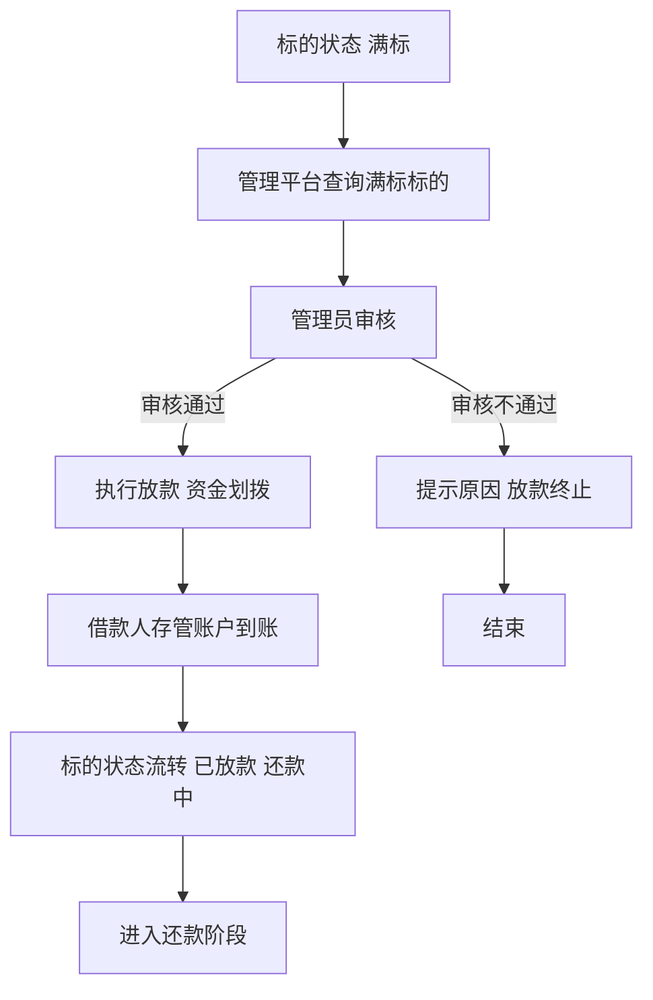
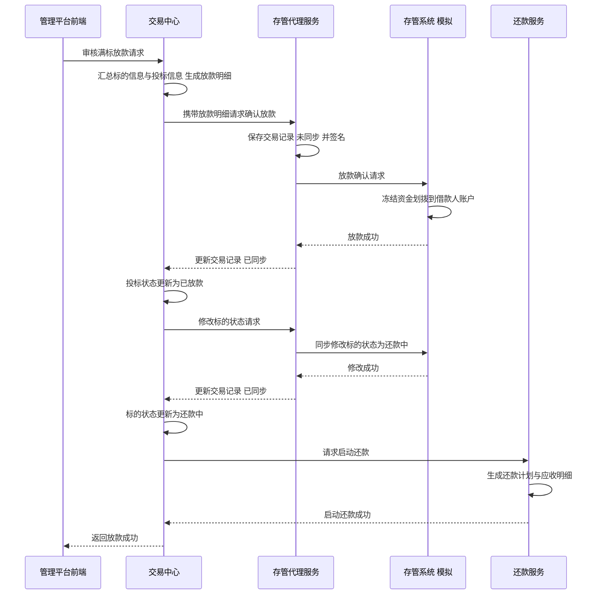

# 满标放款需求分析与接口定义：四个阶段、四个接口、一个新微服务

> 🔒 安全提示：文中示例的口令/密钥均为课程教学环境演示口径，生产环境的安全要求见《安全与合规须知》。

用户投标全线收官，标的投着投着就会攒到一个临界点：借款人要筹的钱凑够了，标的进入满标状态。满标不等于借款人拿到钱，投资人的钱此刻还冻在银行存管侧，中间隔着平台审核与放款两道关口。放款是投标放款这一章的最后一块硬骨头，时序图比投标还要长，动工前照例把需求掰开：满标之后发生什么、钱怎么划到借款人账户、状态怎么一路流转，以及这次要新增一个什么服务。

## 先给结论

- 满标后的主线是：平台管理员审核满标标的，审核通过才执行放款，银行存管系统把所有投资人的冻结资金划拨到借款人账户，借款人贷款成功，投资人也投资成功。
- 整个放款业务拆成四个阶段：生成放款明细、放款、修改标的业务状态、启动还款，每个阶段对应一个接口，共四个接口。
- 放款业务会新增一个还款微服务，还款计划与应收明细的生成、执行、记录、归档都归它管；放款一旦成功就要立即启动还款，所以这个服务在放款阶段就要登场。
- 四个接口分别是：交易中心的放款总入口 `loansApprovalStatus`，存管代理的确认放款 `confirmLoan` 与修改标的状态 `modifyProjectStatus`，还款服务的启动还款 `startRepayment`。
- 平台佣金 `commission` 作为放款入口的第三个参数，是平台撮合交易收取的服务费，值不从前端传，由配置提供；存管代理的请求一律带 `@RequestBody`，路径按内部接口约定以 `/l` 打头。

## 业务主线：满标、审核、放款

满标是标的状态的一个转折点。借款人要借 10 万，投资人的投标累计到 10 万，可投额度归零，标的状态变成满标，此后任何人投标都会被校验拦下。但此时钱还一分没到借款人手里，只是「够数」。接下来平台管理员要介入审核，把关这批资金的真实性与合规性；审核通过，平台才发起放款，银行存管系统把各投资人冻结的资金划拨到借款人的存管账户，借款人的贷款这才真正落地。这条主线画出来是四段：



关键分叉在审核：不过审则放款终止并给出原因，过审则一口气走完放款与状态流转。审核入口在管理平台前端，操作路径是先在标的列表里按满标状态筛选出待审核的标的，点进去核对放款明细，确认无误再点审核按钮选择通过，这一下点击触发的就是整个放款业务的总入口。审核这一步延续发标阶段立下的风控思路：资金划出去之前，平台是最后一道闸。

## 时序图拆四个阶段

放款的时序图横跨前端、交易中心、存管代理服务、存管系统、还款服务五个参与者，二十多个步骤，一口气啃不动，课程把它拆成四个阶段，每个阶段对应一个接口。拆分的依据还是那个读图技巧：锁定交易中心的生命线，把这条线上收发的箭头按语义分组，聚合信息归一段，发往存管代理的两次请求各归一段，发往还款服务的请求单独收尾，四个阶段自然浮出来。这张图按阶段把关键链路串起来：



**第一阶段生成放款明细**（图中 1 到 2）。前端只发一个请求，交易中心先做信息汇总：把标的信息与该标的全部投标记录拢在一起，形成一份放款明细，谁发的标、借多少钱、多少人投了、每人投了多少。这份明细既是审核的依据，也是后续与存管侧交互的数据来源。

**第二阶段放款**（图中 3 到 12），这是真正的资金动作。交易中心把放款明细发给存管代理服务，存管代理走老套路：保存一条状态为未同步的交易记录、对数据签名，然后请求银行存管系统。存管系统这边执行真正的放款：把所有投资人的投标冻结金额划拨到借款人账户，投资人可能有多个，划拨是逐笔的。划拨完成返回放款成功，存管代理据此把交易记录更新为已同步，交易中心收到成功结果后把投标信息的状态更新为已放款。

**第三阶段修改标的业务状态**（图中 13 到 21）。放款的核心动作在第二阶段已经完成，第三阶段做的是状态收尾：交易中心再次请求存管代理，注意这里又保存了一次交易记录，一次放款业务先后落了两条，因为这是两笔独立的存管交互。这次的目的是把标的状态改成还款中，银行侧同步修改，交易记录逐级回传置为已同步，交易中心把本地标的状态从满标改成还款中。放款成功立即进入还款不是着急，是业务因果：钱一到手，还款义务即刻成立，标的状态必须如实反映。

**第四阶段启动还款**（图中 22 到 25）。交易中心发请求到还款服务，还款服务据此生成还款计划与应收明细：借款人一共要还多少、每个月还多少、每个月几号还，先算出来生成计划，至于实际还款动作是后面章节的事。计划生成完毕返回成功，交易中心最终把放款成功响应给前端，整个业务闭环。

## 新增一个还款微服务

四个阶段里前三个都在既有的服务之间流转，第四阶段牵出一个新角色：还款服务。它是一个独立的微服务工程，职责是为平台提供还款计划的生成、执行、记录与归档。放款业务只用到它的第一步，生成还款计划，但工程要先搭起来、先跑通，接口才能定义与联调。

准备工作三步。导入还款服务工程，浏览一遍它的依赖与既有的包结构，工具类、配置类、实体类课程已经预置了一部分；配置启动参数，端口号定为 53080；Apollo 上新建对应项目做基础配置，`application` 命名空间放 Swagger 开关与全局异常项，HTTP 命名空间配服务的基础访问路径，Ribbon 关联公共命名空间即可，MyBatis-Plus 命名空间配实体扫描包与数据源连接串，连接串指向还款库，账号沿用本机 MySQL 的 root/123456。配置完成后启动一次，控制台能看到端口 53080 正常监听、配置从 Apollo 正常拉取，这个服务就可用了。

## 四个接口逐一落位

接口①是整个放款业务的总入口，定义在交易中心的 `TransactionApi` 上。方法名 `loansApprovalStatus`，三个参数：标的 ID 指明审核哪个标的，审核状态对应前端弹框里的通过或不通过，平台佣金是平台从每笔撮合交易中抽取的服务费，好比租房交易里中介收的佣金，交易达成时收取：

```java
/** 交易中心 API 满标放款接口① 按讲义接口定义口径整理 包名按 com.study.finance 系改写 */
/**
 * 审核标的满标放款
 * @param id 标的 id
 * @param approveStatus 审核状态
 * @param commission 平台佣金
 * @return 处理结果
 */
RestResponse<String> loansApprovalStatus(Long id, String approveStatus, String commission);
```

Controller 实现里前两个参数走路径，第三个参数不走路径走查询参数，而且值不由前端传入，将来从配置里取：

```java
/** 交易中心 Controller 接口① 按讲义口径整理 包名按 com.study.finance 系改写 */
@Override
@ApiOperation("审核标的满标放款")
@ApiImplicitParams({
        @ApiImplicitParam(name = "id", value = "标的id", required = true,
                dataType = "long", paramType = "path"),
        @ApiImplicitParam(name = "approveStatus", value = "标的的状态", required = true,
                dataType = "string", paramType = "path"),
        @ApiImplicitParam(name = "commission", value = "平台佣金", required = true,
                dataType = "string", paramType = "query")
})
@PutMapping("/m/loans/{id}/projectStatus/{approveStatus}")
public RestResponse<String> loansApprovalStatus(@PathVariable("id") Long id,
        @PathVariable("approveStatus") String approveStatus, String commission) {
    return null;
}
```

路径以 `/m` 打头，这是管理端维护类接口的约定，审核动作本来就在管理平台发起。

接口②落在存管代理服务的 `DepositoryAgentApi` 上，方法名 `confirmLoan`，确认放款。入参 `LoanRequest` 承载交易中心传来的全部数据：放款明细集合、平台佣金、标的编码、请求流水号与业务实体 ID。放款明细不止一条，用集合封装，每一条再由 `LoanDetailRequest` 承载放款金额与预处理业务流水号：

```java
/** 存管代理 API 接口②与请求结构 按讲义口径整理 包名按 com.study.finance 系改写 */
/**
 * 确认放款
 * @param loanRequest 满标放款信息
 * @return 处理结果
 */
RestResponse<String> confirmLoan(LoanRequest loanRequest);

// 放款请求结构
public class LoanRequest {
    /** 放款明细 */
    private List<LoanDetailRequest> details;
    /** 平台佣金 */
    private BigDecimal commission;
    /** 标的编码 */
    private String projectNo;
    /** 请求流水号 */
    private String requestNo;
    /** 业务实体 id */
    private Long id;
}

// 放款明细结构
public class LoanDetailRequest {
    /** 放款金额 */
    private BigDecimal amount;
    /** 预处理业务流水号 */
    private String requestNo;
}
```

Controller 实现的路径以 `/l` 打头，这是微服务之间内部接口的约定，发起方是交易中心这个后台服务，前端经网关摸不到它；入参是结构化对象，加 `@RequestBody` 从请求体反序列化。明细集合与第一阶段生成的放款明细一一对应：汇总阶段算出的「谁投了多少」，到这里逐条转成 `LoanDetailRequest`，金额与预处理业务流水号配对，银行侧按流水号逐笔划拨，一一对应才对得上账。

接口③还在存管代理的 `DepositoryAgentApi` 上，方法名 `modifyProjectStatus`，修改标的状态，把标的状态改成还款中。入参 `ModifyProjectStatusDTO` 封装四个字段：请求流水号、标的编码、要改成的标的状态（这里就是还款中）与业务实体 ID。注意 DTO 里的状态值是按标的编码去银行侧定位标的的，交易中心本地用自增 ID，存管系统认的是标的编码，两套标识并存正是接口设计时容易忽略的一处：请求里 ID 与编码都要带上，各自服务各自的寻址。存管代理收到后签名、落交易记录、请求银行同步修改状态、回传结果，套路与接口②一致：

```java
/** 存管代理 API 接口③ 按讲义口径整理 包名按 com.study.finance 系改写 */
/**
 * 修改标的的状态
 * @param modifyProjectStatusDTO 标的状态信息
 * @return 处理结果
 */
RestResponse<String> modifyProjectStatus(ModifyProjectStatusDTO modifyProjectStatusDTO);

// 状态修改请求结构
public class ModifyProjectStatusDTO {
    /** 请求流水号 */
    private String requestNo;
    /** 标的号 */
    private String projectNo;
    /** 更新标的的状态 */
    private String projectStatus;
    /** 业务实体 id */
    private Long id;
}
```

Controller 的路径同样是 `/l` 打头的内部约定，`@RequestBody` 接请求体。

接口④落在新建的还款服务上。API 工程里新建 `repayment` 包，定义 `RepaymentApi` 接口与 `RepaymentController` 实现类，方法名 `startRepayment`，启动还款。入参 `ProjectWithTendersDTO` 是标的与投标记录的聚合体：一个 `ProjectDTO` 装标的信息，一个集合装该标的全部投标记录，外加两个年化利率字段，投资人年化利率与借款人年化利率，这两个值在课程语境里叫投资人让利与借款人让利，是生成还款计划时计算收益分配的依据：

```java
/** 还款服务 API 接口④与入参结构 按讲义口径整理 包名按 com.study.finance 系改写 */
/**
 * 启动还款
 * @param projectWithTendersDTO 标的与投标记录聚合信息
 * @return 处理结果
 */
RestResponse<String> startRepayment(ProjectWithTendersDTO projectWithTendersDTO);

// 标的与投标记录聚合结构
public class ProjectWithTendersDTO {
    /** 标的信息 */
    private ProjectDTO project;
    /** 标的对应的全部投标记录 */
    private List<TenderDTO> tenders;
    /** 投资人年化利率 投资人让利 */
    private BigDecimal commissionInvestorAnnualRate;
    /** 借款人年化利率 借款人让利 */
    private BigDecimal commissionBorrowerAnnualRate;
}
```

Controller 的路径依旧是 `/l` 打头，发起方是交易中心，`@RequestBody` 接收。到这里四个接口全部定义完毕，放款业务的骨架立起来了：一个总入口接住管理端的审核请求，两个存管接口完成资金划拨与状态同步，一个还款接口接住放款成功的接力棒。后续课程按四个阶段逐一把功能填进去。

## 常见误区

- **以为满标就是借款人拿到钱。** 错例：额度投满即视为交易完成。正解：满标只是募集够数，资金还冻在投资人存管账户里，必须经管理员审核、存管系统划拨，借款人账户到账才算放款成功。
- **把一次放款的多次存管交互当成一条交易记录。** 错例：确认放款与修改标的状态共用一条交易记录。正解：两笔是独立的存管交互，各自签名、各自落交易记录、各自从未同步流转到已同步，流水号与对账凭据一一对应。
- **接口③的修改状态画蛇添足去做资金动作。** 错例：以为第三阶段还要再划一次钱。正解：第三阶段只同步标的状态为还款中，资金划拨在第二阶段的存管系统内部已经完成，两个阶段动的是不同性质的东西。
- **平台佣金当作前端传参。** 错例：佣金随审核请求由前端传值，存在被篡改的风险。正解：佣金是平台经营参数，接口签名上虽留有该参数，值从服务端配置读取，不信任前端输入。
- **放款业务漏掉还款服务的铺垫。** 错例：把还款服务当成后续章节的事，联调时才发现服务没搭、配置没建。正解：放款成功的下一步就是生成还款计划，还款服务的工程、端口与 Apollo 配置要在定义接口④之前备好。

## 面试可能被问到的问题

1. 面试官追问：「满标放款为什么要拆成四个阶段，而不是一个事务做完？」
   答：四个阶段对应四个性质不同的动作：生成明细是本地数据聚合，放款是跨机构的资金划拨，状态修改是与银行侧的双向同步，启动还款是下一个业务的启动信号。资金划拨必须以审核通过为前提，状态同步依赖划拨结果，启动还款依赖放款成功，因果链决定只能分段推进，每段独立留痕、独立回传，出了问题能定位到具体阶段。
2. 面试官追问：「一次放款为什么在存管代理落两条交易记录？」
   答：确认放款与修改标的状态是两次独立的存管交互，各自有各自的请求流水号、签名与银行侧响应。交易记录是每笔交互的对账凭据，从未同步到已同步的状态流转必须逐笔闭环，合并成一条会造成凭据与实际交互对不上。
3. 面试官追问：「放款成功为什么立即启动还款，而不是等还款日？」
   答：启动还款这一步只是生成还款计划与应收明细，把借款人每期还多少、几号还算清楚，并不发起实际扣款。计划依赖放款结果与利率信息，放款一成功信息就齐了，立即生成可以让借款人第一时间看到还款安排，也为后续按期执行做好数据准备。
4. 面试官追问：「接口路径的 `/m`、`/l`、`/my` 前缀分别是什么约定？」
   答：`/my` 面向登录用户的前端请求，走网关带认证；`/m` 面向管理后台的维护类接口；`/l` 面向内部微服务之间的调用，前端经网关不可达。前缀约定把接口的信任边界写在路径上，安全策略与文档都按它区分。
5. 面试官追问：「平台佣金为什么放在放款环节收取？」
   答：放款意味着撮合成功、资金落地，此时收佣金的业务事实成立，银行侧划拨时可以同步完成佣金的账务处理。发标或投标阶段交易尚未达成，收佣金既无依据也无法对账。
6. 面试官追问：「接口④的入参为什么要标的与投标记录打包传？」
   答：生成还款计划需要两样底数：借款总额、利率、期限来自标的信息；每期应收明细要按每个投资人的投标金额分别计算，需要全部投标记录。打包成聚合 DTO 一次传输，避免还款服务反向多次远程查询交易中心，接口一次到位。

## 配套资料

- 讲义：`materials/docs/10/万信金融-第4章-投标放款v1.0.md`，3.1 需求分析：满标放款业务流程与四个阶段划分、还款微服务职责说明；3.2.1 接口定义：3.2.1.1 交易中心满标放款接口（接口①）、确认放款与修改标的状态的存管代理接口、3.2.1.4 还款服务启动还款接口（接口④）。
- 代码：`materials/code/10/wanxinp2p/`，P2P 工程归档（目录保留原始命名，路径只列到该层级），可对照 API 工程结构与包组织方式，交易中心、存管代理与还款服务业务工程随课程资料单独提供。
- 说明：四个接口声明、请求结构与管理端路径按讲义与画面线口径整理，包名与工程名按 `com.study.finance` 系改写；还款服务的 Apollo 配置项与启动参数为按本课写法补全的示例，端口 53080 与连接串以本机环境为准。
