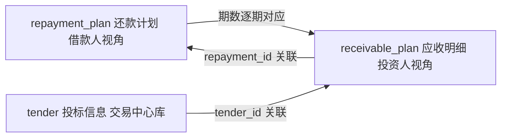

# 满标放款接口④数据访问层：PlanMapper 与 ReceivablePlanMapper 的落地

放款总入口已经把标的、投标与让利利率装进了聚合对象，接下来接力的是还款服务。启动还款要产出借款人的还款计划与投资人的应收明细，两份计划都要落库，所以在写任何业务逻辑之前，先得把数据访问层立起来。这一层没什么悬念，但有两个容易走神的地方：两张表对应的实体与 Mapper 要成对出现、一套一套配齐，以及继承了 MyBatis-Plus 的 `BaseMapper` 之后接口看着是空的、实际自带全套增删改查。

## 先给结论

- 还款服务的数据访问层是两组「实体 + Mapper 接口 + XML 映射文件」：还款计划一组，应收明细一组，两两对应，缺一不可。
- Mapper 接口继承 `BaseMapper<实体>`，泛型指定实体类，接口体内一行代码都不用写，单表 CRUD 全部由 MyBatis-Plus 提供。
- 实体类用 `@TableName` 绑定表名、`@TableId` 绑定主键、`@TableField` 绑定字段，属性与表字段一一对应。
- XML 映射文件里只写 `namespace` 指向 Mapper 接口全限定名，不写任何 SQL，后续遇到复杂查询再往里补充。

## 两张表，两组数据访问层

启动还款的功能拆成两块：生成借款人的还款计划，生成投资人的应收明细。两块各自有表，各自需要一套数据访问代码。还款计划表 `repayment_plan` 面向借款人，核心字段包括借款人用户标识、借款人用户编码、标的标识、标的编码、还款期数、还款利息、还款本金、还款金额、应还时间、还款状态、平台佣金与创建时间；应收明细表 `receivable_plan` 面向投资人，字段结构与还款计划表高度相似，多出投标信息标识与还款计划项标识两个关联字段。两张表的对应关系画出来是这样：



借款人的一期还款对应这一标的下每位投资人的一条应收，业务层生成计划时要靠这层对应关系逐期拆分，数据访问层则只管各自那张表，互不掺和。

## 实体类：属性与表字段一一对应

实体类提前放在还款服务的 `entity` 包下，以还款计划实体为例，注解把类、主键、普通字段依次绑到表结构上：

```java
package com.study.finance.repayment.entity;

/** 借款人还款计划实体 按讲义口径整理 包名按 com.study.finance 系改写 */
@TableName("repayment_plan")
public class RepaymentPlan implements Serializable {
    private static final long serialVersionUID = 1L;

    // 主键
    @TableId("ID")
    private Long id;

    // 借款人用户标识
    @TableField("CONSUMER_ID")
    private Long consumerId;

    // 借款人用户编码
    @TableField("USER_NO")
    private String userNo;

    // 标的标识
    @TableField("PROJECT_ID")
    private Long projectId;

    // 期数
    @TableField("NUMBER_OF_PERIODS")
    private Integer numberOfPeriods;

    // 还款利息
    @TableField("INTEREST")
    private BigDecimal interest;

    // 还款本金
    @TableField("PRINCIPAL")
    private BigDecimal principal;

    // 还款金额 本息合计
    @TableField("AMOUNT")
    private BigDecimal amount;

    // 应还时间
    @TableField("SHOULD_REPAYMENT_DATE")
    private LocalDateTime shouldRepaymentDate;

    // 还款状态
    @TableField("REPAYMENT_STATUS")
    private String repaymentStatus;

    // 平台佣金
    @TableField("COMMISSION")
    private BigDecimal commission;

    // 创建时间
    @TableField("CREATE_DATE")
    private LocalDateTime createDate;
}
```

应收明细实体 `ReceivablePlan` 同构，关联字段换成 `tenderId`（投标信息标识）、`repaymentId`（还款计划项标识），状态字段换成应收状态，时间字段换成应收时间与创建时间。金额字段统一用 `BigDecimal`，利息、本金这类钱相关的数值不用 `Double` 是老规矩，浮点误差在金融场景里不可接受。

## Mapper 接口：继承 BaseMapper 就够了

在还款服务工程的 `mapper` 包下定义两个接口。还款计划的：

```java
package com.study.finance.repayment.mapper;

import com.baomidou.mybatisplus.core.mapper.BaseMapper;
import com.study.finance.repayment.entity.RepaymentPlan;

/** 借款人还款计划 Mapper 接口 按讲义口径整理 */
public interface PlanMapper extends BaseMapper<RepaymentPlan> {
}
```

应收明细的：

```java
package com.study.finance.repayment.mapper;

import com.baomidou.mybatisplus.core.mapper.BaseMapper;
import com.study.finance.repayment.entity.ReceivablePlan;

/** 投资人应收明细 Mapper 接口 按讲义口径整理 */
public interface ReceivablePlanMapper extends BaseMapper<ReceivablePlan> {
}
```

接口体是空的，但这不等于接口里没有方法。`BaseMapper` 里定义了 `insert`、`deleteById`、`updateById`、`selectById`、`selectList` 等一整套单表方法，泛型一指定，这些方法的参数与返回值就锁定到具体实体上，业务层拿到 `PlanMapper` 就能直接对 `repayment_plan` 表增删改查，启动还款要做的恰恰是逐期 `insert` 还款计划、逐条 `insert` 应收明细，`insert` 一个方法就够用了。

## XML 映射文件：只留 namespace

每个 Mapper 接口配一份同名 XML，放在资源目录与接口对应的路径下。还款计划的：

```xml
<?xml version="1.0" encoding="UTF-8"?>
<!DOCTYPE mapper PUBLIC "-//mybatis.org//DTD Mapper 3.0//EN"
        "http://mybatis.org/dtd/mybatis-3-mapper.dtd">
<mapper namespace="com.study.finance.repayment.mapper.PlanMapper">
</mapper>
```

应收明细的把 `namespace` 换成 `com.study.finance.repayment.mapper.ReceivablePlanMapper`，其余原样。`namespace` 必须写 Mapper 接口的全限定名，MyBatis 靠它把接口方法与 XML 里的语句挂接起来；当前没有任何自定义 SQL，文件里只有一个空的 mapper 标签，先占住位置，等出现关联查询或多表统计时再往里写语句。整个数据访问层到此完成，两张表、两个实体、两个接口、两份 XML，结构对称。

## 常见误区

- **以为空接口什么都不能干。** 错例：看到 `PlanMapper` 接口体是空的，就再往里补 `insert`、`selectById` 的方法声明。正解：`BaseMapper<RepaymentPlan>` 已经提供了全套单表方法，空接口继承泛型后自动具备能力，重复声明反而会与父接口方法冲突。
- **两个功能写在一起或漏掉一组。** 错例：只建 `PlanMapper`，应收明细的保存临时用别的 Mapper 凑合。正解：两张表两套数据访问层，实体、接口、XML 成对出现，缺哪一组对应的落库就写不了。
- **XML 的 namespace 随手写。** 错例：`namespace` 写成实体类路径或少了包的一段。正解：`namespace` 必须与 Mapper 接口全限定名完全一致，否则启动扫描时接口方法与映射文件挂不上，调用时报绑定异常。
- **金额与状态字段用错类型。** 错例：利息、本金用 `Double`，状态用数字混着字符串比较。正解：金额用 `BigDecimal`，状态用与表字段一致的类型，实体映射字段类型对不上会在写入时才暴露，排查成本高。

## 面试可能被问到的问题

1. 面试官追问：「MyBatis-Plus 的 `BaseMapper` 是怎么让空接口拥有 CRUD 能力的？」
   答：MyBatis-Plus 在启动时扫描 Mapper 接口，识别出继承了 `BaseMapper` 的接口，结合泛型里的实体类与 `@TableName`、`@TableField` 注解解析出表结构，再用注入器为每个方法生成对应的 SQL 模板注册进 MyBatis，所以接口不用写一行代码就能执行单表操作。
2. 面试官追问：「实体类上 `@TableName`、`@TableId`、`@TableField` 各解决什么问题？」
   答：`@TableName` 绑定类与表名的映射，应对类名与表名不一致；`@TableId` 标记主键并指定列名，还能指定主键生成策略；`@TableField` 绑定属性与列名，应对驼峰与下划线之外的不一致。三者共同把对象关系映射的信息写在实体上，SQL 由框架拼装。
3. 面试官追问：「还款计划表和应收明细表字段大量重复，为什么不合并成一张表？」
   答：两张表面向的角色与生命周期不同。还款计划是借款人一笔借款的整体安排，一条借款一期一条；应收明细是投资人视角的每笔投标收款，同一期会按投标人数拆成多条，且要挂投标标识与还款计划标识。角色、粒度、更新时机都不同，合并后写入相互干扰，查询也要靠角色过滤，得不偿失。
4. 面试官追问：「金额字段为什么坚持用 `BigDecimal` 而不是 `Double`？」
   答：`Double` 是二进制浮点，无法精确表示 0.1 这类十进制小数，累加与比较会产生误差，金融计算里误差会被逐期放大。`BigDecimal` 按十进制精确计算，配合指定的舍入规则能得到确定结果，落库时对应 `decimal` 类型同样精确。

## 配套资料

- 讲义：`materials/docs/10/万信金融-第4章-投标放款v1.0.md`，3.2.5 还款服务启动还款接口（接口④）之 3.2.5.2 功能实现：数据访问层，PlanMapper 接口与 PlanMapper.xml、ReceivablePlanMapper 接口与 ReceivablePlanMapper.xml 的定义。
- 代码：`materials/code/10/wanxinp2p/`，P2P 工程归档（目录保留原始命名，路径只列到该层级），可对照 API 工程包结构；还款服务业务工程随课程资料单独提供。
- 说明：还款服务业务实现源码不在归档目录中，文中实体与 Mapper 代码按讲义 3.2.5.2 与画面线口径整理，包名按 `com.study.finance` 系改写；`ReceivablePlan` 实体字段以画面线中的 `receivable_plan` 表结构为准。
