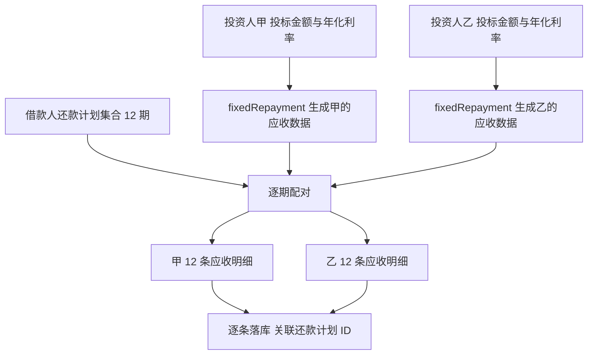

# 满标放款接口④业务层：借款人还的每一期，就是投资人应收的每一期

借款人还款计划落库之后，业务层还有第二块任务：生成投资人的应收明细。借款人每期还的那笔钱不会凭空消失，它按出资比例分给这个标的的所有投资人，每个投资人手里都要有一份「我每个月能收多少本金、多少利息、平台抽走多少」的明细。这块功能同样拆成生成与保存两步，但生成方式和还款计划不一样的地方在于：它调用的是同一个等额本息工具方法，传入的却是每个投资人自己的数据。

## 先给结论

- 应收明细站在投资人角度，数据与借款人还款计划同源：借款人还的就是投资人收的，计算仍复用 `RepaymentUtil.fixedRepayment` 等额本息工具方法。
- 区别在传参：生成还款计划传借款金额与借款人年化利率，生成应收明细传每笔投标的投标金额与投资人年化利率，佣金参数对应投资人让利的年化利率。
- 有几个投资人就循环几轮，每轮算出一份该投资人的 `EqualInterestRepayment`；再拿借款人还款计划集合逐期配对，一期生成一条应收明细。
- 应收明细条数等于投资人数乘以期数：5 个投资人、12 期的标的，落库 60 条。
- 应收明细通过还款计划 ID 与借款人还款计划逐条关联，期数与应还时间直接从还款计划复制，两边永远对得上账。
- 应收状态默认未收，创建时间取当前时间；全部生成保存成功后返回成功编码，五个 0 由枚举 `DepositoryReturnCode.RETURN_CODE_00000` 统一提供。

## 为什么同一个方法能算两种数据

还款计划和应收明细在概念上是两份数据，在数学上是同一组公式。借款人每月还多少钱，投资人每月就应收多少钱（差额是平台佣金），金额、期数、时间完全一样，只是视角一个站在借款端、一个站在投资端。既然公式相同，计算入口自然复用同一个 `fixedRepayment` 方法，变化的只有传参。

传参的差异集中在两处。金额这头：还款计划传标的借款总额，应收明细传单个投资人的投标金额，投得多的投资人每期应收自然多。利率这头：还款计划用借款人年化利率，应收明细用投资人年化利率，两个利率的差值部分就是平台的利润空间，佣金的计算也分别对应各自的让利口径。月数不用换，借款人借多久投资人就投多久，前一步算好的 `month` 直接传。



这张图讲的是生成的组织方式：外层按投资人循环，内层按还款计划的期数循环，两层循环嵌套下来，应收明细就是一张「投资人乘期数」的矩阵，矩阵的每一行都能追溯到某个投资人的某笔投标和借款人的某一期还款。

## 外层循环：一个投资人一份应收数据

生成代码嵌在等额本息的分支里，紧跟在保存还款计划之后。外层遍历投标记录集合：

```java
//2. 生成投资人应收明细 遍历投标记录 每个投资人生成一份应收数据
tenders.forEach(tender -> {
    // 按投标金额与投资人年化利率计算该投资人的每期应收
    final EqualInterestRepayment receipt = RepaymentUtil.fixedRepayment(
            tender.getAmount(),                          // 该投资人的投标金额
            tender.getProjectAnnualRate(),               // 投资人年化利率
            month,                                       // 还款月数 与借款人一致
            projectWithTendersDTO.getCommissionInvestorAnnualRate());
    // 内层逐期配对 借款人每期还款计划对应一条应收明细
    planList.forEach(plan -> saveReceivablePlan(plan, tender, receipt));
});
```

10 个人投标，外层循环就执行 10 次，每次得到一份只属于这个投资人的按期计算结果。`receipt` 这个名字对应「收款」的语义，与借款人那边的还款计划区分开。内层 `planList.forEach` 把借款人还款计划的每一条拿来配对，一个还款计划对象加一个投资人的应收数据，正好生成一条应收明细，生成一条保存一条，两个动作锁在同一层循环里。

## 保存应收明细：三个参数一次配对

保存逻辑同样单独抽方法，`saveReceivablePlan` 要三个参数：借款人还款计划对象、投标信息、该投资人的应收计算结果。三个参数各管一摊：还款计划提供期数、关联主键与应还时间，投标信息提供投资人身份，应收计算结果提供金额。落库的表是应收明细表，数据访问层的 `ReceivablePlanMapper` 继承 MyBatis-Plus 的 `BaseMapper`，插入直接复用通用方法：

```java
/** 保存投资人应收明细 按讲义口径整理 包名按 com.study.finance 系改写 */
private void saveReceivablePlan(RepaymentPlan repaymentPlan, TenderDTO tender,
        EqualInterestRepayment receipt) {
    final Map<Integer, BigDecimal> principalMap = receipt.getPrincipalMap();
    final Map<Integer, BigDecimal> interestMap = receipt.getInterestMap();
    final Map<Integer, BigDecimal> commissionMap = receipt.getCommissionMap();
    final ReceivablePlan receivablePlan = new ReceivablePlan();
    // 投标记录 id
    receivablePlan.setTenderId(tender.getId());
    // 期数 与借款人还款计划逐期对应
    receivablePlan.setNumberOfPeriods(repaymentPlan.getNumberOfPeriods());
    // 投资人用户标识
    receivablePlan.setConsumerId(tender.getConsumerId());
    // 投资人用户编码
    receivablePlan.setUserNo(tender.getUserNo());
    // 关联借款人还款计划 id
    receivablePlan.setRepaymentId(repaymentPlan.getId());
    // 当期应收利息 按还款计划的期数取值
    receivablePlan.setInterest(interestMap.get(repaymentPlan.getNumberOfPeriods()));
    // 当期应收本金
    receivablePlan.setPrincipal(principalMap.get(repaymentPlan.getNumberOfPeriods()));
    // 当期应收本息和 BigDecimal 求和用 add
    receivablePlan.setAmount(receivablePlan.getInterest().add(receivablePlan.getPrincipal()));
    // 应收时间 与借款人应还时间一致
    receivablePlan.setShouldReceivableDate(repaymentPlan.getShouldRepaymentDate());
    // 应收状态 默认未收
    receivablePlan.setReceivableStatus("0");
    // 创建时间
    receivablePlan.setCreateDate(DateUtil.now());
    // 平台佣金
    receivablePlan.setCommission(commissionMap.get(repaymentPlan.getNumberOfPeriods()));
    // 插入应收明细表
    receivablePlanMapper.insert(receivablePlan);
}
```

这段代码里最值得注意的是期数的取法：不再用应收计算结果自己的 Map 键，而是取还款计划对象上的期数。两个 Map 键体系本来一致，但以借款人还款计划为锚，能保证应收明细与还款计划在期数上绝对同步，哪怕将来某一方计算口径调整，关联关系也不会错位。`setRepaymentId` 存的是还款计划落库后的主键，这就是两份数据之间的外键级纽带，后续对账、催收、结清都要靠它把借款人该还的与投资人该收的连起来。

应收状态默认未收，与借款人侧的待还款互相呼应：借款人还了第 3 期，系统把对应还款计划状态更新，同时按还款计划 ID 找到所有投资人的第 3 期应收明细更新为已收，一侧动作两侧联动，这个联动的基础就是现在写进去的关联字段。

## 成功码的统一口径

两块功能全部执行完，业务层要把成功结果交回 Controller。课程项目里成功编码统一用五个 0，值由枚举 `DepositoryReturnCode.RETURN_CODE_00000` 定义，用 `getCode()` 取值返回。直接写字符串「00000」也能跑，但编码收敛在枚举里，调用方判断、日志输出、文档生成都引用同一个来源，改一处全局生效。其他业务返回过 `-1` 表示不支持，与五个 0 形成对照：可预期的业务分支用约定值表达，不可预期的异常交给异常机制，两条通道各司其职。

## 常见误区

- **以为应收明细要单独写一套等额本息算法。**错例：为投资人另写一个计算工具。正解：公式完全相同，复用同一个 `fixedRepayment`，只换传参，两套算法迟早算出对不上的账。
- **按投资人循环时忘掉内层按期循环。**错例：每个投资人只落一条汇总记录。正解：应收明细按期组织，外层投资人、内层期数，两层嵌套后条数是投资人数乘期数。
- **期数取自投资人计算结果的 Map 键而不取还款计划。**错例：两边键体系虽一致，但失去了以借款人还款计划为锚的约束。正解：期数与应还时间统一从还款计划对象复制，配对关系不依赖两套计算的巧合一致。
- **应收状态默认写成已收。**错例：生成即已收，用户一进来就看到收益到账。正解：钱还没到，状态是未收，实际收款发生时再逐期更新。
- **金额求和用加号。**错例：`interest + principal` 对 `BigDecimal` 不成立。正解：与还款计划侧同一口径，一律 `add`。

## 面试可能被问到的问题

1. 面试官追问：「还款计划和应收明细为什么存两张表，存一张行不行？」
   答：两张表视角不同、主体不同、生命周期也不同。还款计划是借款人的负债安排，应收明细是投资人的收益安排，多投资人场景下一期还款对应多条应收，一张表装不下两层结构；分开存还便于各自独立查询与状态流转，靠还款计划 ID 关联对账。
2. 面试官追问：「应收明细的条数怎么估，会不会膨胀？」
   答：条数等于投资人数乘借款期数。人数与期数是业务规模变量，单标的一般可控；平台级优化可以做投资人间按比例聚合或视图计算，但明细逐条存是对账与部分转让、结清业务的基础，膨胀换来的准确性在金融场景通常划算。
3. 面试官追问：「生成应收明细时为什么要传投资人年化利率，借款利率不就有了吗？」
   答：借款人利率与投资人利率是两个商业参数，中间差值是平台利润空间。计算投资人收益必须用投资人口径的利率加佣金让利参数，直接套借款利率会把平台抽成算给投资人，账立刻不平。
4. 面试官追问：「应收明细与还款计划怎么保证逐期对得上？」
   答：以借款人还款计划为锚，期数、应还时间从还款计划对象复制，应收明细存还款计划主键做关联。后续借款人每还一期，按期数加关联 ID 定位所有投资人的当期应收并联动更新状态，关联字段在生成时就写死，不依赖运行期推断。
5. 面试官追问：「成功码为什么用枚举维护而不是常量类或魔法值？」
   答：枚举能承载编码加语义描述，类型安全，遍历和文档生成方便；魔法值散落各处迟早出现五个 0 少写一个 0 的事故。项目里存管交互的返回码本来就有一套枚举，业务层成功码沿用同一体系，风格统一。

## 配套资料

- 讲义：`materials/docs/10/万信金融-第4章-投标放款v1.0.md`，3.2.5 还款服务启动还款接口（接口④）功能实现：遍历投标信息生成投资人应收明细、保存应收明细到数据库、数据访问层 `ReceivablePlanMapper` 与映射配置、启动还款整体返回口径。
- 讲义：`materials/docs/10/万信金融-第5章-用户还款v1.0.md`，还款执行按期更新还款计划与应收明细状态的联动口径，可对照应收明细关联字段在后续章节的用法。
- 代码：`materials/code/10/wanxinp2p/`，P2P 工程归档（目录保留原始命名，路径只列到该层级），可对照工程结构；还款服务业务工程随课程资料单独提供，文中业务层代码按讲义与画面线口径整理，包名按 `com.study.finance` 系改写，字段注释与局部变量命名为按本课写法补全。
