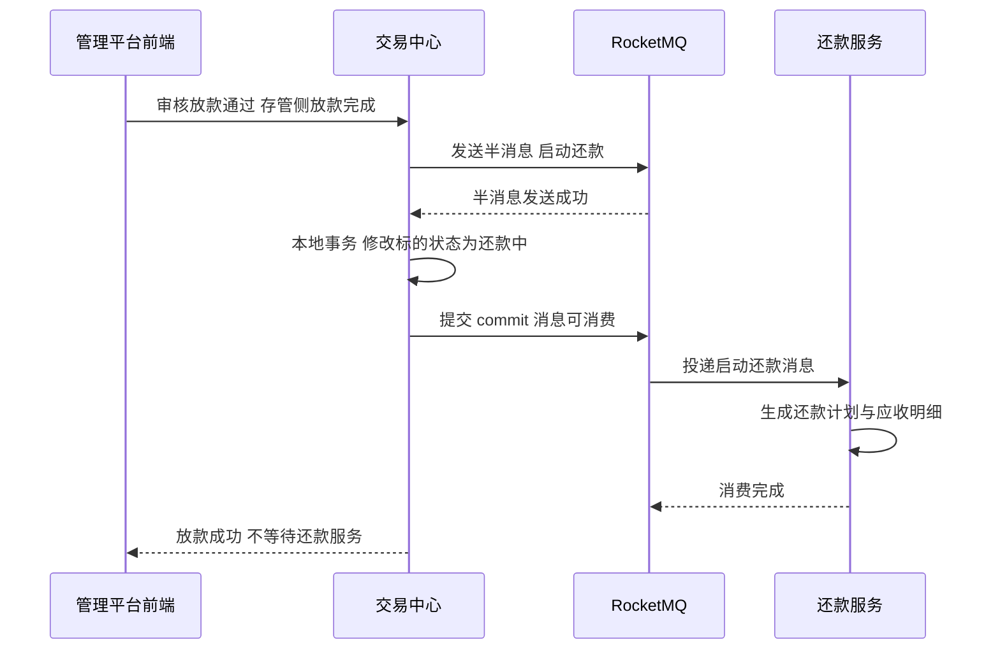

# 可靠消息实现最终一致性：放款链路最后一跳的方案总览

满标放款的代码写完、集成测试通过，链路上还留着一处有计划的空白：交易中心把标的状态改成还款中的同时，要可靠地通知还款服务生成还款计划与应收明细，这两件事跨着两个微服务，必须同生同灭，用普通的远程调用保证不了。这一课先不动代码，把解决方案的整体面貌交代清楚：用 RocketMQ 的可靠消息实现最终一致性。学完方案再做一个入门案例，回头才能把放款链路这最后一跳补上。

## 先给结论

- 放款链路的分布式事务场景：交易中心本地改标的状态为还款中，同时要通知还款服务生成还款计划与应收明细，两者原子性绑定，改了状态就必须生成计划。
- 选可靠消息的理由：还款服务生成计划与明细是较耗时的业务，不应阻塞放款主流程，且该业务对强一致性要求低，追求的是最终一致性。
- 方案的核心思路：把分布式事务拆成若干个本地事务，中间用消息队列协调，本次选 RocketMQ，它的事务消息机制天生适合做这件事。
- RocketMQ 事务消息靠半消息、本地事务确认、事务回查三件套保证「本地事务成功则消息一定可达」，实现最终一致。
- 方案落地要解决三个问题：发送方本地事务与发消息的原子性、接收方消费与本地事务的原子性、消息重复消费的幂等性，三个都有解，后续课程逐一落地。

## 从 CAP 到 BASE：为什么追求的是最终一致性

方案的理论地基在分布式事务章节铺过，这里快速回拢一遍。CAP 理论说的是一个分布式系统最多同时满足一致性、可用性、分区容忍性中的两项，而且分区容忍性在网络故障是常态的现实下没法放弃，所以真正的选择只在 C 与 A 之间。互联网应用节点多、分布广，集群规模越大故障越频繁，同时还要保证服务可用性达到 99.99% 这样的水平线，于是多数大型互联网应用的取舍是：保 P 与 A，舍弃强一致 C，改保最终一致性。

最终一致性的通俗解释是：事务涉及的所有操作不必立即达成一致，给系统一段时间，期间允许出现中间状态，等待之后所有操作要么都成功要么都失败，结果整体一致。BASE 理论里的「软状态」描述的就是这个中间期，日常网上支付时看到的「支付中」就是典型的软状态：不是立即成功也不是立即失败，几秒到几十秒内结果收敛。可靠消息方案要达成的目标就是这个：不追求每一毫秒两边都对齐，追求最终对齐，而 RocketMQ 负责让「消息必达」这件事足够可靠，成为对齐的纽带。

## 方案总览：本地事务加消息队列

可靠消息最终一致性方案的骨架一句话能说清：把分布式事务拆成两个本地事务，中间靠消息队列传递「我这边做完了，该你那边了」的信号。课程用最经典的转账案例来展开：张三在银行一开户，李四在银行二开户，张三给李四转 30 元，银行一扣减余额 30 元，银行二增加余额 30 元，两个动作必须要么都发生要么都不发生。

大概流程是：银行一在本地事务里扣减张三余额，扣完发一条消息，消息不直接发给银行二，而是发给 RocketMQ，银行二从 MQ 消费到消息后在本地事务里给李四加余额。两边各自的数据库操作都是本地事务，跨行协调完全靠消息接力，画出来是这样：


关键路径是中间的 MQ：它不是可选的加速器，而是方案的协调者。银行一做完本地事务相当于打了个电话告诉银行二「该你了」，MQ 保证这个电话一定打通、一定只按业务要求送达。这个思路容易理解，实现成本也比较低，这是它相对 TCC 这类方案的显著优势。

## RocketMQ 凭什么可靠：事务消息机制

普通消息解决不了「本地事务成功但消息丢了」的问题，RocketMQ 给出的是事务消息。讲义里对它的评价点出了两个设计基础：Broker 与发送方具备双向通信能力，使 Broker 天生可以扮演事务协调者；RocketMQ 自身提供存储机制，事务消息可以持久化保存，即便发生异常依然能推动事务走向一致。完整的机制分六步：

1. 发送方向 Broker 发送一条事务消息，消息被标记为 Prepared 状态，即半消息，此时接收方还不能消费它。
2. Broker 返回发送成功。
3. 发送方执行本地事务，例如操作数据库。
4. 本地事务成功则向 Broker 发送 commit，消息转为可消费，接收方随即能拿到；本地事务失败则发送 rollback，Broker 删除该消息。
5. 若发送方在执行本地事务过程中服务挂掉、网络闪断或超时，Broker 收不到确认结果。
6. RocketMQ 主动发起事务回查，不停询问发送方本地事务的执行状态，根据回查结果决定 commit 或 rollback。

这套机制保证的是：本地事务与消息的发送同时成功或同时失败，这正是方案要解决的第一个死结。半消息的存在还顺带解耦了时间：本地事务执行的耗时不再阻塞消息消费，接收方永远看到的都是确认过的事实。落地时的代码骨架是发送方注册一个事务监听器，两个回调对应执行与回查：

```java
/** RocketMQ 事务消息监听器骨架 为按本课写法补全的示例 包名按 com.study.finance 系改写 */
@Component
public class LoanTransactionListener implements TransactionListener {

    /** 执行本地事务 半消息发送成功后回调 */
    @Override
    public LocalTransactionState executeLocalTransaction(Message msg, Object arg) {
        // 在这里完成本地事务 例如修改标的状态为还款中
        // 成功返回 COMMIT_MESSAGE 失败返回 ROLLBACK_MESSAGE
        return LocalTransactionState.COMMIT_MESSAGE;
    }

    /** 事务回查 Broker 收不到确认结果时定时回调 */
    @Override
    public LocalTransactionState checkLocalTransaction(MessageExt msg) {
        // 查询本地事务的真实结果决定提交或回滚
        return LocalTransactionState.COMMIT_MESSAGE;
    }
}
```

发送消息本身用的是带事务的消息发送入口，与普通发送的区别在于多了监听器与回查协议：

```java
/** 事务消息发送骨架 为按本课写法补全的示例 包名按 com.study.finance 系改写 */
TransactionMQProducer producer = new TransactionMQProducer("loan-producer-group");
producer.setTransactionListener(loanTransactionListener);
producer.start();
Message message = new Message("loan-repaying-topic",
        "repaying", JSON.toJSONBytes(projectWithTendersDTO));
// 发送的是半消息 Broker 确认后回调监听器执行本地事务
producer.sendMessageInTransaction(message, projectWithTendersDTO);
```

这两个骨架是按本课写法补全的示例，课程本课只到方案总览，代码要到解决放款链路问题时才真正落进项目。

## 放款链路对号入座

把方案套回满标放款，场景对应关系就清楚了。讲义对这笔账算得很明白：交易中心修改标的状态为还款中，同时要通知还款服务生成还款计划和应收明细，两者为原子性绑定，标的状态改成功了，就必须生成还款计划和应收明细；两个独立的微服务，各自连着自己的库，这就是典型的分布式事务场景。选型上，还款微服务生成计划与明细涉及逐期逐人的计算与批量落库，是较耗时的业务，不适合阻塞放款主流程让管理员在前端干等；同时这个业务对强一致性要求低，晚几秒生成不影响资金正确性。耗时、可异步、弱一致，三个特征指向同一个答案：RocketMQ 可靠消息实现最终一致性。



这张图讲的是改造后的放款收尾：交易中心只对自己库里的状态修改负责，通知职责交给事务消息，主流程不再同步等待还款服务。钱划完了、状态改对了，计划晚几秒生成，整体依然一致。

## 方案遗留的三个问题

方案总览不能只讲好话，它落地前还有三道坎，课程在概述阶段就点名。**第一，发送方本地事务与发消息的原子性。**普通写法里本地事务包含两步：数据库操作和发送消息，看似一个事务包住就行，但若发消息遇到超时异常，消息实际已经到达 MQ、只是响应在网络闪断中丢了，本地事务回滚而消息已存在，两边不一致。这个死结正是事务消息的半消息与回查机制要解的。**第二，接收方消费消息与本地事务的原子性。**消费成功之后本地事务必须执行成功，不允许消息收了、余额没加；RocketMQ 的消费重试机制配合本地事务的可靠执行来保证，消费失败的消息会重新投递。**第三，消费幂等性。**生产环境里接收方往往是集群，一个节点消费完没来得及响应就挂了，MQ 会把消息重新投递给其他节点，同一笔转账可能被消费多次，余额被加多次就出大事了。幂等的口径还是那条：同一业务操作执行多少次，效果都与执行一次相同，具体手段到实现时展开。三道坎全部有解，方案才真正成立，这也是后续课程的主线。

## 常见误区

- **把最终一致性当成可以不一致。**错例：追求最终一致性意味着两边允许永久不一致。正解：中间允许软状态，但结果必须收敛，收敛的推动力就是可靠消息与重试机制。
- **以为本地事务能包住发消息。**错例：数据库操作和消息发送写进同一个本地事务，认为回滚能一起回滚。正解：消息发送是不可回滚的外部动作，超时闪断下会出现库回滚了消息却已发出的不一致，必须用事务消息的半消息加回查机制。
- **认为选可靠消息是因为它比 TCC 高级。**错例：技术选型按新旧或强弱排序。正解：选型看业务特征，短时强一致的业务适合 TCC，耗时、可异步、弱一致的业务适合可靠消息最终一致性，放款通知属于后者。
- **忽视消息重复消费。**错例：方案里只关心消息必达。正解：必达的另一面是可能重复投递，集群环境下尤其明显，消费端必须设计幂等，否则可靠性反而放大了重复执行的伤害。
- **事务回查当成异常兜底的补丁。**错例：回查很少发生，实现时随便返回。正解：回查是机制的一部分，挂机、闪断、超时都会触发，回查逻辑必须能基于本地事务的真实结果给出确定答案。

## 面试可能被问到的问题

1. 面试官追问：「可靠消息最终一致性和 TCC 怎么选？」
   答：看业务的一致性强度与耗时。TCC 强一致但三个阶段都要业务改造，软状态时间短，适合转账、扣款这类必须实时对齐的短业务；可靠消息弱一致、异步、实现成本低，适合通知下游做耗时处理的场景。放款后通知还款服务生成计划属于后者。
2. 面试官追问：「半消息是什么，为什么需要它？」
   答：半消息是标记为 Prepared 状态、暂不能被消费的事务消息。它先把「要发消息」这个事实持久化到 Broker，再回头执行本地事务，本地事务结果决定提交或删除，这样消息的存续与本地事务绑成一体，解开了本地事务与发消息的原子性问题。
3. 面试官追问：「事务回查查的是什么，怎么答？」
   答：Broker 在约定时间内没收到发送方的提交或回滚确认时，定时回调发送方的回查接口，查的是本地事务的真实执行结果，比如标的状态是否真的改成了还款中。回查实现必须查库给确定答案，不能凭猜测返回。
4. 面试官追问：「消息重复消费怎么防？」
   答：消费端做幂等。常用手段是按业务唯一键建防重记录，消费前先查或先占位，重复消息直接跳过；或者用数据库唯一约束兜底。防重键要选业务语义键，如请求流水号，消息 ID 在重投时可能变化，不适合做唯一依据。
5. 面试官追问：「为什么放款通知不直接用 Feign 同步调用？」
   答：生成还款计划与应收明细是逐期逐人的计算加批量落库，耗时不可控，同步调用会把放款主流程拖住，前端干等；而且同步调用失败后的补偿要自己写重试与对账，事务消息天然带持久化、重投与回查，可靠性和解耦都更好。
6. 面试官追问：「BASE 理论的三个字母分别指什么？」
   答：基本可用、软状态、最终一致。它是对 CAP 中放弃强一致后的工程化补充：允许出现中间状态的软状态，允许响应降级的基本可用，但保证经过一段时间后数据收敛一致。

## 配套资料

- 讲义：`materials/docs/10/day16-项目总结&就业指导v1.0.md`，3.4 分布式事务章节：CAP 与 BASE 的结论回顾、3.4.3 如何通过 RocketMQ 事务消息实现最终一致性事务（半消息、提交回滚、事务回查六步、满标放款场景选型分析）。
- 讲义：`materials/docs/10/万信金融-第4章-投标放款v1.0.md`，3.3 分布式事务：满标放款涉及分布式事务问题、需使用 RocketMQ 事务消息实现最终一致性事务的指引。
- 讲义：`materials/docs/10/万信金融-第5章-用户还款v1.0.md`，还款业务用可靠消息解决问题的实践，可对照本方案在后续章节的落地形态。
- 讲义：`materials/docs/10/RocketMQ研究v1.0.md`，RocketMQ 基础与环境资料。
- 代码：`materials/code/10/rocketmq-all-4.5.0-bin-release/` 与 `materials/code/10/rocketmq-console/`，RocketMQ 发行包与控制台，可搭建本方案的本地环境；文中事务消息监听器与发送骨架为按本课写法补全的示例，包名按 `com.study.finance` 系改写。
