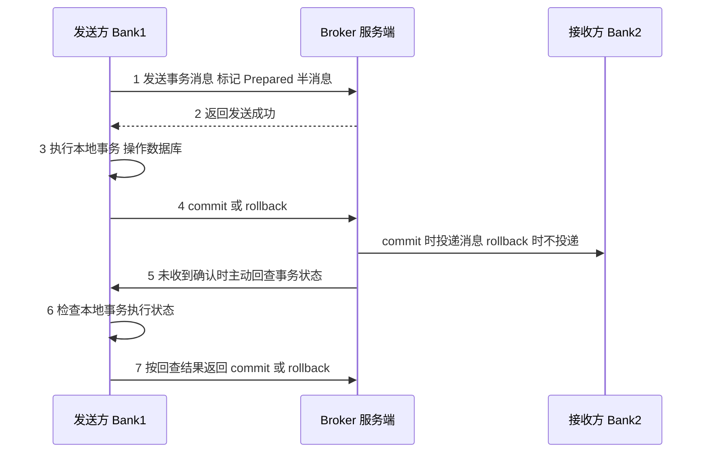

# RocketMQ 事务消息：半消息、本地事务与事务回查的完整闭环

概述课把可靠消息最终一致性方案的全貌铺开之后，留了三个待解的问题，其中最要命的一个是发送方的原子性：银行一的余额已经扣了，消息却没有送达 MQ，转账就此凭空蒸发。普通的发送调用给不了任何承诺，消息发出去后发送方就失去了对它的控制权。RocketMQ 的事务消息正是为这个死结设计的，这一课把它的运行机制完整拆开。

## 先给结论

- RocketMQ 从 4.3 版本起正式支持事务消息，为分布式事务实现提供了便利支持，课程环境统一采用 4.5.0，版本低于 4.3 不具备事务消息能力。
- 事务消息有两个设计基础：Broker 与发送方具备双向通信能力，Broker 天生可以扮演事务协调者；RocketMQ 自身提供存储机制，事务消息可以持久化保存，发生异常依然能推动事务走向一致。
- 完整流程六步：发半消息、Broker 确认、执行本地事务、commit 或 rollback、异常时回查、按回查结果定提交回滚。
- 半消息是打上 Prepared 标记、暂时不能被接收方消费的消息，它把「消息的存续」与「本地事务的结果」绑成一体。
- 编码层面只需要实现事务监听器的两个方法：执行本地事务、事务回查，其余步骤 RocketMQ 自动完成。

## 版本门槛与两个设计基础

RocketMQ 来自阿里巴巴，2012 年开源，2017 年成为 Apache 顶级项目。用它解决分布式事务问题有一个硬性前提：Apache RocketMQ 4.3 之后的版本才正式支持事务消息。这一点在选型审查时要作为检查项写清楚，拿一个 4.2 之前的版本去实现事务消息，代码根本编译不出正确的入口。

机制能成立，靠的是两条设计。**第一，双向通信。**Broker 是 RocketMQ 的服务端，它与发送方之间的通信是双向的：发送方可以发消息给 Broker，Broker 也可以发消息给发送方。不少消息中间件只提供单向投递，服务端无法主动「打电话」回来，这种先天差异决定了谁能做事务协调者。Broker 能主动联络发送方，才谈得上回查。**第二，自带存储。**RocketMQ 自身提供存储机制，事务消息在服务端持久化保存，即便发送方挂了、网络断了，消息还躺在 Broker 上，等状态确认后再决定投递还是删除。

## 半消息：先把意图存下来

事务消息流程的起点很反直觉：发送方不是先操作数据库，而是先给 Broker 发一条消息。担心接收方立刻收到消息、余额还没扣就先加钱？这个担心在「半消息」的设计面前不成立。发送方发出的消息到了 Broker 会被打上 Prepared 状态标记，带这个标记的消息暂时不能被接收方消费，想接收也接收不了。这种「消息已到达服务端、但接收方不可见」的消息就叫半消息（Half Message）。

半消息解决的正是时间差问题：先把「我要发一条转账通知」这个事实持久化到 Broker，再回头执行本地事务。此时消息的生杀大权还握在发送方手里，本地事务成功则正式放行，失败则就地删除，接收方从头到尾看不到任何中间状态。

## 六步完整流程

这张时序图讲的是事务消息从发出到确认的全过程，前四步是正常路径，第五到第七步是异常路径。



前三步走完，本地事务要么成功要么失败。**成功路径**：发送方向 Broker 发送 commit，消息状态从 Prepared 改为可消费，接收方随即拿到消息，扣钱与通知两个动作同时成立。**失败路径**：发送方向 Broker 发送 rollback，Broker 把这条半消息直接删除，接收方永远收不到，两个动作同时取消。

第五步处理的是最棘手的场景：本地事务明明执行成功了，发送 commit 时网络闪断、服务挂掉或者请求超时，Broker 既没等到 commit 也没等到 rollback。这种情况下 RocketMQ 不死等，超时后主动发起事务回查，不停地向发送方获取本地事务的执行状态，发送方查一下数据库里本地事务到底成没成，再把结果作为第七步返回给 Broker，Broker 据此决定投递还是删除。前四步加上回查兜底，消息发送与本地事务同时成功或同时失败就有了保障。

## 编码只做两件事

流程里的第二步确认、第四步状态流转、第五步回查触发，全是 RocketMQ 自己的能力，不需要写任何代码。开发者要补的只有两处：本地事务是什么，回查时怎么查。这两处都落在事务监听器接口上，对应它的两个方法：

```java
/** 事务监听器骨架 包名按 com.study.finance 系改写 依赖 rocketmq-spring-boot-starter 2.0.2-RELEASE */
public interface TransactionListener {

    /** 半消息发送成功后 RocketMQ 回调此方法 在这里执行本地事务 */
    LocalTransactionState executeLocalTransaction(Message msg, Object arg);

    /** Broker 收不到确认结果时定时回调 在这里查询本地事务的真实状态 */
    LocalTransactionState checkLocalTransaction(MessageExt msg);
}
```

`executeLocalTransaction` 里做本地事务该做的事，成功返回 `COMMIT_MESSAGE`，异常返回 `ROLLBACK_MESSAGE`；`checkLocalTransaction` 里必须给出确定答案，凭数据库里的真实记录判断，查到了就 commit，没查到就 rollback。配套的发送入口是 `TransactionMQProducer` 的 `sendMessageInTransaction`，它把监听器注册给生产者，消息的确认与回查协议由框架接管。bank1 演示工程里这两个方法的具体实现，后续课程按链路逐层展开。

## 剩下两个问题：重试归 MQ，幂等归自己

发送方的问题被事务消息解掉之后，方案还剩两问，分工很明确。**接收方消费与本地事务的原子性**，靠 RocketMQ 的重试机制兜底：消费消息或执行本地事务的过程中出现异常，MQ 隔一段时间重新投递一次，再消费再执行，遇到超时也会不停地重复「消费消息、执行本地事务」这个循环，一直到本地事务执行成功才停。接收方这边基本不用写额外代码，只要保证自己的业务代码没有 bug。真出现永远失败的情况，多半是代码有缺陷或网络彻底不可修复，理论不应发生，出现了就转人工兜底。**消费幂等性**则完全靠自己：MQ 保证消息必达，代价是可能重复投递，同一笔转账被消费两次，余额就加两次。幂等要求同一业务操作执行多少次效果都与一次相同，具体手段在入门案例里会落成一张去重表，与事务回查共用。

## 常见误区

- **以为先发消息会污染接收方。**错例：半消息发出后接收方立刻消费，余额没扣就先加了钱。正解：半消息带 Prepared 标记，在 commit 之前对接收方不可见，消息可达性与可见性是两件事。
- **把事务回查当成可选的锦上添花。**错例：认为正常情况走前四步就够了，回查逻辑随便返回。正解：挂机、闪断、超时都会让 Broker 收不到确认，回查是机制的一部分，实现必须查库给确定答案，否则半消息会长期悬挂。
- **用普通消息发送代替事务消息。**错例：本地事务提交后再调一次普通发送，觉得概率上没事。正解：事务提交后发送前进程崩溃，或发送超时但消息实际已到达，都会造成本地事务与消息不一致，必须用半消息加回查的闭环。
- **版本选型忽略 4.3 门槛。**错例：拿旧版本客户端按事务消息 API 开发。正解：事务消息是 4.3 起的正式能力，环境统一用 4.5.0 服务端，客户端用对应版本的 spring boot starter。
- **以为消费重试可以替代幂等设计。**错例：MQ 会重试所以接收方不用管重复。正解：重试解决「失败后终会成功」，不解决「成功后重复执行」，重投恰恰制造了重复消费，幂等必须消费端自己实现。

## 面试可能被问到的问题

1. 面试官追问：「半消息为什么叫半，它和普通消息差在哪？」
   答：差在状态与可见性。半消息到达 Broker 时被标记为 Prepared，此时消息已持久化但不能被消费者拉到，处于「发了但不算数」的半成品状态。本地事务执行结果 commit 后它才转正为可消费消息，rollback 则被删除，普通消息没有这个待定阶段。
2. 面试官追问：「事务回查什么时候发生，回查的实现要注意什么？」
   答：发送方执行本地事务后没能把 commit 或 rollback 送达 Broker 时发生，典型原因是服务挂掉、网络闪断或超时。回查实现必须基于本地事务的真实结果，例如查去重表里有没有这笔事务的日志，查到返回 commit，查不到返回 rollback，不能凭内存变量或猜测返回。
3. 面试官追问：「Broker 凭什么能当事务协调者？」
   答：两个设计基础。一是 Broker 与发送方具备双向通信能力，Broker 可以主动联络发送方发起回查，这是多数只支持单向投递的 MQ 做不到的；二是 RocketMQ 自带存储机制，事务消息持久化保存，异常发生后状态不丢，事务还能被推动走向一致。
4. 面试官追问：「事务消息方案里，接收方为什么几乎不用写代码？」
   答：消费与本地事务的原子性由 RocketMQ 的重试机制保证，消费或执行失败会隔一段时间重投重试，超时也会持续尝试直到本地事务成功。接收方只需保证业务代码本身正确，失败最终能收敛；而重复消费的幂等问题 MQ 不会替你解决，那部分必须自己写。
5. 面试官追问：「本地事务和发消息为什么不能写在同一个本地事务里？」
   答：发消息是外部动作，不参与数据库事务的回滚。先提交事务再发消息，发送失败则两边不一致；先发消息再提交事务，回滚则消息已经出去了。超时场景更隐蔽，响应丢失但消息实际已到达，看起来失败实则成功。事务消息用半消息加确认加回查把这个环节纳入协议，才真正做到同生同灭。

## 配套资料

- 讲义：`materials/docs/10/day16-项目总结&就业指导v1.0.md`，3.4.3 如何通过 RocketMQ 事务消息实现最终一致性事务：Broker 双向通信与存储机制两个设计基础、半消息与事务回查的六步流程。
- 讲义：`materials/docs/10/RocketMQ研究v1.0.md`，RocketMQ 4.5.0 的安装与启动（NameServer、Broker 命令与 9876 端口）、`RocketMQTemplate` 消息发送的基本用法。
- 讲义：`materials/docs/10/万信金融-第4章-投标放款v1.0.md`，3.3 分布式事务：满标放款需使用 RocketMQ 事务消息实现最终一致性事务的选型结论。
- 代码：`materials/code/10/rocketmq-all-4.5.0-bin-release/` 与 `materials/code/10/rocketmq-console/`，事务消息所需的 RocketMQ 服务端发行包与控制台。
- 代码：`materials/code/10/完整代码/完整代码/shanjupay/test-rocketmq/`，`RocketMQTemplate` 各类消息发送方式的真实参考代码。文中事务监听器骨架为按本课写法补全的示例，bank1/bank2 演示工程无源码包，包名按 `com.study.finance` 系改写。
