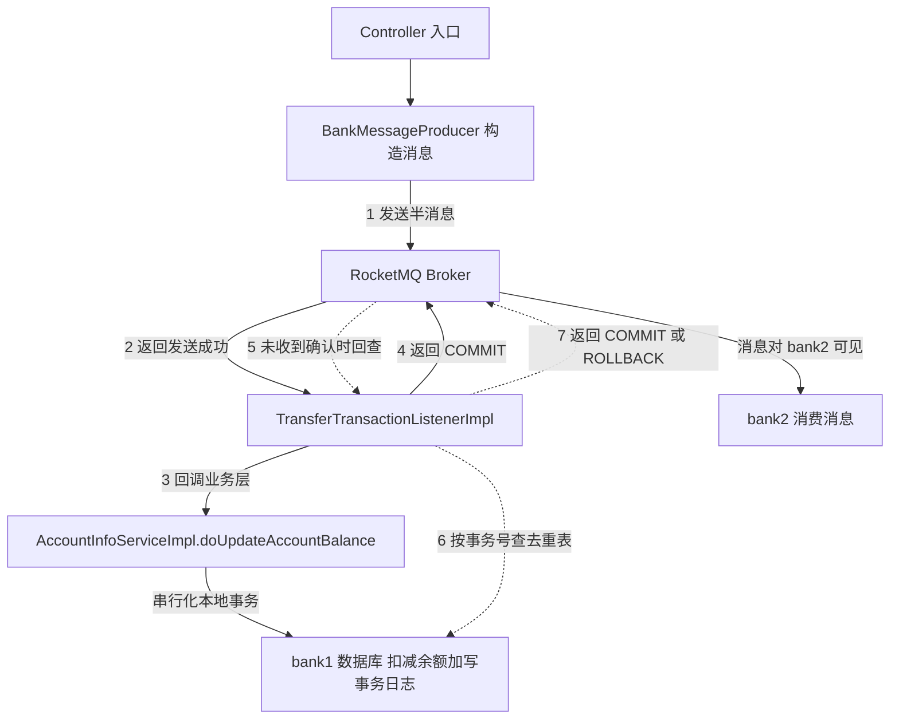

# bank1 完整实现：从 DAO 到事务回查的四层推进

bank1 是转账案例里的发送方，也是事务消息机制里戏份最重的一方：它要发半消息、执行本地事务、响应回查，理论课里的第一、三、五、六、七步全部落在它的代码上。把这条链路拆开看是四个动作，串起来看是一条消息从构造到确认再到兜底的完整生命周期。bank2 还没开工也不影响 bank1 的实现，事务消息的设计本来就允许发送方先把「消息必达」的责任扛起来。

## 先给结论

- bank1 侧的代码分四层推进：消息模型与 DAO 层、发送转账消息的生产者、业务层、事务监听器，各层职责单一。
- 数据访问层操作两张表四个功能：`account_info` 表的余额更新与账户查询，`de_duplication` 去重表的日志写入与存在性查询。
- 发送转账消息用 `RocketMQTemplate.sendMessageInTransaction`，消息体是业务对象转 JSON 再封装成 Spring Message。
- 业务层是发消息与本地事务的分界线：入口方法只发消息，本地事务方法用 `@Transactional(isolation = Isolation.SERIALIZABLE)` 包住扣减余额与写事务日志两个 SQL。
- 事务监听器实现 `RocketMQLocalTransactionListener` 接口的两个方法，`executeLocalTransaction` 执行本地事务并返回 COMMIT 或 ROLLBACK，`checkLocalTransaction` 查去重表回答 Broker 的回查。
- 监听器注解 `@RocketMQTransactionListener` 的 `txProducerGroup` 必须与发送事务消息时指定的组名完全一致，回查按组路由。

## 消息模型：AccountChangeEvent 的三个字段

发送方每发一条转账通知，都要把「给哪个账号、变多少、哪笔事务」说清楚，这三个信息由 `AccountChangeEvent` 封装，工程里已提供，编码前先认识它：

```java
package com.study.finance.demo.bank1.model;

@Data
@AllArgsConstructor
@NoArgsConstructor
public class AccountChangeEvent implements Serializable {
    // 目标账号
    private String accountNo;
    // 变动金额
    private double amount;
    // 事务号 时间戳
    private long txNo;
}
```

`accountNo` 决定操作哪行数据，`amount` 是带正负语义的变动金额而不是绝对值，`txNo` 是整个方案里最小的设计却承担最大的责任：它既是事务回查时检索本地事务状态的钥匙，也是消费幂等时判断重复的依据。消息体一旦构造出来，这三个字段会原样穿越 MQ 与去重表，中途不产生新的标识。

与它配套的还有账户实体 `AccountInfo`，对应账户表 `account_info` 里的账号、密码与余额三个字段，转账真正改动的只有余额一列。事件类与实体类分开各司其职：事件类描述「一次转账请求」，随消息流动；实体类描述「一个账户」，只活在 bank1 自己的数据库里。混用一个类既会把账户密码字段塞进消息体，也会让消息契约绑定到单表结构上，日后改表就动摇了消息协议。

## 数据访问层：两张表四个功能

转账必然操作数据库，bank1 侧要动的表就是上述两张：账户表 `account_info` 与去重表 `de_duplication`。两张表对应四个数据操作，全部用 MyBatis 注解 SQL 写在 `AccountInfoDao` 接口里，本项目此处用的是 MyBatis 而非 MyBatis-Plus：

```java
@Mapper
public interface AccountInfoDao {

    // 修改某账号的余额 amount 为正数即增加 为负数即扣减
    @Update("update account_info set account_balance = account_balance + #{amount} " +
            "where account_no = #{accountNo}")
    int updateAccountBalance(@Param("accountNo") String accountNo, @Param("amount") Double amount);

    // 根据账号查询账户信息
    @Select("select * from account_info where account_no = #{accountNo}")
    AccountInfo selectAccountInfo(@Param("accountNo") String accountNo);

    // 查询事务日志条数 用于判断该事务是否已执行
    @Select("select count(1) from de_duplication where tx_no = #{txNo}")
    int isExistTx(@Param("txNo") long txNo);

    // 保存事务日志 create_time 取数据库当前时间
    @Insert("insert into de_duplication (tx_no, create_time) values (#{txNo}, now())")
    int addTx(@Param("txNo") long txNo);
}
```

前两个方法服务账户本身：`updateAccountBalance` 在余额上做加法，正负由调用方决定，方法名说的是「变动」而不是「增加」；`selectAccountInfo` 提供账户的查询能力。后两个方法服务去重表：`isExistTx` 只查 `count(1)` 而不是整行记录，因为调用方关心的只有「这条事务日志存在与否」一个布尔事实，名字里的 isExist 直接表达了用途；`addTx` 把事务号与数据库当前时间写进去，`now()` 由数据库自己取值，避免应用时钟不准。

选注解 SQL 而不是 XML 映射文件，是这个 demo 的取巧之处：四条语句都很短，写在接口上方一目了然，也省掉一套 mapper XML 的配置。工程化项目里复杂 SQL 还是建议回到 XML 或 MyBatis-Plus，但理解注解写法是所有变体的地基。

## 缺口盘点：七步图上还差什么

发送消息与本地事务的代码都有了，对照事务消息的七步流程盘一遍进度，会发现链条并没有接通。第一步发送半消息，`BankMessageProducer` 已经实现；第三步执行本地事务，业务层的 `doUpdateAccountBalance` 已经实现；但第二步「接收 Broker 的确认结果并触发本地事务」没有落点：发送方发出半消息之后，谁来接住 Broker 的回调、谁去调业务层的方法、谁把结果 commit 或 rollback 送回去，这些环节全都缺着。第五到第七步的事务回查同样完全空白。换句话说，缺的是一个能把 Broker 与本地代码接起来的适配层，这正是事务监听器要补的位置。动手前先做这样的盘点，写代码时才知道每个方法补的是哪一环，而不是凭感觉堆功能。

## 发送转账消息：事务消息的入口

按事务消息的流程，链路的第一个动作是发半消息，所以数据访问层写完先不碰业务层，先把发送消息独立成一个类，放在 message 包下：

```java
@Component
@Slf4j
public class BankMessageProducer {

    @Resource
    private RocketMQTemplate rocketMQTemplate;

    public void sendAccountChangeEvent(AccountChangeEvent accountChangeEvent) {
        // 业务对象转 JSON 再封装为 Spring Message
        JSONObject jsonObject = new JSONObject();
        jsonObject.put("accountChange", accountChangeEvent);
        Message<String> msg = MessageBuilder.withPayload(jsonObject.toJSONString()).build();
        // 发送事务消息 参数依次为事务发送组名 目的 topic 消息体 附加参数
        rocketMQTemplate.sendMessageInTransaction("producer_ensure_transfer",
                "topic_ensure_transfer", msg, null);
    }
}
```

三段式结构很固定：先把 `AccountChangeEvent` 放进 `JSONObject`，键为 `accountChange`，这个键名接收方要按它取值，两端是隐式契约；再经 `MessageBuilder.withPayload(...).build()` 转成 Spring 消息，RocketMQ 的 starter 走的是 Spring Messaging 体系；最后调 `sendMessageInTransaction`。这个方法名里的 InTransaction 是关键标识，与普通的 `syncSend` 完全不同：它发出的是半消息，Broker 确认后会自动回调监听器，而不是像普通发送那样返回一个 `SendResult` 就结束。第一个参数的组名与第二个参数的 topic 名要记下来，后面监听器要用同一个组名，bank2 消费时要用同一个 topic。

还有一处容易看漏的差别：普通发送关心返回的 `SendResult`，可以拿它记录消息状态；事务消息发送的返回值几乎没有利用价值，因为本地事务还没执行，发送结果不等于业务结果。事务的成败由监听器回调里的执行情况决定，发送方的职责在消息构造与参数传递上，这也是为什么这个类里没有一行数据库代码。

## 业务层：发消息与本地事务的分界

业务层接口只暴露两个方法，正好对应 bank1 的两件事：

```java
public interface AccountInfoService {
    // 发送转账消息 对外入口
    void updateAccountBalance(AccountChangeEvent accountChange);
    // 执行本地事务 由事务监听器调用
    void doUpdateAccountBalance(AccountChangeEvent accountChange);
}
```

实现类把前面两层的成果组装起来：

```java
@Service
@Slf4j
public class AccountInfoServiceImpl implements AccountInfoService {

    @Autowired
    private BankMessageProducer bankMessageProducer;
    @Autowired
    private AccountInfoDao accountInfoDao;

    @Override
    public void updateAccountBalance(AccountChangeEvent accountChange) {
        // 只负责发消息 半消息确认后的本地事务由监听器触发
        bankMessageProducer.sendAccountChangeEvent(accountChange);
    }

    @Override
    @Transactional(isolation = Isolation.SERIALIZABLE)
    public void doUpdateAccountBalance(AccountChangeEvent accountChange) {
        // bank1 是扣款方 传入的变动金额为正数 这里取负数实现扣减
        accountInfoDao.updateAccountBalance(accountChange.getAccountNo(),
                accountChange.getAmount() * -1);
        // 事务日志与余额变更在同一个本地事务 回查时以日志的存在性为准
        accountInfoDao.addTx(accountChange.getTxNo());
    }
}
```

两个细节值得停一下。**第一，金额取负的位置。**DAO 的 update 语句是纯加法，bank1 作为扣款方必须扣钱，所以在业务层把正数乘以 -1 再传下去，bank2 那边将来直接传正数加钱，一张表一个 update 语句同时服务两方。**第二，事务注解的隔离级别。**`doUpdateAccountBalance` 里是两个 SQL：扣余额与写事务日志，它们必须同生同灭，是一个不折不扣的本地事务，所以加 `@Transactional`；`isolation` 设为 `Isolation.SERIALIZABLE`，是隔离级别里最严格的一档，要求操作严格按顺序执行，并发性能会受影响，但这里要的是数据完整性与一致性，并发不是 demo 的目标。这个注解对回查的正确性至关重要：余额扣了而日志没写（或反过来）会让回查得出错误答案。

接口先写、实现后接也是刻意的编排：监听器注入的是 `AccountInfoService` 接口而不是实现类，业务层对上层只暴露两个方法签名，扣钱前要不要校验余额、校验失败抛什么异常，这些都属于实现细节，将来放在 `doUpdateAccountBalance` 内部演化，监听器与 Controller 的代码不用跟着动。demo 里没有做余额不足的拦截，张三没钱也能扣成负数，这是简化，不是疏漏，正式业务里校验逻辑属于本地事务的前置条件，失败同样以异常形式汇入监听器的 ROLLBACK 分支。

## 事务监听器：执行本地事务

到这里对照流程图盘点进度：第一步发送半消息已实现，第三步本地事务有了，但第二步「接收 Broker 的确认并触发本地事务」还没接上。这一环由事务监听器完成，RocketMQ 收到半消息确认后自动回调监听器，不需要任何人显式调用：

```java
@Slf4j
@Component
@RocketMQTransactionListener(txProducerGroup = "producer_ensure_transfer")
public class TransferTransactionListenerImpl implements RocketMQLocalTransactionListener {

    @Autowired
    private AccountInfoService accountInfoService;

    @Override
    public RocketMQLocalTransactionState executeLocalTransaction(Message msg, Object arg) {
        // 接收并解析消息 发送方发出的消息由发送方自己消费回来
        final JSONObject jsonObject = JSON.parseObject(new String((byte[]) msg.getPayload()));
        AccountChangeEvent accountChangeEvent =
                jsonObject.parseObject(jsonObject.getString("accountChange"), AccountChangeEvent.class);
        // 执行本地事务
        Boolean isCommit = true;
        try {
            accountInfoService.doUpdateAccountBalance(accountChangeEvent);
        } catch (Exception e) {
            isCommit = false;
        }
        // 返回执行结果 COMMIT 则消息转可消费 ROLLBACK 则 Broker 删除半消息
        if (isCommit) {
            return RocketMQLocalTransactionState.COMMIT;
        } else {
            return RocketMQLocalTransactionState.ROLLBACK;
        }
    }
}
```

类头上的注解有两个硬要求：`@Component` 让 Spring 管理它，`@RocketMQTransactionListener(txProducerGroup = "producer_ensure_transfer")` 把监听器与发送组绑定，组名必须与 `sendMessageInTransaction` 的第一个参数完全一致，随便写一个别的名字，回查时 Broker 找不到对应的监听器。这里顺带把生产者组的语义捋清：group 表示一组角色相同的生产者，一个组可以容纳多台服务器上的多个生产者实例，也可以是单机多进程；事务场景下组的真正价值在于容错，某个生产者实例意外挂掉，Broker 会回调同组中其他任意一台机器确认事务状态，多实例互为备份。

方法体的逻辑与发送方代码正好互逆，相当于自己发消息自己消费：从 `msg.getPayload()` 取出消息内容（字节数组，先转字符串再转 `JSONObject`），再用当初写入的键 `accountChange` 取出业务对象，两参数版的 `parseObject` 指定目标类型。然后 try-catch 包住本地事务调用，用一个布尔变量标记执行结果：走到返回处变量仍为 true 说明没有抛异常，本地事务成功，返回 `RocketMQLocalTransactionState.COMMIT`；进了 catch 块说明执行失败，返回 `ROLLBACK`。返回值不用自己造字符串常量，RocketMQ 已把状态封装进这个枚举。

## 事务回查：拿去重表回答 Broker

监听器的第二个方法对应流程图的第五、六、七步。场景是本地事务执行成功了，返回 commit 时网络闪断或服务挂掉，Broker 等到超时也没拿到结果，于是主动回查。Broker 怎么问，我们就得答得上来，答案的依据正是业务层那个本地事务留下的痕迹：

```java
    @Override
    public RocketMQLocalTransactionState checkLocalTransaction(Message msg) {
        // 接收并解析消息 拿出事务号
        final JSONObject jsonObject = JSON.parseObject(new String((byte[]) msg.getPayload()));
        AccountChangeEvent accountChangeEvent =
                jsonObject.parseObject(jsonObject.getString("accountChange"), AccountChangeEvent.class);
        // 查询去重表 日志存在即本地事务执行成功
        int isExistTx = accountInfoDao.isExistTx(accountChangeEvent.getTxNo());
        // 根据查询结果返回
        if (isExistTx > 0) {
            return RocketMQLocalTransactionState.COMMIT;
        } else {
            return RocketMQLocalTransactionState.ROLLBACK;
        }
    }
```

推理链条只有三句话：扣余额与写日志在同一个串行化隔离级别的本地事务里，要么都成要么都不成；日志写了就证明余额扣了；所以按事务号查 `de_duplication` 表，查到记录返回 COMMIT，查不到返回 ROLLBACK。这就是监听器里要注入 `AccountInfoDao` 的原因，回查答的是数据库里的事实，不是内存里的猜测。

回查还有一个容易被忽略的性质：它不是一次性的。Broker 在约定时间内拿不到确认结果时会不停地向发送方询问本地事务状态，一次没问出结果还会再问，直到拿到确定答案为止。这决定了 `checkLocalTransaction` 必须是纯查询、无副作用、可重复执行的逻辑，同一事务号被查多少次，答案都要一致。好在查去重表天然满足这些要求，查询不动数据，事务日志要么在要么不在，答案永远确定。至此 bank1 侧一到七步的代码全部就位。

这张图把 bank1 侧四层代码与事务消息七步流程对上了号，实线是每次转账都走的正常路径，虚线是异常时的回查路径：



关键路径在监听器这个枢纽：它既是步骤三的执行者，又是步骤五到七的应答者，而它的应答能力完全建立在业务层本地事务写下的那条日志上。层与层之间环环相扣，缺了任何一层，整条链路都闭不了环。

## 常见误区

- **把变动金额当绝对值传。**错例：bank1 直接把 100 传给 `updateAccountBalance`，结果余额加了 100。正解：DAO 是纯加法语义，扣款方要在业务层取负，收款方传正，约定写进方法注释。
- **监听器组名与发送组名不一致。**错例：`sendMessageInTransaction` 传 `producer_ensure_transfer`，监听器注解写成别的组名。正解：两处必须逐字符一致，Broker 的确认回调与事务回查都按组名路由监听器，不一致时半消息无人认领，最终被回查判死。
- **以为监听器要手动调用。**错例：在业务层里自己去调 `executeLocalTransaction`。正解：半消息确认后由 RocketMQ starter 自动回调监听器，开发者只负责在回调里填业务逻辑，调用时机与线程都归框架管。
- **本地事务方法漏写事务注解或用默认隔离级别。**错例：`doUpdateAccountBalance` 不加 `@Transactional`，两个 SQL 各自提交。正解：扣减余额与写事务日志必须原子，回查的逻辑前提就是「日志在则余额已扣」，用 `SERIALIZABLE` 隔离级别保证这个等式成立。
- **回查逻辑查内存或查消息。**错例：回查时读本地缓存里的执行标志。正解：服务可能重启过，内存不可信，唯一可靠的是数据库里事务日志的存在性，回查实现必须落到 DAO 查询上。

## 面试可能被问到的问题

1. 面试官追问：「bank1 的 DAO 为什么要四个方法，少一个行不行？」
   答：两个方法服务账户表，两个服务去重表。余额更新与账户查询是转账的基本操作；`isExistTx` 服务回查，判断事务是否已执行；`addTx` 服务本地事务，把执行结果落到日志。少了 `addTx` 回查永远答 ROLLBACK，消息会被误删；少了 `isExistTx` 回查无从作答，两个去重表方法是闭环的钥匙。
2. 面试官追问：「sendMessageInTransaction 和 syncSend 的本质区别是什么？」
   答：`syncSend` 发普通消息，返回 SendResult 后发送方与这条消息的因果就断了，本地事务与消息的成败互不相关。`sendMessageInTransaction` 发的是半消息，发出后 RocketMQ 会回调事务监听器执行本地事务，本地事务结果决定消息 commit 还是 rollback，Broker 收不到结果还会回查，消息的存续被绑定在本地事务上。
3. 面试官追问：「监听器方法里为什么用布尔变量加 try-catch，而不是直接在 catch 里返回？」
   答：等价写法可以，但布尔变量把「执行」与「判定」分开：try 块专心做业务，异常只负责改标志，返回处统一给出 COMMIT 或 ROLLBACK。这样逻辑一目了然，也便于后续在 catch 里补日志、补偿动作，避免 return 散落在分支里。
4. 面试官追问：「事务监听器注解里的 txProducerGroup 是干什么的，设计上为什么需要组？」
   答：它把监听器与某类事务消息的发送者绑定，Broker 按组路由确认与回查请求。组代表角色相同的一类生产者，可以横跨多台服务器的多个实例；事务场景下某个生产者挂掉时，Broker 会回调同组其他实例确认事务状态，让回查在集群里不落空。
5. 面试官追问：「本地事务的隔离级别为什么选 SERIALIZABLE，代价是什么？」
   答：回查正确性的前提是「事务日志存在当且仅当余额已扣」，两个 SQL 必须严格原子且顺序执行。SERIALIZABLE 是最严格的隔离级别，杜绝并发下的乱序与交叉，代价是并发性能下降，转账 demo 不追求吞吐所以可接受。生产里也可以用默认级别加唯一约束兜底，但前提是保证回查判据依然成立。
6. 面试官追问：「执行本地事务时如果 doUpdateAccountBalance 抛了异常，半消息会怎样？」
   答：监听器捕获异常返回 ROLLBACK，RocketMQ 把这条半消息从服务端删除，bank2 永远收不到这条转账通知，bank1 的数据库也因本地事务回滚没有扣余额，两边同时取消，这正是事务消息要的同生同灭。

## 配套资料

- 讲义：`materials/docs/10/day16-项目总结&就业指导v1.0.md`，3.4.3 事务消息六步流程，与监听器两个方法一一对应。
- 讲义：`materials/docs/10/万信金融-第4章-投标放款v1.0.md`，3.3 分布式事务：满标放款选型与事务消息指引。
- 讲义：`materials/docs/10/RocketMQ研究v1.0.md`，RocketMQTemplate 消息发送基本用法与生产者组配置参考。
- 代码：`materials/code/10/完整代码/完整代码/shanjupay/test-rocketmq/`，`RocketMQTemplate` 注入、`MessageBuilder` 封装消息体的真实参考代码。
- 代码：`materials/code/10/rocketmq-all-4.5.0-bin-release/`，事务消息运行所需的服务端。bank1/bank2 演示工程无源码包，文中 `AccountInfoDao`、`BankMessageProducer`、`AccountInfoServiceImpl`、`TransferTransactionListenerImpl` 均按本课画面线与讲义写法补全，包名按 `com.study.finance` 系改写。
