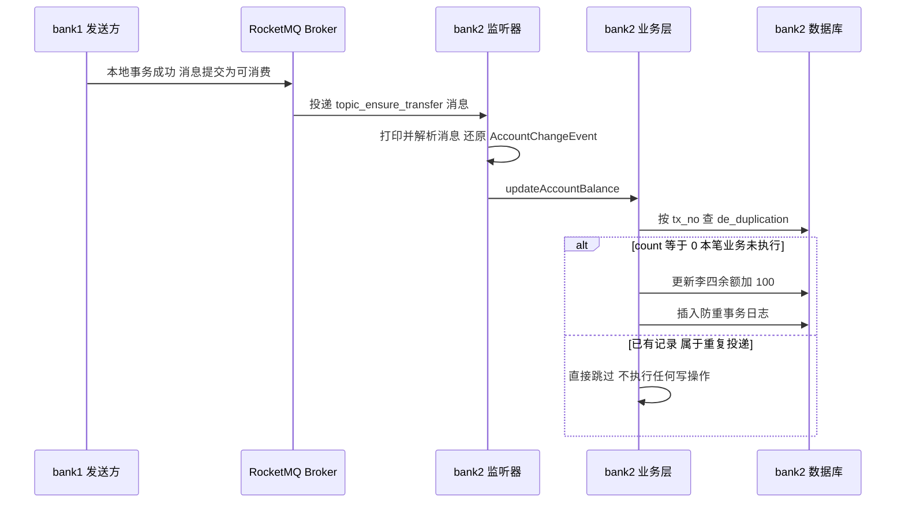

# bank2 接收方落地：收钱的本地事务与消费消息的幂等控制

转账入门案例的发送方 bank1 已经跑通：本地事务扣减张三余额，事务消息经 Broker 确认后投递出去。可整条链路此刻还停在半空，接收方 bank2 一行代码都没有。接收方要回答两个问题：一是入口变了，不再有 Controller 接请求，业务动作只能由消费消息触发；二是可靠性带来的另一面，集群环境下同一条消息可能被投递多次，重复收钱绝不能发生。这两个视频把 bank2 的数据访问层、业务层与消息监听器补齐，转账链路的两端才算真正接通。

## 先给结论

- bank2 的数据访问层与 bank1 完全同构，操作的还是 `account_info` 与 `de_duplication` 两张表，整包复用即可；金额传正数，同一条 update 语句天然就是加钱。
- 业务层用 `@Transactional(isolation = Isolation.SERIALIZABLE)` 把两个动作绑进一个本地事务：更新李四余额、向防重表 `de_duplication` 插入一条事务日志，要么都成功要么都失败。
- 幂等控制的判定口径：先查防重表，`count` 为 0 才执行收钱与写日志；查到记录说明这笔业务已被某个节点执行过，直接跳过。
- 消费入口是实现 `RocketMQListener<String>` 的监听器类，`@RocketMQMessageListener` 的 topic 必须与 bank1 发送目的地逐字一致，`consumerGroup` 决定集群内如何均摊消费。
- `onMessage` 的固定三步：打印并解析消息、还原 `AccountChangeEvent`、调用业务层执行本地事务；演示工程里接收方账号写死为李四。

## 接收方的活为什么比发送方少

bank1 作为发送方，要操心半消息、本地事务、事务回查三件套，代码分散在生产者与事务监听器两处。bank2 作为接收方只做一件事：等消息、收钱。业务方向上的差异只有一处：bank1 扣钱要把金额处理成负数再落库，bank2 收钱只要金额本身是正数，余额加正数就是进账。数据库层面的操作两侧完全一致，都是「按账号改余额」加「按流水号记录日志」，这正是数据访问层能够直接搬运的原因。

入口的变化也值得提前想清楚。传统三层架构里，业务层的调用方永远是 Controller：HTTP 请求进来，参数被封装成 DTO，一路往下传。消息驱动的架构把这个调用链从中间截断了，业务层的触发者变成了 MQ 投递过来的消息。这带来两个直接后果：一是业务层方法的参数必须从消息体里反序列化还原，二是业务层再也不能依赖「请求一定来自前端」的假设，每一条消息都可能是重复投递的副本。这两个后果分别对应本章后面要写的解析逻辑与幂等控制。

## 数据访问层直接从 bank1 搬过来

bank2 的库里同样是 `account_info` 账户表与 `de_duplication` 防重表，后者只有 `tx_no` 与时间两个字段，按事务流水号记录每一次业务执行。数据访问层的接口与 bank1 一字不差地复用：

```java
/** bank2 数据访问层 与发送方同构 包名按 com.study.finance 系改写 */
public interface AccountInfoDao {

    // 修改账户余额 金额为正即是收钱
    @Update("update account_info set account_balance = account_balance + #{amount} " +
            "where account_no = #{accountNo}")
    int updateAccountBalance(@Param("accountNo") String accountNo, @Param("amount") Double amount);

    // 查询事务记录是否存在 用于消费幂等控制
    @Select("select count(1) from de_duplication where tx_no = #{txNo}")
    int isExistTx(long txNo);

    // 保存事务执行记录
    @Insert("insert into de_duplication values(#{txNo}, now())")
    int addTx(long txNo);
}
```

同一张防重表在两端扮演不同角色：bank1 用它回答「这笔业务到底执行成功没有」，为事务回查提供依据；bank2 用它回答「这条消息是不是已经被处理过」，为消费幂等提供依据。表结构相同，读它的目的不同，这一点在排查问题时容易混淆。

字段设计也顺带交代一下。`tx_no` 是事务流水号，由发起方在业务发起时生成并随消息一路携带，两个库里的记录靠它对上号；时间是插入时刻，用于事后审计与排查时判断执行顺序。表里没有金额、账号这些业务字段，因为它只回答「这笔业务做没做过」，业务事实本身在 `account_info` 的余额变动里。设计防重表时克制字段数量是一个好习惯，字段越多，写入失败的可能性越大，而防重记录恰恰必须是整个链路里最不容易写失败的那张表。

## 业务层：一个本地事务包住收钱与防重记录

接口只需一个方法，接收方收到消息后要做的全部事情都收拢在 `updateAccountBalance` 里：

```java
public interface AccountInfoService {
    /**
     * 更新账户余额 收钱并记录防重日志
     * @param accountChange 账户变动事件 含账号 金额 事务流水号
     */
    void updateAccountBalance(AccountChangeEvent accountChange);
}
```

实现类的关键在注解与方法体的顺序：

```java
@Service
@Slf4j
public class AccountInfoServiceImpl implements AccountInfoService {

    @Autowired
    private AccountInfoDao accountInfoDao;

    @Override
    @Transactional(isolation = Isolation.SERIALIZABLE)
    public void updateAccountBalance(AccountChangeEvent accountChange) {
        // 幂等控制 先查防重表 有记录说明这笔业务已被执行过
        int isExistTx = accountInfoDao.isExistTx(accountChange.getTxNo());
        if (isExistTx == 0) {
            // 收钱 李四余额增加
            accountInfoDao.updateAccountBalance(accountChange.getAccountNo(),
                    accountChange.getAmount());
            // 记录事务日志 与收钱同处一个本地事务
            accountInfoDao.addTx(accountChange.getTxNo());
        }
    }
}
```

两个动作必须绑成一个事务，逻辑并不复杂：消费方收到钱就必须留痕，留了痕就必然已经收到钱。于是「防重表里有没有这条流水号」成为这笔业务是否执行过的唯一判据。`count` 为 0 意味着没有任何节点执行过本次收钱，正常走更新余额加写日志；`count` 非 0 意味着此前某个节点已经处理过同一条消息，本次重复投递被直接拦下，余额不会被加第二次。

隔离级别提升到 `Isolation.SERIALIZABLE` 是这门课刻意的写法。先查后写天然存在竞态：两个节点可能同时查到 `count` 为 0，然后各自执行一遍。串行化隔离级别把「查、写」两个动作排成队，同一流水的并发处理被数据库挡住。代价是并发越高锁冲突越多，演示工程可以接受；生产环境更常见的做法是给 `tx_no` 建唯一索引，靠数据库约束兜底，插入冲突即视为重复，两种思路的取舍在面试里经常被追问。

从写代码的顺序看，这个方法的形态也值得留意：整个方法体只有一次查询加一次条件分支，分支内是两条持久化调用，没有手写的事务边界控制。本地事务的边界由 `@Transactional` 声明式地圈定，方法内任何一步抛出异常，已执行的写操作一并回滚，防止出现「日志写了、余额没加」或反过来的半成品状态。业务代码保持这样薄的形态，事务边界才清晰，出问题时也容易定位是哪一步破坏了原子性。

## 消费入口：RocketMQListener 监听器

bank2 没有 Controller，唯一的入口是消息监听器。在 `message` 包下新建类，实现 RocketMQ 提供的监听接口：

```java
/** bank2 消费监听器 包名按 com.study.finance 系改写 */
@Slf4j
@Component
@RocketMQMessageListener(topic = "topic_ensure_transfer",
        consumerGroup = "consumer_ensure_transfer")
public class EnsureMessageConsumer implements RocketMQListener<String> {

    @Autowired
    private AccountInfoService accountInfoService;

    @Override
    public void onMessage(String message) {
        log.info("开始消费消息：{}", message);
        // 解析消息 取出账户变动事件 键名与 bank1 发送侧保持一致
        JSONObject jsonObject = JSON.parseObject(message);
        AccountChangeEvent accountChangeEvent = JSON.parseObject(
                jsonObject.getString("accountChange"), AccountChangeEvent.class);
        // 演示工程接收方固定为李四 账号 2 真实场景应由消息体携带
        accountChangeEvent.setAccountNo("2");
        // 执行本地事务 收钱并写防重日志
        accountInfoService.updateAccountBalance(accountChangeEvent);
    }
}
```

注解上的两个值各有讲究。**topic 是投递的地址，必须与 bank1 发送消息的目的地逐字一致。**bank1 生产消息时把 `topic_ensure_transfer` 作为目的地，bank2 消费时若拼错一个字母，程序不报任何错，只是永远收不到消息，消息安静地留在 Broker 里。这类「无声失败」在联调期最消耗时间，值得当成硬规则记住。**`consumerGroup` 是消费组的名字，决定集群怎么分活。**RocketMQ 把角色相同的一批消费者实例划成一个消费组，组内多个实例（可以是多台机器、多个进程，甚至一个进程里的多个消费者对象）默认以均摊方式消费，一条消息组内只投递一次；若配置成广播模式，组内每个实例都会消费全量消息。演示工程在 `onMessage` 里打印原始消息，正是为了后续观察重复投递时能一眼数出次数。

顺带补全发送侧的对称概念。消费组之外还有生产者组，一组 Producer 实例同样可以跨机器、跨进程。生产者组在普通消息场景主要起标识作用，便于运维查询某个发送应用下有多少实例；在事务消息场景它有实质意义：发送方执行本地事务途中意外宕机时，Broker 的事务回查会回调该生产者组内任意一台存活的实例来确认事务状态，这也解释了为什么回查逻辑必须写成「查数据库给确定答案」，而不是查内存：接住回查的可能是另一台机器，它手里只有数据库这一份事实。

泛型参数写 `String`，意味着监听器收到的消息体是原始 JSON 字符串。解析代码与 bank1 发送侧互为镜像：发送方把事件对象以键 `accountChange` 放进 JSON，消费方按同一个键取出字符串再反序列化成 `AccountChangeEvent`，键名对不上取出来就是空，链路同样无声失败。

## 整条链路串起来

这张图讲的是消息到达 bank2 之后的完整路径，幂等分支是重点：



关键路径是分支前的那次查询：无论 Broker 因为重试、节点宕机还是网络抖动而重复投递多少次，消息进入业务层后都要先过防重表这道闸，只有第一个处理的节点能通过，后续全部在闸外止步。这正是「同一业务操作执行多少次，效果都与执行一次相同」的落地形态。

用文字把同一条链路再走一遍，方便与图对照。bank1 本地事务扣款成功，消息由半消息转成可消费状态；Broker 按目的地把消息投给 `consumer_ensure_transfer` 组内一个实例；该实例的 `onMessage` 被触发，先把原始消息打印出来留证，然后按 `accountChange` 键解析出账户变动事件；账号在演示场景被固定为李四的 2 号账号；业务层方法带着事务注解开始执行，第一次查询确认流水号没有记录，随后更新余额、写入防重日志，事务提交。任何一个环节抛异常，消息回到 Broker 等待重投，下一次投递依然走同样的路径，只是防重查询的答案可能已经变成「有记录」。

## 原理与容易踩的细节

**事务注解生效的位置。**`@Transactional` 标在业务层实现类上，调用方是监听器注入的业务层接口对象，走的是 Spring 代理，注解正常生效。若监听器图省事自己 `new` 一个实现类对象，事务会静默失效，收钱失败时防重日志却可能已写入，幂等判据从此不可信。

**消费失败会重试，重试依赖幂等。**`onMessage` 抛出异常时，RocketMQ 认为本次消费失败，会把消息重新投递。重试机制保证「收到的消息最终一定执行成功」，但前提是业务能承受重复执行，这正是防重表存在的意义：幂等不做，重试就从保险机制变成事故放大器。重试次数与间隔都有默认配置，也可以在监听器注解侧自定义；超过上限仍失败的消息进入死信队列，需要人工介入或另建补偿任务处理，监控死信队列是消费端运维的常规动作。

**打印日志是观察异步链路的手段。**同步调用时代，打断点单步跟就能看清调用链；消息驱动之后，发送方与接收方跑在两个进程里，控制台日志成了串联事实的主要线索。发送侧打印半消息确认与本地事务结果，消费侧打印原始消息与本地事务执行，两边日志按流水号对齐，链路上的任何一次重复投递、重试、回查都无所遁形。

**消息体选字符串而不是对象。**监听器拿 `String` 再手动 JSON 解析，比直接监听对象类型多了统一打印与排查的便利，键名解析错误也能从日志里直接看出。演示工程与生产代码都常用这种写法。

## 常见误区

- **以为收钱要另写一条加钱 SQL。**错例：为 bank2 单独造一个 `account_balance - amount` 的镜像方法。正解：同一条按账号更新余额的语句，金额的正负决定方向，bank1 传负数扣钱，bank2 传正数收钱。
- **幂等只做先查后写，忘记事务与约束兜底。**错例：`isExistTx` 判断写在事务外，或查询与写入之间没有并发防护。正解：查与写必须同处一个本地事务，并以 `tx_no` 唯一索引兜底，靠隔离级别或数据库约束堵住并发竞态。
- **把 topic 一致性当成「大概一致就行」。**错例：消费端 topic 大小写、下划线与发送端有细微出入，联调半天查不出为什么收不到。正解：两端逐字一致，发送端改名时同步修改消费端。
- **consumerGroup 随手起名。**错例：两个服务监听同一 topic 时用了不同组名，以为互不影响。正解：不同消费组各自消费一份全量消息，同名组内才均摊；组名要按业务归属规划，否则消息会被意外复制多份。
- **幂等查询放在监听器里做。**错例：在 `onMessage` 里先查防重表再决定要不要调业务层。正解：幂等判断必须与业务写入处于同一个本地事务，拆到监听器后两者失去了原子绑定，查询通过但业务失败时留下「查过却没做成」的空洞，后续消息会被误判为已处理。

## 面试可能被问到的问题

1. 面试官追问：「消费端的幂等具体怎么实现？」
   答：按业务唯一键（这里的事务流水号）建防重记录，消费前先查，查到即跳过；查询与写入包在同一个本地事务里，再给唯一键加数据库唯一约束兜底并发。消息 ID 在重投场景下可能变化，不适合当防重键。
2. 面试官追问：「consumerGroup 的作用是什么，同名组和不同名组有什么区别？」
   答：消费组把承担相同角色的一批消费者实例划成一组，组内默认均摊消费，一条消息只投给组内一个实例；不同组之间互不感知，各自消费一份全量消息。组名相同是「分活」，不同是「复制」。
3. 面试官追问：「为什么业务层隔离级别要用 SERIALIZABLE？」
   答：先查后写的幂等判断存在并发竞态，两个节点可能同时查空然后都执行。串行化隔离级别让同一流水的查与写排队执行，从数据库层面挡住并发重复。它的代价是高并发下锁冲突严重，生产更常用唯一索引加插入冲突处理来替代。
4. 面试官追问：「消费失败后消息去哪了？」
   答：RocketMQ 按消费重试机制重新投递，多次失败后进入死信队列等待人工处理。重试保证了消息最终被执行，因此消费逻辑必须幂等，否则重试会造成重复业务。
5. 面试官追问：「消息发出去了但消费端一直收不到，怎么排查？」
   答：先比对发送目的地与监听注解里的 topic 是否逐字一致，再用 RocketMQ 控制台查看该 topic 的消息轨迹与消费进度，确认消息是否真正发出、消费组是否注册、堆积在哪个环节。
6. 面试官追问：「为什么防重表用事务流水号而不是消息的 msgId？」
   答：msgId 是 Broker 侧的消息标识，重投、重新发送等场景下可能变化，消费端无法用它稳定识别同一笔业务；事务流水号由发起方在业务发起时生成并贯穿两端，业务语义稳定，两边库里的记录靠它对账才有意义。

## 配套资料

- 讲义：`materials/docs/10/day16-项目总结&就业指导v1.0.md`，3.4.3 如何通过 RocketMQ 事务消息实现最终一致性事务（半消息、本地事务确认、事务回查的完整机制）。
- 讲义：`materials/docs/10/RocketMQ研究v1.0.md`，RocketMQ 消息模型、消费组与消费重试的基础概念。
- 代码：`materials/code/10/rocketmq-all-4.5.0-bin-release/` 与 `materials/code/10/rocketmq-console/`，RocketMQ 发行包与控制台，消费联调与重复消费观察会用到。
- bank2 演示工程无独立源码包，文中代码为按本课画面与写法补全的示例，包名按 `com.study.finance` 系改写。
