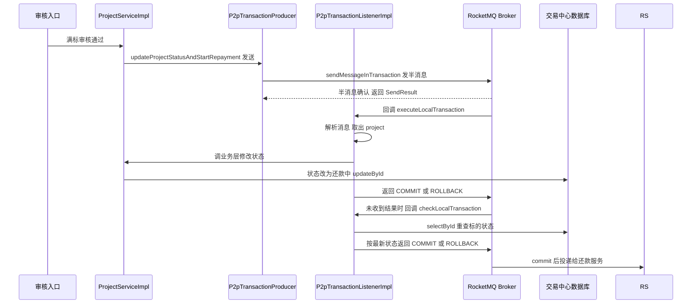

# 满标放款接入事务消息：交易中心的半消息发送与事务监听器

问题分析已经把账算清：交易中心改标的状态与还款服务生成还款计划是原子性绑定，解法是 RocketMQ 事务消息，方案图上第 22 步的空白等着被代码填上。编码从消息发送方交易中心开始，两个视频覆盖发送侧的全部改动：一个负责构造并发送事务消息的生产者，一个负责执行本地事务与事务回查的事务监听器，外加把状态修改逻辑从审核主流程里搬到业务层。写完这批代码，交易中心既是消息的生产者，又是事务结果的裁决者。

## 先给结论

- 接入前的两步检查：`rocketmq-spring-boot-starter` 依赖（版本 2.0.2）是否引入，Apollo 配置中心 `micro_service.rocketmq` 命名空间里生产者组与 NameServer 地址是否配置。
- 发送侧单独建生产者类，方法接收 `Project` 与 `ProjectWithTendersDTO` 两个参数，把两个业务对象打包进 JSON 构造消息，再用 `rocketMQTemplate.sendMessageInTransaction` 以事务消息方式发出。
- 发送方法的调用点就是审核方法里预留的位置：数据准备完毕后发消息，发完返回「审核成功」。
- 标的状态修改的既有代码从审核方法里剪切出来，搬进业务层独立方法，加 `@Transactional` 并指定 `rollbackFor`，它就是事务监听器要执行的本地事务。
- 事务监听器实现 `RocketMQTransactionListener` 接口，`executeLocalTransaction` 三步走（解析消息、执行本地事务、返回结果），`checkLocalTransaction` 重查标的状态给确定答案；回查直接查标的状态，无需再造事务日志表。

## 依赖与配置的两步检查

编码前先确认地基。`pom.xml` 里需要 RocketMQ 的 Spring Boot 启动器：

```xml
<dependency>
    <groupId>org.apache.rocketmq</groupId>
    <artifactId>rocketmq-spring-boot-starter</artifactId>
    <version>2.0.2</version>
</dependency>
```

配置方面，交易中心在 Apollo 上的 `micro_service.rocketmq` 命名空间此前已经配过，这一步是核对而非新写，两个键决定发送行为：

```properties
rocketmq.producer.group = producer_start_repayment
rocketmq.name-server = 127.0.0.1:9876
```

`rocketmq.name-server` 指向本机 RocketMQ，端口 9876 是 NameServer 的默认端口；`rocketmq.producer.group` 是生产者组名，它会在事务监听器的注解里再次出现，两处必须一致，原因后文展开。

配置放在 Apollo 的 `micro_service.rocketmq` 命名空间而不是工程内的 `application.properties`，取舍逻辑在于环境差异：开发、测试、生产的 NameServer 地址各不相同，配置中心统一管理可以按环境发布，代码零改动。启动器自动装配出 `RocketMQTemplate` 并按组名注册底层生产者实例，业务代码只面向模板编程，客户端的连接管理、序列化配置都被收进框架里，这也是选 starter 而不是裸用 RocketMQ 客户端的原因。

## 消息生产者：两个业务对象打包进一条消息

在交易中心的 `message` 包下新建生产者类，与讲义命名保持一致。方法名直译就是它的职责：修改标的状态并启动还款。

```java
/** 交易中心事务消息生产者 包名按 com.study.finance 系改写 */
@Component
public class P2pTransactionProducer {

    @Resource
    private RocketMQTemplate rocketMQTemplate;

    @Value("${rocketmq.producer.group}")
    private String txProducerGroup;

    public void updateProjectStatusAndStartRepayment(Project project,
            ProjectWithTendersDTO projectWithTendersDTO) {
        // 1 构造消息 两个业务对象打包进一个 JSON
        JSONObject object = new JSONObject();
        object.put("project", project);
        object.put("projectWithTendersDTO", projectWithTendersDTO);
        Message<String> msg = MessageBuilder
                .withPayload(object.toJSONString())
                .build();
        // 2 发送事务消息 半消息确认后由事务监听器接管
        SendResult sendResult = rocketMQTemplate.sendMessageInTransaction(
                txProducerGroup, "topic_start_repayment:tag_start_repayment", msg, null);
        log.info("事务消息发送结果 {}", sendResult.getLocalTransactionState());
    }
}
```

**两个参数为什么缺一不可。**`Project` 是标的信息，还款服务据此知道哪个标的要启动还款；`ProjectWithTendersDTO` 是满标放款功能实现时专门准备的标的加投资人明细对象，还款服务生成还款计划与应收明细全靠它逐条遍历投资记录。这两个对象恰好都是还款服务侧需要的输入，所以消息体里成对携带，打包方式与转账案例一样：`JSONObject` 组装键值，`MessageBuilder.withPayload` 把 JSON 字符串装进 Spring Messaging 的 `Message`，这是 `rocketmq-spring-boot-starter` 提供的消息抽象。

**`sendMessageInTransaction` 的四个参数。**第一个是生产者组名，从配置注入，事务监听器按这个名字找到自己；第二个是目的地，`topic:tag` 形式，topic 与还款服务消费监听器的 topic 必须逐字一致，命名可以自定义但两端要同步；第三个是消息本体；第四个是透传参数，本例不需要，传 `null`。方法返回 `SendResult`，其中的本地事务状态打印出来便于联调时确认半消息的走向。

与转账案例逐项对照，从注解到方法体几乎逐行同构，差异只有业务对象与目的地名字。这种「模板已验证、只换内容」的迁移方式，正是入门案例存在的意义。

发送类单独建而不是把发送逻辑内联进审核方法，还有两个工程上的理由。**其一，职责收口。**消息目的地的命名、消息体的打包结构，这些属于「对外协议」，集中在生产者类里维护，协议变更时只改一处；散落在业务方法里的发送代码迟早会因复制粘贴产生多个不一致的版本。**其二，可替换性。**将来如果通知内容扩展、目的地拆分，或者切换消息中间件，改动被限制在 `message` 包内，审核主流程感知不到。命名上方法名采用动词加宾语的完整拼法，长一点但见名知义，跨服务协作的代码宁可名字长也不要语义含糊。

## 把第 21 步搬进业务层

方案图上第 21 步「修改标的状态为还款中」的代码早已存在于审核方法里，现在它要换个位置：事务监听器执行本地事务时必须调用业务层方法，这段逻辑不能再长在审核流程的中间。业务层实现类里单独定义方法，把原有的两行状态修改代码剪切过来：

```java
/** 业务层实现 修改标的状态为还款中 包名按 com.study.finance 系改写 */
@Override
@Transactional(rollbackFor = BusinessException.class)
public Boolean updateProjectStatusAndStartRepayment(Project project) {
    // 标的状态改为还款中
    project.setProjectStatus(ProjectCode.REPAYING.getCode());
    return this.updateById(project);
}
```

三个细节值得停一下。**状态值不手写**：还款中对应的编码封装在 `ProjectCode` 里，取 `REPAYING.getCode()`，魔法字符串是状态字段出错的高发源头。**返回值保留布尔语义**：`updateById` 由 MyBatis-Plus 提供，返回修改是否生效，这个布尔值在监听器里直接决定 commit 还是 rollback。**注解显式指定 `rollbackFor`**：默认回滚规则对受检异常不生效，指定自定义业务异常后，任何路径的失败都能让本地事务回滚，回查才有「没改成」这个答案可查。

还有一处容易疏漏：方法定义在实现类的同时必须在业务层接口里补上声明。监听器注入的是接口类型，接口里没有这个方法就无法调用；声明式事务依赖代理对象，从接口走调用也保证了代理链路完整。实现类里补了方法却忘了接口声明，报错会先出现在监听器一侧，排查时容易绕远路。

## 事务监听器：执行本地事务与事务回查

交易中心要自己实现 RocketMQ 的事务监听接口，它承担两个回调。新建实现类，注解绑定的组名就是发送侧配置注入的那个 `producer_start_repayment`：

```java
/** 交易中心事务监听器 包名按 com.study.finance 系改写 */
@Slf4j
@Component
@RocketMQTransactionListener(txProducerGroup = "producer_start_repayment")
public class P2pTransactionListenerImpl implements RocketMQTransactionListener {

    @Autowired
    private ProjectService projectService;
    @Autowired
    private ProjectMapper projectMapper;

    /** 执行本地事务 半消息确认后由 Broker 回调 */
    @Override
    public RocketMQLocalTransactionState executeLocalTransaction(Message msg, Object arg) {
        log.info("执行本地事务 消息内容 {}", msg);
        // 1 解析消息 取出标的对象
        final JSONObject jsonObject =
                JSON.parseObject(new String((byte[]) msg.getPayload()));
        Project project = jsonObject.getObject("project", Project.class);
        // 2 执行本地事务 修改标的状态为还款中
        Boolean result = projectService.updateProjectStatusAndStartRepayment(project);
        // 3 返回执行结果
        if (result) {
            return RocketMQLocalTransactionState.COMMIT;
        } else {
            return RocketMQLocalTransactionState.ROLLBACK;
        }
    }

    /** 事务回查 Broker 未收到执行结果时定时回调 */
    @Override
    public RocketMQLocalTransactionState checkLocalTransaction(Message msg) {
        log.info("执行事务回查 消息内容 {}", msg);
        // 1 解析消息 取出标的对象
        final JSONObject jsonObject =
                JSON.parseObject(new String((byte[]) msg.getPayload()));
        Project project = jsonObject.getObject("project", Project.class);
        // 2 重查标的最新状态
        Project projectDb = projectMapper.selectById(project.getId());
        // 3 状态已是还款中说明本地事务执行成功
        if (projectDb != null
                && ProjectCode.REPAYING.getCode().equals(projectDb.getProjectStatus())) {
            return RocketMQLocalTransactionState.COMMIT;
        } else {
            return RocketMQLocalTransactionState.ROLLBACK;
        }
    }
}
```

`executeLocalTransaction` 的三步与转账案例的回查实现相互呼应：解析消息取数据、调用业务层、按结果返回状态。消息负载是发送侧打包的 JSON 字符串，以字节数组取出再反序列化，按 `project` 键拿到标的对象，交给业务层方法执行状态修改，布尔结果直接映射为 `COMMIT_MESSAGE` 语义的 `COMMIT` 与 `ROLLBACK`。

`checkLocalTransaction` 处理的是发送方失联的局面：本地事务执行完、确认结果没能送达 Broker（宕机、闪断、超时都可能），Broker 定时回调这个方法。它的回答策略比转账案例更简洁：转账案例靠事务日志表回答「做过没有」，满标放款里标的状态本身就是事实源，按标的 ID 重查一次，状态已经是还款中就证明本地事务成功，返回 commit；查不到或状态不对，返回 rollback。**不需要为回查再造一张表**，因为状态字段天然可查、天然与业务对齐，能省的表就省。前提条件只有一个：回查必须基于落库事实，不能凭内存或日志猜。

回查的实现细节里还有一处选择：重查状态直接注入 `ProjectMapper` 调 `selectById`，而不是走业务层。这不是偷懒，是刻意区分：回查要的是一条只读的、单表的、无副作用的查询，业务层方法带着事务注解、承载写语义，回查场景用不上反而增加代理开销。读操作直达 Mapper，写操作走业务层，读写两条路径泾渭分明，这个习惯在大型服务里能省掉很多不必要的事务嵌套问题。回查的触发频率与次数由 Broker 侧配置控制，默认策略下会持续追问直到拿到确定答案或消息超期，实现方只需要保证每次回调都能给出与落库一致的回答。

注解上组名一致性的原因至此也清楚了：`sendMessageInTransaction` 以组名发起事务，`@RocketMQTransactionListener` 以组名声明自己就是这组事务的裁决者，Broker 的回查请求按组名路由到监听器。两处名字对不上，回查会路由不到任何裁决者，事务消息悬在半消息状态。

## 接回审核主流程

生产者写完，回到审核方法里预留的调用点。此处数据准备早已完成：标的信息与投资人明细在满标审核流程里已经组装好，只欠发出。注入生产者并补上调用：

```java
// 预留的第 22 步 以事务消息方式通知还款服务启动还款
p2pTransactionProducer.updateProjectStatusAndStartRepayment(project, projectWithTendersDTO);
//审核成功
return "审核成功";
```

方法的下游分支保持原样：整个流程没有异常最终返回「审核成功」，分支不满足则抛出业务错误码对应的异常。要注意语义变化：这里的「审核成功」意味着审核操作与半消息发送完成，还款计划的生成已经交给异步链路，前端不再等待还款服务的执行结果。

调用点的上下文值得回放一遍。满标审核方法走到这一步之前，已经完成了存管侧放款结果核验、标的与投资人明细的数据组装，`projectWithTendersDTO` 就是那个阶段准备好、原打算直接发给还款服务的对象。现在它的去向改为进入消息体，先发往 RocketMQ。数据的准备逻辑一行未动，改变的只是「数据如何抵达下游」：同步 RPC 变成事务消息，而这一切对上游代码保持透明，改动面被压缩到最小。

这张图把交易中心一侧从审核入口到回查的完整代码路径串起来：



关键路径在中间的往返：发送方法发出半消息后立刻返回，真正的状态修改发生在 Broker 回调监听器之后，审核主流程与本地事务在时间上被解耦，在机制上由组名、目的地、回查协议绑成一体。commit 之后消息才进入可消费状态，还款服务一侧的消费与幂等实现是链路的下一段。

联调阶段这张图也是排查地图。审核返回成功但还款服务没动静，先看 RocketMQ 控制台的消息轨迹：半消息存在且已 commit，问题在消费侧；半消息存在但停在 Prepared，问题在监听器或回查路由，重点核对组名；压根查不到消息，问题在发送侧的 NameServer 地址或依赖装配。两个监听器方法里的日志打印就是为这类排查预留的观测点，按时间轴串起「发送确认、本地事务、回查、提交」四个时刻，链路状态一目了然。

## 常见误区

- **在发送方法里直接改状态再发消息。**错例：先 `updateById` 再 `sendMessageInTransaction`，以为一个方法里就是原子。正解：本地事务必须放在监听器的 `executeLocalTransaction` 里执行，半消息先行落库，消息存续与本地事务才绑定成一体。
- **监听器注解的组名与发送侧不一致。**错例：组名随手另起一个。正解：`txProducerGroup` 是 Broker 路由事务结果的钥匙，两处必须一致，否则回查无门、消息悬死。
- **回查实现里凭日志或内存判断。**错例：回查时打个日志返回 commit。正解：接住回查的可能是另一台实例，唯一可信的事实源是数据库，重查标的状态是唯一正确姿势。
- **忘记在业务层接口声明新方法。**错例：只在实现类里写方法，监听器注入接口对象后调不到。正解：接口补声明，同时保证事务代理链路完整。
- **把「审核成功」理解为还款计划已生成。**错例：前端收到成功提示就认为还款数据就绪。正解：成功只代表状态修改的本地事务进入提交轨道，计划生成为异步链路，监控应盯消息轨迹与还款服务日志。

## 面试可能被问到的问题

1. 面试官追问：「`sendMessageInTransaction` 与普通 `send` 的区别在哪？」
   答：普通发送是单向投递，消息发出即不可撤回；事务发送先落半消息、再由监听器执行本地事务、按结果 commit 或 rollback，还有回查兜底。发送方法的第一个参数是生产者组名，用于绑定裁决该事务的监听器。
2. 面试官追问：「为什么标的状态修改要挪到业务层独立方法？」
   答：它现在是事务监听器的本地事务，必须能被监听器以事务代理方式调用，同时审核主流程不再包含这段逻辑。独立方法配合 `@Transactional` 与 `rollbackFor`，回滚语义完整，回查时也有明确的落库结果可查。
3. 面试官追问：「回查为什么不需要事务日志表？」
   答：转账案例里扣款本身不留可查状态，只能靠日志表回答做过没有；满标放款的本地事务结果是标的状态字段，重查状态即可还原事实。回查实现的核心要求是基于落库事实给确定答案，用什么承载事实按业务而定。
4. 面试官追问：「`executeLocalTransaction` 返回 ROLLBACK 之后消息怎样？」
   答：Broker 删除这条半消息，消费端永远收不到；本地事务已随返回前的异常或失败回滚，两侧一致。若本地事务实际成功而返回的是 ROLLBACK，就是代码 bug，回查机制对此无能为力，裁决结果的正确性由实现者负责。
5. 面试官追问：「消息体为什么用 JSON 字符串打包两个对象？」
   答：一次事务要携带标的信息与投资人明细两类输入，JSON 键值结构灵活、两端解析成本低，调试时消息内容可直接打印比对。键名是两端约定，消费侧按键取值，改名必须同步。
6. 面试官追问：「审核接口返回成功时，用户看到的语义是什么？」
   答：审核通过且标的状态进入还款中的提交轨道，启动还款的消息已可靠受理。还款计划生成是异步进行，秒级延迟属正常，前端不等待，这正是选可靠消息方案的初衷。
7. 面试官追问：「为什么消息体里要带上 ProjectWithTendersDTO 而不是让还款服务自己查？」
   答：标的与投资人明细是审核流程已核验的数据快照，随消息携带保证还款服务基于同一份事实计算，也避免了跨服务回查放大调用量。数据快照与消息一体落库在 Broker，天然具备可重放性。

## 配套资料

- 讲义：`materials/docs/10/万信金融-第4章-投标放款v1.0.md`，3.3 分布式事务：满标放款需使用 RocketMQ 事务消息实现最终一致性事务的指引。
- 讲义：`materials/docs/10/day16-项目总结&就业指导v1.0.md`，3.4.3 事务消息机制步骤与满标放款选型分析。
- 代码：`materials/code/10/rocketmq-all-4.5.0-bin-release/` 与 `materials/code/10/rocketmq-console/`，RocketMQ 发行包与控制台，联调时可观察半消息与消息轨迹。
- 交易中心的完整源码不在本课资料包内，文中代码为按本课画面与写法补全的示例，包名按 `com.study.finance` 系改写；依赖坐标、Apollo 配置键与类名、方法名均与本课讲义保持一致。
