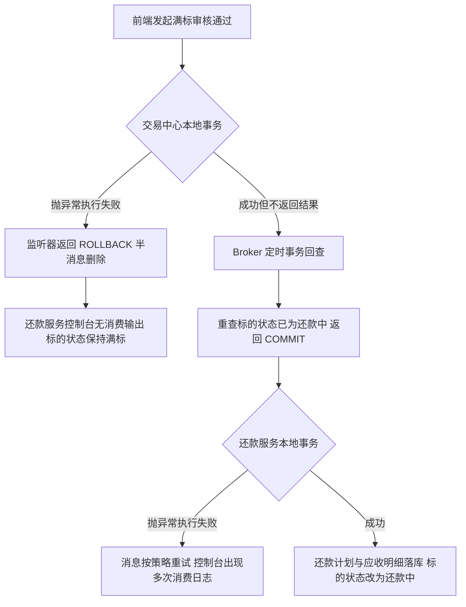

# 满标放款事务消息的消费方：还款服务监听器与端到端功能测试

交易中心的发送侧已经就位：半消息发出去了，本地事务在监听器里执行，回查也有了落库答案。但方案图上这条链路还差最后一环，commit 之后的消息要有人接住。接的人是还款微服务，它要做两件事：消费 `topic_start_repayment` 上的消息，然后在消费回调里执行自己的本地事务，即生成还款计划与投资人应收明细。代码写完并不代表问题解决，满标放款的分布式事务到底被可靠消息方案兜住了没有，还要靠一轮覆盖失败场景的功能测试来回答。

## 先给结论

- 还款服务的消费监听器实现 `RocketMQListener<String>` 接口，`topic` 与 `consumerGroup` 两个属性必须与发送侧约定逐字一致；消费组是消费方的身份标识，与生产者组是两回事，不能照抄。
- `onMessage` 方法只做两步：解析消息按 `projectWithTendersDTO` 键取出标的与投资人明细，调用业务层 `startRepayment` 执行本地事务。
- 生成还款计划与应收明细是多次数据库写操作，业务层方法必须补上 `@Transactional(rollbackFor = BusinessException.class)`，否则消费方就没有真正的本地事务。
- 幂等控制不新造防重表：给 `repayment_plan` 表加 `CONSUMER_ID + PROJECT_ID + NUMBER_OF_PERIODS` 的组合唯一索引，重复消息插入重复数据时直接被数据库拒绝。
- 功能测试按四种情况推演：发送方本地事务失败、事务成功但不返回结果触发回查、消费方本地事务失败引发消息重试、全部成功后核对三处落库结果。

## 消费方要做的两件事

消息接收方的职责清单很短：接收消息、执行本地事务。执行本地事务这一半其实早就写好了，还款服务在满标放款功能实现阶段就完成了 `startRepayment` 方法，里面包括计算还款月数、按等额本息算法生成借款人还款计划、逐个投资人生成应收明细并落库。当时它是被同步调用链调用的普通业务方法，如今它的调用方换成了消息监听器，语义也随之升级为 RocketMQ 事务消息的消费侧本地事务。

真正的新代码只有监听器。与转账案例的套路一致：单独定义一个消息消费类，实现 RocketMQ 的监听接口，收到消息后解析，再调用业务层。还款服务此前没有 `message` 包，这一次新建，消息协议相关的类集中在这一个包里维护。

## 消费监听器：解析消息并调用业务层

新建 `StartRepaymentMessageConsumer` 类。监听器的注解里有两个值要特别当心：

```java
/** 还款服务事务消息消费监听器 包名按 com.study.finance 系改写 */
@Slf4j
@Component
@RocketMQMessageListener(
        topic = "topic_start_repayment",
        consumerGroup = "consumer_start_repayment")
public class StartRepaymentMessageConsumer implements RocketMQListener<String> {

    @Autowired
    private RepaymentService repaymentService;

    /** 收到消息 解析并执行本地事务 */
    @Override
    public void onMessage(String projectStr) {
        log.info("消费消息 {}", projectStr);
        // 1 解析消息 取出标的与投资人明细
        JSONObject jsonObject = JSON.parseObject(projectStr);
        ProjectWithTendersDTO projectWithTendersDTO = JSON.parseObject(
                jsonObject.getString("projectWithTendersDTO"),
                ProjectWithTendersDTO.class);
        // 2 调用业务层执行本地事务 生成还款计划与应收明细
        repaymentService.startRepayment(projectWithTendersDTO);
    }
}
```

**第一，topic 与发送侧逐字一致。**交易中心发送时目的地写的是 `topic_start_repayment:tag_start_repayment`，监听器的 `topic` 属性必须与之对应，消息才能路由到这个消费类。讲义里给出的写法是大写的 `TP_START_REPAYMENT` 与 `CID_START_REPAYMENT`，两种拼法都对，工程里关键是两端用同一套命名风格并保持一致，命名本身可以自定义。

**第二，consumerGroup 不是生产者组。**转账案例里曾强调过这个易混点：`consumerGroup` 标识的是一组消费者实例，用于 Broker 侧的负载均衡与重试管理，它与发送侧 `@RocketMQTransactionListener` 绑定的 `producer_start_repayment` 毫无关系。随手把生产者组名抄过来当消费组，编译运行都不报错，但多实例部署时消费行为会变得难以解释。

**第三，泛型直接写 String。**发送侧把两个业务对象打包成 JSON 字符串放进消息负载，消费侧收到的就是这个字符串，`onMessage` 的参数即消息原文。解析按键取值：`projectWithTendersDTO` 这个键是发送侧 `JSONObject.put` 时定下的约定，消费侧按键反序列化出 `ProjectWithTendersDTO`，标的加投资人明细一次拿全，生成还款计划与应收明细的全部输入都在这一个对象里。

## 本地事务的最后一道封条：@Transactional

业务层方法早已存在，但作为「消息消费方的本地事务」，它缺一个事务注解。生成还款计划要写 `repayment_plan` 表，生成应收明细要写 `receivable_plan` 相关表，多次写操作必须同生共死，这正是本地事务的定义：

```java
/** 业务层实现 启动还款 即消费方的本地事务 包名按 com.study.finance 系改写 */
@Override
@Transactional(rollbackFor = BusinessException.class)
public String startRepayment(ProjectWithTendersDTO projectWithTendersDTO) {
    // 1.1 标的信息
    ProjectDTO projectDTO = projectWithTendersDTO.getProject();
    // 1.2 投资人明细
    List<TenderDTO> tenders = projectWithTendersDTO.getTenders();
    // 1.3 还款方式 只处理等额本息
    String repaymentWay = projectDTO.getRepaymentWay();
    if (repaymentWay.equals(RepaymentWayCode.FIXED_REPAYMENT.getCode())) {
        // 1.4 按等额本息算法生成还款计划
        EqualInterestRepayment fixedRepayment = RepaymentUtil.fixedRepayment(
                projectDTO.getAmount(), projectDTO.getPeriod(), projectDTO.getTenders());
        // 1.5 按投资人生成并保存应收明细
        tenders.forEach(tenderDTO -> {
            List<RepaymentPlan> planList = saveRepaymentPlan(projectDTO, fixedRepayment);
            planList.forEach(plan -> tenderDTO.receipt(plan));
        });
    }
    return DepositoryReturnCode.RETURN_CODE_00000.getCode();
}
```

注解照旧显式指定 `rollbackFor`。默认回滚规则只对运行时异常生效，指定业务异常类型后，业务校验抛出的受检异常也能触发回滚，消费失败时方法内已执行的插入会一并撤销，RocketMQ 拿到的就是「本地事务没成功」的事实，随后按重试策略再次投递。去掉这个注解，方法照样能跑，多次写操作却各自提交，一次中途失败就会留下半套数据，而且消息侧完全无从感知。

方法末尾返回存管返回码 `RETURN_CODE_00000`，沿用了满标放款阶段既有的返回约定；对消息监听器而言这个返回值并不参与裁决，真正的裁决信号是方法是否抛出异常。

## 幂等控制：组合唯一索引替代防重表

RocketMQ 的消费语义是至少一次，同一条消息可能被投递多次：消费方处理成功但提交消费位点的时机不巧、消费方处理超时被 Broker 重新投递，都会造成重复消费。转账案例为此专门建了一张事务日志表，用「记录存在与否」判断消息是否处理过。这次遇到同样的问题，思路却可以更轻。

幂等的本质诉求是防止重复执行造成重复数据。`startRepayment` 的重复执行会做什么？把同一批还款计划、同一批应收明细再往表里插一遍。既然如此，让数据库自己拒绝重复插入就够了：给 `repayment_plan` 表加一个组合唯一索引。

```sql
USE p2p_repayment;
ALTER TABLE repayment_plan
ADD UNIQUE INDEX plan_unique (CONSUMER_ID, PROJECT_ID, NUMBER_OF_PERIODS);
```

三个字段的选取值得琢磨：`CONSUMER_ID` 是借款人标识，`PROJECT_ID` 是标的标识，`NUMBER_OF_PERIODS` 是期数。借款人对同一标的的同一期，在整个系统里只允许有一条还款计划，这三者组合恰好构成业务上的天然主键。只挑一个或两个字段都不行，借款人可以借多个标的，一个标的又分十二期，单字段约束要么拦不住重复、要么误伤正常数据。

索引名 `plan_unique` 可自定义。执行这条 DDL 还有个小坑值得记下：从 PDF 讲义复制 SQL 时可能夹带不可见字符，执行报语法错误时先检查标点，或者干脆手写一遍；索引名重复也会报错，换个名字重新执行即可。这个方案零 Java 代码、零新表，重复消息到达时 `insert` 直接抛唯一约束冲突，本地事务回滚，消费按失败重试，最终结果始终一致。测试环节会验证它是否真的生效。

## 功能测试：四种情况的完整推演

代码齐了，进入前后端集成测试。业务越来越复杂，准备工作也要列清单：交易中心、还款服务等本阶段涉及的微服务全部启动，前端工程启动，RocketMQ 的 NameServer 与 Broker 必须在运行状态，分布式事务全靠它协调；测试数据还原成规范状态，保证借款人、标的信息有效。

Apollo 配置上有一处容易被忽略的检查项。满标放款要用等额本息算法计算还款数据，交易中心命名空间里三个利率配置必须有效：

```properties
# 借款人年化利率
borrower.annual.rate = 0.05
# 借款人佣金年化利率
commission.borrower.annual.rate = 0.02
# 投资人佣金年化利率
commission.investor.annual.rate = 0.01
```

三个值既不能为空也不能为 0，否则算法环节直接报错。取值不必与示例完全一致，规范即可。

测试沿发送方本地事务、事务回查、消费方重试、全链路成功四条路径推进，这张图概括了每种情况的判定标志：



关键分支在中间：回查拿不到显式答案时，Broker 会反复追问，直到监听器给出与落库一致的结果；消费失败的消息同样由 Broker 重新投递，两种兜底共用「消息不丢、结果对齐」这一套逻辑。

**情况一，发送方本地事务失败。**在交易中心的 `updateProjectStatusAndStartRepayment` 方法里临时加一行除零异常制造失败，重启交易中心微服务，在前端对满标标的状态的借款项目点击审核通过。观察两处：还款服务控制台应当没有任何消费日志，因为发出去的是半消息，本地事务失败后监听器返回 rollback，消息被删除，永远不会进入可消费状态；标的状态应当保持原值不变，证明本地事务确实回滚了。发送方失败，下游无感，这正是事务消息要保证的第一半。

**情况二与情况三合并测试。**这两种情况联系紧密，可以一次覆盖。交易中心侧改造：去掉情况一的异常，让本地事务正常执行成功，但在返回执行结果之前再抛一次异常，导致监听器既没有返回 commit 也没有返回 rollback，Broker 等待超时后发起事务回查。还款服务侧改造：在 `startRepayment` 方法末尾加除零异常，让消费方本地事务失败。重启两侧微服务，前端重新触发审核，然后盯两处控制台：交易中心出现回查日志，说明 Broker 的定时追问抵达了监听器，回查重查标的状态后返回 commit；还款服务出现不止一次「消费消息」输出，时间间隔由 Broker 的重试策略决定，说明失败消息在按预期重投。两边日志齐备，两种情况同时验证通过。

**情况四，全部成功。**把两侧临时加的异常代码全部删掉，重启微服务，把标的状态手工还原成满标，再次在前端审核通过。等待链路跑完后核对三处数据：`repayment_plan` 表应有 12 条记录，对应 12 期借款人的还款计划；应收明细表应有 60 条记录，5 个投资人乘以 12 期，每人每期一条；标的状态变为还款中对应的编码。审核接口返回成功与表里出现数据之间存在秒级延迟属正常现象，本地事务由 Broker 回调异步执行，前端提示出现后立刻查表查不到，稍等几秒再看即可。

三种失败与成功路径全部符合预期，满标放款的分布式事务问题至此闭环：交易中心的标的状态修改与还款服务的计划生成，两个跨库事务由一条事务消息绑定成「要么都成、要么重试到都成」的整体。

## 满标放款专题的收官复盘

回头串一遍第四章的完整脉络，这条业务链从用户投标开始：投资人投标、投标结果同步存管，标的金额凑满进入满标状态；管理平台执行满标审核，交易中心先到存管侧确认放款结果，再组装标的与投资人明细，原来打算直接同步调用还款服务生成还款计划，由此引出跨服务的分布式事务问题；随后转向 RocketMQ 可靠消息最终一致性方案，交易中心改造成消息发送方，还款服务改造成消息消费方；到本课消费监听器与功能测试完成，链路上每一环都有了落库验证。

复盘时有三条经验值得沉淀。**其一，方案先于代码。**方案图上把每一步编号，消息发送、本地事务、回查、消费各占一行，编码时逐行填空，测试时按编号核对，十四个视频的改动始终没有偏离最初的图纸。**其二，模板迁移优于凭空设计。**转账入门案例验证过的生产者、监听器、回查三板斧，换掉业务对象与目的地就能复用，满标放款的实现几乎是对模板的逐行套用。**其三，测试按失败场景设计。**全链路成功只是底线，发送方失败、回查触发、消费重试三种异常路径各有一个可观测的判定标志，场景清单在编码阶段就列出，测试时只做验证不做探索。

这三条经验在下一章会立即派上用场：用户还款的确认还款环节存在与满标放款同构的分布式事务问题，解法依旧是 RocketMQ 事务消息，只是消息的接收方这次换成了发送方自己。

## 常见误区

- **把生产者组抄进 consumerGroup。**错例：`@RocketMQMessageListener` 的消费组直接写 `producer_start_repayment`。正解：消费组标识一组消费者实例，与生产者组各自独立命名，混用不影响编译但会干扰 Broker 的重试与负载分配。
- **以为业务方法能跑就不需要事务注解。**错例：`startRepayment` 不加 `@Transactional`，中途失败留下半套数据。正解：消费回调里执行的是多次写操作，显式注解加 `rollbackFor` 才构成完整本地事务，回滚结果才能驱动消息重试。
- **唯一索引只建单字段。**错例：只对 `PROJECT_ID` 建唯一索引，一个标的十二期直接冲突。正解：借款人、标的、期数三字段组合唯一，与业务语义对齐才能既防重复又不误伤。
- **审核通过后立刻查表核对数据。**错例：前端提示成功即去查 `repayment_plan`，查不到就认定失败。正解：本地事务异步执行，秒级延迟正常，按控制台日志与消息轨迹确认进度。
- **测试完不清理临时异常代码。**错例：除零异常留在方法里直接提交。正解：测试代码集中标注、测完即删，回归前先重读 diff。

## 面试可能被问到的问题

1. 面试官追问：「消息消费方为什么不用实现事务监听接口，只要实现 RocketMQListener？」
   答：事务裁决只发生在发送方，回查也只路由给生产者组的监听器。消费方拿到的是已 commit 的普通消息，只需实现 `RocketMQListener` 的 `onMessage` 做业务处理；它的可靠性由 Broker 的重投机制与自身幂等保证。
2. 面试官追问：「消费方幂等用唯一索引，和用事务日志表各有什么优劣？」
   答：唯一索引零代码、依赖数据库约束，适合写入结果能构成业务唯一键的场景；事务日志表通用性强，适合无天然唯一键的业务，代价是多一张表和一套读写逻辑。能靠业务唯一键时优先选唯一索引，简单直接。
3. 面试官追问：「消费失败后 RocketMQ 怎么处理这条消息？」
   答：本地事务回滚后消费结果按失败处理，Broker 按重试策略延时重新投递，默认次数用尽后进入死信队列。工程上要保证重投期间业务幂等，唯一索引在这里正好兜住重复插入。
4. 面试官追问：「为什么组合唯一索引选了借款人、标的、期数三个字段？」
   答：还款计划的业务唯一性就是这三者的组合，借款人对某标的的某期只应有一条计划。选字段要从业务语义出发，保证「重复业务数据」必然命中约束，「正常业务数据」必然不冲突。
5. 面试官追问：「审核接口返回成功但表里没数据，算不算 bug？」
   答：不算。返回成功只代表审核与半消息受理完成，还款计划的生成在异步链路中，秒级延迟正常。判断是否异常应看 RocketMQ 消息轨迹与两个服务的控制台日志，而不是前端响应时间。
6. 面试官追问：「测试发送方本地事务失败时，为什么标的状态不变就能证明回滚？」
   答：状态修改就是该场景的本地事务，事务失败理应回滚到原值。验证回滚要选一个落库可见的事实作为观测点，标的状态字段就是这个事实，比只看日志更可信。

## 配套资料

- 讲义：`materials/docs/10/万信金融-第4章-投标放款v1.0.md`，3.3 分布式事务：满标放款使用 RocketMQ 事务消息实现最终一致性事务的指引。
- 讲义：`materials/docs/10/day16-项目总结&就业指导v1.0.md`，事务消息机制步骤与本项目分布式事务选型的汇总口径。
- 代码：`materials/code/10/rocketmq-all-4.5.0-bin-release/` 与 `materials/code/10/rocketmq-console/`，RocketMQ 发行包与控制台，观察半消息状态与消息轨迹用。
- 还款微服务的完整源码不在资料包内，消费监听器与幂等索引相关代码按本课画面与讲义示例补全，包名按 `com.study.finance` 系改写；topic、消费组与索引字段命名均与本课保持一致，讲义原文写作 `TP_START_REPAYMENT`、`CID_START_REPAYMENT`。
