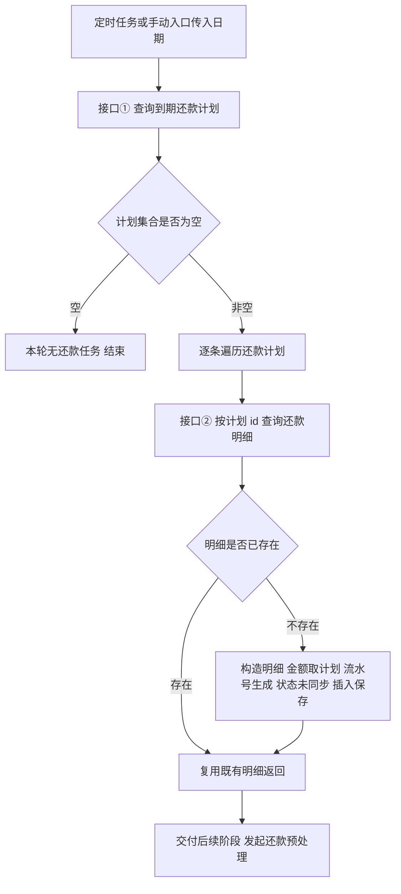

# 还款第一阶段实现：到期还款计划查询与还款明细生成

需求分析把用户还款切成了四个阶段，编码从第一阶段开始：图中 1.1 与 1.2 两步，先查询到期的还款计划，再根据计划生成还款明细。这两个动作对应两个接口，接口不经过 Controller 组织，全部落在业务层；查询条件里藏着日期格式化的细节，生成明细则要先查重再落库。三个视频覆盖这两个接口的定义与实现，第一阶段做完，第二阶段的还款预处理就有了输入。

## 先给结论

- 两个接口都定义在业务层 `RepaymentService` 接口里：`selectDueRepayment(String date)` 查询到期还款计划，`saveRepaymentDetail(RepaymentPlan)` 生成并保存还款明细。
- 查询条件有两个：应还时间等于传入日期、还款状态等于 0（待还）；前者传参，后者固定写死。
- 数据访问层用 `@Select` 注解 SQL 而非 MyBatis-Plus 的 API：`DATE_FORMAT` 要把 `DATETIME` 字段格式化成 `yyyy-MM-dd` 再做相等比较，手写 SQL 更灵活。
- 生成明细前先按 `REPAYMENT_PLAN_ID` 查重，查到即复用返回，查不到才构造对象插入；这个「先查后插」与唯一索引共同构成第一阶段的幂等保障。
- 明细的四个关键字段各有来源：本息金额取自还款计划、实际还款时间取当前时间、请求流水号由 `CodeNoUtil` 按 `REQ_` 前缀生成、状态初始化为未同步。

## 两个接口为什么定义在业务层

需求分析时交代过一个前提：用户还款与前端无关，触发源是定时任务。由此带来接口形态的变化。此前每个功能都从 Controller 接口开始定义，前后端约定 URL 与参数；这一章的接口没有前后端约定可谈，所谓「接口」就是业务层接口，供定时任务入口或后续阶段的方法调用。

两个接口的职责边界如下。接口①回答「今天该给谁扣款」：按日期查询所有到期的还款计划，返回计划集合。接口②回答「这一期怎么执行」：根据单条还款计划生成还款明细并保存，返回明细对象。返回明细对象而非布尔值，是因为后续阶段还要用明细里的请求流水号与状态字段发起存管侧的预处理请求，生成即复用，避免二次查询。

定义先于实现，先把两个方法声明写进 `RepaymentService` 接口：

```java
/** 业务层接口 还款第一阶段两个接口 包名按 com.study.finance 系改写 */
public interface RepaymentService {

    /**
     * 查询所有到期的还款计划
     * @param date 格式：yyyy-MM-dd
     * @return
     */
    List<RepaymentPlan> selectDueRepayment(String date);

    /**
     * 根据还款计划生成还款明细并保存
     * @param repaymentPlan
     * @return
     */
    RepaymentDetail saveRepaymentDetail(RepaymentPlan repaymentPlan);
}
```

接口①只有一个日期参数，注释里明确了格式 `yyyy-MM-dd`，年月日之间用连字符连接，这个格式约定马上会体现在 SQL 里。返回集合是因为到期计划一定不止一条：平台每天要还款的借款人以批量计，一次查询命中一批计划。接口②的参数是单条还款计划，按计划逐条生成明细，天然与第一阶段的批量查询衔接成「查一批、逐条处理」的循环。

## 接口①：从 Mapper 到 @Select 注解 SQL

查询到期还款计划是一个明确的数据库操作，先到数据访问层。还款服务里还没有操作 `repayment_plan` 表的 Mapper，新建 `PlanMapper` 接口并定义查询方法：

```java
/** 借款人还款计划 Mapper 接口 包名按 com.study.finance 系改写 */
public interface PlanMapper extends BaseMapper<RepaymentPlan> {

    /**
     * 查询所有到期的还款计划
     * @param date 格式：yyyy-MM-dd
     * @return
     */
    @Select("SELECT * FROM repayment_plan WHERE DATE_FORMAT(SHOULD_REPAYMENT_DATE, '%Y-%m-%d') = #{date} " +
            "AND REPAYMENT_STATUS = '0'")
    List<RepaymentPlan> selectDueRepayment(String date);
}
```

**为什么不用 MyBatis-Plus 的条件构造器。**此前的增删改查几乎都靠继承 `BaseMapper` 与 `LambdaQueryWrapper` 完成，这次选择手写 SQL，原因在查询条件本身。应还时间字段是 `DATETIME` 类型，存的是某天零点加时分秒的完整时间值，而传入的参数只有年月日；直接用 `eq(SHOULD_REPAYMENT_DATE, date)` 永远等不上，必须先把字段值格式化成 `yyyy-MM-dd` 再比较。MyBatis-Plus 的条件构造器表达「函数处理后的字段」比较别扭，手写 SQL 一行 `DATE_FORMAT` 就解决了，日期处理场景下手写反而更灵活。

SQL 里两个条件各有一个细节。`DATE_FORMAT(SHOULD_REPAYMENT_DATE, '%Y-%m-%d')` 的格式串按 MySQL 的约定书写，`%Y` 四位年、`%m` 两位月、`%d` 两位日，与 Java 侧传入的 `yyyy-MM-dd` 逐位对应。`REPAYMENT_STATUS = '0'` 的 0 带引号，因为该字段是字符类型不是数字类型，写成数字 0 部分数据库能隐式转换，但会失去索引命中能力，字符字段配字符字面量才是干净写法。状态值固定为 0，即只查待还的计划，已还与部分还款的记录不进入本轮还款。

业务层实现是对 Mapper 的一行转发：

```java
/** 业务层实现 查询到期还款计划 包名按 com.study.finance 系改写 */
@Override
public List<RepaymentPlan> selectDueRepayment(String date) {
    return planMapper.selectDueRepayment(date);
}
```

实现类里注入 `PlanMapper`，把日期参数原样传递。业务层暂无附加逻辑，但转发层的存在让后续扩展有处安放，比如叠加分页、按借款人过滤，都从这层改起，不必动接口签名。

状态条件固定写死在 SQL 里而不作为方法参数，同样是刻意的选择。到期还款计划的查询语义由业务规则决定：进入还款流程的计划必须是待还状态，这条规则对一切调用方成立，不存在「查已还计划」的正当场景。把不变的规则写进 SQL，把变化的事实（日期）留给参数，接口的调用面就收敛到最小，调用方既不能传错状态，也不能绕过状态过滤拿到已还款的计划。规则内聚在数据访问层，接口签名保持一个参数，这是「约定优于配置」在查询接口上的具体落地。

## 先在数据库里验证查询语义

SQL 写进注解之前，先在数据库客户端里把查询语义跑一遍是个值得保留的习惯。用一条真实数据手动执行：

```sql
SELECT * FROM repayment_plan
WHERE DATE_FORMAT(SHOULD_REPAYMENT_DATE, '%Y-%m-%d') = '2024-04-15'
  AND REPAYMENT_STATUS = '0';
```

执行结果应当只返回应还时间落在该日期、且状态为待还的计划。日期参数换成别的值，结果集跟着变化；状态条件去掉，已还款的记录混入结果集，这条对比能直观证明两个条件各自的作用。验证之后再固化到 `@Select` 注解里，SQL 逻辑出错的可能性就被压到最低。满标放款阶段落库的 12 条计划按每月一个还款日排列，任意选一个日期执行，命中的应该是全体借款人在当月到期的计划条数，结果集形状符合预期，查询语义即告确认。

## 接口②：先查重再生成

生成还款明细是「增」操作，但它多了半步前置判断。每个还款计划对应一条还款明细，而明细可能已经存在：定时任务重复调度、手动触发入口被连续点击、上一轮执行中断后重跑，都会让同一条计划第二次走到生成环节。重复生成意味着重复插入，明细里的请求流水号还会是新的值，对账时出现两笔执行单指向同一期还款。

所以实现拆成两步：先按还款计划 ID 查询明细是否存在，存在则直接返回既有记录，不存在才构造并保存。数据访问层新建操作 `repayment_detail` 表的 Mapper，继承 `BaseMapper` 即可，通用增删改查已够用：

```java
/** 操作还款明细表的 Mapper 接口 包名按 com.study.finance 系改写 */
public interface RepaymentDetailMapper extends BaseMapper<RepaymentDetail> {
}
```

业务层实现是第一阶段的核心方法：

```java
/** 业务层实现 生成并保存还款明细 包名按 com.study.finance 系改写 */
@Override
public RepaymentDetail saveRepaymentDetail(RepaymentPlan repaymentPlan) {
    // 1 根据还款计划 id 查询是否已存在还款明细
    RepaymentDetail repaymentDetail = repaymentDetailMapper.selectOne(
            Wrappers.<RepaymentDetail>lambdaQuery()
                    .eq(RepaymentDetail::getRepaymentPlanId, repaymentPlan.getId()));
    // 2 不存在才生成保存 存在则复用返回
    if (repaymentDetail == null) {
        repaymentDetail = new RepaymentDetail();
        // 还款计划项标识
        repaymentDetail.setRepaymentPlanId(repaymentPlan.getId());
        // 实还本息 金额取自还款计划
        repaymentDetail.setAmount(repaymentPlan.getAmount());
        // 实际还款时间
        repaymentDetail.setRepaymentDate(LocalDateTime.now());
        // 请求流水号
        repaymentDetail.setRequestNo(
                CodeNoUtil.getNo(CodePrefixCode.CODE_REQUEST_PREFIX));
        // 未同步
        repaymentDetail.setStatus(StatusCode.STATUS_OUT.getCode());
        // 保存数据
        repaymentDetailMapper.insert(repaymentDetail);
    }
    return repaymentDetail;
}
```

**查询条件不是主键。**`selectOne` 按 `RepaymentDetail::getRepaymentPlanId` 相等查询，这是明细表里的外键语义字段，不是 `ID` 主键。用 Lambda 条件构造器封装相等判断，编译期即可校验字段引用，重命名时编译器会直接报错，比字符串列名安全。`Wrappers.lambdaQuery` 的泛型写法指明操作实体为 `RepaymentDetail`，`eq` 的第一个参数是方法引用形式的字段定位，第二个参数是比对值。这个写法在统一账户、交易中心阶段已经反复使用，属于本项目的标准查询姿势；`selectOne` 在命中多条时抛出异常，恰好把「一个计划对应一份明细」的不变量变成可检测的约束，数据一旦异常立刻暴露而不是被悄悄吞掉。

**四个字段的赋值来源对应四种语义。**`amount` 从还款计划的应还本息直接取值，明细金额必须与计划金额一致，这是后续与银行对账的锚点；`repaymentDate` 取当前时间，表示这条执行单的生成时刻，真实还款完成时间由确认还款阶段回写；`requestNo` 是整个请求链路的身份证，后续每一次与存管代理服务的交互都携带它，由流水号工具按前缀生成；`status` 初始化为未同步，表示本地已记账、存管侧尚无动作，这个状态在第二阶段冻结成功后由「未同步」推进，确认还款阶段再更新为已同步。

**流水号工具是公共模块里的既有资产。**`CodeNoUtil.getNo` 接收编码前缀枚举，拼接 UUID 去掉连字符后的大写串，`REQ_` 前缀标识请求流水号业务。该工具类在本项目公共模块中的真实实现如下（包名按 `com.study.finance` 系改写）：

```java
/** 流水号生成工具 包名按 com.study.finance 系改写 */
public class CodeNoUtil {

    /**
     * 使用 UUID 生成编码
     * @param prefixCode 前缀用于标识不同业务 已用枚举类型规定业务名称
     * @return java.lang.String
     */
    public static String getNo(CodePrefixCode prefixCode) {
        return prefixCode.getCode()
                + UUID.randomUUID().toString().replaceAll("-", "").toUpperCase();
    }
}
```

前缀枚举 `CodePrefixCode` 中已备好 `CODE_REQUEST_PREFIX`（`REQ_`）与用户编码、标的号等常量，直接取用，不必新造。全局唯一的流水号让明细可以被幂等地追溯：即便并发场景下两个线程同时查重失败、各自插入一条明细，两条例外明细也能靠唯一约束或后续对账被发现，单靠「先查后插」不够时，配合数据库唯一索引兜底才是完整方案。流水号的前缀机制还有一层查询红利：`REQ_` 开头的字符串在交易记录表里一眼可辨，联调排查时按前缀过滤就能把一次还款的全部关联记录串起来，这在满标放款的功能测试里已被反复验证。

## 还款明细表与实体类

接口②落库的目标表 `repayment_detail` 字段不多，每个字段都为后续阶段服务。实体类与表结构按本课画面还原，对应关系如下：

```java
/** 还款明细实体 关键字段 包名按 com.study.finance 系改写 */
@Data
@TableName("repayment_detail")
public class RepaymentDetail {

    //主键
    @TableId
    private Long id;

    //还款计划标识
    @TableField("REPAYMENT_PLAN_ID")
    private Long repaymentPlanId;

    //实还本息
    @TableField("AMOUNT")
    private BigDecimal amount;

    //实际还款时间
    @TableField("REPAYMENT_DATE")
    private LocalDateTime repaymentDate;

    //请求流水号
    @TableField("REQUEST_NO")
    private String requestNo;

    //可用状态
    @TableField("STATUS")
    private Integer status;
}
```

六个字段，四个承担业务语义。`repaymentPlanId` 是明细与计划的关联键，查重与对账都靠它；`amount` 用 `BigDecimal` 承载金额，金融数据不能用浮点类型，精度丢失会直接造成账务差错；`repaymentDate` 用 `LocalDateTime` 承载时间，MyBatis-Plus 对 Java 8 时间类型的映射开箱即用；`requestNo` 是跨服务链路的关联键；`status` 承载同步状态机。实体注解沿用 MyBatis-Plus 的常规写法，`@TableName` 绑表、`@TableField` 绑列，列名大写与数据库建表风格一致。

第一阶段执行到哪一步，状态就走到哪一步，这张图把两个接口的衔接画了出来：



关键节点在右侧的查重分叉：存在即复用，保证同一期还款在任何重试与重复调度下只产生一份执行单；生成的明细带着未同步状态向下传递，第二阶段的冻结请求以它为输入，接口编号与状态语义就此接上。

## 第一阶段的定位：为后续阶段备好执行单

单看第一阶段，功能只是「查一批计划、生成一批明细」，没有资金动作，也不跨服务。它的价值要在后续阶段的对照下才显出来：第二阶段发起还款预处理时，冻结金额取自明细的 `amount`，请求流水号取自明细的 `requestNo`；确认还款阶段要更新明细状态为已同步，定位依据还是 `requestNo`。第一阶段的每一次赋值，都是在为后面的跨服务请求准备参数。

三个视频的工作量也可以对齐复盘：第一个视频定义两个业务层接口的签名与注释，格式约定 `yyyy-MM-dd` 在注释里就固定下来；第二个视频实现接口①，`PlanMapper` 加 `@Select` SQL，业务层一行转发；第三个视频实现接口②，新建 `RepaymentDetailMapper`，查重、构造、赋值、插入四步完成明细落库。实现顺序先查后增，与依赖方向一致：接口②的输入是接口①的输出，接口②的输出是第二阶段的输入。

到这里第一阶段的功能边界就完整了。下一课把三段代码接上一个临时触发入口，用一条请求验证「查询加生成」的批量链路，再往后进入第二阶段，通过 Feign 调存管代理服务冻结借款人应还金额。

## 常见误区

- **日期比较不做格式化。**错例：`WHERE SHOULD_REPAYMENT_DATE = #{date}`，`DATETIME` 字段与 `yyyy-MM-dd` 字符串永不相等，查询恒为空。正解：`DATE_FORMAT` 格式化到日粒度再比较，两侧格式串逐位对应。
- **遗漏状态条件。**错例：只按日期查询，已还款的计划再次生成明细、再次扣款。正解：`REPAYMENT_STATUS = '0'` 固定写死在 SQL 里，到期与待还两个条件缺一不可。
- **把查重条件当成主键查询。**错例：`selectById(repaymentPlan.getId())`，按明细表主键查当然查不到。正解：明细与计划的关联字段是 `REPAYMENT_PLAN_ID`，用 Lambda 相等条件查询。
- **每次调用都重新生成流水号。**错例：查重命中后仍然重建对象、重发流水号并再次插入。正解：命中即返回既有明细，流水号只在新明细生成时产生一次，保证全链路可追溯。

## 面试可能被问到的问题

1. 面试官追问：「接口为什么定义在业务层而不是 Controller？」
   答：用户还款由定时任务驱动，没有前端参与，不存在前后端接口约定。业务层接口是内部协作契约，调用方是定时任务入口与后续阶段的方法；测试期可以临时加 Controller 入口手动触发，但正式形态不走 HTTP。
2. 面试官追问：「为什么这条 SQL 手写而不用 MyBatis-Plus 条件构造器？」
   答：条件里有 `DATE_FORMAT` 函数处理，条件构造器对「函数包裹后的字段做相等比较」表达不便；手写 SQL 直观、可控，日期格式串与 Java 侧约定一目了然。框架 API 与手写 SQL 的取舍标准是条件复杂度，而不是习惯。
3. 面试官追问：「先查后插能保证幂等吗？」
   答：单线程下能，并发下有窗口：两个请求同时查空、各自插入。完整方案要求数据库层兜底，比如对还款计划 ID 加唯一索引，插入冲突时捕获异常改走查询复用。应用层判断是第一道闸，数据库约束是最后防线。
4. 面试官追问：「还款明细的请求流水号有什么用？」
   答：它是跨服务请求链路的唯一标识，后续与存管代理服务、银行存管系统的每次交互都携带它，交易记录按流水号关联与回写状态。对账时靠流水号把本地明细与银行执行结果一一对应，冲突或重复一眼可见。
5. 面试官追问：「明细的未同步状态在后续阶段怎么流转？」
   答：未同步表示本地已记账、存管侧无动作。第二阶段冻结成功后交易记录与明细状态推进为已同步，确认还款阶段再更新为终态。状态机的每一次流转都对应一次外部动作的结果，状态与事实对齐是最终一致性方案的落库基础。

## 配套资料

- 讲义：`materials/docs/10/万信金融-第5章-用户还款v1.0.md`，3.1 接口定义（接口① 接口②）、3.2 功能实现（`@Select` SQL、查重生成明细的完整代码）、3.2.3 业务触发入口。
- 讲义：`materials/docs/10/Mybatis-Plus讲义v1.0.md`，`BaseMapper` 继承、条件构造器与注解 SQL 的用法来源。
- 代码：`materials/code/10/wanxinp2p_apollo/`（Apollo 配置工程归档，内部为原始工程命名目录），公共模块含流水号工具类 `CodeNoUtil` 与前缀枚举 `CodePrefixCode` 的真实实现，文中代码按 `com.study.finance` 系改写。
- 代码：`materials/code/10/mp-springboot/`（MyBatis-Plus 入门案例工程），`BaseMapper` 继承与 Mapper 定义的参考写法。
- 还款服务自身源码不在资料包内，两个接口的实现按第 5 章讲义与画面线补全，包名按 `com.study.finance` 系改写；方法名、SQL 与状态常量均与讲义保持一致。
