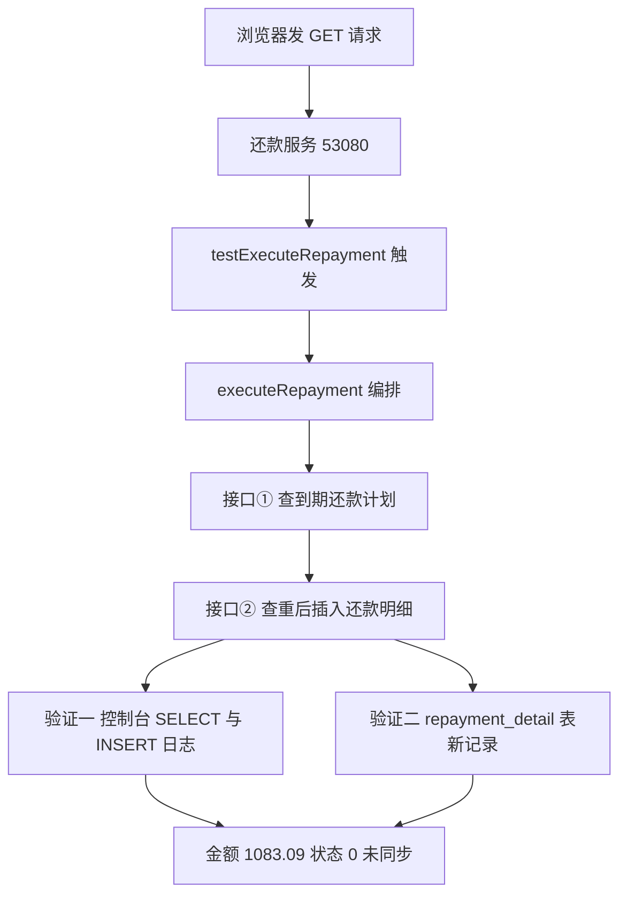
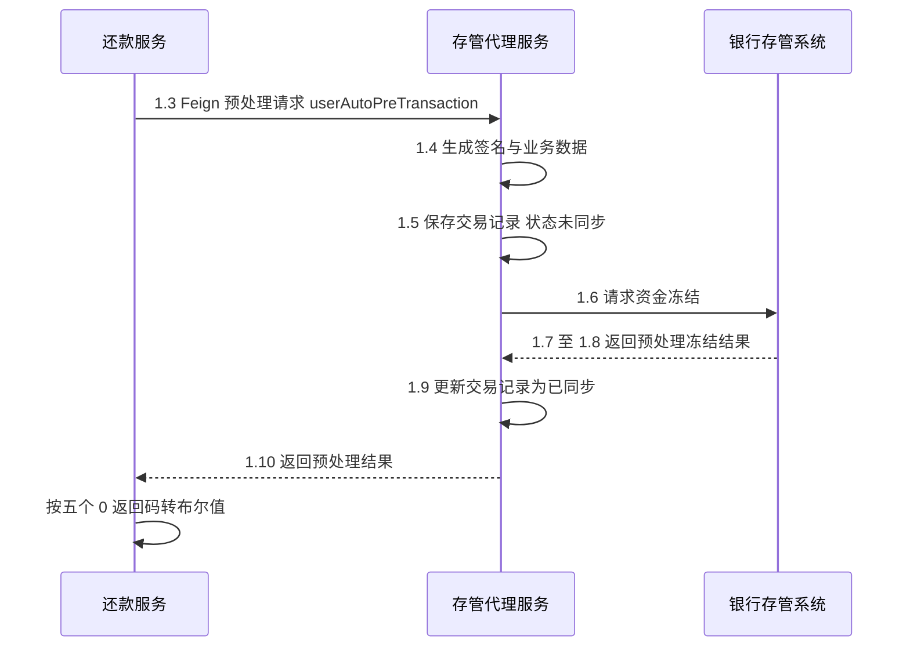

# 第一阶段功能测试与第二阶段实现：从验证还款明细落库到冻结借款人应还金额

业务触发入口已经接好，第一阶段（接口①查到期还款计划、接口②生成还款明细）的代码全部就位。按「开发一点、测试一点」的推进策略，先把第一阶段测通，确认数据落库无误，再马不停蹄地进入第二阶段的开发：还款预处理，把借款人本期应还的金额在银行存管账户里冻结起来。两个视频合在一起，正好走完「测完即推进」的完整节奏。

## 先给结论

- 第一阶段测试只需要启动还款服务一个微服务，端口 53080，因为接口①和接口②只操作本地数据库，不依赖任何远程服务。
- 测试入口是手工触发方法对应的地址 `localhost:53080/repayment/execute-repayment/2019-11-11`，路径里的日期必须从还款计划表里真实取值，与某期的应还时间对得上。
- 验证点有两处：控制台 SQL 日志应出现先查询还款明细、再插入还款明细两条记录；数据库 `repayment_detail` 表新增一条数据，金额与所选期次一致，状态为 `0` 未同步。
- 第二阶段对应方案图 1.3 到 1.10，最终目标是冻结还款人本期应还金额，实现载体是接口③ `preRepayment`，通过 Feign 调存管代理服务的用户自动预处理交易接口。
- 实现分三步：构造 `UserAutoPreTransactionRequest` 请求数据、发起 Feign 远程请求、把存管代理返回的五个 0 编码转成布尔结果。
- 存管代理服务一侧生成签名、保存交易记录、请求银行存管系统的代码在此前发标投标时已经开发过，本次改动全部集中在还款服务侧。

## 第一阶段测试：一个服务就够

测试环境怎么搭，取决于被测代码的依赖面，这一步值得先想清楚再动手。接口①按日期查本地还款计划表，接口②在本地还款明细表里查重并落库，两个接口的调用链从头到尾没出过还款服务进程，远程的存管代理服务、银行存管系统在这个阶段完全不参与。所以测试环境最小化到只启动还款服务，占用的端口是 53080。启动过程中服务会到注册中心完成注册、从 Apollo 配置中心拉取配置，这两个基础设施属于微服务体系的地基，各服务一直连着，不属于本阶段新增的依赖，不启动它们连服务本身都起不来，也就谈不上测试了。

请求怎么发：浏览器、Postman、Swagger 都可以，目标是入口方法映射的地址。路径由三段拼成：服务地址与端口、微服务的基础访问路径 `repayment`、Controller 方法上的 `/execute-repayment/{date}`。日期参数的取值不能拍脑袋，要打开数据库从 `repayment_plan` 表里挑一条真实数据，看它的应还时间字段，比如第一期的应还时间落在 2019 年 11 月 11 日，请求就写成 `localhost:53080/repayment/execute-repayment/2019-11-11`。日期中间用短横线拼接，与 `yyyy-MM-dd` 的格式约定一致。

挑日期与事后核对都是两条固定的 SQL，测试前先从还款计划表里找一期状态为待还款的记录：

```sql
-- 挑选第一期待还款计划 取其应还时间作为测试日期
SELECT ID, NUMBER_OF_PERIODS, AMOUNT, SHOULD_REPAYMENT_DATE, REPAYMENT_STATUS
FROM repayment_plan
WHERE REPAYMENT_STATUS = '0'
ORDER BY NUMBER_OF_PERIODS
LIMIT 1;
```

请求发完后再核对还款明细的落库结果，用挑出来的还款计划 ID 反查明细：

```sql
-- 核对生成的还款明细 金额与状态是两个关键列
SELECT ID, REPAYMENT_PLAN_ID, AMOUNT, REPAYMENT_DATE, REQUEST_NO, STATUS
FROM repayment_detail
WHERE REPAYMENT_PLAN_ID = 118258312871560979;
```

两条 SQL 对应测试的两端：第一条保证请求参数有据可依，第二条把验证从「控制台没报错」推进到「数据真的对了」。联调排查时这一对 SQL 也经常复用，请求没效果先跑第一条确认有没有到期计划，有计划没明细再跑第二条看明细生成到了哪一步。

发完请求前端没有页面可以看，这条链路本来就不面向浏览器，浏览器返回一个空白页属正常现象，只要没有报错堆栈就说明服务端流程走完了。观察点全在两处。**其一，服务控制台。**方法执行的顺序是先查后插，日志里应该先出现一条对还款明细表的 `selectOne` 查询（按还款计划 ID 查重），随后出现一条 `insert`（插入新生成的还款明细）。**其二，数据库表。**打开还款明细表，应能看到一条新记录：金额 1083.09，与所选第一期还款计划的应还本息一致；请求流水号已按前缀规则生成；状态字段为 `0`，对应「未同步」。数值核对得上，第一阶段就算全部测试通过。

这张图把测试动作与验证点串成一条线：



核对的关键在金额与状态的对应关系：金额来自还款计划的本息字段，状态来自枚举 `StatusCode.STATUS_OUT` 的编码，两处任何一处对不上都要回头检查接口②的赋值逻辑。

这次验证还有一个附带收益：它同时确认了业务触发入口的编排逻辑没问题。入口方法调用两个接口的顺序、日期参数的传递、集合遍历都跑通了。入口是后续所有阶段的必经之路，地基验证得越早，后面链路出问题时需要怀疑的范围就越小。

## 第二阶段要做什么：冻结应还金额

第一阶段测通，立刻推进第二阶段。方案图上 1.3 到 1.10 描述的是同一条链：还款服务通过 Feign 向存管代理服务发起还款预处理请求；存管代理服务生成签名与业务数据，保存一条状态为未同步的交易记录；存管代理服务请求银行存管系统执行资金冻结；银行存管系统返回预处理结果；存管代理服务把交易记录更新为已同步，并把处理结果返回给还款服务。整条链跑完，借款人本期应还的钱在存管账户里进入冻结状态，后续确认还款扣的就是这笔冻结金额。

对还款服务来说，这段链路的对外动作只有一个：发起预处理请求并拿到结果。链路中间的签名、交易记录、与银行存管系统的报文交互，全部发生在存管代理服务内部，而那部分代码在开户、发标、投标的业务里已经反复写过，模式完全一致，这次一行都不用改。真正要写的只有两件事：在还款服务定义 Feign 代理，在业务层实现预处理方法。

与投标时的预处理放在一起对照，同构与差异一目了然：调用方从交易中心换成还款服务，请求路径从投标预处理端点换成用户自动预处理交易端点，业务类型从投标换成还款，冻结金额的来源从投标金额换成还款计划的应还本息。其余的部分，Feign 代理的定义方式、流水号的传递、返回码的判定，全部沿用既有模式。换句话说，第二阶段开发量不大，难点不在写新代码，而在认出「这是做过的题」，把老代码的骨架准确地移植过来，只替换业务语义的部分。

## 接口③的定义与 Feign 代理

业务层接口里新增预处理方法，参数有讲究：

```java
/** 还款预处理：冻结借款人应还金额 包名按 com.study.finance 系改写 */
Boolean preRepayment(RepaymentPlan repaymentPlan, String preRequestNo);
```

返回值是布尔类型，`true` 表示预处理成功，`false` 表示失败。两个参数缺一不可：`repaymentPlan` 是还款计划对象，它携带的标的号、用户编码、应还金额将来要被组装进发往存管侧的报文；`preRequestNo` 是本次预处理的请求流水号，凡是与存管代理服务打交道的请求都要求携带流水号，用于交易记录关联与幂等控制，这一点从开户阶段一直沿用至今。

Feign 代理定义在还款服务新开的 `agent` 包中：

```java
@FeignClient(value = "depository-agent-service")
public interface DepositoryAgentApiAgent {

    @PostMapping("/depository-agent/l/user-auto-pre-transaction")
    RestResponse<String> userAutoPreTransaction(
            UserAutoPreTransactionRequest userAutoPreTransactionRequest);
}
```

类上的 `@FeignClient` 指定目标微服务名 `depository-agent-service`，方法上的 `@PostMapping` 指向存管代理服务接收预处理请求的具体端点，两端路径必须逐字对应。这套写法与投标时的预处理调用同构，只是调用方从交易中心换成了还款服务，请求路径与业务类型换了取值。注入方式与既有代码保持一致，业务实现类里加一个 `@Autowired` 字段即可。

接口设计上还有一个容易被忽略的点：预处理方法把流水号作为参数而不是在方法内部生成。生成流水号的时机决定它的归属，入口方法在生成还款明细时已经为每条明细产生过请求流水号，预处理直接复用这一个，同一次还款动作在还款明细与存管交易记录两端就能靠同一个流水号对上账。若在预处理里另起炉灶再生成一个，对账时就要多维护一层映射关系，白白增加复杂度。跨系统协作的流水号设计遵循一条朴素的规则：一次业务动作一个流水号，从头用到尾。

## 请求参数的三步组装与结果判定

预处理方法的实现按三步走。第一步构造请求数据，为保持主流程清爽，组装逻辑单独抽成私有方法：

```java
@Autowired
private DepositoryAgentApiAgent depositoryAgentApiAgent;

@Override
public Boolean preRepayment(RepaymentPlan repaymentPlan, String preRequestNo) {
    // 1 构造请求数据
    final UserAutoPreTransactionRequest userAutoPreTransactionRequest =
            generateUserAutoPreTransactionRequest(repaymentPlan, preRequestNo);
    // 2 请求存管代理服务
    final RestResponse<String> restResponse =
            depositoryAgentApiAgent.userAutoPreTransaction(userAutoPreTransactionRequest);
    // 3 返回结果
    return DepositoryReturnCode.RETURN_CODE_00000.getCode()
            .equals(restResponse.getResult());
}

/** 构造存管代理服务预处理请求数据 */
private UserAutoPreTransactionRequest generateUserAutoPreTransactionRequest(
        RepaymentPlan repaymentPlan, String preRequestNo) {
    UserAutoPreTransactionRequest request = new UserAutoPreTransactionRequest();
    // 冻结金额
    request.setAmount(repaymentPlan.getAmount());
    // 预处理业务类型
    request.setBizType(PreprocessBusinessTypeCode.REPAYMENT.getCode());
    // 标的号
    request.setProjectNo(repaymentPlan.getProjectNo());
    // 请求流水号
    request.setRequestNo(preRequestNo);
    // 用户编码
    request.setUserNo(repaymentPlan.getUserNo());
    // 关联业务实体标识
    request.setId(repaymentPlan.getId());
    return request;
}
```

字段逐个过一遍就知道这份数据在存管侧的用途。`amount` 取自还款计划的应还本息，就是本期要冻结的金额；`bizType` 取枚举 `PreprocessBusinessTypeCode.REPAYMENT` 的编码，标明这笔预处理属于还款业务，与投标时的取值区分开；`projectNo` 是标的号，银行存管系统靠它定位这笔钱挂在哪个标的上；`requestNo` 是请求流水号，直接使用方法入参透传；`userNo` 标识被冻结资金的借款人；`id` 关联业务实体，指向这条还款计划的主键，存管侧交易记录靠它与还款业务对账。

第二步发起远程请求，把组装好的对象扔给 Feign 代理，链路随即从 1.3 走到 1.10，中间的签名、交易记录落库、银行冻结、状态更新都由存管代理服务完成。第三步处理返回结果，存管代理服务的响应统一封装在 `RestResponse<String>` 里，`result` 字段承载返回编码，五个 0 表示成功，编码值由枚举 `DepositoryReturnCode.RETURN_CODE_00000` 提供。判断写成 `RETURN_CODE_00000.getCode().equals(restResponse.getResult())`，把常量放在 equals 左侧，避免响应为空时抛出空指针，这是返回码比较的标准防御写法。

布尔返回值的设计也有讲究。预处理方法不抛异常、不打日志了事，而是把成败收拢成一个布尔值交给调用方，因为调用方（业务触发入口）需要根据这个结果决定后续走不走确认还款，分支判断需要一个干净的判定依据。存管交互失败的具体原因，记录在存管代理服务一侧的交易记录与日志里，还款服务拿到 `false` 后不重复报错，保持链路职责单一：谁持有事实，谁负责记录细节。

这张时序图把第二阶段跨三个参与方的完整交互摆出来：



关键往返在中间三步：存管代理服务先落一条未同步的交易记录再请求银行，银行返回后才把交易记录改成已同步，这个顺序保证了无论银行侧结果如何，存管代理侧都有据可查，失败的请求也留有重试与排查的痕迹。

## 常见误区

- **测第二阶段时只启动还款服务。**错例：沿用第一阶段的测试环境直接发请求。正解：第二阶段要跨三个参与方，还款服务、存管代理服务、银行存管系统都必须启动，少一个请求就会因服务发现失败而报错。
- **测试日期凭空编造。**错例：URL 里随手写一个日期。正解：日期必须与 `repayment_plan` 表中某期真实的应还时间（格式化到天）一致，否则接口①查不出任何计划，循环体一次都不会执行。
- **业务类型编码手写字符串。**错例：`bizType` 直接写死一个自造值。正解：取枚举 `PreprocessBusinessTypeCode.REPAYMENT` 的编码，存管侧按编码识别业务类型，写错会被当成未知业务处理。
- **返回码比较方向颠倒。**错例：`restResponse.getResult().equals(编码)`，响应为空时直接空指针。正解：常量编码放 equals 左侧，空响应只会得到 `false` 而不是异常。
- **重复触发产生重复明细。**错例：测试时多次发请求，以为每次都会重新处理。正解：接口②按还款计划 ID 查重，已有明细的计划直接复用旧明细，幂等设计本身就为重复触发兜底。

## 面试可能被问到的问题

1. 面试官追问：「第一阶段为什么不需要其他服务参与？」
   答：接口①按日期筛选本地还款计划表，接口②在本地还款明细表查重并落库，数据读写全部封闭在还款服务进程内，测试环境最小化到单个服务即可，这也是分阶段开发带来的验证便利。
2. 面试官追问：「还款预处理的流水号有什么用？为什么作为独立参数传入？」
   答：流水号用于存管侧交易记录关联与幂等控制，同一个流水号的请求不会产生第二笔交易。它由调用方在发起前生成并一路透传，预处理方法不负责生成，只负责组装进请求报文。
3. 面试官追问：「Feign 代理为什么指向 depository-agent-service 而不是银行存管系统？」
   答：还款服务是业务服务，不直接对接银行，所有签名、加密、报文组装、交易记录管理都收敛在存管代理服务里，业务服务只发业务语义的请求。代理模式隔离了银行协议细节，也让多家银行的接入可以只改代理层。
4. 面试官追问：「预处理成功后，钱处在什么状态？」
   答：借款人存管账户中本期应还金额被冻结，所有权仍属借款人但无法动用。真正的扣款划转发生在后续确认还款阶段，预处理只锁定资金，不完成支付。
5. 面试官追问：「存管代理服务为什么先保存未同步的交易记录，银行返回后才更新为已同步？」
   答：这是请求留痕的通用做法。未同步状态证明请求已受理但未确认，若银行调用超时或失败，交易记录仍在，可据此对账、重试或人工介入；直接等成功再落记录，失败场景将无迹可寻。
6. 面试官追问：「返回码判空为什么要常量在前？」
   答：`equals` 由常量调用时，即使远程响应对象为空或结果字段为空，表达式只会返回 `false`；反过来由结果调用，空指针异常会直接中断还款流程，在批量循环处理还款计划的场景里，一条计划的异常会影响整批推进。

## 配套资料

- 讲义：`materials/docs/10/万信金融-第5章-用户还款v1.0.md`，3.3 第一阶段功能测试、4.1 第二阶段接口定义（接口③ `preRepayment`）、4.2 功能实现（Feign 代理定义、请求数据构造、`preRepayment` 三步实现）。
- 代码：`materials/code/10/wanxinp2p/`，课程资料包内的工程源码归档目录（内含原始工程命名，与正文改写后的命名并非一一对应）；还款服务与存管代理服务的新增模块源码不在资料包内，文中代码为按讲义与课堂画面补全的示例，包名按 `com.study.finance` 系改写。
