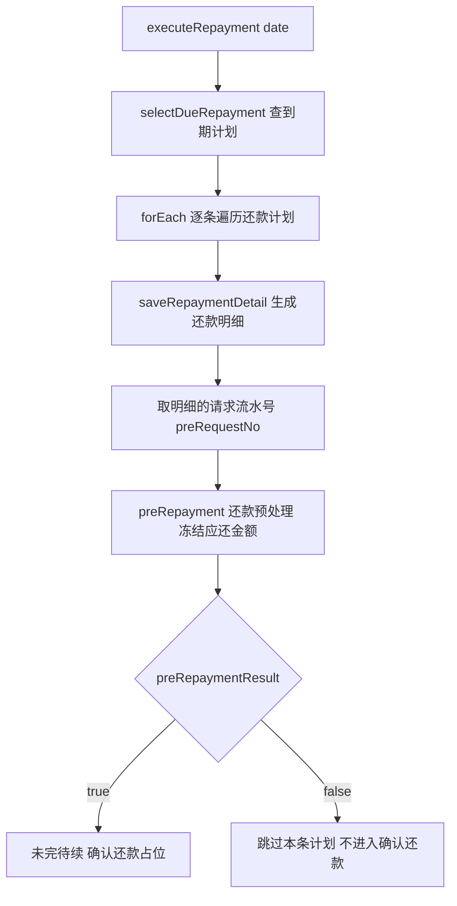

# 第二阶段接入业务触发入口：循环里串起还款预处理，流水号复用不重造

还款预处理方法 `preRepayment` 已经实现完毕，但它还悬在业务层里没人调用。业务触发入口 `executeRepayment` 是全链路的编排骨架，第二阶段的调用必须在骨架上接好：预处理放在循环体里、紧跟明细生成之后，流水号从刚生成的还款明细里取，处理成功的分支先留出占位。这一课的改动不大，却把入口方法从「只会走第一阶段」推进到「能推进到 1.10」。

## 先给结论

- 业务入口 `executeRepayment` 的循环体内新增预处理调用：`preRepayment(repaymentPlan, repaymentDetail.getRequestNo())`，紧跟 `saveRepaymentDetail` 之后。
- 预处理必须在循环里执行，因为到期计划是一个集合，每条计划各自生成明细、各自向存管代理服务发起冻结请求，处理次数与计划条数一致。
- 预处理流水号不重新生成，直接复用还款明细对象里已有的请求流水号，一次还款动作一个流水号贯穿到底。
- 预处理返回的布尔值接收为 `preRepaymentResult`，为 `true` 时才进入后续确认还款，分支体暂时留「未完待续」注释占位，等确认还款事务消息（接口④）开发完再补。
- 入口方法仍由手工触发，测试方式与第一阶段一致，只是验证点从本地表扩展到存管代理服务的交易记录。

## 为什么预处理要挂在循环体里

方案图上第二阶段是 1.3 到 1.10 的一条链，但这条链不是全局跑一次，而是每条到期还款计划各跑一遍。入口方法查回的 `repaymentPlanList` 里可能有多条计划，每条计划的金额、标的号、用户编码都不相同，冻结的金额与对象也各不相同，预处理天然是逐条进行的操作。

所以调用的位置有且只有一个正确答案：循环体内、明细生成之后。顺序也不能颠倒，预处理的流水号来自还款明细，明细不生成流水号就无从取起；先冻结再生成明细虽然业务上不算错，但明细的「未同步」状态会与存管侧的交易记录失去先后的呼应，排查问题时时间线对不齐。紧跟其后，数据因果链最短。



被调用的预处理方法本身在上一课已经实现，调用链的签名约定如下：

```java
/** 还款预处理：冻结借款人应还金额 */
Boolean preRepayment(RepaymentPlan repaymentPlan, String preRequestNo);

/** 预处理内部通过 Feign 代理发起远程请求 */
final RestResponse<String> restResponse = depositoryAgentApiAgent
        .userAutoPreTransaction(userAutoPreTransactionRequest);
```

分支 false 的走向值得说明：预处理失败意味着资金没冻结成功，确认还款绝不能继续，这条计划本次被跳过。跳过不是丢弃，还款明细还躺在库里、状态仍是未同步，下一次任务触发时这条计划依然会被查出来重新处理，链路天然具备自愈能力。

## 入口代码的完善

入口方法在既有骨架上补三行核心代码：

```java
@Override
public void executeRepayment(String date) {
    // 查询所有到期的还款计划
    List<RepaymentPlan> repaymentPlanList = selectDueRepayment(date);
    repaymentPlanList.forEach(repaymentPlan -> {
        // 生成还款明细（未同步）
        RepaymentDetail repaymentDetail = saveRepaymentDetail(repaymentPlan);
        // 还款预处理
        String preRequestNo = repaymentDetail.getRequestNo();
        Boolean preRepaymentResult = preRepayment(repaymentPlan, preRequestNo);
        if (preRepaymentResult) {
            // 未完待续......
        }
    });
}
```

**流水号复用是这段代码最关键的取舍。**`repaymentDetail.getRequestNo()` 取的是生成还款明细时已经写入库里的请求流水号，它带前缀规则、全局唯一，并且随明细落了库。预处理把它透传给存管代理服务，存管侧交易记录记录的也是它，于是同一次还款在「本地明细」与「存管交易记录」之间有了天然的外键。假如在预处理调用处再调一次编码工具生成新流水号，两套流水号并存，对账要靠额外映射，幂等控制也会出现两个口径，得不偿失。

**布尔结果的命名从返回值语义出发。**`preRepaymentResult` 直译就是预处理结果，接收后立刻进入分支判断，变量生命周期极短，不需要更复杂的封装。若预处理抛出远程调用异常，异常会直接冲出循环打断整批处理，这是当前实现的已知边界，正式场景下可考虑对单条计划的异常做隔离，让失败不影响同批其他计划的冻结，本课保持与讲义一致的简单写法。

**「未完待续」的占位位置从循环体尾部移进了 if 分支。**上一版的占位注释挂在循环体末尾，表示「后面还有接口要接」；现在占位收进预处理成功的分支里，语义收窄为「预处理成功之后的确认还款还没实现」。占位位置的变化本身就是进度的刻度，入口骨架的每一处空缺都对应一个尚未开发的接口。

## 常见误区

- **把预处理调用写循环外面。**错例：只对集合中第一条计划做预处理，或干脆在遍历结束后整体调用一次。正解：预处理的对象是单条还款计划，调用点必须在循环体内。
- **预处理前重新生成流水号。**错例：`CodeNoUtil.getNo(...)` 再造一个新号传入 `preRepayment`。正解：复用还款明细已有的流水号，本地与存管两端对账才有统一凭证。
- **不看预处理结果直接往下走。**错例：调用 `preRepayment` 后不接返回值，直接写确认还款调用。正解：冻结失败时后续确认会把没冻结的钱划走，必须以布尔结果守门。
- **流水号取自还款计划对象。**错例：`repaymentPlan` 里找不到流水号字段时报错或改取其他字段。正解：流水号属于还款明细，`getRequestNo` 调用对象是 `repaymentDetail`。

## 面试可能被问到的问题

1. 面试官追问：「预处理失败的那条计划下次还会被处理吗？」
   答：会。失败计划的状态未被修改，明细仍是未同步，下次定时任务按日期与状态查询时它依然会被查出，从明细查重开始完整重走第一阶段与第二阶段，直到预处理成功进入确认还款。
2. 面试官追问：「流水号为什么要复用还款明细里的，而不是预处理时新造？」
   答：一次还款动作一个流水号，明细、存管交易记录、后续确认还款都沿用同一个，跨系统对账才有统一键。多套流水号会让幂等与对账各自维护映射，复杂度翻倍且易错。
3. 面试官追问：「循环里多次远程调用有什么风险？」
   答：到期计划多时，逐条 Feign 调用会拉长整体耗时，一条失败抛异常还会打断整批。生产上可对单条计划做异常隔离与失败记录，或引入批量接口，本课按讲义保持逐条简单实现，重点是让编排顺序正确。
4. 面试官追问：「预处理成功分支里留空的 if 有什么意义？」
   答：它是编排骨架的施工占位，明确标出确认还款事务消息的接入点。占位也让代码在当前状态下语义完整：成功即到此为止，失败即跳过，不留悬空的调用。

## 配套资料

- 讲义：`materials/docs/10/万信金融-第5章-用户还款v1.0.md`，4.2 功能实现第 3 步「完善业务触发入口代码，调用 `preRepayment` 方法执行还款预处理」，含循环体内调用与成功分支占位的完整代码。
- 代码：`materials/code/10/wanxinp2p/`，课程资料包内的工程源码归档目录（内含原始工程命名，与正文改写后的命名并非一一对应）；还款服务模块源码不在资料包内，文中代码为按讲义与课堂画面补全的示例，包名按 `com.study.finance` 系改写。
