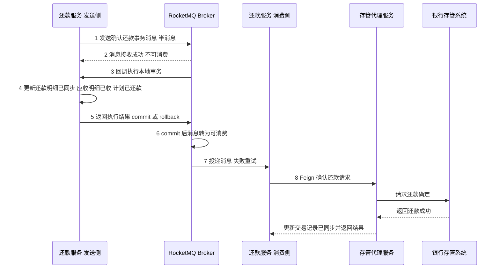

# 第三阶段业务分析：确认还款为何要用事务消息，还款服务为何自发自收

前两个阶段开发完毕、测试通过，剩下的第三阶段（确认还款）与第四阶段（还款成功）看似只是收尾动作，实际上藏着一个硬问题：还款服务要把本地三处状态更新成「钱已结清」，同时还要让银行存管系统真正完成扣款划转，这两件事分属两个系统，任何一侧成功另一侧失败都会造成账实不符。分析清楚这个问题与解法，是把最后两个阶段写对的前提，本课就是这次分析。

## 先给结论

- 第三阶段与第四阶段在开发上分成两步，在业务上紧密相连，分析时必须放到一起：第三阶段执行成功，第四阶段必须跟着成功，这是典型的分布式事务问题。
- 具体的不一致场景：本地把还款明细、应收明细、还款计划都更新成已结清，银行侧却没扣到钱，投资人的钱凭状态字段落了空。
- 解法沿用可靠消息最终一致性方案：RocketMQ 事务消息，发送半消息、执行本地事务、按结果提交或回滚、必要时事务回查，这套流程在满标放款业务中刚实践过。
- 用户还款场景的特殊性在于还款服务既是消息发送方又是消费方，自己发确认还款消息、自己消费，消费之后再通过 Feign 请求存管代理服务执行 2.3 到 2.9 的确认还款链路。
- 消费阶段失败靠消息重试兜底：消费抛出异常，消息会被重新投递，直到确认还款链路执行成功。

## 问题的形态：三处状态更新对一次银行扣款

方案图上 2.1 到 2.2 是第三阶段，2.3 到 2.9 是第四阶段。第三阶段发生在还款服务本地，一次本地事务里要更新三处数据：还款明细状态改为已同步、投资人应收明细状态改为已收、还款计划状态改为已还款。第四阶段跨系统，还款服务请求存管代理服务，存管代理保存交易记录后向银行存管系统发起还款确定，银行返回成功再回传。

两段业务必须原子性地同生共死。本地三处状态更新成功而银行扣款失败，投资人手里拿着「已收」的明细，钱却没到账；银行扣款成功而本地更新失败，借款人被划了钱，平台账面上这笔还款还是待还状态，下个周期会再次发起还款造成重复扣款。两边的数据库互相无法感知对方的事务，强一致事务在这里没有直接可用的工具。

## 解法回顾：可靠消息最终一致性

这个问题的标准解法在满标放款业务里刚刚落地过：RocketMQ 事务消息实现的最终一致性。方案的核心思路是把「跨系统的两件事」拆成「本地事务加一条可靠消息」，本地事务成功则消息必定可达，下游消费消息完成自己的事，消费失败靠重试，最终两侧趋于一致。

把用户还款的两个阶段套进这套模板，流程如下：还款服务先发送确认还款的事务消息，这条消息以半消息形态存在，RocketMQ 自己能看到，消费方暂时不能消费；随后 Broker 回调还款服务执行本地事务，三处状态更新落库，执行结果以 commit 或 rollback 回给 Broker，执行结果缺失时 Broker 主动事务回查；commit 之后消息转为可消费，消费方收到消息开始走 2.3 到 2.9 的确认还款链路。



图上第 5 步是整个方案的枢纽：本地事务的成败决定消息存亡，commit 让消息流动起来，rollback 让消息消失、本地也已回滚，两侧永远不出现「单边成功」的中间态。第 7 步的重试机制补上另一侧的可靠性，确认还款链路某次执行失败，消息重新投递，直到走完 2.3 到 2.9 为止。

## 还款服务为什么自发自收

这套模板里有个与满标放款不同的现象：消息的发送方和消费方都是还款服务。满标放款的消息从交易中心流向还款服务，两端是不同服务；用户还款的消息从还款服务发出，最终又被还款服务自己消费。

原因在业务职责的划分。第三阶段的本地事务是纯数据库操作，适合放在事务监听器里执行；第四阶段要请求存管代理服务、再经存管代理请求银行，是可能失败、需要重试的远程调用，不能塞进本地事务。用消息把两者隔开，本地事务的成功触发消息投递，消费侧专门承担远程调用与重试，发送与消费在同一服务内，中间的 RocketMQ 依然完整承担半消息、回查、重投的全部机制。自发自收不是设计冗余，而是把「必须成功的本地动作」与「必须重试的远程动作」用消息队列切开的标准做法。

下一阶段编码时发送侧的骨架与满标放款的写法同构，生产者把还款计划与还款请求两个对象打包进消息体：

```java
/** 确认还款事务消息生产者 包名按 com.study.finance 系改写 */
@Component
public class RepaymentProducer {

    @Resource
    private RocketMQTemplate rocketMQTemplate;

    public void confirmRepayment(RepaymentPlan repaymentPlan, RepaymentRequest repaymentRequest) {
        // 1 构造消息 两个业务对象打包进 JSON
        JSONObject object = new JSONObject();
        object.put("repaymentPlan", repaymentPlan);
        object.put("repaymentRequest", repaymentRequest);
        Message<String> msg = MessageBuilder.withPayload(object.toJSONString()).build();
        // 2 发送事务消息 半消息由事务监听器接管
        rocketMQTemplate.sendMessageInTransaction(
                "PID_CONFIRM_REPAYMENT", "TP_CONFIRM_REPAYMENT", msg, null);
    }
}
```

本地事务一侧要完成的三处状态更新，对应到数据库层面就是三类定向修改：

```sql
-- 还款明细 状态改为已同步
UPDATE repayment_detail SET STATUS = '1' WHERE REQUEST_NO = '预处理请求流水号';
-- 应收计划 状态改为已收 逐条更新
UPDATE receivable_plan SET RECEIVABLE_STATUS = 1 WHERE REPAYMENT_ID = '还款计划标识';
-- 还款计划 状态改为已还款
UPDATE repayment_plan SET REPAYMENT_STATUS = '1' WHERE ID = '还款计划标识';
```

三类更新必须包在同一个本地事务里，任何一个失败都要整体回滚，否则本地三处状态各改一半，回查与对账都会失去依据。业务层实现会以 MyBatis-Plus 的条件构造器完成同样的更新，语义与上面的 SQL 一致。

## 常见误区

- **把第三、第四阶段当成独立功能分别分析。**错例：先只设计本地状态更新，银行扣款留到以后再想。正解：两段业务绑定在同一个分布式事务问题里，方案的每一步都要同时考虑两侧。
- **把银行扣款塞进本地事务。**错例：在事务监听器里先更新状态再调存管接口。正解：远程调用不可控，失败会拖垮本地事务甚至造成长时间占用连接，远程动作必须交给消息消费侧重试。
- **忽略自发自收的特殊性。**错例：以为消费方是另一个服务，等别人来对接。正解：还款服务自己写消费监听器、自己实现确认还款调用，发送组与消费组都配置在本服务。
- **认为 commit 之后业务就完成了。**错例：消息可消费即视为还款成功。正解：可消费只代表本地事务提交，银行侧的扣款划转要等消费链路执行成功，期间的消息重试属于正常流程。

## 面试可能被问到的问题

1. 面试官追问：「用户还款的分布式事务问题具体指什么？」
   答：还款服务本地的三处状态更新与银行存管系统的扣款划转必须同时成功。本地成功银行失败会让投资人在没有收款的情况下被记为已收，银行成功本地失败会造成重复还款，两个数据库无法用强一致事务绑定，只能靠可靠消息实现最终一致。
2. 面试官追问：「为什么还款服务要自己发消息自己消费？」
   答：本地事务与远程调用需要用消息隔开，事务监听器只做可回滚的数据库更新，消费监听器承担可能失败的 Feign 调用并接受重试。两端动作都在还款服务的职责范围内，消息只是内部的解耦手段，自然表现为自发自收。
3. 面试官追问：「事务回查在用户还款场景里依据什么回答？」
   答：依据还款计划的状态字段。回查时按还款计划标识重查，状态已是已还款即证明本地事务成功，返回 commit；否则返回 rollback。状态字段本身就是本地事务的落库事实，无需另建事务日志表。
4. 面试官追问：「消费失败后消息重试会不会造成重复扣款？」
   答：确认还款的每次执行都携带请求流水号，存管代理侧按流水号做幂等控制，同一流水号的重复请求不会产生第二笔扣款。重试机制保证至少执行一次，幂等设计保证重复执行无害。
5. 面试官追问：「本地事务里为什么恰好是三处更新？」
   答：还款涉及借款人与投资人两侧的数据：还款明细记录借款人实际还款动作，应收计划与应收明细记录投资人一侧的收款事实，还款计划的状态则是整期还款的结论。三处一起变更才能保证借款人与投资人两侧的账面同步闭合。

## 配套资料

- 讲义：`materials/docs/10/万信金融-第5章-用户还款v1.0.md`，第 5 章开头对第三、第四阶段分布式事务问题的描述与 RocketMQ 可靠消息方案图，5.1 确认还款事务消息生产接口（接口④）的生产者代码，5.2 确认还款处理接口中本地事务的三处状态更新。
- 代码：`materials/code/10/wanxinp2p/`，课程资料包内的工程源码归档目录（内含原始工程命名，与正文改写后的命名并非一一对应）；还款服务模块源码不在资料包内，文中代码为按讲义与课堂画面补全的示例，包名按 `com.study.finance` 系改写，SQL 为按讲义业务逻辑整理的等价示例。
