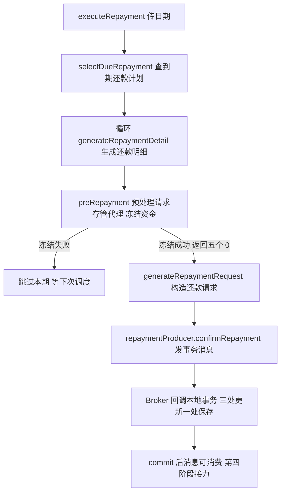

# 还款第三阶段业务触发入口：从预处理成功到事务消息发出的最后一跳

第三阶段的生产者、本地事务、事务监听器三个部件都已写完，但它们现在是一串躺在类里的孤岛：没有任何代码去调用发送方法，链路推不起来。让链路动起来的位置和第一、第二阶段一样，都在业务触发入口 `executeRepayment` 里。这一课做两件事：在预处理成功的分支里补上发消息的调用，再单独封装一个构造还款信息请求的方法，把消息体需要的全部数据凑齐。这两处补完，用户还款从查到期计划到消息可消费的整条链路就算串通了。

## 先给结论

- 触发点在 `executeRepayment` 的预处理成功分支里：原来临时打印的位置换成两行业务代码，先构造 `RepaymentRequest`，再调 `repaymentProducer.confirmRepayment` 发出事务消息。
- 生产者注入到业务实现类里，与此前注入的 `DepositoryAgentApiAgent` 并列，入口只面向这两个依赖编程。
- 请求对象的数据项多（七个字段外加按投资人展开的明细集合），单独封装私有方法 `generateRepaymentRequest`，入口处一行调用拿到现成对象。
- 方法的前置查询是按还款计划标识查应收计划：放款阶段落的每条应收计划，对应消息明细里一位投资人的应得本金与利息。
- 请求流水号用工具类按请求前缀新生成；预处理流水号从第一阶段生成的还款明细里直接取，它就是第二阶段资金冻结的凭据。

## 入口处的改动：成功分支里的两行

业务触发入口此前只推进到第二阶段：查询到期还款计划、循环生成还款明细、逐条发起还款预处理，预处理结果拿布尔值做了分支，分支体里只留了一行临时打印。第三阶段触发代码就落在这个分支里：

```java
/** 还款业务触发入口 包名按 com.study.finance 系改写 */
public void executeRepayment(String date) {
    // 查询到期还款计划
    List<RepaymentPlan> repaymentPlanList = selectDueRepayment(date);
    // 生成还款明细
    repaymentPlanList.forEach(repaymentPlan -> {
        RepaymentDetail repaymentDetail = generateRepaymentDetail(repaymentPlan);
        // 还款预处理
        Boolean preRepaymentResult = preRepayment(repaymentPlan,
                repaymentDetail.getPreRequestNo());
        if (preRepaymentResult) {
            // 构造还款信息请求
            RepaymentRequest repaymentRequest =
                    generateRepaymentRequest(repaymentPlan, repaymentDetail.getRequestNo());
            // 发送确认还款事务消息 触发第三阶段
            repaymentProducer.confirmRepayment(repaymentPlan, repaymentRequest);
        }
    });
}
```

临时打印删掉，换成构造请求与发送消息两步。这个分支的语义在两个阶段之间发生了静默升级：第二阶段测试时它只是观察点，现在它是流程的接续点。预处理返回真，意味着银行存管侧已经把本期应还金额冻结成功，钱已经在账上等着划转，此时才轮到第三阶段发确认消息；返回假则什么都不做，借款人账上冻结不了钱，后面的确认动作无从谈起。

发消息的第一参数现成，循环变量 `repaymentPlan` 就是它；第二参数必须现凑一个 `RepaymentRequest`。注入生产者的动作加在实现类的依赖清单里：

```java
@Autowired
private RepaymentProducer repaymentProducer;
```

## 单独封装构造方法：消息体的数据从哪来

`RepaymentRequest` 要装的东西不少：请求流水号、预处理业务流水号、标的编码、平台佣金、业务 id、还款总额，外加一个按投资人逐条展开的明细集合。这些数据来源分散，全挤在入口方法里会把主流程搅乱，讲义的做法是单独封装一个私有方法，入口一行调用：

```java
/** 构造还款信息请求 包名按 com.study.finance 系改写 */
private RepaymentRequest generateRepaymentRequest(RepaymentPlan repaymentPlan,
        String preRequestNo) {
    // 根据还款计划id查询应收计划
    List<ReceivablePlan> receivablePlanList = receivablePlanMapper.selectList(
            Wrappers.<ReceivablePlan>lambdaQuery()
                    .eq(ReceivablePlan::getRepaymentPlanId, repaymentPlan.getId()));
    // 明细集合放款时有几条应收计划 这里就封装几条明细
    List<RepaymentDetailRequest> detailRequests = new ArrayList<>();
    receivablePlanList.forEach(receivablePlan -> {
        RepaymentDetailRequest detailRequest = new RepaymentDetailRequest();
        // 投资人用户编码
        detailRequest.setUserNo(receivablePlan.getUserNo());
        // 向投资人收取的佣金
        detailRequest.setCommission(receivablePlan.getCommission());
        // 投资人应得本金
        detailRequest.setAmount(receivablePlan.getPrincipal());
        // 投资人应得利息
        detailRequest.setInterest(receivablePlan.getInterest());
        detailRequests.add(detailRequest);
    });
    RepaymentRequest repaymentRequest = new RepaymentRequest();
    // 请求流水号 工具类按请求前缀生成
    repaymentRequest.setRequestNo(CodeNoUtil.getNo(CodePrefixCode.CODE_REQUEST_PREFIX));
    // 预处理业务流水号 从第一阶段生成的还款明细里传入
    repaymentRequest.setPreRequestNo(preRequestNo);
    // 标的编码
    repaymentRequest.setProjectNo(repaymentPlan.getProjectNo());
    // 平台佣金
    repaymentRequest.setCommission(repaymentPlan.getCommission());
    // 业务id
    repaymentRequest.setId(repaymentPlan.getId());
    // 还款总额
    repaymentRequest.setAmount(repaymentPlan.getAmount());
    // 放款明细集合
    repaymentRequest.setDetails(detailRequests);
    return repaymentRequest;
}
```

方法体里的数据来源分三类。**还款计划里现成的**：标的编码、平台佣金、业务 id、还款总额都直接从第一个参数取。**要查一次库的**：明细集合依赖应收计划，按还款计划标识查出本期相关的所有应收计划，遍历时逐条把投资人用户编码、应得本金、应得利息、投资人佣金装进 `RepaymentDetailRequest`。字段取值对应关系记一条即可：应收计划里的本金字段对明细的本金，利息字段对明细的利息，实体与 DTO 字段名不完全一致时以业务含义对齐。派息字段当前业务用不上，留空即可。**要自己生成的**：请求流水号用工具类按请求前缀拼一个新号，这笔确认还款请求从此有了唯一凭据，将来存管侧的交易记录与幂等判断都以它为锚。

预处理流水号的来源链路值得回看一眼。第一阶段生成还款明细时，每条明细都带了一个预处理业务流水号；第二阶段发起预处理请求时用的是它，银行存管侧的资金冻结就挂在这个流水号下。现在构造还款请求，这个值从 `repaymentDetail.getRequestNo()` 传入，银行划转时按它逐笔解冻对应资金，预处理与确认两步靠同一个流水号闭环。

## 触发链路全景

三个阶段的触发点在同一张图里对齐，消息发出之后的所有环节由 RocketMQ 驱动，入口方法的职责到发送为止：



关键路径在预处理成功之后的那一跳：`generateRepaymentRequest` 把银行需要的全部数据凑齐进消息体，`confirmRepayment` 一调，方案图上 2.1 完成，后面的本地事务、回查、消费全部交给 RocketMQ 与监听器推进。入口方法对第三阶段内部的机制零感知，这正是把发送逻辑收进生产者类的好处，触发入口永远只做编排。

## 常见误区

- **在预处理失败的分支里也发消息。**错例：拿到布尔值不分真假一律发送。正解：只有存管侧冻结成功（返回五个 0 编码）才有资格进入第三阶段，冻结失败时发确认消息等于让银行划转一笔没冻结的钱。
- **把消息明细的字段取值搞混。**错例：明细的本金取应收计划的 `amount` 本息合计。正解：明细按投资人逐笔划转，本金对应应收计划的 `principal`，利息对应 `interest`，本息合计留在计划层面做总额校验。
- **预处理流水号重新生成一个。**错例：构造请求时再调一次工具类生成新号。正解：预处理与确认还款是同一笔资金动作的前后两步，共用第一阶段留下的流水号，银行侧按它找到冻结资金逐笔解冻。
- **入口方法里内联整段构造逻辑。**错例：几十行 setter 调用直接写进 `executeRepayment`。正解：独立私有方法承载构造，入口保持一行调用，主流程的编排语义不被数据装配细节淹没。

## 面试可能被问到的问题

1. 面试官追问：「为什么构造还款请求要单独封装方法，不直接写在触发入口里？」
   答：入口的职责是编排三个阶段的触发顺序，构造请求涉及查库、遍历装配、流水号生成等十余行细节，内联会让主流程失去可读性。独立方法还有复用潜力，将来其他入口触发确认还款时直接调用，装配口径天然一致。
2. 面试官追问：「还款请求的明细集合为什么按应收计划展开？」
   答：应收计划是放款阶段按投资人逐期落库的数据，本期到期的每条计划对应一位投资人应得的本金与利息。银行划转按投资人逐笔进行，明细集合就是划转清单，一条不缺、一条不错，账才对得上。
3. 面试官追问：「预处理流水号在整条链路里被用了几次，分别起什么作用？」
   答：三次。第一阶段生成还款明细时写入作为凭据；第二阶段发起预处理请求时携带，银行按它冻结资金；第三阶段构造还款请求时再次携带，银行划转时按它解冻对应金额。一个流水号串起冻结到划转的完整资金动作。
4. 面试官追问：「预处理失败的那一期还款，后面怎么补上？」
   答：入口按日期查询到期计划，预处理失败的期次本次跳过，借款人账户资金不足属于正常业务分支。任务调度下一次触发时会再次查到这期未还的计划重新走全流程，还款计划的状态仍是待还，不会遗漏。

## 配套资料

- 讲义：`materials/docs/10/万信金融-第5章-用户还款v1.0.md`，5.4 业务触发入口完善：预处理成功后调用 `RepaymentProducer.confirmRepayment` 触发第三阶段，以及构造还款信息请求方法的数据装配清单。
- 代码：`materials/code/10/wanxinp2p/`，课程资料包内的工程源码归档目录（内含原始工程命名，与正文改写后的命名并非一一对应）；还款服务模块源码不在资料包内，文中代码为按讲义与课堂画面补全的示例，包名按 `com.study.finance` 系改写。
