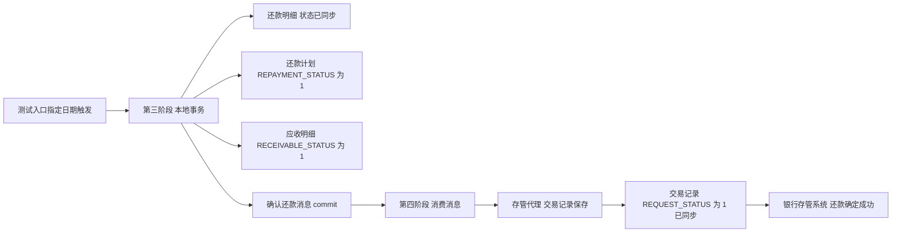

# 用户还款功能测试：四个阶段一次跑通后的数据核对清单

四个阶段的代码全部开发完毕，前两个阶段当时已经测过，这一课的重点是给第三、第四阶段做一次端到端验证：从触发还款入口开始，一路走到银行存管系统，再把三处本地状态与一条交易记录逐一核对。测试做完，用户还款这条业务线才算真正收官。

## 先给结论

- 需要启动的服务有三个：还款服务（53080）、存管代理服务、银行存管系统，协调两侧的 RocketMQ 也必须在线，漏掉任何一个测试都会卡在半路。
- 定时任务还没有开发，触发入口暂时用还款服务里预留的测试接口，浏览器直接请求 `localhost:53080/repayment/execute-repayment/2019-11-11`。
- 观察点集中在四处数据：还款计划状态改为已还款、应收明细状态改为已收（五个投资人各一条）、还款明细状态同步更新、存管代理侧交易记录保存且状态改为已同步。
- 事务消息的回查与重试可以顺带验证：故意不返回执行结果观察回查，故意让第四阶段抛异常观察消息重投，套路与此前实现转账、满标放款时一致。

## 测试环境与触发入口

用户还款业务本身与前端无关，它的正式触发入口是定时任务，到期还款计划由调度系统每天自动扫描。定时任务尚未开发，所以测试阶段依靠还款服务 Controller 里预留的测试入口，指定一个日期直接触发执行：

```java
@ApiOperation("测试用户还款")
@GetMapping("/repayment/execute-repayment/{date}")
public void testExecuteRepayment(@PathVariable String date) {
    repaymentService.executeRepayment(date);
}
```

浏览器访问 `localhost:53080/repayment/execute-repayment/2019-11-11`，2019 年 11 月 11 日正是此前测试投标、放款时造出来的到期日期，这笔标当时由五个投资人共同投资，应收侧天然有多条明细可供核对。请求发出后，链路按接口①到接口④的顺序推进：第一、二阶段生成预处理结果与触发还款，第三阶段本地事务更新三处状态并发送确认还款消息，第四阶段消费消息走 2.3 到 2.9 的确认还款链路。

启动清单里特别提醒 RocketMQ。发送与消费两侧的代码都已经写好，半消息、事务回查、消费重投全靠 Broker 支撑，Broker 不在，第三阶段的消息发不出去，第四阶段的消费入口收不到任何东西，测试现象会是本地状态全部更新、银行侧毫无动静。

## 数据核对：四个观察点

控制台先扫一眼有无报错，还款服务与存管代理服务两侧的 SQL 语句都应正常生成，还款预处理成功的日志出现。之后去数据库逐项核对，四个观察点全部落位才算通过。



- **还款计划。**查 `repayment_plan` 表，到期日期为 2019 年 11 月 11 日、状态为 0 的那条记录，`REPAYMENT_STATUS` 字段应已变为 1，表示已还款。
- **应收明细。**查 `receivable_plan` 与应收明细记录，这一笔标对应五个投资人，五条记录的 `RECEIVABLE_STATUS` 应全部变为 1，代表每个投资人的本息都已收到。五个全改才对，任何一个没改都说明第三阶段的本地事务没闭合。
- **还款明细。**借款人一侧的还款明细记录状态同步更新为已同步，它与前三项包在同一个本地事务里，要么一起成功要么一起失败，抽查其中之一即可确认事务整体成立。
- **交易记录。**这条数据在存管代理服务的库里，第三、四阶段推进过程中保存的还款交易记录，`REQUEST_STATUS` 应从 0 变为 1，即已同步。它是银行侧真正完成扣款划转的凭证，这一条没变，等于第四阶段没走完。

本地三处更新加存管侧一条交易记录，四项观察点分别覆盖借款人、投资人、平台三个视角，任何一项缺失都指向链路中具体的一段，排查时按图索骥即可。

## 顺手验证消息机制的兜底能力

常规数据核对通过后，事务消息的两条兜底路径也值得验证。事务回查的测法是让本地事务执行后故意不向 Broker 返回任何结果，观察 Broker 是否在延迟之后回调本地事务检查方法，依据还款计划状态给出 commit 或 rollback；消息重试的测法是故意让第四阶段抛出异常，比如临时让存管代理调用失败，观察控制台消息被反复投递、链路反复执行，直到异常消失后消费成功。这两项在实现转账与满标放款时都完整演练过，套路不变，有时间可以照做一遍，进一步确认用户还款场景下兜底机制同样生效。

到此，用户还款功能四个阶段全部开发完毕、全部测试通过，这条业务线仅剩的缺口是触发方式：目前靠测试接口手工触发，现实里每天到期的还款计划数量庞大，人工触发不现实，后续用任务调度框架把触发动作交给系统自动完成。

## 常见误区

- **只验本地不验存管侧。**错例：看到还款计划、应收明细都改成已收就宣布测试通过。正解：本地更新成功只代表第三阶段，银行侧扣款划转的凭证是存管代理库里那条状态已同步的交易记录，四项观察点缺一不可。
- **忘记启动 RocketMQ。**错例：三个服务起来了就直接发请求，第三阶段之后毫无反应。正解：事务消息方案里 Broker 是协调中枢，启动清单里必须包含它，排查静默失败时也先确认 Broker 状态。
- **换一个随机日期测试。**错例：随便敲个日期发请求，发现什么都没触发就怀疑代码有错。正解：测试日期必须与造数阶段给还款计划设定的到期日期一致，2019 年 11 月 11 日这笔数据此前经过投标与放款，应收侧五条明细完整，最适合核对。
- **把手工触发当成正式流程。**错例：以为测试入口就是最终形态。正解：测试接口只是定时任务缺位期间的临时入口，定时还款任务实现后触发权交给调度系统，测试接口完成使命即应下线。

## 面试可能被问到的问题

1. 面试官追问：「用户还款功能测试要验证哪些数据？」
   答：四个观察点：还款计划的还款状态改为已还款、五个投资人的应收明细状态全部改为已收、借款人侧还款明细状态更新、存管代理侧交易记录保存且状态为已同步。前三项验证第三阶段本地事务，后一项验证第四阶段银行链路真正走完。
2. 面试官追问：「为什么测试入口要接收一个日期参数？」
   答：正式流程由定时任务按当前日期扫描到期还款计划，测试接口用日期参数模拟这一扫描动作，指定日期后业务层按该日期查询到期且未还款的计划并触发整个四阶段流程，这样既复用了同一条业务链路，又能控制测试哪笔数据。
3. 面试官追问：「测试时如何验证消息重试机制？」
   答：故意让第四阶段执行失败，例如使存管代理调用抛出异常，观察控制台消息被重新投递、确认还款链路反复执行；移除故障后链路成功走完，本地与银行侧状态最终一致。前提是存管代理侧有按请求流水号的幂等控制，重试不会造成重复扣款。
4. 面试官追问：「如果应收明细只有四条改成已收，说明什么？」
   答：五个投资人对应五条应收明细，少改一条说明第三阶段的本地事务没有完整闭合，可能是逐条更新时某条失败但整体未回滚，也可能是应收数据在放款阶段就缺失。本地三处更新在同一个事务里，出现部分成功本身就是异常信号，需要先查事务边界。
5. 面试官追问：「测试通过后为什么还要补定时任务？」
   答：测试入口是人工发起请求触发，只适合开发验证。生产环境每天到期的还款计划数量大、日期分散，人工触发不可行也不可靠，必须由调度系统在约定时刻自动触发，这正是后续任务调度模块要解决的问题。

## 配套资料

- 讲义：`materials/docs/10/万信金融-第5章-用户还款v1.0.md`，6.6 节用户还款功能测试要点，7.2 节定时还款任务的分片查询设计，7.3 节测试时还款服务以 53080 与 53081 双实例部署的说明。
- 代码：`materials/code/10/wanxinp2p/`，课程资料包内的工程源码归档目录（内含原始工程命名，与正文改写后的命名并非一一对应）；还款服务模块源码不在资料包内，测试入口代码为按课堂画面补全的示例，包名按 `com.study.finance` 系改写；涉及的表结构以讲义与数据库设计为准。
