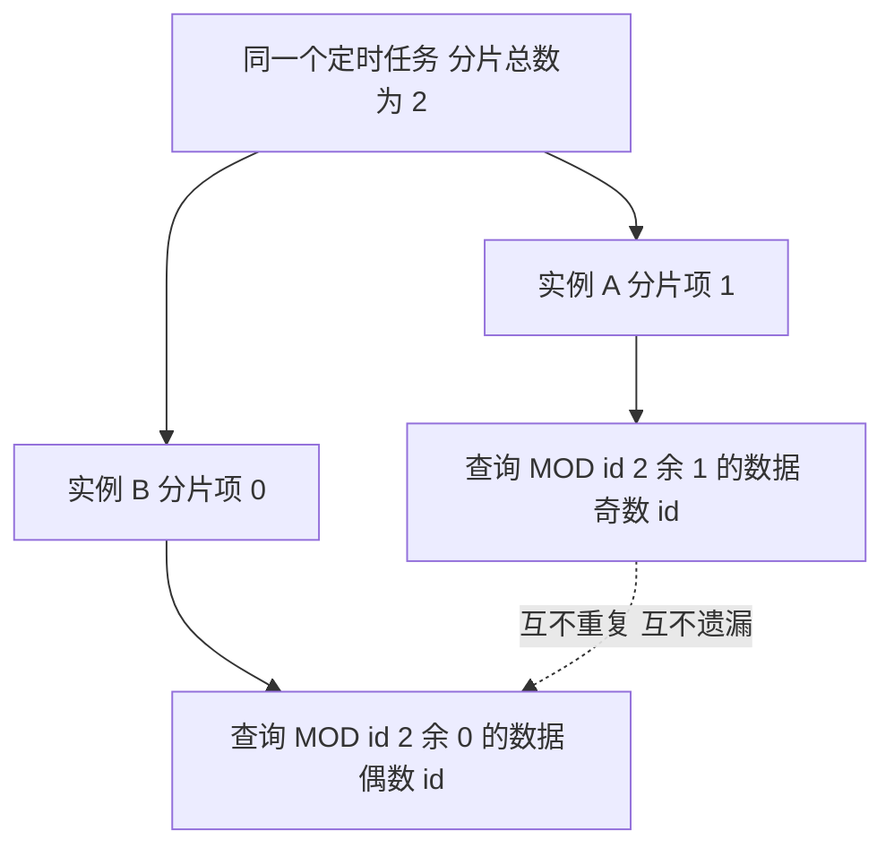

# Elastic-Job 快速入门（一）：把 ZooKeeper 与工程骨架搭起来

学过分片、Leader 选举与 cron 表达式之后，概念层面的准备已经齐了，接下来要做的就是把框架真正跑起来。直接上定时还款这种业务并不合适，它的数据链路太长，会把框架本身的行为淹没在业务细节里，所以先用一个极简的入门案例把 Elastic-Job 的完整使用姿势走通，再迁移到还款服务上。这一篇先把地基打好：版本约束、ZooKeeper 的安装启动、数据库准备与工程骨架。

## 先给结论

- 入门案例的业务极简：分布式架构下，用 Elastic-Job 把「查询某张表」做成支持分片的定时任务，多台服务器各查一部分数据。
- 版本底线：JDK 1.7 以上、Maven 3.0.4 以上、ZooKeeper 3.4.6 以上。
- ZooKeeper 在这里的角色与 Eureka 高度相似，都是注册与管理中心，区别在于 Elastic-Job 额外用到它的选举机制，由选出的 Leader 负责分片协调。
- ZooKeeper 免安装，解压即用，只需要把 `conf` 目录下的 `zoo_sample.cfg` 改名为 `zoo.cfg`，再到 `bin` 下运行 `zkServer.cmd`。
- 数据沿用 MyBatis-Plus 阶段的 `mp` 库与 `tb_user` 表，按 id 取模分片，两台服务器一台查奇数一条查偶数条，正好验证分工。

## 入门案例要做出什么效果

案例的完整目标一句话就能说清：在分布式架构下，通过 Elastic-Job 实现分片查询数据的定时任务。查询本身没有难度，难点在「分片」要真实发生：任务按 cron 周期性触发，每次触发时集群里的多台实例不重复、不遗漏地把表里的数据查完。

具体到这个案例，假设启动两台服务器，效果应当是：一台服务器负责查询 id 为奇数的数据，另一台负责查询 id 为偶数的数据；如果扩到三台，就按分片项再细分。分片数与实例数的关系、分片项的编号规则在前面的概念篇已经交代过，案例要做的就是把这套抽象变成看得见的运行结果。



图上两条查询支路合起来覆盖全表，任何一条数据都只会被其中一个分片项查到，这就是案例最终要验证的效果。后面几篇的任务类与配置类代码，都是为这个图服务的。

## 版本要求与 ZooKeeper 的角色

框架对环境有三条硬约束：JDK 要求 1.7 以上版本，Maven 要求 3.0.4 以上版本，ZooKeeper 要求 3.4.6 以上版本。三者都满足即可开工，没有必要刻意追新。

ZooKeeper 为什么要装，可以从熟悉的组件类比。Eureka 的定位是微服务的注册中心与发现中心，一个 P2P 网贷项目里几十个微服务，每个微服务还可能做成集群，这么多服务实例要统一注册、统一管理，靠的就是 Eureka 这类组件。ZooKeeper 的基本作用与之非常相似，同样用来做微服务的注册与管理。

Elastic-Job 依赖 ZooKeeper 的还不止注册这一层，更关键的是它的选举机制：多个作业实例注册上来之后，ZooKeeper 保证从多台服务器中选出一个 Leader，由这个 Leader 负责分片协调，把任务分给其余实例。注册解决「谁在集群里」，选举解决「谁来分工」，这两件事叠加，才是 Elastic-Job 选它做注册中心的完整原因。

## 安装与启动：解压改名加双击

ZooKeeper 不需要单独安装，到官网下载压缩包，解压即用。解压后的目录里真正要动手的只有两处。

**第一处，`conf` 目录。** 解压包里提供的配置文件名是 `zoo_sample.cfg`，顾名思义只是一个样例，ZooKeeper 启动时不认这个名字。把它删掉样例后缀改名成 `zoo.cfg`，文件内容不用动，默认配置已经够用。样例里的关键配置如下：

```properties
# 心跳间隔 单位毫秒
tickTime=2000
# 初始同步阶段允许的心跳次数
initLimit=10
# 请求与应答之间允许的心跳次数
syncLimit=5
# 快照数据存放目录
dataDir=D:/zookeeper-3.4.9/data
# 客户端连接端口
clientPort=2181
```

五个配置项里最值得记住的是两个：`clientPort=2181` 是客户端连接 ZooKeeper 的默认端口，后面工程配置里的连接地址就写它；`dataDir` 指定数据落盘位置，样例默认指向了解压路径下的一个 `data` 目录，保持一致即可。

**第二处，`bin` 目录。** 运行其中的 `zkServer.cmd`，窗口跑起来后留意有没有报错，没有异常输出就说明服务正常监听在 2181 端口上。整个过程没有安装环节，改个名、点一下，ZooKeeper 就绪。


## 数据准备：沿用 mp 库的 tb_user 表

案例要查询的数据不必新建，直接沿用 MyBatis-Plus 入门案例阶段用过的 `mp` 数据库，其中有一张 `tb_user` 表，几条数据，字段包括 id、用户名、密码、姓名、年龄，规模刚好适合观察分片效果。

对这张表要做两件事：定时查询与分片查询。分片规则按 id 取模，分片总数为 2 时，id 对 2 取余为 1 的奇数记录归一个分片项，余 0 的偶数记录归另一个；扩成三台服务器就把模数换成 3，尽量平均分配。分片条件最终会写进 SQL 的 `MOD` 函数里，数据访问层那一步再展开。

## 新建工程与依赖

工程就是一个普通的 Maven 工程，不需要专门的脚手架。按功能分包组织，骨架如下：

```text
elastic-job-springboot
├── src/main/java/com/study/elasticjob
│   ├── config        // ZooKeeper 注册中心与作业相关配置类
│   ├── dao           // Mapper 接口
│   ├── job           // Elastic-Job 任务类
│   └── pojo          // 实体类
└── src/main/resources
    └── application.properties
```

`pom.xml` 里需要五类依赖：Web 启动器、Elastic-Job 与 Spring 的整合包、MyBatis-Plus、MySQL 驱动与 Lombok。核心的一条是 Elastic-Job 的 Spring 集成模块：

```xml
<!-- Elastic-Job-Lite 的 Spring 集成模块 -->
<dependency>
    <groupId>com.dangdang</groupId>
    <artifactId>elastic-job-lite-spring</artifactId>
    <version>2.1.5</version>
</dependency>
```

```xml
<dependency>
    <groupId>org.springframework.boot</groupId>
    <artifactId>spring-boot-starter-web</artifactId>
</dependency>
<dependency>
    <groupId>mysql</groupId>
    <artifactId>mysql-connector-java</artifactId>
    <version>5.1.47</version>
</dependency>
<dependency>
    <groupId>org.projectlombok</groupId>
    <artifactId>lombok</artifactId>
    <optional>true</optional>
</dependency>
```

MyBatis-Plus 负责数据访问层，Lombok 负责给实体类生成 getter、setter 与构造方法，这两者的选择延续了此前案例的写法。骨架、依赖与正在运行的 ZooKeeper 凑齐之后，环境部分就完成了，下一篇从数据访问层开始填代码。

## 常见误区

- **只改了配置没改名。** 错例：修改 `zoo_sample.cfg` 里的内容后直接运行服务，ZooKeeper 找不到配置启动失败。正解：框架只认 `conf` 目录下的 `zoo.cfg` 文件名，样例文件必须改名（或复制一份改名），内容本身维持默认即可。
- **把 2181 端口记错或被占用。** 错例：连接地址写成 2180，或者本机 2181 已被其他进程占用导致 `zkServer.cmd` 启动报错。正解：默认客户端端口由 `clientPort=2181` 决定，冲突时改配置里的端口，工程配置同步调整。
- **版本条件不满足硬跑。** 错例：Maven 版本低于 3.0.4 或 ZooKeeper 低于 3.4.6，出现难以理解的启动异常。正解：三条版本底线（JDK 1.7+、Maven 3.0.4+、ZooKeeper 3.4.6+）先核对再动手。
- **把 ZooKeeper 当成只做注册。** 错例：认为换掉 ZooKeeper 换成 Eureka 也能跑 Elastic-Job。正解：Elastic-Job 还依赖 ZooKeeper 的选举机制产生 Leader 来协调分片，这不是普通注册中心能替代的。

## 面试可能被问到的问题

1. 面试官追问：「Elastic-Job 为什么选 ZooKeeper 做注册中心，而不是用 Eureka？」
   答：ZooKeeper 除了提供与 Eureka 类似的服务注册与管理能力，还提供选举机制，能在多台作业实例中选出一个 Leader 负责分片协调，Leader 下线自动重选。Elastic-Job 的分片协调与高可用正是建立在这套能力之上，Eureka 只解决注册发现，承担不了协调者的角色。
2. 面试官追问：「ZooKeeper 在 Windows 上怎么快速跑起来？」
   答：官网下载压缩包解压即用，无需安装。把 `conf` 目录下的 `zoo_sample.cfg` 改名为 `zoo.cfg`，内容保持默认（心跳 2000 毫秒、客户端端口 2181、指定 dataDir），再到 `bin` 目录运行 `zkServer.cmd`，确认无报错即启动成功。
3. 面试官追问：「zoo.cfg 里 clientPort 和 tickTime 分别是什么？」
   答：clientPort 是客户端连接 ZooKeeper 的端口，默认 2181，业务工程里的连接地址 `localhost:2181` 指的就是它；tickTime 是心跳时间间隔，单位毫秒，默认 2000，initLimit 与 syncLimit 都以它为单位衡量同步阶段的时长。
4. 面试官追问：「快速入门案例怎么验证分片真的生效了？」
   答：把分片总数设为 2，启动两个端口不同的服务实例，SQL 里用 `MOD(id, 分片总数) = 分片项` 作为查询条件。观察两个实例的控制台输出，一个实例打印的数据 id 全是奇数，另一个全是偶数，合起来覆盖全表且没有重复，说明分片分配与查询过滤都在正常工作。

## 配套资料

- 讲义：`materials/docs/10/万信金融-第5章-用户还款v1.0.md`，7.2 节功能实现（`elastic-job-lite-spring` 2.1.5 依赖坐标出自该节依赖检查部分）；Elastic-Job 专题讲义（快速入门环境搭建一节：版本要求、zoo.cfg 配置、mp 库 tb_user 表说明）未随资料包归档，环境步骤按课堂讲授与画面内容整理。
- 代码：`materials/code/10/wanxinp2p/`，课程资料包内的工程源码归档目录（内含原始工程命名，与正文改写后的命名并非一一对应）；快速入门工程源码不在资料包内，文中工程结构与依赖为按本课写法补全的示例，包名统一为 `com.study.elasticjob`。
