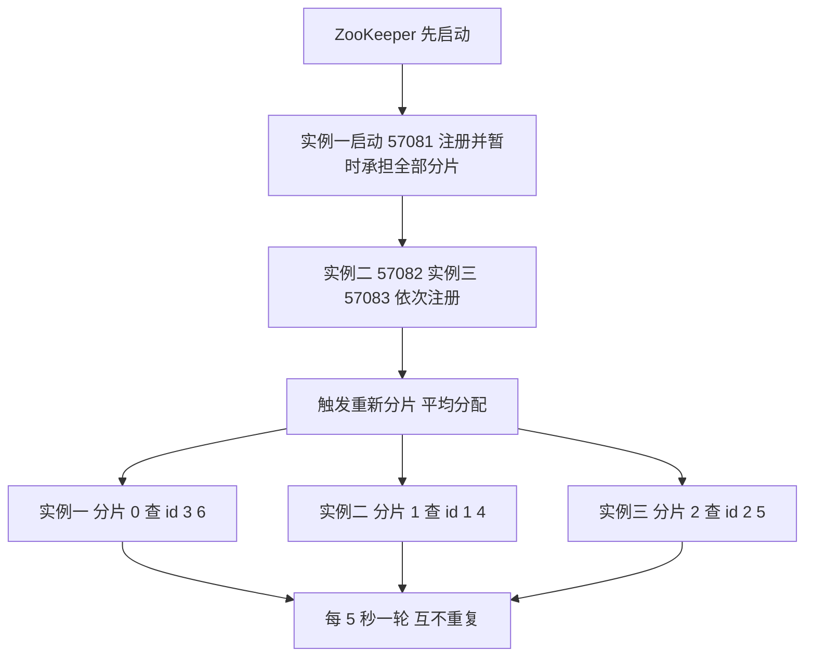

# Elastic-Job 入门案例运行效果：三实例平均分片，实例下线后自动重分片

> 🔒 安全提示：文中示例的口令/密钥均为课程教学环境演示口径，生产环境的安全要求见《安全与合规须知》。

配置全部就绪之后，检验成果的方式只有一个：跑起来看。这一课把入门案例完整启动一遍，观察三件事，分片是否真的平均分配、实例下线后任务会不会中断、中间出现的短暂停顿到底是什么。运行现象背后是注册、选举、重分片三个机制在起作用，把现象与机制对上号，分布式调度的价值才算真正看懂。

## 先给结论

- 分片总数配置为 3，就启动三个微服务实例，端口通过环境变量分别指定，默认端口是 57081。
- 启动初期分片不一定均匀，先注册的实例可能把活全干了，等三个实例都注册完毕、协调完成后，查询结果稳定为平均分配。
- 表里六条数据按 `MOD(id, 3)` 分给三个分片项，每实例稳定查到两条，且三轮之间没有任何一条数据被重复处理。
- 停掉一个实例后任务短暂阻塞，这是 ZooKeeper 重新选举 Leader 的过程，随后两个实例重新瓜分三个分片项，六条数据依旧不重不漏。
- 测试中出现的停顿与延迟属正常现象，注册要花时间，选举也要花时间，不能当成故障处理。

## 启动前的准备：ZooKeeper 在前，实例在后

运行顺序有讲究。Elastic-Job 内部使用 ZooKeeper 做协调，所以 ZooKeeper 服务必须先启动；实例启动时要向它注册，注册中心不在，实例无处可注册。

分片数量是 3，理论上需要三个微服务实例。入门案例工程的端口配置写成了支持外部覆盖的形式：

```properties
server.port=${PORT:57081}
spring.application.name = elastic-job-springboot
logging.level.root = info

spring.datasource.driver-class-name=com.mysql.jdbc.Driver
spring.datasource.url=jdbc:mysql://localhost:3306/mp?useUnicode=true&characterEncoding=utf8&autoReconnect=true
spring.datasource.username=root
spring.datasource.password=123456

# zookeeper服务地址
zookeeper.connString = localhost:2181
# 命名空间
myjob.namespace = elastic-job-example
# 分片总数
myjob.count = 3
# cron表达式(定时策略)
myjob.cron = 0/5 * * * * ?
```

`server.port=${PORT:57081}` 的含义是优先读取名为 `PORT` 的环境变量，读不到就用 57081。这样同一个工程不改文件就能起三个实例：第一个直接启动落在 57081，第二个启动前把 `PORT` 设为 57082，第三个设为 57083。IDEA 的运行配置里给每个实例分别指定环境变量与工作目录即可，之后三个实例依次启动。

## 三实例齐全：从各自为战到平均分配

启动过程的表现值得逐段分析。第一个实例起来后立刻向 ZooKeeper 注册，注册完成它就开始干活，此时另外两台还没启动。观察它最早的输出，分片 0、1、2 的活全在这一台上，三片数据它一个人查了个遍。这不是 bug：Leader 分片的前提是知道集群里有谁，后两台尚未注册，框架只能先把所有分片项交给当前唯一的实例。

随着第二、第三个实例陆续注册，ZooKeeper 感知到集群成员变化，框架触发分片重新分配，输出随之稳定下来。测试表 `t_user` 里有六条数据，查询按 `MOD(id, 3)` 过滤，三个分片项各自分到两条：

```sql
-- 验证分片项 1 对应的数据
SELECT * FROM `t_user` WHERE MOD(id,3) = 1;
```

三个控制台的稳定输出分别是：

```text
实例一  作业分片:0--->User(id=3, ...)   作业分片:0--->User(id=6, ...)
实例二  作业分片:1--->User(id=1, ...)   作业分片:1--->User(id=4, ...)
实例三  作业分片:2--->User(id=2, ...)   作业分片:2--->User(id=5, ...)
```

每 5 秒一轮，每轮三个实例并行各查各的，六条数据没有一条被两个实例同时处理。把整个生命周期画出来：



图上从「承担全部分片」到「平均分配」之间有一条隐含的状态切换，它由框架在感知到新实例注册时自动触发，业务代码与配置都不用改，这正是弹性扩容的含义：加机器即加并行度。

## 实例下线：短暂阻塞与重新瓜分

三台运行正常时各干各的活，接下来故意把最后一台停掉，模拟宕机。现象分两个阶段。

**第一阶段是停顿。**剩下两个实例的输出同时安静下来，看起来像任务卡死。原因是分片数量还是 3，实例却只剩两台，集群成员变化触发 ZooKeeper 的 Leader 选举流程，选举出下一个 Leader 之前，所有任务处于阻塞状态。这个机制在概念课里提过：宁可短暂等待，也不允许没有协调者的混乱期。停顿不会太长，几秒量级。

**第二阶段是重新分配。**选举完成后输出恢复，三个分片项被两台实例瓜分：实例一从只查分片 0 变成查分片 0 与分片 2，输出变成 id 3、6、2、5 四条；实例二仍是分片 1 的两条，id 1、4。两台加起来还是六条数据，不重不漏，只是负载从三份变成两份。把剩下的实例也停掉，六条数据会全部落到最后一台上，可以自行验证。

这就是分片调度对高可用的回答：实例减少不丢任务，分片自动收敛；实例恢复后分片又会摊开，并行度自动回升。

## 常见误区

- **把启动初期的全量执行当成重复执行故障。**错例：看到第一台把分片 0、1、2 全干了，判定配置失效。正解：后两个实例尚未注册，框架只能把全部分片项交给现存实例，成员齐全后自动重分片，属正常过渡现象。
- **把选举期间的停顿当成死锁或宕机。**错例：停掉一个实例后两台都没输出，慌忙重启应用。正解：这是 ZooKeeper 重选 Leader 的正常阻塞，新 Leader 产生前任务等待，几秒内恢复，重启反而延长不可用时间。
- **用实例数去解释分片数。**错例：以为分片数 3 就必须三台机器，少一台任务就会失败。正解：分片数是任务拆分粒度，实例数是执行者数量，两者不必相等，框架保证每个分片项总有人执行，多的实例领多片。
- **验证分片结果只看控制台日志。**错例：日志里各实例输出条数一致就认为分片正确。正解：更可靠的方式是按分片规则反查数据，例如对查询列做 `MOD(列, 分片总数)` 的 SQL，核对每个分片项的数据集合，再与实例输出比对。
- **忘记先启动 ZooKeeper。**错例：直接启动三个实例，注册失败或反复重试。正解：协调依赖 ZooKeeper，启动顺序必须是注册中心在前、实例在后。

## 面试可能被问到的问题

1. 面试官追问：「三个实例先后启动，为什么一开始任务都堆在一台上？」
   答：分片分配依赖集群成员视图，先启动的实例注册时集群里只有它自己，框架把全部分片项交给它。后续实例注册后 ZooKeeper 感知成员变化并触发重分片，任务随即摊到全部实例上，这是弹性扩容的自动行为。
2. 面试官追问：「一个实例下线后，正在运行的任务会怎样？」
   答：集群成员变化触发重新选举与重分片，选举完成前任务短暂阻塞，之后存活实例瓜分下线实例名下的分片项继续执行，数据不重不漏。若是执行中途宕机，未完成的分片还会走失效转移，由其他实例接手本轮任务。
3. 面试官追问：「如何验证分片查询的划分是否正确？」
   答：按业务分片规则构造 SQL 反查，例如按主键对分片总数取模，分别查出每个分片项应包含的数据集合，再与各实例控制台输出比对。示例中六条数据按 MOD(id,3) 分成三组各两条，三组并集等于全表且两两不相交即为正确。
4. 面试官追问：「测试时任务偶尔停顿几秒，可能是什么原因？」
   答：大概率是集群成员变化触发的 Leader 选举阻塞，或实例启动时向 ZooKeeper 注册的耗时。选举机制保证协调者角色的高可用，代价是新 Leader 产生前任务等待，对秒级以上间隔的调度任务影响可以接受。
5. 面试官追问：「实例数超过分片数会发生什么？」
   答：多出的实例分不到分片项而处于空闲，不参与执行但保持注册，一旦有实例下线，空闲实例会立即参与重分片接管任务。因此容量规划时分片数一般不低于预期的实例数，避免机器闲置。

## 配套资料

- 讲义：`materials/docs/10/万信金融-第5章-用户还款v1.0.md`，7.3 节功能测试（多实例启动、分片数据观察的测试思路）；Elastic-Job 入门案例的运行效果未随资料包归档，示例端口与输出内容按课堂画面整理。
- 代码：`materials/code/10/wanxinp2p/`，课程资料包内的工程源码归档目录（内含原始工程命名，与正文改写后的命名并非一一对应）；入门示例工程不在资料包内，文中的端口配置与分片验证 SQL 为按本课写法补全的示例。
