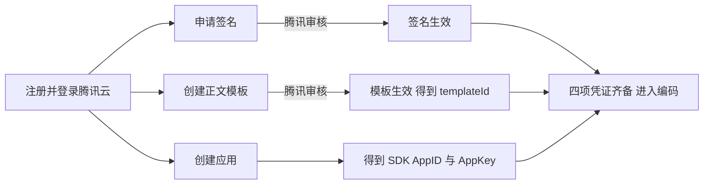

# 还款短信提醒开工：腾讯云短信的签名、模板与密钥准备

定时还款任务接入之后，系统已经能每天自动扫出到期还款计划并逐笔执行。但还款成功有一个绕不开的前提：借款人账户里得有足够的余额。充值这件事平台替不了，只能由借款人自己在还款日前完成，而人是最容易忘事的，忘了充值，定时任务照样跑，还款照样失败。平台的目标不是靠罚息和滞纳金挣钱，而是让用户按时还上款，所以在还款日前一两天发一条提醒短信，写清还款日期与应还金额，是让还款功能真正闭环的必要补丁。这条短信怎么发出来，就是本课及后续几课的主线。

## 先给结论

- 还款提醒短信不复用登录阶段的统一验证码服务：那套封装绑定固定模板，只能发验证码与有效期，塞不进还款日期与金额这类动态内容。
- 短信通道选用腾讯云短信（SMS），个人或企业账号都可以申请，官方宣称秒级触达、99% 到达率，国内外短信均可发送。
- 后台要做三项设置：申请签名、创建正文模板、创建应用拿到 SDK AppID 与 AppKey；签名与模板都要经过腾讯审核。
- 开发侧准备两件事：还款服务 `pom.xml` 引入 `qcloudsms` 依赖（1.0.6 版本）；Apollo 的 repayment-service 项目新建 `sms` 名称空间，写入 appId、appKey、templateId、sign 四项，并把 `sms` 挂进 `application.yml` 的命名空间列表。
- AppKey 与 AppID 一一对应且必须高度保密，泄露等于把短信发送权拱手交给人。

## 为什么验证码服务顶不上这个活

注册登录功能开发时，项目里部署过一个统一验证码服务，它对腾讯云短信做过一层封装。看它的接口签名就能发现问题：`send(String mobile, String code, int effectiveTime)`，参数是手机号、验证码与有效时长，模板内容固定为验证码加几分几秒内有效，两个占位符全部围绕验证码设计。还款提醒要发的内容是日期与金额，模板语义完全不同，这套封装一点忙都帮不上。

它的价值在另一个层面：抽象。业务代码只依赖 `SmsService` 接口，底层用哪家短信服务、怎么调 API，全部藏在实现类里。这次发还款提醒照同样的思路做，在还款服务里定义自己的 `SmsService` 接口，实现类换成直接对接腾讯云，将来若换成其他短信服务商，业务层一行代码都不用动。接口的具体定义留到下一课展开，本课先把外围环境备齐。

## 腾讯云后台的三项设置

注册并登录腾讯云（个人或企业账号均可），进入短信产品控制台，在使用短信服务之前有三件事必须做完：

**第一，申请签名。** 短信开头方括号里的署名就是签名，收到的每条营销或通知短信都带着它。申请时签名类型分个人、公司、公众号、网站、APP 等，按实际情况选择，用途分自用与他用。签名要做实人实名审核，企业签名需要提供组织机构代码、营业执照等资质材料，弄虚作假一定审核不通过。审核通常在两小时内完成。

**第二，创建正文模板。** 模板是短信正文的骨架，变化的部分用占位符留空。还款提醒的模板长这样：尊敬的用户您好，您的到期还款日是 {1}，本次应还金额 {2} 元。{1} 与 {2} 就是从 1 开始计数的占位符，对应代码里传入的参数数组下标，给哪个借款人发短信，就把他的日期与金额填进这两个位置。模板类型选普通短信即可，还款提醒属通知性质，不是营销。模板内容同样要过审核，违法与违规内容会被驳回。

**第三，创建应用。** 要在哪个项目里使用短信服务，就在控制台的应用管理里为它创建一个应用，起个名字即可。创建完成后腾讯云会生成一个 SDK AppID，点进应用详情还有一个与之对应的 AppKey。这两样加上签名与模板 ID，就是编码阶段要用的全部凭证。

三项设置的先后关系如下：



图上三条支线彼此独立，签名与模板的审核是等待项，应用创建即时完成；三条线汇合的终点就是编码阶段要注入配置的那四个值。

## 开发侧准备：依赖与配置

凭证备齐后，工程侧只有两步。

**第一步，检查依赖。** 打开还款服务的 `pom.xml`，查找 `qcloudsms`，没有就补上：

```xml
<!-- 腾讯云短信 SDK -->
<dependency>
    <groupId>com.github.qcloudsms</groupId>
    <artifactId>qcloudsms</artifactId>
    <version>1.0.6</version>
</dependency>
```

**第二步，配置凭证。** 项目的环境配置统一由 Apollo 管理，在 Apollo 的 repayment-service 项目下新建一个名称空间，名字就叫 `sms`，把四个凭证写进去（值为占位示例，实际取自己控制台申请到的数据）：

```properties
# 腾讯云短信 SDK AppID
sms.qcloud.appId = example-appid
# 与 AppID 一一对应的密钥
sms.qcloud.appKey = example-app-key
# 审核通过的正文模板 ID
sms.qcloud.templateId = example-template-id
# 审核通过的签名内容
sms.qcloud.sign = example-sign
```

与 Apollo 打过多次交道之后这条规则已经不需要再强调：新建的名称空间必须挂进 `application.yml` 的 `apollo.namespaces`，否则客户端根本不会去拉它，四个键一个都读不到：

```yaml
apollo:
  bootstrap: true
  # 命名空间列表追加 sms
  namespaces: sms, micro_service.elasticjob, micro_service.springframework
```

键名与后续实现类里 `@Value` 占位符必须逐字一致，`appId` 与 `appid` 在 Apollo 里是两个不同的键，大小写对不上，启动时直接报占位符解析失败。

## 关于申请资质与密钥保管的两句实话

以个人身份申请签名与模板，通过率很低，审核要求的资质材料个人通常拿不出来，这条路课程里也演示过，卡在资质环节是常态。学习阶段的可行做法是：流程照着走一遍体验申请过程，编码不受影响，发送环节先用日志输出模拟效果，等有了可用凭证再把真实发送打开。

密钥保管比申请更值得上心。AppKey 一旦泄露，任何人在任何项目里都能拿它以你的名义发短信，费用与投诉都会落到你的账号头上。凭证只放 Apollo 这类配置中心，仓库与文档里一律写占位值；怀疑泄露立即在控制台重置 AppKey。

## 常见误区

- **模板占位符与传参顺序对不上。** 错例：模板里 {1} 是金额、{2} 是日期，代码却按日期在前传数组。正解：占位符下标从 1 开始，与 `sendWithParam` 的参数数组顺序一一对应，传参顺序必须以模板定义为准，发出去才发现填反了，钱和日期就串了。
- **把真实 AppKey 提交进代码仓库。** 错例：图省事直接把凭证写死在工程配置文件里随代码入库。正解：凭证放 Apollo 的 `sms` 名称空间，仓库里只保留 example 占位值，泄露时在控制台一键重置即可止损。
- **新建 `sms` 名称空间后忘了挂进 `apollo.namespaces`。** 错例：Apollo 界面上四个键都填好了，启动却报 `${sms.qcloud.appId}` 无法解析。正解：客户端只加载 yml 里声明过的命名空间，`namespaces` 列表补上 `sms` 并重启。
- **模板选成营销类型。** 错例：建模板时随手选了营销短信，审核被驳回或上线后发送成功率极低。正解：还款提醒属通知类，选普通短信；营销短信审核更严，且容易被运营商拦截。

## 面试可能被问到的问题

1. 面试官追问：「项目里已经有验证码短信服务了，为什么还款提醒还要单独接一套？」
   答：验证码服务的封装与固定模板绑定，参数只有验证码和有效期，表达不了还款日期与金额这类动态内容。还款提醒需要自建模板、自传参数，所以按同样的抽象思路在还款服务里另起一个发送接口，底层对接腾讯云短信。接口抽象保留，实现可替换。
2. 面试官追问：「短信签名和正文模板分别是什么？为什么都要审核？」
   答：签名是短信开头的署名，标识发送方身份；模板是正文的固定骨架加占位符。两者都要审核是因为短信通道受运营商与监管强管控，实名与内容审核是为了防止骚扰与诈骗信息借道发送，审核通过后签名与模板各有唯一 ID 供代码引用。
3. 面试官追问：「SDK AppID 和 AppKey 泄露了会有什么后果，怎么防？」
   答：AppKey 是发送凭证，泄露后他人可用你的额度以你的签名发任意短信，产生费用与投诉风险。防范上凭证只存配置中心不进代码仓库，仓库与文档用占位值，泄露立即在控制台重置 AppKey。
4. 面试官追问：「模板占位符和代码参数是怎么对应的？」
   答：模板里用 {1}、{2} 这样的占位符标记变量位置，下标从 1 开始；调用发送 API 时传入字符串数组，数组第 0 个元素填 {1}，第 1 个填 {2}，依此类推。顺序以模板定义为准，传反了内容就错位。
5. 面试官追问：「为什么短信凭证要放 Apollo 而不是本地配置文件？」
   答：还款服务接入了 Apollo 配置中心，所有环境参数统一下发，凭证放独立的 sms 名称空间便于修改与多环境管理，密钥轮换时改一处配置即可，不用重新打包发布，也避免了凭证随代码仓库扩散。

## 配套资料

- 讲义：`materials/docs/10/万信金融-第5章-用户还款v1.0.md`，8.1 节腾讯云概述和环境准备（注册登录、签名与模板申请、依赖坐标、Apollo 的 `sms` 名称空间配置）。
- 讲义：`materials/docs/10/验证码服务使用指南.md`，1.3.3 节开通腾讯云短信服务的步骤，与本课后台设置流程互为参照。
- 代码：`materials/code/10/sailing/`，验证码服务工程归档（目录保留原始工程命名，与正文改写后的命名并非一一对应），其 `sms/qcloud` 包下的 `QCloudSmsService` 对腾讯云短信做了完整封装，`sms.qcloud.*` 四项配置键与发送调用写法同源，是本功能实现的真实参照。
