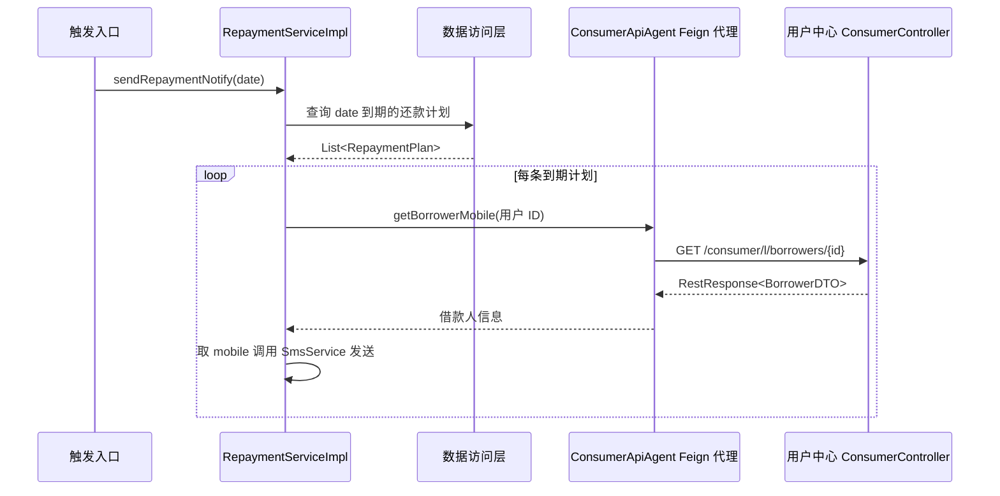

# 还款提醒功能落地：跨服务取手机号与到期计划的遍历执行

发送与提醒两个接口已经按契约定义完毕，接下来先实现还款提醒接口。实现它之前必须想清楚一个数据归属问题：还款服务手里只有还款计划，短信要发到的手机号却在用户中心的数据库里，中间隔着一个服务边界。怎么把手机号安全地、按项目既有规范地取过来，是这个功能最核心的设计点；取到之后，查询到期计划、逐条遍历、调用发送，就都是熟路了。

## 先给结论

- 手机号存放在用户中心侧的 `consumer` 表中，还款服务必须通过 Feign 远程调用去取，跨服务的数据绝不直连对方数据库。
- 实现路径共四步：用户中心 `ConsumerAPI` 新增根据用户 ID 查用户信息的方法；`ConsumerController` 实现该方法且路径以 `/l` 开头供微服务访问；还款服务新建 Feign 代理 `ConsumerApiAgent`；`RepaymentServiceImpl` 实现 `sendRepaymentNotify` 方法。
- 不能复用用户中心既有的查借款人接口：那个接口的路径是给前端带登录态用的，微服务之间调用没有登录上下文，必须单独开一条内部通道。
- 到期计划查询要恢复单参数版本：带分片参数的版本是定时还款任务专用，按分片条件过滤；短信提醒需要的是某个日期的全部到期计划，不带分片条件。两条查询以不同方法名共存，因为 MyBatis 的 Mapper 方法不能重载。
- 业务实现的主体是一个循环：查到期计划、遍历、取借款人信息与手机号、调 `smsService.sendRepaymentNotify(mobile, date, amount)` 完成提醒。

## 数据在哪：跨服务取手机号的设计分析

先盘点手头有什么、缺什么。还款服务的数据访问层里，`repayment_plan` 表保存着每一条还款计划，计划对象里带着借款人的用户 ID、应还金额（本息和）、应还日期等字段；唯独没有手机号。手机号在用户中心维护的 `consumer` 表里，那张表保存用户的姓名、用户编码、手机号等基础信息。表在人家库里，服务边界横在中间，方案只有一个：还款服务通过 Feign 发起远程请求，让用户中心代为查询。

请求过去总得带个寻址条件。查到期计划的时候，计划对象里现成有借款人的用户 ID，把 ID 作为参数传给用户中心，让它按 ID 从 `consumer` 表把用户信息查出来返回，手机号就在返回的 DTO 里。整个链路的形状如下：



这条链路与项目里做过的每一次远程调用同构：调用方定契约、被调方实现、中间架一座 Feign 代理。按讲义给定的步骤拆成四件事，用户中心两件，还款服务两件，下面逐一落实。

再往深一层看，为什么还款计划里存的是借款人用户 ID 而不是手机号？这是建表时就已经定下的设计。手机号属于用户资料，用户可以换号、可以修改，它是会变的数据；用户 ID 是全系统稳定的标识，永远不变。还款计划在放款时生成，一存就是几个月到几年，中间借款人换了手机号，计划里存的若是手机号，提醒短信就会发到旧号码上。以 ID 为准绳、用的时候再去用户中心取最新的手机号，是数据归一化的标准做法：每类数据只在自己归属的域里维护一份，其他地方只存引用。这个习惯从开户、投标一路贯穿到现在的短信提醒，值得在动手前想明白。

## 用户中心侧：新增一条供微服务访问的通道

动手前先看看用户中心有没有现成的能力。`ConsumerAPI` 里确实有一个查借款人用户信息的方法，入参是用户 ID，返回 `RestResponse<BorrowerDTO>`，`BorrowerDTO` 里就封装着手机号，功能上完全对口。再看它的实现，问题出来了：那个方法在 `ConsumerController` 里的映射路径是给前端用的，带登录态、走网关、面向浏览器请求。而现在要调它的是一个微服务，微服务之间的调用没有用户登录上下文，让还款服务伪装成前端去调一个面向人的接口，路径语义与鉴权设计都对不上。

功能可用不代表路径可用，项目对此早有约定：以 `/l` 开头的路径是微服务之间的内部接口，网关不向前端转发这类路径。所以正确的做法是给同一个功能另开一条内部通道，在 `ConsumerAPI` 中新增一个方法：

```java
/**
 * 获取借款人用户信息-供微服务访问
 * @param id 用户标识
 * @return
 */
RestResponse<BorrowerDTO> getBorrowerMobile(Long id);
```

`ConsumerController` 里补上实现，功能体与既有方法一致，都是委托 `consumerService.getBorrower(id)` 查询并包装返回，差别只在映射路径与方法名：

```java
@Override
@ApiOperation("获取借款人用户信息-供微服务访问")
@ApiImplicitParam(name = "id", value = "用户标识", required = true,
        dataType = "Long", paramType = "path")
@GetMapping("/l/borrowers/{id}")
public RestResponse<BorrowerDTO> getBorrowerMobile(@PathVariable Long id) {
    return RestResponse.success(consumerService.getBorrower(id));
}
```

路径 `/l/borrowers/{id}` 三个信息量都齐了：`/l` 声明这是内部接口，`borrowers` 说明资源是借款人，`{id}` 是路径参数。方法名单独取 `getBorrowerMobile`，与前端那条通道区分开，注释里「供微服务访问」六个字把用途写在明面上，后来者一眼就知道这条通道该被谁用。

`/l` 约定能挡住前端的原理值得复习一遍。前端的所有请求都要过网关，网关按路由规则把 `/consumer/**` 的请求转发给用户中心；而内部接口的保护并不靠网关拉黑名单，靠的是前端根本不会发起这类请求、网关转发的路径集合与内部路径天然错开，加上 Swagger 文档与接口说明里把 `/l` 接口标注为服务间调用，三道约束叠在一起，边界才守得住。反过来说，Feign 是服务注册中心里的直连调用，不经过网关，`/l` 路径对它畅通无阻，这正是内外有别的设计意图：外面的请求走网关受管控，里面的调用走注册中心走直连。

## 还款服务侧：一条指向用户中心的 Feign 代理

用户中心就绪后，切回还款服务建 Feign 代理。代理对这个项目来说早已是肌肉记忆：接口加注解，方法签名从对端照搬，路径补全。在还款服务的 `agent` 包下定义 `ConsumerApiAgent`：

```java
package com.study.finance.repayment.agent;

import com.study.finance.api.ConsumerAPI;
import org.springframework.cloud.openfeign.FeignClient;
import org.springframework.web.bind.annotation.GetMapping;
import org.springframework.web.bind.annotation.PathVariable;

@FeignClient(value = "consumer-service")
public interface ConsumerApiAgent {

    @GetMapping(value = "/consumer/l/borrowers/{id}")
    RestResponse<BorrowerDTO> getBorrowerMobile(@PathVariable("id") Long id);
}
```

三处细节决定这条代理能不能通。第一，`@FeignClient` 的 value 填用户中心注册进注册中心的服务名 `consumer-service`，代理按名字找实例，名字写错到运行时才报找不到服务。第二，方法路径必须与对端完整路径逐字一致：用户中心的基本路径 `consumer` 加上方法映射 `/l/borrowers/{id}`，少一截就 404。第三，`@PathVariable` 的绑定值要写清参数名，路径参数与形参才对得上位。启动类的 `@EnableFeignClients` 扫描范围此前已覆盖 `agent` 包，新代理放进去即可被框架接管。

## 恢复单参数的到期计划查询

业务实现第一步是查询到期的还款计划。这个能力此前开发过，但当时为了配合定时还款任务，数据访问层的查询方法带上了分片参数，按分片项对期数取模过滤，两个实例各查各的半边数据。短信提醒的诉求不同：不管分片，把某个日期到期的还款计划一次全部查出。分片版查询与无分片版查询的条件不一样，两条都得留。

在引入定时任务时，原始的无分片查询与业务方法被注释封存了，现在正是恢复它们的时候。数据访问层恢复单参数版本的查询，按到期日期与未还款状态过滤：

```java
@Select("SELECT * FROM repayment_plan WHERE DATE_FORMAT(should_repayment_date, '%Y-%m-%d') = #{date} "
        + "AND repayment_status = '0'")
List<RepaymentPlan> selectDueRepayment(String date);
```

这里埋着一条讲义专门标注的注意点：MyBatis 的 Mapper 接口方法不能重载。MyBatis 默认拿方法名当 SQL 语句的 ID，同名方法无论参数几个，映射到的是同一条语句，参数对不上直接出错。所以分片版本与单参数版本必须以不同的方法名共存，谁也别想靠重载省事。业务层同样把当初封存的查询入口恢复出来，供短信提醒调用：分片多参版本继续服务定时还款任务，单参数版本服务短信提醒，功能相似、条件不同、各司其职。

## 业务实现：查询、遍历、取手机号、调发送

准备工作全部就位，`RepaymentServiceImpl` 里的实现水到渠成。注入两个新依赖：Feign 代理 `ConsumerApiAgent` 与发送短信的 `SmsService`，然后重写 `sendRepaymentNotify`：

```java
@Autowired
private ConsumerApiAgent consumerApiAgent;

@Autowired
private SmsService smsService;

@Override
public void sendRepaymentNotify(String date) {
    // 1. 查询到期的还款计划
    List<RepaymentPlan> repaymentPlanList = selectDueRepayment(date);
    // 2. 遍历还款计划
    repaymentPlanList.forEach(repaymentPlan -> {
        // 3. 得到还款人的信息
        RestResponse<BorrowerDTO> consumerResponse =
                consumerApiAgent.getBorrowerMobile(repaymentPlan.getConsumerId());
        if (consumerResponse.isSuccessful()) {
            // 4. 得到还款人的手机号
            String mobile = consumerResponse.getResult().getMobile();
            // 5. 发送还款短信
            smsService.sendRepaymentNotify(mobile, date, repaymentPlan.getAmount());
        }
    });
}
```

逐段拆开看。查询调的是刚恢复的单参数方法，传入业务方法收到的日期，返回集合用 `List<RepaymentPlan>` 接住。遍历用 `forEach`，循环体里第一件事是远程调用：从计划对象里取出借款人的用户 ID，交给 Feign 代理发往用户中心，返回值是 `RestResponse<BorrowerDTO>`。拿到响应先判断调用是否成功，成功才继续，网络抖动或对端异常时这条计划被跳过而不是让整批提醒中断。取数据用两层解包：`getResult()` 拿到 `BorrowerDTO`，再 `getMobile()` 拿到手机号，中间那层 DTO 是用户中心契约的一部分，手机号就躺在里面。最后一步把手机号、日期与应还金额一起交给 `smsService`，金额直接取计划对象里的本息和字段，`BigDecimal` 类型与发送接口的签名严丝合缝。

至此第二个接口整条链路走通。发送接口 `SmsService` 的实现还空着，当前调用只会进到那个空方法，这是接口先行策略的正常中间态：编排侧完全就绪，能力侧只欠一个实现类。

## 规模与健壮性：逐条远程调用的代价

实现虽短，它的性能形状值得看清。循环体里每条到期计划都要发起一次 Feign 调用，到期计划有 N 条，用户中心就挨 N 次请求，这就是典型的 N 加一调用模式。日常规模下问题不大：到期计划的量级是每天几十上百条，用户中心又只是做一次主键查询，响应很快。但规模一旦上来，比如促销活动导致放款集中、某个还款日集中到期几千条计划，串行的 N 次远程调用就把提醒的总时长拉得很长，用户中心的查询压力也跟着堆高。

生产化的改进方向有两条。一条是把查询接口升级成批量形态：传一组用户 ID，一次请求返回一批用户信息，循环里的远程调用从 N 次收敛到一两次，代价是对端要支持集合参数与批量查询。另一条是并发化：批量查不了就并行查，用线程池把逐条调用摊开，注意控制并发度别把用户中心打挂。课堂实现选择最朴素的串行版本，胜在逻辑直白、与讲义逐行对应，先把正确性立住，扩展手段记在心里，面试被追问性能时能立刻接上。

健壮性方面的底线前面已经做了：响应判成功才解包，失败跳过记录。再往上一层的保护项目公共配置里早就备好，Feign 调用默认带着超时与熔断配置，用户中心短暂不可用时熔断器打开，提醒功能降级而不是把还款服务的线程拖死。旁路功能的健壮性标准就是这几个层级：不崩、不堵、可跳过、可补偿。

## 常见误区

- **复用用户中心给前端的借款人查询接口。** 错例：还款服务的 Feign 代理直接指向带登录态的前端路径。正解：微服务间调用走 `/l` 开头的内部接口，没有登录上下文也能用，前端经网关摸不到这条通道，边界清晰。
- **Feign 代理路径少拼基本路径。** 错例：方法映射只写 `/l/borrowers/{id}`，漏掉用户中心的 `consumer` 基本路径，请求打到对端 404。正解：代理路径必须是对端基本路径加方法映射的完整拼接，与 Controller 上的映射逐字一致。
- **Mapper 接口里重载查询方法。** 错例：单参数与多参数版本同名共存，MyBatis 拿方法名当语句 ID，映射错乱。正解：两个版本用不同方法名，各自绑定各自的 SQL。
- **远程响应不判成功直接解包。** 错例：拿到 `RestResponse` 就取 `getResult().getMobile()`，对端异常时直接空指针或把异常抛进循环。正解：先判断响应成功与否，失败的计划跳过并记录，保证一批提醒尽量多送出去。
- **手机号查询每条计划重复实现。** 错例：在循环里各自写一遍 HTTP 调用细节。正解：统一走 `ConsumerApiAgent` 一个入口，超时、熔断、日志都在代理层收口，链路可观测。

## 面试可能被问到的问题

1. 面试官追问：「还款服务为什么不直接连用户中心的数据库查手机号？」
   答：微服务架构下每个服务独占自己的数据库，库是服务的私有实现细节，跨库直连会把两个服务的Schema耦死，对方改表这边直接崩。标准做法是走服务间远程调用，用户中心封装查询逻辑并返回 DTO，数据边界与服务边界保持一致。
2. 面试官追问：「用户中心已有查借款人的接口，为什么还要新增一个？」
   答：既有接口面向前端，路径带登录态语义，微服务调用没有用户上下文，复用它语义不符。项目约定 `/l` 前缀是服务间内部接口，网关不转发，所以按约定新增一条内部通道，功能委托同一个 Service，只是入口与受众不同。
3. 面试官追问：「Feign 代理定义时最容易错的地方是什么？」
   答：路径与服务名。服务名必须与对端注册进注册中心的名字完全一致，路径必须是对端基本路径加方法映射的完整拼接，任何一处对不上都是运行期 404 或找不到服务，编译期毫无提示。参数绑定注解也要写清，路径变量与形参才对得上。
4. 面试官追问：「为什么 MyBatis 的 Mapper 方法不能重载？」
   答：MyBatis 把接口方法名作为 SQL 映射语句的 ID，全限定名加方法名唯一定位一条 SQL，同名不同参的 重载方法会映射到同一条语句，参数解析必然错乱。需要相似但条件不同的查询时，用不同方法名分别定义。
5. 面试官追问：「一批提醒短信里有一条借款人查询失败，怎么处理更稳妥？」
   答：单条失败不应中断整批。判断响应成功后跳过失败项并记录日志，必要时收集失败清单事后补偿。若渠道允许，还可以引入重试与延迟队列，把偶发的远程失败隔离开，保证提醒的最终送达率。
6. 面试官追问：「到期计划量很大时，逐条远程查手机号会有什么问题，怎么优化？」
   答：这是典型的 N 加一调用，远程请求次数随计划数线性增长，串行调用拉长总耗时，也给用户中心带来压力尖峰。优化方向是把查询接口改成批量形态，一次传一组用户 ID 返回一批信息，把 N 次调用收敛成一两次；或用受控并发把逐条调用摊开。数据量大时还应结合分片并行处理，与定时还款任务的分片思路一致。

## 配套资料

- 讲义：`materials/docs/10/万信金融-第5章-用户还款v1.0.md`，8.3.1 节还款服务还款提醒接口（四步实现路径：`ConsumerAPI` 新增方法、Controller 实现、Feign 代理、业务层实现），以及 8.4 节关于 Mapper 方法不能重载的注意事项。
- 代码：`materials/code/10/wanxinp2p/`，课程资料包内的工程源码归档目录，其中用户中心模块可对照 `ConsumerController` 与 `consumer` 表相关实现（内含原始工程命名，与正文改写后的命名并非一一对应）；还款服务模块源码不在资料包内，文中 `RepaymentServiceImpl` 实现与 Feign 代理为按讲义与课堂画面补全的示例，包名按 `com.study.finance` 系改写。
