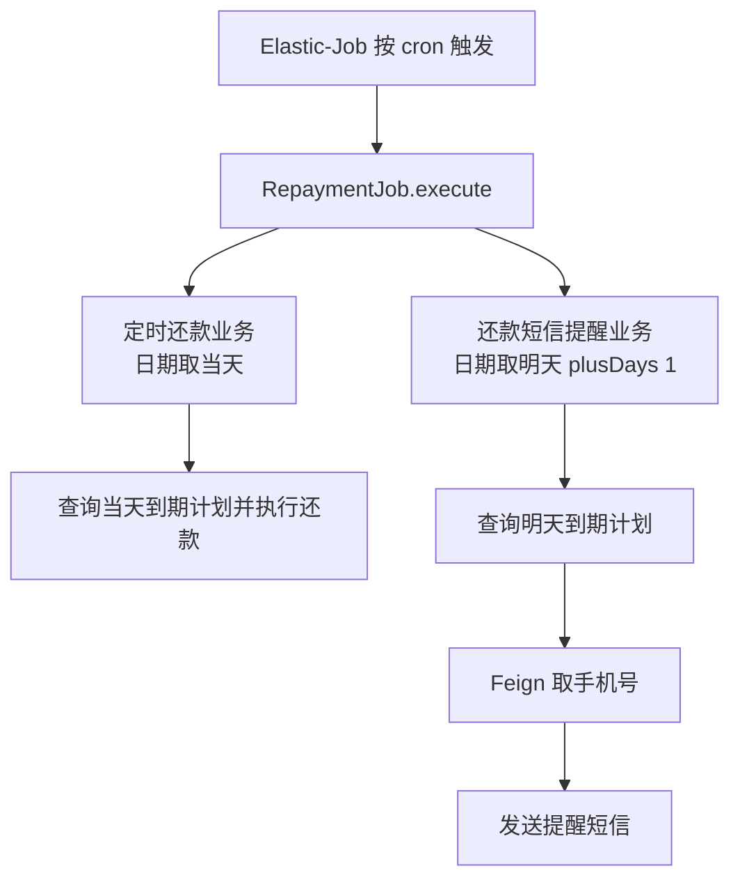

# 定时还款短信提醒：把提醒入口挂进 RepaymentJob，第五章收官

还款短信提醒功能开发完、也测试通过了，但它目前仍靠人工在浏览器里发请求触发。人工触发在真实业务里不成立：P2P 平台交易量与客户量大，几乎每天都有大批用户临近还款日，靠人守着发请求既不现实也不可靠。这一课把提醒功能挂到 Elastic-Job 定时任务上，由系统每天自动执行，同时也为第五章用户还款画上句号。

## 先给结论

- 提醒功能的最简接入方式是复用现有任务类：在 `RepaymentJob` 的 `execute` 方法里追加一行业务调用，随定时还款任务一起被调度。
- 两个业务可以共用一个任务类的前提是定时规则一致；如果规则不同，必须拆成独立任务类各自配置 cron。
- 触发日期传的是明天：`LocalDate.now().plusDays(1)`，今天查明天到期的计划，实现提前一天提醒；要提前 N 天就传 `plusDays(N)`。
- ZooKeeper、Elastic-Job、Apollo 的全部配置沿用定时还款任务那一套，除 `execute` 里加一行代码外其他地方一律不动。
- 测试要把表里的应还日期人工改成明天的日期，否则查询为空看不到效果；每 5 秒一次的 cron 仅为观察方便，生产环境按天调度。

## 两个方案怎么选

接入定时任务有两条路。一是照定时还款任务的样子单独做一个任务类，重写 `SimpleJob` 的 `execute`，再把 Apollo 里的调度配置复制一套；二是把提醒的触发入口直接加进已有的 `RepaymentJob`。选哪条路，判断依据是定时规则是否相同。

定时还款任务与还款短信提醒的调度节奏完全一致：真实环境里都是每天执行一次，例如凌晨三点或五点扫一遍。规则相同就没必要养两套任务类和两份配置，一个任务类的 `execute` 方法里本来就可以编排多个业务。反过来，若两个业务的调度规则不同，一个按天一个按小时，就必须拆开，各写任务类、各配 cron，强行合在一起只会互相迁就。

## 一行代码接入

打开任务类 `RepaymentJob`，它实现了 `SimpleJob` 接口，`execute` 是调度器的触发入口，cron 每到触发点就执行一次这个方法。当前方法里已有定时还款业务的调用，在其后追加提醒业务：

```java
import java.time.LocalDate;
import java.time.format.DateTimeFormatter;

@Component
public class RepaymentJob implements SimpleJob {

    @Autowired
    private RepaymentService repaymentService;

    @Override
    public void execute(ShardingContext shardingContext) {
        // 调业务层执行定时还款任务
        repaymentService.executeRepayment(LocalDate.now().format(DateTimeFormatter.ISO_LOCAL_DATE),
                shardingContext.getShardingTotalCount());

        // 调业务层执行还款短信通知
        repaymentService.sendRepaymentNotify(LocalDate.now().plusDays(1).format(DateTimeFormatter.ISO_LOCAL_DATE));
    }
}
```

两个调用只差在日期上：还款业务查的是今天到期的计划，传当天；提醒业务要提前一天，传明天。`plusDays(1)` 在当前日期基础上加一天，今天 2 号就查 3 号到期的计划并给对应借款人发短信，明天执行时自然查 4 号的，滚动向前。方向别搞反：`plusDays` 向后加，`minusDays` 向前减，这里要的是「明天」，写正数。想提前两天提醒，把 1 改成 2 即可，业务语义直接映射到参数上。日期用 `DateTimeFormatter.ISO_LOCAL_DATE` 格式化成 `yyyy-MM-dd`，与查询条件里 `DATE_FORMAT` 的格式对齐。

除了这一行，其他什么都不用改。ZooKeeper 连接、作业命名空间、分片总数、cron 表达式都在 Apollo 的 `micro_service.elasticjob` 命名空间里，配置类与注册逻辑全部现成，这正是当初把定时任务基础设施搭完整的回报。

## 测试与现象

测试前先解决数据问题：提醒查的是明天的到期计划，而表里的应还日期都是历史值。用数据库工具挑一条或几条 `repayment_plan` 记录，把 `SHOULD_REPAYMENT_DATE` 人工改成明天的日期，例如今天是 10 月 25 日就改成 10 月 26 日。 Apollo、ZooKeeper 启动后，把还款微服务与用户中心微服务拉起来。为了观察方便，可以把定时还款业务先注释掉，只看短信提醒这条线。

调度每 5 秒触发一次，控制台周期性打出查询 SQL 与发送日志：查的是 10 月 26 日的到期计划，取出借款人手机号，短信按模板填入日期与金额发出。手机上每隔五秒收到一条，效果直观但也暴露了测试频率的荒谬之处，真实上线绝不能是这个频率。



图上同一个 `execute` 分出两条业务线，各自带各自的日期语义。上生产前把 cron 从 `0/5 * * * * ?` 改成每天一次，例如 `0 0 3 * * ?`，两条业务线就都在凌晨三点走一遍。

## 腾讯云短信申请不到怎么办

个人身份申请短信签名与模板的通过率很低，这是整章反复出现的现实约束。申请不下来时，把发送实现里的 SDK 调用换成控制台输出或日志打印，模拟发送即可：

```java
@Override
public void sendRepaymentNotify(String mobile, String date, BigDecimal amount) {
    // 无真实凭证时模拟发送，只输出日志观察链路
    log.info("模拟发送还款提醒：手机号 {}，还款日期 {}，应还金额 {}", mobile, date, amount);
}
```

方法签名不变，上层编排一行不动，链路的查询、取号、遍历照样验证。本课练习的重点是定时任务的接入方式，短信 API 只是链路末端的一格，拿到审核通过的凭证后把实现换回真实调用即可。

## 第五章收官复盘

至此第五章全部结束，回头看这条主线：从用户还款的需求分析出发，先实现了还款功能本身，再引入任务调度与分布式任务调度的概念，用 Elastic-Job 把还款挂上定时调度并做了分片，最后给还款流程补上借款人体验的一环，到期前自动发出提醒短信。过程中贯穿了 Apollo 配置管理、Feign 服务间调用、腾讯云短信对接，也踩掉了 Mapper 方法重载这样的框架级坑。充值、还款、提醒在系统里形成闭环，P2P 平台最核心的交易后链路就此完整。

## 常见误区

- **提醒与还款共用任务类时日期也共用。** 错例：两个业务都传当天日期，提醒查的是当天到期的用户，当天提醒失去意义。正解：提醒业务单独传 `plusDays(1)` 的明天日期，提前一天触达借款人。
- **把 `plusDays` 写成 `minusDays`。** 错例：想查明天到期却传了昨天的日期，查询永远为空。正解：`plusDays` 向后加一天，`minusDays` 向前减，提前一天提醒对应 `plusDays(1)`。
- **定时规则不同的业务硬塞进同一个任务类。** 错例：一个按天一个按小时的业务共用一个 cron，互相迁就。正解：规则相同才合并，不同就拆任务类，各自配置调度参数。
- **拿着 5 秒的测试 cron 上线。** 错例：联调完直接发布，短信服务每 5 秒被调一次，账号很快被服务商限制。正解：生产环境改按天调度，凌晨低峰执行，并评估单次数据量与分片配置。

## 面试可能被问到的问题

1. 面试官追问：「还款短信提醒为什么不做成接口由前端调用，而是做成定时任务？」
   答：提醒的触发时机由还款日决定，与用户操作无关，前端调用无法保证时效也不可控。挂到 Elastic-Job 上由系统每天自动扫描明天的到期计划并批量发送，触发可靠、频率可控，人工只负责维护规则不参与执行。
2. 面试官追问：「两个业务共用一个任务类，怎么决定合还是拆？」
   答：看定时规则是否一致。规则一致就合并，一个 `execute` 编排多个业务，省掉重复的任务类与配置；规则不一致必须拆成独立任务类，各自配置 cron，避免互相牵制。合并时还要评估两个业务的耗时，防止长任务拖累另一条业务线的触发时效。
3. 面试官追问：「提前一天提醒的日期是怎么计算的？」
   答：用 `LocalDate.now().plusDays(1)` 取明天，再格式化成与查询条件一致的 `yyyy-MM-dd` 字符串。今天执行查明天到期的计划，随日期滚动自然实现提前一天触达；要提前 N 天就传 `plusDays(N)`。
4. 面试官追问：「定时任务接入短信提醒，配置层面要改什么？」
   答：什么都不用改。ZooKeeper 地址、作业命名空间、分片总数、cron 都在 Apollo 的 `micro_service.elasticjob` 命名空间里，任务类与配置类沿用定时还款任务那一套，唯一的变化是 `execute` 方法里多了一行业务调用，这正是配置中心化带来的好处。
5. 面试官追问：「测试时为什么要把表里的应还日期改成明天？」
   答：提醒业务查询的是明天的到期计划，表里的存量数据日期要么是历史值要么是很久以后的值，不满足条件查询为空。把测试记录的应还日期人工改成明天，调度触发后才能查到数据并观察到完整的发送链路。

## 配套资料

- 讲义：`materials/docs/10/万信金融-第5章-用户还款v1.0.md`，8.5 节定时还款短信提醒（人工触发不成立的分析、`RepaymentJob.execute` 追加提醒调用的完整代码）。
- 代码：`materials/code/10/wanxinp2p/`，课程资料包内的工程源码归档目录（内含 `wanxinp2p/` 等原始命名子目录，路径只列到该层级，与正文改写后的命名并非一一对应）；还款服务与任务类源码不在资料包内，文中 `RepaymentJob` 与模拟发送实现为按讲义与课堂画面补全的示例，包名按 `com.study.finance` 系改写。
- 代码：`materials/code/10/wanxinp2p_apollo/`，接入 Apollo 的工程源码归档（目录保留原始工程命名），可对照查看微服务侧 Apollo 客户端与命名空间的接法。
