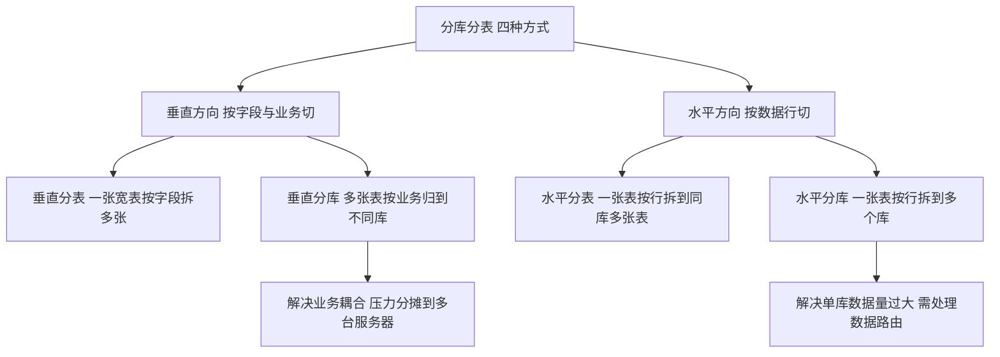

# 面试易问技术：分库分表，为什么拆、怎么拆、拆完的坑怎么填

项目业务讲完，面试官必然把火力压到数据层：你项目里数据库是怎么扛住大数据量的？分库分表是必问的第一站，因为万信金融的交易库真按这套方案拆过。这一问看着开放，其实有一条标准作答路径：为什么拆、有哪几种拆法、项目里怎么拆的、拆完带来什么问题怎么解。四段答下来，面试官就知道你是真做过还是只背了名词。

## 先给结论

- 回答「为什么拆」先报两个经验阈值：MySQL 单库数据量 5000 万以内性能尚可，超过后性能随数据量增大明显降低；单表数据量超过 1000 万，性能下降严重，查询变慢甚至卡死，并发一高就能把系统拖垮。
- 拆分方式四种：垂直分表、垂直分库、水平分表、水平分库。判断口诀是垂直看字段看业务，水平看数据行。
- 万信金融对交易中心落地了水平分库与水平分表：分库以发标人 ID 取模奇偶分流到 `finance_transaction_0` 与 `finance_transaction_1`，分表以标的 ID 取模拆成标的信息表与投标信息表各两张，两表互为绑定表。
- 分库分表解决的只是存储与性能问题，跨库关联、主键唯一、结果归并这些新问题由 Sharding-JDBC 在 JDBC 层统一收敛，应用照旧面向逻辑表编程。
- 拆分粒度要按项目实情选择，垂直与水平常常综合运用，不存在标准答案，能讲清自己的选择理由比背概念更加分。

## 第一问：为什么要在项目里分库分表

作答要从一个朴素的事实切入：项目刚上线时库里没多少数据，甚至混着测试数据，但随着平台发展，数据量会持续增长。P2P 平台尤其明显，标的信息与投标信息是基础业务数据，借款与投资一旦活跃起来，这两类数据的增长是几何级的，达到亿级很正常。

亿级数据压在 MySQL 上会发生什么，用两个阈值说话。单库数据量 5000 万以内，性能还可以接受；一旦超过，性能随数据量增大明显降低。单表的数据量最好不要超过 1000 万，超过后性能下降严重，查询一次花的时间越来越长，并发操作达到一定量时可能直接卡死。运营商的通话详单、消费明细就是现成的反面教材：客户量庞大到惊人的程度，用户查一笔几个月前的记录，等上几分钟查不出来甚至直接卡死，这就是系统被数据量拖垮的样子。

有面试官会追问：加硬件行不行。能行，但要当场算两笔账：扩容服务器成本高，而且单机性能提升是有上限的，数据涨到一定量级，再贵的机器也只是一台机器的吞吐。相比之下，把数据分散到不同的数据库，让每个库、每张表的数据量都变小，成本可控，且改造可控：底层还是关系型数据库，原来的运维体系、备份监控这些基础设施都能重用。这条对比讲完，「为什么拆」就立住了。

## 第二问：常见的拆分方式有哪几种

四种方式先用一张图分好类，垂直与水平的差异一眼可见：



**垂直分表拆的是字段。** 一张 20 个字段的宽表，按访问频次、业务耦合松紧、是否是大字段这几个角度综合考量，把一部分字段拆出去放到另一张表，字段总量不变，单表数据量随之变小。拆完有一个副作用要主动交代：原来一张表能完成的查询，现在可能要联表，所以要尽量从业务角度避免联查，否则拆分省下的性能又从关联查询里赔回去，得不偿失。

**水平分表拆的是行。** 一张 1000 万行的表，前 500 万行放进 A 表，后 500 万行放进 B 表，字段完全不动，每个表只承载部分数据。它能小幅提升性能，通常作为水平分库的补充优化。

**垂直分库拆的是业务。** 以往的坏习惯是一个库里什么数据都往里塞，登录的、交易的、日志的全混在一起。垂直分库按业务把表归类，用户数据一个库，交易数据另一个库，也可以按访问频次归类，把访问量特别大的数据单独放一个库，将来对这个库做负载均衡、上更好的硬件都有的放矢。库分布在多台服务器上，访问压力被负载分摊，业务边界也随之清晰。

**水平分库同样是拆行，只是拆到了不同的库。** 一亿行的表，拿一千万行放 A 库、再一千万行放 B 库，不考虑业务归类，简单粗暴。它不仅带来跨库问题，还要解决数据路由：一行数据进来，得有个明确规则决定它去哪个库。

一句话收拢：凡是水平拆分，简单粗暴按行扔；凡是垂直拆分，要综合业务与访问频次考量。实际项目里两种方向往往综合运用，万信金融就是垂直分库（交易数据独立成库）打底，再做水平分库与水平分表。

## 第三问：项目里是怎么拆的

这一段要给出能落到库表名字上的细节。交易相关数据（标的信息、投标信息）增长最凶，所以单独创建交易中心数据库存放，先对该数据库做水平分库。分库前有一条业务铁律要先摆出来：相同发标人的数据最好不要分散，否则查询这个发标人的相关信息要跨库。据此以发标人作为分片键，分片策略取发标人 ID 对 2 取模，奇偶决定数据进 `finance_transaction_0` 还是 `finance_transaction_1`。发标人 ID 一旦确定，他名下所有数据的落库永远唯一，铁律自动成立。

库拆完表还没完。库内的标的信息表与投标信息表会以标的 ID 作为关联键做联合查询，因此分表以标的 ID 作为分片键，同样对 2 取模，两张表各拆成两张，并且把标的信息表与投标信息表设置为绑定表：分片规则一致的主子表，关联查询按下标一一对应组合，不会出现笛卡尔积。这一问里「水平还是垂直」的判断也要主动点破：取模看的是行里某个字段的值，这是水平拆分，无论分库还是分表都是。

分片口径翻译成 Sharding-JDBC 配置大致是下面的样子（示例，按本课分片口径整理，库名按 `com.study.finance` 系口径改写）：

```properties
# 标的信息表的数据节点 两个库各两张真实表
spring.shardingsphere.sharding.tables.project.actual-data-nodes = finance_transaction_$->{0..1}.project_$->{0..1}
# 分库策略 分片键为发标人ID 奇偶定库
spring.shardingsphere.sharding.tables.project.database-strategy.inline.sharding-column = consumer_id
spring.shardingsphere.sharding.tables.project.database-strategy.inline.algorithm-expression = finance_transaction_$->{consumer_id % 2}
# 分表策略 分片键为标的ID 奇偶定表
spring.shardingsphere.sharding.tables.project.table-strategy.inline.sharding-column = id
spring.shardingsphere.sharding.tables.project.table-strategy.inline.algorithm-expression = project_$->{id % 2}
# 投标信息表 同口径拆分 分片键同为标的ID
spring.shardingsphere.sharding.tables.tender.table-strategy.inline.sharding-column = project_id
spring.shardingsphere.sharding.tables.tender.table-strategy.inline.algorithm-expression = tender_$->{project_id % 2}
# 两表互为绑定表 关联查询按下标对齐
spring.shardingsphere.sharding.binding-tables = project,tender
```

业务代码因此可以保持干净：保存标的信息时写的仍是逻辑表 `project`，发标人 ID 与主键两个分片键赋值到位，数据落哪个库哪张表由这套规则自动算出。

```java
/** 交易中心保存标的信息 节选 包名按 com.study.finance 系改写 */
@Service
public class ProjectServiceImpl implements ProjectService {

    @Override
    public void saveProject(ProjectDTO projectDTO) {
        Project project = ProjectConvert.INSTANCE.toProject(projectDTO);
        // consumerId 即发标人ID 分库分片键
        project.setConsumerId(projectDTO.getUserId());
        // id 由雪花算法生成 分表分片键
        projectDAO.insert(project);
    }
}
```

## 第四问：拆完带来什么问题，怎么解

答到拆法还不算完，面试官多半会补一句「分库分表有什么副作用」。这一段恰好是检验是否真做过的分水岭，逐条报即可。**跨库关联查询**：原来一条 SQL 关联两张表，现在数据可能散在不同库，靠绑定表配置把规则一致的主子表关联约束到下标对齐，避免笛卡尔积式的全组合路由。**主键唯一**：各库各自维护的自增主键只能保证局部唯一，两个库都会产出 ID 为 1 的行，必须换成分布式全局主键，Sharding-JDBC 内置 SNOWFLAKE 雪花算法，在客户端生成全局唯一且趋势递增的 ID。**分页与排序**：SQL 要先在所有命中节点执行，再把结果归并起来，这部分开销由框架的归并引擎承担。**跨库事务**：一次业务操作写多个库，本地事务管不住，要用分布式事务方案，这属于另一道面试题的范畴。

这些麻烦要是全靠手工处理，拆分的工作量会大到不可接受。Sharding-JDBC 以增强版 JDBC 驱动的形态工作在应用进程内，解析 SQL、路由、改写、执行、归并全部由它完成，复杂度收敛到配置里。项目里拆分方案与框架的分工一句话讲清：人工负责把库表按策略拆好，框架负责让应用感觉不到拆过。

## 常见误区

- **把垂直分表说成按行拆。** 错例：把老数据切到新表叫垂直分表。正解：垂直拆的是字段，按访问频次、业务耦合、大字段原则切；按行拆的是水平方向，两种方向的判断依据完全不同。
- **认为分库分表之后性能问题就一劳永逸。** 错例：拆完就不再关注慢查询。正解：拆分解决单库单表数据量过大的问题，跨库关联、结果归并引入了新的开销，分片键选错还会导致全路由，设计与使用都要持续审视。
- **分片键随手挑一个字段。** 错例：按记录创建时间取模分库。正解：分片键要满足业务铁律，交易场景里相同发标人的数据不分散，据此选发标人 ID；SQL 不带分片键会路由到所有节点，性能极差。
- **漏掉绑定表配置。** 错例：标的信息表与投标信息表各自拆分，关联查询不管。正解：两表分片规则一致，必须登记为绑定表，否则主子表真实表交叉组合，SQL 数量相乘且结果重复。

## 面试可能被问到的问题

1. 面试官追问：「你们项目为什么要做分库分表？」
   答：P2P 平台的标的信息与投标信息是基础业务数据，随平台发展会几何级增长到亿级。MySQL 单库 5000 万、单表 1000 万是经验阈值，超过后性能明显下降，查询变慢甚至卡死拖垮系统。加硬件成本高且有上限，把数据分散到多个库多张表，让每个库每张表的数据量变小，改造成本可控，运维体系还能重用。
2. 面试官追问：「垂直拆分和水平拆分的区别是什么？」
   答：垂直拆的是字段与业务，分表按访问频次、业务耦合、大字段原则切字段，分库按业务把表归类到不同库；水平拆的是数据行，把一张表的行分散到多张表或多个库，不考虑业务归类。口诀是垂直看业务看字段，水平看行，实际项目常综合运用。
3. 面试官追问：「你们交易库的分片键是怎么选的？」
   答：分库以发标人 ID 为分片键，对 2 取模奇偶分流到两个交易库，依据是业务铁律：相同发标人的数据不能分散，否则查询相关信息要跨库。分表以标的 ID 为分片键，标的信息表与投标信息表按标的 ID 关联，两表拆分规则一致并配置为绑定表，关联查询按下标对齐。
4. 面试官追问：「分库分表后主键怎么处理？」
   答：各分片库的自增主键只能局部唯一，全局会冲突，比如两个库都会出现 ID 为 1 的行。方案是改用分布式全局主键，Sharding-JDBC 内置 SNOWFLAKE 雪花算法，客户端生成全局唯一且趋势递增的 ID，递增特性对 B+ 树索引友好。
5. 面试官追问：「拆分后哪些问题需要框架帮你解决？」
   答：跨库关联靠绑定表约束路由组合，主键唯一靠全局主键算法，分页排序靠归并引擎在多节点执行后合并结果，跨库事务要另配分布式事务方案。Sharding-JDBC 在 JDBC 层完成解析、路由、改写、执行、归并，应用仍面向逻辑表编程。
6. 面试官追问：「所有项目都应该做分库分表吗？」
   答：不是。系统设计阶段先按业务耦合确定垂直拆分；数据量与访问压力不大时，索引优化、缓存、读写分离是性价比更高的手段；只有单表数据量逼近千万级且持续增长、上述手段都不够用时才上水平分库分表，它成本高、复杂度高，要按实情评估。

## 配套资料

- 讲义：`materials/docs/10/day16-项目总结&就业指导v1.0.md`，3.3.1 为什么要分库分表（亿级数据与单库单表阈值）、3.3.2 请介绍几种常见的分库分表方式（四种方式定义与交易库分片策略）。
- 讲义：`materials/docs/10/Sharding-jdbc专题-v1.0.md`，数据分片核心概念（逻辑表、分片键、绑定表）与框架定位，是「拆完的问题怎么解」的理论来源。
- 代码：`materials/code/10/wanxinp2p/`，P2P 工程归档（目录保留原始命名，路径只列到该层级），父 `pom.xml` 锁定 `sharding-jdbc-spring-boot-starter` 4.0.0-RC1。
- 代码：`materials/code/10/基础代码/基础代码/dbsharding/`，分库分表入门示例工程骨架。文中分片配置与保存标的代码为按本课分片口径整理的示例，分片规则以讲义口径为准。
