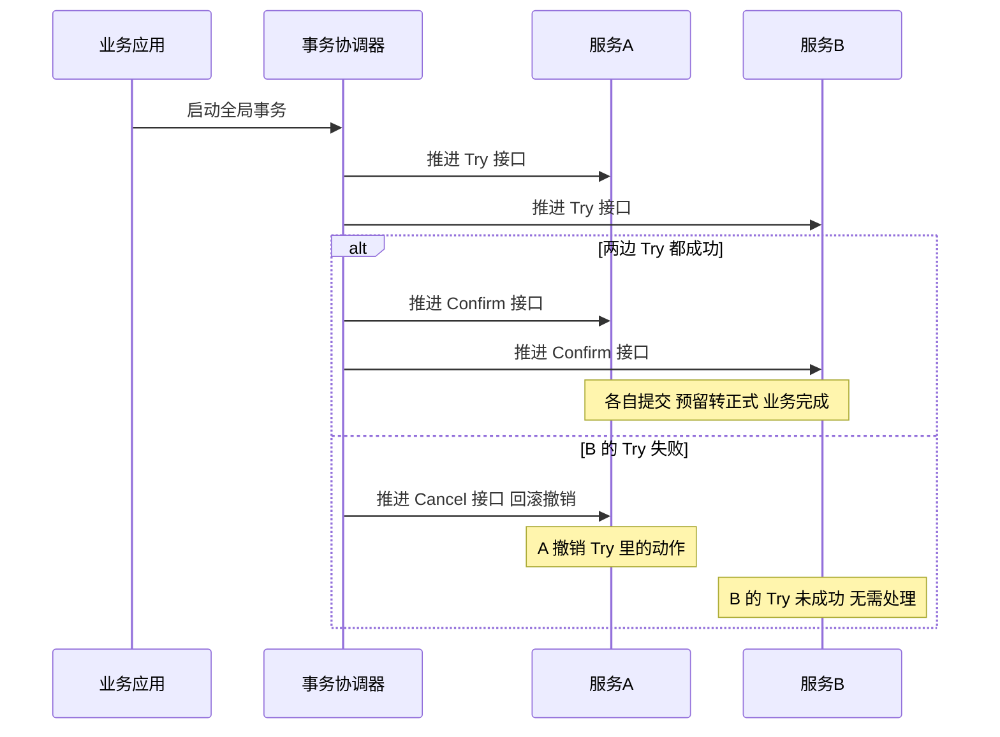

# 面试易问技术：TCC，三操作两阶段、三大坑与 Hmily 落地经验

TCC 是分布式事务面试里的深水区。答概念只会「Try、Confirm、Cancel 三个英文单词」肯定不够，面试官会顺着往下挖：两个阶段怎么划分、Confirm 失败了怎么办、为什么你的项目用它。这一课把 TCC 的答法按面试节奏整理一遍，再补上实战里躲不开的三个坑与项目里的落地方式。

## 先给结论

- TCC 是 Try、Confirm、Cancel 三个单词的缩写，核心思想一句话：针对每个分支事务操作，都要向全局事务发起方注册 Try、Confirm、Cancel 三个操作，具体实现由业务自己写，然后分两个阶段执行。
- Try 做业务检查与资源预留，是初步操作；Confirm 做确认提交，与 Try 一起构成完整业务；Cancel 在业务出错时回滚，释放预留资源。
- 三个操作、两个阶段：Try 一定执行，Confirm 与 Cancel 二选一，Try 成功走 Confirm，Try 失败走 Cancel。
- 框架假设 Confirm 与 Cancel 不会出错；真出错就引入重试机制或转人工处理，前提是操作幂等。
- 项目落地在注册功能：用户中心与统一账号服务两个微服务共同完成注册，业务执行时间短、一致性要求严，TCC 的软状态时间很短，所以选它；框架用 Hmily。

## 核心思想：把每个操作拆成三块

TCC 里的「分支事务」指一个功能被拆分后的每个小操作。比如一个功能由三个微服务共同参与，每个微服务负责其中一个小操作，每个小操作就是一个分支事务。TCC 的硬性要求是：不管你的业务是注册、登录还是别的什么，只要用它解决分布式事务，每个分支事务的代码必须拆成三块，对应三个接口：Try、Confirm、Cancel。三块里各装什么业务，完全由业务决定，套路固定、内容自由。

三个操作的分工要背到脱口而出。**Try 阶段**做业务检查（保证一致性）及资源预留（保证隔离），它只是一个初步操作，和后续的 Confirm 一起才能真正构成完整的业务逻辑。**Confirm 阶段**做确认提交，Try 阶段所有分支事务执行成功后开始执行。**Cancel 阶段**在业务执行出错、需要回滚的状态下执行，做分支事务的业务取消与预留资源释放。

「三个操作、两个阶段」是理解 TCC 的钥匙，也是常见追问点：明明三个操作，为什么说两个阶段？因为 Confirm 与 Cancel 是二选一的关系：Try 一定执行，执行完产生两个结果，成功则推进 Confirm，失败则推进 Cancel，Confirm 与 Cancel 永远不会都执行。作答时把这层二选一点破，面试官就知道你是真理解而不是背缩写。

框架还有一条约定要交代：TCC 认为 Confirm 与 Cancel 这两块代码执行时不应出错，只要业务代码本身没问题，Try 成功则 Confirm 一定成功，Try 失败则 Cancel 一定成功。真出错怎么办？引入重试机制让它多试几次，还不行就转人工处理。这两阶段的出错概率很小，但重试与人工兜底的设计必须提前写好。

## 执行流程怎么讲

流程题用图答最清晰。图里有业务应用、事务协调器与两个微服务，服务 A 与服务 B 各自操作自己的数据库，共同完成一个业务：



顺着关键路径讲：业务应用先启动一个全局事务，随后由事务协调器推进所有参与方的 Try 接口；假设存在服务 A 远程调用服务 B 的关系，通常先执行 A 的 Try，再触发 B 的 Try。Try 全部成功，协调器推进各方 Confirm，预留资源转为正式业务，全局事务收尾；任何一方 Try 失败，协调器推进 Try 成功过的一方走 Cancel，把已执行的动作撤销回滚，Try 失败的一方没有预留过什么，无需处理。这条「成功者回滚、失败者免处理」的规则正是 TCC 回滚策略的出发点，具体到复杂业务里，Try 有几步，Cancel 就要设计对应的逆操作序列。

项目里的对应实例是注册功能：注册请求由用户中心与统一账号服务协调完成，用户中心保存用户业务信息，远程调用统一账号服务保存账号信息。两个服务各自按 TCC 拆出三块，由 Hmily 框架充当事务协调器推进两阶段，注册链路里两个库的数据始终一致。

## 为什么注册功能选 TCC

「什么业务场景你会选 TCC」是紧跟着概念来的必问题。选型理由要从业务特征倒推，注册功能有两条：一是用户与账号信息不一致会引发严重问题，业务对一致性要求较为严格；二是注册属于执行时间较短的业务，不能让用户等太久。TCC 方案的软状态时间很短，一致性较强，恰好压中这两条。

反例同场对比更有说服力：满标放款要通知还款服务生成还款计划和应收明细，业务可能比较耗时，不建议阻塞主流程，对强一致性要求也低，这类业务就走可靠消息最终一致性的路子，而不是 TCC。不同业务有不同的场景，就应该选择不同的分布式事务方案，这句总结放在选型题的结尾刚好。

落地用到的框架是 Hmily，项目父工程锁定的是 `hmily-springcloud` 2.0.4-RELEASE：

```xml
<!-- TCC 框架依赖 项目父工程真实配置 -->
<dependency>
    <groupId>org.dromara</groupId>
    <artifactId>hmily-springcloud</artifactId>
    <version>2.0.4-RELEASE</version>
</dependency>
```

使用方式是把业务方法标注为 TCC 方法，Confirm 与 Cancel 指向同类里的对应实现（示例，按本课写法补全，包名按 `com.study.finance` 系改写）：

```java
/** 统一账号服务 注册分支事务的三个操作骨架 */
@Service
public class AccountTccService {

    /** Try 业务检查与资源预留 返回业务检查结果 */
    @Tcc(confirmMethod = "confirmSave", cancelMethod = "cancelSave")
    public boolean trySave(AccountDTO accountDTO) {
        // 检查账号是否已存在 预留账号记录
        return accountDao.reserve(accountDTO);
    }

    /** Confirm 确认提交 Try 成功后由框架推进 */
    public boolean confirmSave(AccountDTO accountDTO) {
        // 把预留记录转为正式账号数据
        return accountDao.confirm(accountDTO);
    }

    /** Cancel 业务取消 释放预留资源 */
    public boolean cancelSave(AccountDTO accountDTO) {
        // 删除预留记录 回到 Try 之前的状态
        return accountDao.release(accountDTO);
    }
}
```

TCC 模式下每个分支的三个方法都由自己按业务实现，框架负责的是两阶段的推进、异常时的协调与事务日志的记录，项目为此单独准备了记录框架事务日志的库，协调状态不丢，重试与回滚才有据可依。

## 三大坑：空回滚、悬挂、幂等

TCC 理论简洁，工程坑不少，面试常拿这三个检验实战经验（课程未展开，属通用实践知识，按主流口径作答）。

**空回滚。** 协调器推进 Cancel 时，参与方的 Try 可能根本没执行过（比如 Try 请求在网络中超时丢失，协调器判定失败直接回滚）。此时 Cancel 不能照常执行回滚逻辑，否则把不存在的预留「释放」一遍，很可能把别的数据改坏。对策是给每个全局事务记录执行状态：Try 执行过才允许 Cancel 回滚，没执行过就空跑返回。

**悬挂。** 与空回滚同源：Cancel 先执行完了，迟到的 Try 请求才抵达。如果 Try 照常执行，预留的资源再也没有对应的 Confirm 或 Cancel 来收尾，资源就此悬死。对策同一条状态记录：Try 执行前先检查该事务是否已经回滚完毕，已回滚则拒绝执行 Try。

**幂等。** Confirm 与 Cancel 出错会重试，同一操作可能被推进多次，不加防重的话，预留可能被确认两次、回滚两次。对策与上面共用一套事务状态表，推进前先查状态，已执行过直接返回成功。三个坑的解法本质是同一件事：把每个分支事务的执行轨迹落库，所有动作先查轨迹再动手。

## 常见误区

- **把 TCC 说成三个阶段。** 错例：回答「TCC 分三个阶段执行」。正解：三个操作、两个阶段，Try 一定执行，Confirm 与 Cancel 二选一，Try 成功走 Confirm、失败走 Cancel。
- **以为框架替你实现了 Try、Confirm、Cancel。** 错例：引入 Hmily 后以为加个注解就完事。正解：框架只负责协调推进与事务日志，三块业务代码必须自己按业务实现，包括每个 Try 动作对应的逆操作回滚设计。
- **认为 Confirm、Cancel 不会出错就不用管。** 错例：按「一定成功」的假设裸写提交与回滚。正解：假设成立的前提是代码正确，真出错要靠重试加人工兜底，且重试必须配合幂等与事务状态记录。
- **回滚设计只写一句撤销。** 错例：Cancel 里笼统地回滚全部。正解：Try 内部可能有多步，第二步失败与第三步失败对应的撤销序列不同，Cancel 要按失败位置逐项逆操作。

## 面试可能被问到的问题

1. 面试官追问：「TCC 的核心思想是什么？」
   答：针对每个分支事务操作，向全局事务发起方注册 Try、Confirm、Cancel 三个操作，具体实现由业务自己完成，然后分两个阶段执行。Try 做业务检查与资源预留，Confirm 确认提交，Cancel 回滚释放预留，Try 成功走 Confirm、失败走 Cancel，Confirm 与 Cancel 二选一。
2. 面试官追问：「为什么说 Confirm 和 Cancel 不会出错？真出错了怎么办？」
   答：这是框架的约定假设：只要业务代码正确，Try 成功后 Confirm 必然能完成提交，Try 失败后 Cancel 必然能完成回滚，因为这两阶段做的是确定性动作。真出错就引入重试机制多次尝试，仍不行转人工处理，重试的前提是操作幂等，否则会重复确认或重复回滚。
3. 面试官追问：「你们项目哪些业务用了 TCC，为什么选它？」
   答：注册功能。它由用户中心与统一账号服务两个微服务共同完成，用户与账号信息不一致会导致严重问题，一致性要求严格；同时注册执行时间短，不能让用户久等。TCC 的软状态时间很短、一致性较强，与这两条特征匹配。耗时的放款通知类业务则走可靠消息最终一致性，不走 TCC。
4. 面试官追问：「TCC 有什么不足？」
   答：一是业务侵入性强，每个分支事务都要拆出三个接口按套路实现，业务变化时改造成本高；二是实现难度大，回滚要覆盖 Try 各步骤的失败位置，重试要配幂等。换来的是短平快业务上的强一致性，适合用在执行时间短、一致性敏感的场景。
5. 面试官追问：「什么是空回滚和悬挂？怎么防？」
   答：空回滚是 Try 未执行过 Cancel 却先到达，直接回滚会破坏数据；悬挂是 Cancel 执行完后迟到的 Try 才抵达，预留资源无人收尾。防法是给每个全局事务落一条状态记录：Cancel 前检查 Try 是否执行过，Try 执行前检查事务是否已回滚，配合幂等，三个坑共用同一套事务轨迹表。
6. 面试官追问：「TCC 的 Try 阶段为什么要做资源预留？」
   答：为的是隔离。Try 之后到 Confirm 之前存在时间差，不做预留的话，这段窗口里并发操作可能把资源改掉，Confirm 提交时前置条件已不成立。预留把资源标记为本次事务专用，别的操作动不了，从 Try 到 Confirm 的路径才始终成立。

## 配套资料

- 讲义：`materials/docs/10/day16-项目总结&就业指导v1.0.md`，3.4.2 什么是 TCC（补偿事务）：Try、Confirm、Cancel 三操作的分工、两阶段执行约定、出错兜底方式与注册功能的选型结论。
- 讲义：`materials/docs/10/万信金融-第2章-讲义-开户v1.0.md`，「注册功能中的分布式事务」小节：用户中心与统一账号服务协调完成注册、使用 Hmily 框架解决分布式事务问题的落地说明。
- 代码：`materials/code/10/wanxinp2p/`，P2P 工程归档（目录保留原始命名，路径只列到该层级），父 `pom.xml` 锁定 `hmily-springcloud` 2.0.4-RELEASE。文中 `@Tcc` 三方法骨架与事务日志库说明为按本课写法整理的示例，注册链路完整源码未在仓库归档，包名按 `com.study.finance` 系改写；空回滚、悬挂、幂等三坑为通用实践知识补充，课程未单独成节。
