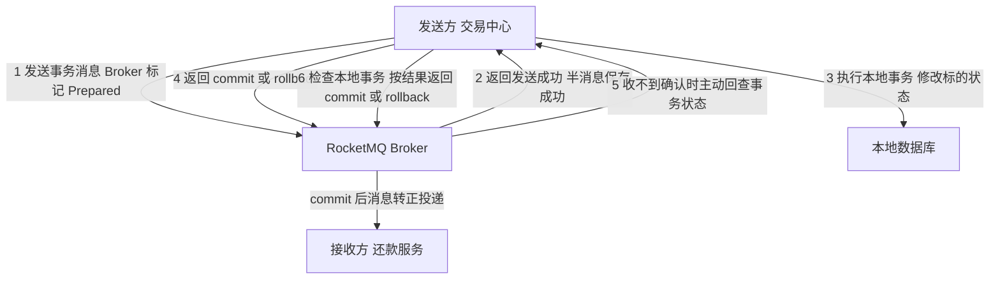

# 面试易问技术：RocketMQ 事务消息，六步流程与事务回查的答题路线

可靠消息实现最终一致性，是分布式事务面试的第三张王牌。概述课把半消息与回查的机制铺开之后，这一课换一个视角：面试官会怎么问、答到哪一层算合格。典型追问链是固定的：你们项目里分布式事务还有什么方案？它凭什么能实现最终一致性？流程讲一遍。本地事务的结果没送到 Broker 怎么办？按这条链把每一环的答法备齐，再配上满标放款业务的选型对比，这类题就成型了。

## 先给结论

- RocketMQ 是阿里巴巴出品、2012 年开源、2017 年成为 Apache 顶级项目的消息中间件，用它实现的是最终一致性：数据在某个时间点可能不一致，隔一段时间后最终走向一致。
- 最终一致性的生活原型是网购支付：输完交易密码看到「支付中」状态，此刻数据还没对齐，几秒后变成「支付成功」，所有数据就全部一致了。
- 方案成立靠两个设计基础：Broker 与发送方具备双向通信能力，天生能扮演事务协调者；RocketMQ 自带持久化存储，出异常后事务消息依然保存完好，事务还能被推动走向一致。
- 六步流程一句话：发半消息、Broker 确认、执行本地事务、commit 或 rollback、异常时回查、按回查结果定投递回滚。
- 项目落地在满标放款：还款服务生成还款计划与应收明细比较耗时，不阻塞主流程、对强一致性要求低，所以选可靠消息方案而不用 TCC，选型逻辑与注册功能恰好相反。

## 开场先把两个设计基础交代清楚

面试官问「RocketMQ 凭什么能解决分布式事务」，别急着背流程，先把两个设计基础说出来，这是判断方案可行性的地基。

**第一，双向通信。**Broker 是 RocketMQ 的服务端，它与发送方之间的通信是双向的：发送方能发消息给 Broker，Broker 也能主动联络发送方。多数消息中间件只做单向投递，服务端发不出「回访电话」，这种先天差异决定了谁能当事务协调者；Broker 能主动打电话回来，事务回查才谈得上。

**第二，自带存储。**RocketMQ 提供持久化存储机制，事务消息可以持久化保存到服务端。发送方挂掉、网络断掉，消息还躺在 Broker 上，等状态确认后再决定投递还是删除。两条设计合在一起，即便中间出异常，方案依然能保证最终达成事务的一致性，这句话就是开场答题的收尾。

## 六步流程怎么讲

流程题对着图讲最稳。这张图把发送方（交易中心）、Broker、接收方（还款服务）三方的关系和七步交互画在一起，前四步是正常路径，五到七步是异常兜底路径：



顺着编号讲：发送方先发一条半消息给 Broker，半消息指打上 Prepared 标记、暂时不能被接收方消费的消息，Broker 已把它存起来，但接收方拉不到；Broker 回复发送成功后，发送方开始执行本地事务，即操作自己的数据库完成某个小功能，这里是改标的状态；执行完只有两种结果，成功则向 Broker 发 commit，Broker 把半消息盖成可消费状态，接收方随即收到消息并执行自己那边的业务，失败则发 rollback，半消息不修改状态，接收方永远收不到，两边业务同时取消。

前三步讲完，一定要把设计意图点破：发送方业务执行成功，接收方才能收到消息去执行自己的业务；发送方事务没成功，接收方收不到消息也就不会执行业务。两边能这样协调，靠的正是半消息的巧思：先存意图、暂不可见，等本地事务的结果出来再放行。能主动说出这层因果，面试官就知道你不是在背步骤。

## 事务回查怎么答

第四步有个致命缺口：本地事务执行完了，返回 commit 或 rollback 时网络断了、服务挂了或请求超时，Broker 什么都收不到，等也不是、删也不是。第五到第七步就是为这个场景准备的，术语叫事务回查：Broker 不死等，超时后主动询问发送方，获取本地事务的执行状态；发送方检查刚才那些操作到底成没成功，把结果返回给 Broker，commit 则半消息转正投递，rollback 则半消息作废，前四步加回查兜底，消息发送与本地事务同时成功或同时失败才真正成立。

回查环节最容易在追问里翻车，答题要点有三条。**第一，触发时机要说全**：服务挂机、网络闪断、返回结果超时，都属于 Broker 收不到确认的场景，这不是小概率事件，是机制的固定组成部分。**第二，回查实现必须查库给确定答案**，不能凭内存变量或感觉返回，惯例是本地事务成功时写一条事务日志，回查时凭日志表里的记录说话。**第三，回查与消费重试、人工兜底的分工要分清**：发送方的问题归回查管，接收方消费失败归 RocketMQ 重试机制管，反复重试仍失败的情况极少，出现就转人工。编码层面开发者只补两处，落点都在事务监听器接口上（示例，按本课写法补全，包名按 `com.study.finance` 系改写）：

```java
/** 满标放款事务监听器 本地事务与回查都在这里实现 */
@Component
public class LoanTransactionListener implements TransactionListener {

    /** 半消息发送成功后框架回调此方法 在这里执行本地事务 */
    @Override
    public LocalTransactionState executeLocalTransaction(Message msg, Object arg) {
        try {
            // 本地事务 把标的状态改为还款中
            transactionService.updateProjectStatusToRepaying(arg);
            // 写事务日志 回查时凭这条记录给出确定答案
            transactionLogService.save(msg.getTransactionId());
            return LocalTransactionState.COMMIT_MESSAGE;
        } catch (Exception e) {
            // 本地事务失败 返回 rollback 半消息将被删除
            return LocalTransactionState.ROLLBACK_MESSAGE;
        }
    }

    /** Broker 收不到确认结果时定时回查 查事务日志表定夺 */
    @Override
    public LocalTransactionState checkLocalTransaction(MessageExt msg) {
        boolean exists = transactionLogService.existsByTransactionId(msg.getTransactionId());
        return exists ? LocalTransactionState.COMMIT_MESSAGE
                      : LocalTransactionState.ROLLBACK_MESSAGE;
    }
}
```

## 项目落地：满标放款为什么不用 TCC

面试官确认你熟方案之后，必问项目里哪块业务用了它、为什么。满标放款是标准素材：标的满标后要放款，交易中心把标的状态改成还款中，同时要通知还款服务生成还款计划与应收明细，两边是原子性绑定，标的改成功了就必须生成计划和明细，这是两个独立微服务共同完成一个业务，分布式事务问题成立。

选型理由从业务特征倒推：还款服务生成还款计划和应收明细很可能比较耗时，交易中心的业务应该先执行完，后面耗时的部分不能阻塞主流程，让交易中心干等不现实；同时这个业务对强一致性要求低，晚几分钟达成一致完全可以接受。这两条特征指向可靠消息最终一致性方案。反面对照是注册功能：执行时间短、一致性要求严，TCC 软状态时间短、一致性强的特点正合适。同一个项目里两处业务选了两种方案，结论一句话：不同的业务有不同的场景，应该选择不同的分布式事务解决方案，这句放在选型题结尾最有分量。

## 常见误区

- **把方案答成强一致。**错例：说 RocketMQ 事务消息保证任何时刻两边数据一致。正解：它实现的是最终一致性，中间存在时间差，追求的是隔一段时间后数据最终正确，与 TCC 的强一致定位不同。
- **漏掉双向通信与存储两个设计基础。**错例：直接开讲七步流程。正解：先交代 Broker 能双向通信、能持久化存储，方案可行性有了依据，流程才有落脚点。
- **把回查答成可选补丁。**错例：认为正常走前四步，回查很少发生可以随便实现。正解：挂机、闪断、超时都会让 Broker 收不到确认，回查实现必须查事务日志表给确定答案，否则半消息长期悬挂。
- **选型理由张冠李戴。**错例：说满标放款一致性强所以用可靠消息。正解：满标放款耗时、不阻塞主流程、强一致性要求低才选它，一致性严、执行短的业务才选 TCC，理由要与业务特征对得上。

## 面试可能被问到的问题

1. 面试官追问：「什么是最终一致性？」
   答：数据在某个时间点可能不是正确的，但隔一段时间之后最终没有问题，中间存在时间差。网购支付是典型例子：输完密码界面显示「支付中」，此时数据还没对齐，几秒后变成「支付成功」，所有数据全部一致。RocketMQ 可靠消息方案追求的就是这个目标。
2. 面试官追问：「半消息是什么，为什么需要它？」
   答：到达 Broker 后被打上 Prepared 标记、暂时不能被接收方消费的消息。它先把「我要发这条消息」这个事实持久化下来，再回头执行本地事务，把消息的存续与本地事务的结果绑成一体：commit 则转正投递，rollback 则删除，接收方看不到任何中间状态。
3. 面试官追问：「事务回查什么时候触发，实现要注意什么？」
   答：发送方执行完本地事务，Broker 却收不到 commit 或 rollback 时触发，典型原因是服务挂掉、网络闪断、返回结果超时。Broker 会不停询问发送方获取本地事务执行状态。实现上必须基于真实结果，惯例是查事务日志表，有记录返回 commit，没记录返回 rollback，不能凭猜测。
4. 面试官追问：「接收方业务执行失败了怎么办？」
   答：RocketMQ 有重试机制，消费失败隔一段时间重新投递，再接收再执行，默认有多次重试，直到本地事务执行成功。一直失败的情况很少见，真碰上交给人工处理。所以接收方基本不用写额外代码，重点是保证业务代码本身没有缺陷。
5. 面试官追问：「满标放款为什么不用 TCC？」
   答：还款服务生成还款计划和应收明细比较耗时，不建议阻塞主业务流程，并且对强一致性要求较低，可靠消息最终一致性与这两条特征匹配。TCC 软状态时间短、一致性强，更适合注册功能那类执行时间短、一致性敏感的业务，不同业务场景选不同方案。
6. 面试官追问：「这个方案和 TCC 在侵入性上有什么区别？」
   答：可靠消息方案的侵入集中在发送方一个事务监听器的两个方法，接收方几乎零改造，靠 MQ 重试兜底；TCC 要求每个参与方都拆出 Try、Confirm、Cancel 三块业务代码，侵入性强得多。换来的是 TCC 的软状态时间更短、一致性更强，两者是按场景互补的关系。

## 配套资料

- 讲义：`materials/docs/10/day16-项目总结&就业指导v1.0.md`，3.4.3 如何通过 RocketMQ 事务消息实现最终一致性事务：六步流程图、事务回查说明、满标放款业务的选型结论（还款服务耗时、不阻塞主流程、强一致性要求低）。
- 讲义：`materials/docs/10/RocketMQ研究v1.0.md`，RocketMQ 4.5.0 服务端的安装启动（NameServer、Broker 与 9876 端口）与消息发送基本用法，事务消息所需的环境口径。
- 代码：`materials/code/10/rocketmq-all-4.5.0-bin-release/` 与 `materials/code/10/rocketmq-console/`，事务消息所需的服务端发行包与控制台。
- 代码：`materials/code/10/wanxinp2p/`，P2P 工程归档（目录保留原始命名，路径只列到该层级）。满标放款链路完整源码未在仓库归档，文中事务监听器实现为按本课写法补全的示例，包名按 `com.study.finance` 系改写。
