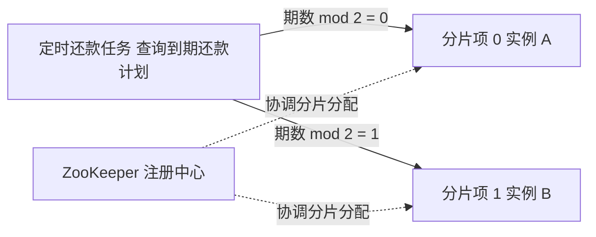

# 面试易问技术：分布式定时任务与分片，重复执行、任务分配与错过触发怎么答

聊到项目里的定时任务，面试官的追问通常分三层：任务调度和分布式定时任务是什么关系？多实例跑同一个任务，重复执行怎么办？分片是怎么做的？这一课按面试节奏把三层答法理顺，落到项目里就是定时还款任务与 Elastic-Job 的组合：概念答清、分片答实、版本答准。

## 先给结论

- 任务调度指系统为了自动完成特定任务，在约定的特定时刻去执行任务的过程，两个关键词是「自动」与「特定时刻」，四个典型场景是定点发券、还款短信提醒、凌晨结算与定时抓取天气。
- 服务部署多个实例形成集群后，在分布式环境下运行任务调度，就是分布式任务调度，核心矛盾有两个：任务不能重复执行，任务要合理分配到各实例。
- 分片是把一个任务拆分成多个独立的任务项，由分布式服务器分别执行某一个或几个分片项，分配规则按取余设计，如 `ID % 10`。
- 项目落地是定时还款任务：用 Elastic-Job 实现分布式定时还款，查询到期还款计划时根据期数 `NUMBER_OF_PERIODS` 做取余分片，父工程锁定 `elastic-job-lite` 2.1.5 系版本。
- 错过触发是通用追问点：分片项错过后框架按 misfire 策略补偿执行，答时分清「重复执行靠分片隔离，错过执行靠补偿策略」两条线。

## 任务调度与分布式定时任务的场景铺垫

定义题别背书，先给场景再收定义。电商系统每天上午 10 点、下午 3 点、晚上 8 点发放一批优惠券；银行系统在信用卡还款日的前三天发短信提醒；财务系统每天凌晨结算前一天的财务数据并统计汇总；网站为了天气实时展示，每隔 10 分钟去天气服务器获取最新信息。四个场景的共同点一句话就能说穿：要干一个活，而且是定时定点地干，到点就执行，靠人工记时间不现实，每隔 10 分钟一次的活更不可能派人守着。

收定义时点出两个关键词。**第一，自动**：这些任务由系统自动触发执行，解放人力。**第二，特定时刻**：不是一直执行，而是到达约定的时间点才执行。两词齐了，任务调度的定义就是：系统为了自动完成特定任务，在约定的特定时刻去执行任务的过程。

往下追问必然是「分布式定时任务又是什么」。现在的项目多采用微服务分布式架构，一个服务往往部署多个实例运行业务，比如用户中心部署到三台服务器组成集群，在这个环境下运行任务调度，就叫分布式任务调度。多实例立刻带来两个问题，答调度题就是答这两个问题：**一是任务不能重复执行**，三台服务器都要跑任务，优惠券重复发放、还款短信重复发送，业务直接出错；**二是任务要合理分配**，不能有的实例累死、有的闲着，理想状态是把工作平均摊下去，比如查询某张表的数据，前三分之一交给 A 服务器、中间三分之一交给 B、剩下的交给 C。既不重复、又大体平均，这就是分布式任务调度要解决的两件事。

## 分片怎么答

分片是这块的必问题。定义一句话：任务的分布式执行，需要将一个任务拆分为多个独立的任务项，然后由分布式的服务器分别执行某一个或几个分片项。拿最直观的例子展开：有一个遍历数据库某张表的作业，表里 100 行数据，现有 2 台服务器，为了快速执行，每台承担 50%，把作业分成 2 片，每台执行 1 片；表里都有 ID 字段，就让服务器 A 遍历 ID 为奇数的数据、服务器 B 遍历偶数的数据，恰好平均。分成 10 片同理，每片的分片项是 `ID % 10`，服务器 A 领到分片项 0 到 4，遍历 ID 以 0 到 4 结尾的数据，服务器 B 领到分片项 5 到 9。



图上把一个任务按取余拆成两个分片项，两台实例各查半边数据，注册中心负责把分片项分配到实例并协调这个分配过程。答分片题时把这层说透：分成几片看服务器数量与任务量，两片、三片、十片都行，取余规则由业务自己定义，分片的本质是既不重复执行、又让各实例承担的任务相对平均。

## 项目落地：定时还款任务与期数取余

项目素材是借款人的定时还款。借款人借到钱后每个月都要还款，和还信用卡一样有还款日，靠人工触发不现实，必须做成定时任务由系统到点自动执行；还款服务部署两台以上实例时，就是分布式环境，要解决分配问题。技术选型是 Elastic-Job 实现分布式定时还款任务，项目父工程真实锁定了版本：

```xml
<!-- 项目父 pom 真实配置 Elastic-Job 相关依赖统一锁定版本 -->
<dependency>
    <groupId>com.dangdang</groupId>
    <artifactId>elastic-job-lite-core</artifactId>
    <version>2.1.5</version>
</dependency>
<dependency>
    <groupId>com.dangdang</groupId>
    <artifactId>elastic-job-lite-spring</artifactId>
    <version>2.1.5</version>
</dependency>
```

分片落到查询上，是一条带取余条件的 SQL，查询当天到期且未还款的还款计划（讲义原文按 `com.study.finance` 系包名整理）：

```sql
SELECT *
FROM repayment_plan
WHERE DATE_FORMAT(SHOULD_REPAYMENT_DATE, '%Y-%m-%d') = #{date}
  AND REPAYMENT_STATUS = '0'
  AND MOD(NUMBER_OF_PERIODS, #{shardingCount}) = #{shardingItem}
```

三个条件各有分工：日期条件保证只处理今天到期的计划，状态条件保证已还款的记录不再进入流程，`MOD` 条件就是分片开关，期数除以分片总数取余，余数等于本实例分片项的记录才被查出。分片总数是 2 时余数只有 0 和 1，偶数期的计划全落进分片项 0、奇数期的落进分片项 1，两台实例各查各的半边，合起来不重复也不遗漏。按哪个字段分片视业务而定，期数、ID 都可以，规则由业务决定。工程侧的装配与入门案例一致：任务类实现 `SimpleJob` 接口，`ZookeeperRegistryCenter` 注册中心连 ZooKeeper，`JobCoreConfiguration`、`SimpleJobConfiguration`、`LiteJobConfiguration` 三层包装出配置对象，最终由 `SpringJobScheduler` 按 cron 触发任务类的 `execute` 方法，分片总数与 cron 表达式交给 Apollo 下发。这套骨架的关键在两条配置链的 `@Bean(initMethod = "init")`，注册中心的 init 建立会话、调度器的 init 启动引擎，漏了任何一处，作业静默不跑。

## 错过触发与通用追问

重复执行之外还有一类追问：实例宕机重启、错过调度时间点，任务怎么办。Elastic-Job 的应对是 misfire 补偿机制（属通用实践，按主流口径补充）：作业分片项因实例宕机、调度停顿等原因错过后，实例恢复时框架检测到错过标记，按 misfire 策略在可用实例上补偿执行错过的分片项，配置层面 `LiteJobConfiguration` 的 misfire 开关默认开启。答题时分清两条线：重复执行靠分片项隔离，同一分片项同一时刻只归一个实例；错过执行靠补偿策略兜底，配合 ZooKeeper 注册中心感知实例上下线、重新分片，两种故障各有各的出口。再被问到失效转移，答的也是同一条链：实例下线，ZooKeeper 上的临时节点消失，框架把该实例的分片项重新分配给存活实例接着跑。

## 常见误区

- **把任务调度答成需要人工触发。**错例：说定时任务靠运维手动执行脚本。正解：定义的两个关键词是自动与特定时刻，触发由系统按 cron 自动完成，人力只做结果监控。
- **只答重复执行、漏掉合理分配。**错例：说分布式定时任务就是加个锁防重复。正解：核心矛盾有两条，任务不重复执行、任务合理分配到各实例且相对平均，分片同时解决这两条。
- **分片规则说不出依据。**错例：只说「按 ID 均分」。正解：给出取余公式与字段选择，项目里按期数 `MOD(NUMBER_OF_PERIODS, #{shardingCount}) = #{shardingItem}` 分片，字段按业务定。
- **以为加锁能替代分片。**错例：三台实例抢分布式锁，谁抢到谁跑。正解：锁只防重复，不并行、不分摊，任务量大时仍是单实例跑全量；分片让多实例并行处理各自的数据段，效率完全不同。

## 面试可能被问到的问题

1. 面试官追问：「什么是任务调度，举几个场景。」
   答：系统为了自动完成特定任务，在约定的特定时刻去执行任务的过程。场景如电商每天三个时间点发优惠券、银行在还款日前三天发短信提醒、财务系统凌晨结算前一天数据、网站每 10 分钟抓取天气，共同点是定时定点、系统自动执行。
2. 面试官追问：「分布式环境下跑定时任务，有什么问题要解决？」
   答：两个。一是避免任务重复执行，多实例都被 cron 触发，同一笔业务会被处理多次；二是任务合理分配，把工作拆分摊到各实例，保证不重复、负载相对平均，手段就是分片。
3. 面试官追问：「说一下分片的概念，你们怎么分的片。」
   答：把一个任务拆分成多个独立的任务项，由分布式服务器分别执行某一个或几个分片项。我们的定时还款任务按还款计划期数取余分片，SQL 里 `MOD(期数, 分片总数) = 分片项`，两台实例时奇数期与偶数期各归一台，不重复不遗漏。
4. 面试官追问：「为什么选 Elastic-Job，用的什么版本？」
   答：它是基于 ZooKeeper 的分布式任务调度框架，天然支持分片、注册中心协调与失效转移，与项目的 ZooKeeper、Apollo 环境契合。父工程锁定 elastic-job-lite 系列 2.1.5 版本，spring boot starter 用配套版本。
5. 面试官追问：「一台实例挂了，分到它名下的任务会丢吗？」
   答：不会。实例通过临时节点注册在 ZooKeeper，宕机后节点消失，框架感知到实例下线，触发重新分片，把它的分片项分配给存活实例，配合 misfire 补偿策略执行错过的分片，任务不丢，只是延后完成。
6. 面试官追问：「同一分片项的任务会被执行两次吗？」
   答：正常情况不会，框架保证同一分片项同一时刻只由一个实例执行，取余条件也让各实例查到的数据天然不重叠。要防的是业务侧的重试与补偿造成的重复动作，那部分靠业务幂等设计兜底，与分片是两道独立的防线。

## 配套资料

- 讲义：`materials/docs/10/day16-项目总结&就业指导v1.0.md`，3.5.1 什么是任务调度？什么是分布式定时任务？与 3.5.2 请说一下分片的概念：四场景、定义、奇偶分片与 10 片 `ID%10` 示例、定时还款任务按期数分片的结论。
- 讲义：`materials/docs/10/万信金融-第5章-用户还款v1.0.md`，用户还款功能与定时还款任务的实现章节：`repayment_plan` 到期计划查询、Elastic-Job 配置类与 Apollo 参数键名。
- 代码：`materials/code/10/wanxinp2p/`，P2P 工程归档（目录保留原始命名，路径只列到该层级），父 `pom.xml` 锁定 `elastic-job-lite-core` 与 `elastic-job-lite-spring` 2.1.5。还款服务完整源码未在仓库归档，文中分片 SQL 按讲义原文整理、配置骨架按本课写法补全，包名按 `com.study.finance` 系改写；misfire 补偿为通用实践知识补充，课程未单独成节。
