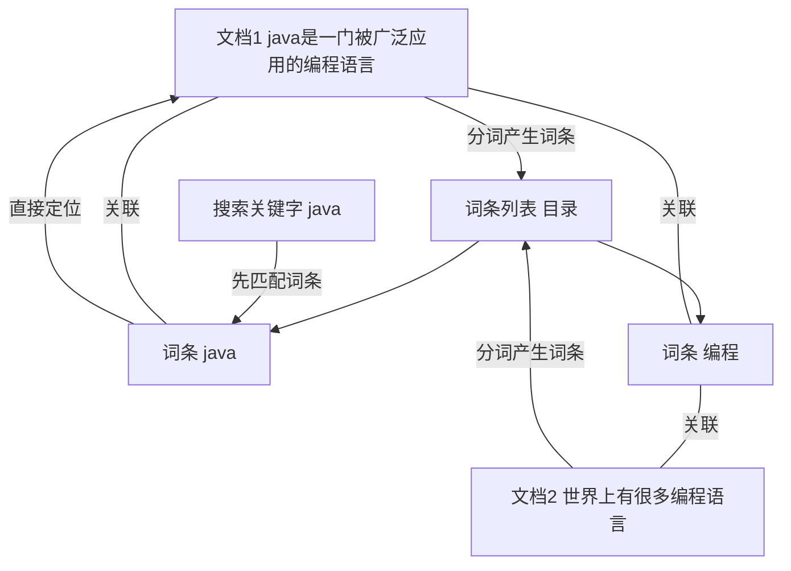

# 面试易问技术：Elasticsearch 倒排索引，写入与查询原理、和数据库分工怎么答

「你们项目里用没用到全文检索技术，原理说一下」，这是全文检索方向的固定开场。答案落到 Elasticsearch 上，面试官接着必问两层：往索引库存数据时发生了什么，为什么查起来比数据库快。原理答不透，后面的追问全是空中楼阁。这一课按写入与查询两条线把原理讲透，再接上项目的落地架构：分库分表、读写分离之后为什么还要上 ES，查询请求在微服务之间怎么流转。

## 先给结论

- ES 的检索原理一句话：写数据时先分词产生词条，词条存进内部列表（相当于目录），数据本身作为文档存储，词条与文档有对应关系；查数据时先匹配词条、命中后直接定位文档，不走逐行扫描。
- 常用分词器是 IK 分词器，中文按词典拆出「广泛」「应用」「编程语言」这样的词条，这正是倒排索引结构：由词找文档，而不是由文档找词。
- 项目里上 ES 的原因：交易中心数据库做了分库分表、读写分离后，模糊查询、多字段过滤在大数据量下仍有性能瓶颈，需要全文检索技术再补一层。
- 落地方式是单独抽取内容检索微服务，基于 Elasticsearch + Logstash 为整个项目提供全文检索服务，交易中心收到检索请求后转发给它，由它查 ES 索引库。
- 查询链路六步：前端发请求给交易中心，交易中心请求内容检索服务，内容检索服务按条件检索 ES 索引库，结果原路返回。

## 写数据时发生了什么

ES 往索引库存数据的动作，本质是在建一本带目录的字典。以课程里的例子走一遍：往索引库存一句话「java 是一门被广泛应用的编程语言」，存储时这句话会被分词器分词，产生若干词条，词条就是拆分后的一个个词，比如「广泛」「应用」「java」「编程」「语言」。词条会存到内部的一个列表当中，这个列表相当于新华字典的目录；同时数据本身也会存储，作为一个文档保存，词条与文档之间建立对应关系。再存第二句「世界上有很多编程语言」，分词产生「世界」「很多」「编程」「语言」等词条，同样进列表、同样落文档。

对应关系是关键，也是快的原因所在：词条「广泛」只跟第一句那个文档关联；词条「java」同时跟第一句和第三句文档关联，因为第三句「我爱 java」里也有这个词。一个词条指向一个或多个文档，每个文档对应一串词条，这张映射表就是倒排索引，类比新华字典的目录：先在目录里找到词，再翻到正文页码。传统数据库恰恰相反，它是正排的，拿着条件从第一行开始逐行匹配、逐行比对，命中与否都要扫到才知道。

## 查数据时为什么快

查询这条线更短，也更能体现设计意图。用户在电商或博客站的搜索框里输入关键字，比如「java」，ES 拿着这个关键字和列表（目录）里的词条进行匹配：列表里正有一个「java」词条，匹配成功，由于存储时词条与文档的对应关系早已建好，跟「java」关联的文档直接定位，一下子就把结果拿回来。整个过程不需要碰任何无关文档，这就是 ES 全文检索快的根本原因。



图上从上往下是写入路径：两句话分词后各自产生词条进入目录，词条与文档建立关联；从下往上是查询路径：关键字先匹配词条「java」，命中后凭关联直接定位到文档1。答题时点出两侧对比，查询快的感受才立体：数据库逐行匹配，数据量越大扫描越久；ES 先查目录，目录找到就一步定位，与数据量关系不大。

## 项目落地：内容检索服务与查询链路

原理说完要接业务，面试官紧接着问「你们哪里用了、怎么用的」。项目的动因要从前置优化说起：为了提高数据库性能，交易中心数据库 `p2p_transaction` 已经做了分库分表、读写分离，但即便如此，某些查询仍然面临性能瓶颈，典型的是模糊查询与多字段过滤，数据量很大时这类查询仍然耗时。在这种情况下引入全文检索技术，把性能再往前推一层。平台里多处业务数据都有这种需求，所以不把 ES 塞进某个业务工程，而是单独创建一个微服务工程，即内容检索服务，为整个项目提供全文检索服务，技术上就是 Elasticsearch + Logstash 的组合。

具体到标的信息查询这条业务链路：P2P 平台的标的信息量非常大，前端要按关键字检索标的，请求还是发给交易中心，但交易中心不再直接查数据库，而是把请求转发到内容检索服务，由它去 ES 索引库里做全文检索，结果再原路返回。六步交互用图收拢：


图上六步一眼看完，要点在第二步的分工：交易中心职责是接请求、做转发与业务编排，检索这件事整体外包给内容检索服务。课程给的工程建议同样可以直接引用：需要全文检索时，一般单独抽取一个微服务专门干这个活，本项目也是这么设计的。检索接口的实现形态大致如下（示例，按本课写法补全，包名按 `com.study.finance` 系改写）：

```java
/** 内容检索服务 按关键字检索标的 全文检索入口 */
public List<LoanInfoDTO> searchLoanInfo(String keyword, int page, int size) {
    // 关键字交给分词器匹配词条 命中后直接定位文档
    SearchRequest request = new SearchRequest("loan_info");
    SearchSourceBuilder source = new SearchSourceBuilder();
    source.query(QueryBuilders.multiMatchQuery(keyword, "projectName", "activityType"))
          .from((page - 1) * size)
          .size(size);
    request.source(source);
    try {
        SearchResponse response = restHighLevelClient.search(request, RequestOptions.DEFAULT);
        // 命中的文档还原成标的 DTO 沿链路返回给交易中心
        return Arrays.stream(response.getHits().getHits())
                .map(hit -> JSON.parseObject(hit.getSourceAsString(), LoanInfoDTO.class))
                .collect(Collectors.toList());
    } catch (IOException e) {
        throw new RuntimeException("全文检索失败", e);
    }
}
```

索引侧的字段类型与分词器决定检索质量，典型的索引定义把检索字段声明为 text 类型并指定 IK 分词（示例，按主流写法补全）：

```json
{
  "mappings": {
    "properties": {
      "projectName": { "type": "text", "analyzer": "ik_max_word" },
      "activityType": { "type": "keyword" }
    }
  }
}
```

## 常见误区

- **把检索快归因于内存或缓存。**错例：说 ES 快是因为数据放内存。正解：快在倒排索引结构，先匹配词条再定位文档，省掉了数据库逐行扫描的比对过程，存储介质不是根本原因。
- **分词与词条的关系说不清。**错例：以为 ES 存的是整句话的关键字索引。正解：存储时由分词器（常用 IK）把内容拆成词条，词条进目录、内容落文档、词条与文档建对应关系，三者缺一不可。
- **认为上了分库分表就不需要 ES。**错例：说性能优化做过分库分表、读写分离就够了。正解：模糊查询、多字段过滤在大数据量下仍有瓶颈，全文检索是综合手段里的又一层，多种技术一起上才把性能做住。
- **把 ES 当成替代数据库的方案。**错例：说所有查询都改走 ES、数据库可以下线。正解：ES 索引库只承担查询与搜索，增删改仍走 MySQL，两库分工配合数据同步机制，不是替代关系。

## 面试可能被问到的问题

1. 面试官追问：「说一下 ES 全文检索的原理。」
   答：写数据时，内容被分词器分词产生词条，词条存进内部的列表（相当于目录），数据本身作为文档存储，词条与文档建立对应关系；查数据时，ES 拿着搜索关键字先和列表里的词条匹配，一旦匹配上立即直接定位到对应文档，不做逐行扫描，所以查询快。
2. 面试官追问：「ES 为什么比数据库查询快？」
   答：结构不同。数据库按条件从第一行开始逐行匹配，数据量越大耗时越长；ES 是倒排索引，由词条指向文档，查询先在目录里匹配词条，命中后凭对应关系一步定位，开销与命中数据相关而与总量关系不大。
3. 面试官追问：「数据库都做了分库分表和读写分离，为什么还要用 ES？」
   答：分库分表与读写分离解决的是读写压力与单表数据量问题，但模糊查询、多字段过滤这类操作在大数据量下仍然耗时，属于另一类瓶颈。全文检索针对的正是这类场景，所以项目把它作为综合优化手段的又一层。
4. 面试官追问：「你们项目里 ES 怎么接入的，请求链路是什么？」
   答：单独抽取了内容检索微服务，基于 Elasticsearch + Logstash 为整个项目提供全文检索服务。前端把检索请求发给交易中心，交易中心不再直接查数据库，而是转发给内容检索服务，由它按条件检索 ES 索引库，结果沿原路返回，交易中心负责接请求与转发编排。
5. 面试官追问：「IK 分词器的作用是什么？」
   答：它是中文分词器，存储数据时把中文内容按词典切分成词条，比如一句话拆出「编程」「语言」这样的词。词条质量决定检索质量，不装 IK 或用错分词器，中文会被拆成单字或整句，搜索召回与准确度都会明显下降。
6. 面试官追问：「哪些查询适合走 ES，哪些仍留在数据库？」
   答：关键字模糊匹配、多条件组合过滤、按相关度排序这类检索密集型查询走 ES 索引库；涉及事务的增删改以及强一致性的关联查询仍走 MySQL。两库分工靠数据同步衔接，这才是完整的方案。

## 配套资料

- 讲义：`materials/docs/10/day16-项目总结&就业指导v1.0.md`，3.6.1 请说一下 ES 进行全文检索的原理：分词产生词条存入内部列表（目录）、数据作为文档存储、词条与文档的对应关系，以及分库分表读写分离之后仍需全文检索的动因与内容检索服务的架构结论。
- 讲义：`materials/docs/10/Sharding-jdbc专题-v1.0.md`，交易中心数据库分库分表、读写分离的前置优化口径，与 ES 层优化衔接。
- 代码：`materials/code/10/wanxinp2p/`，P2P 工程归档（目录保留原始命名，路径只列到该层级）。内容检索服务完整源码未在仓库归档，文中检索接口与索引定义为按本课写法补全的示例，包名按 `com.study.finance` 系改写。
