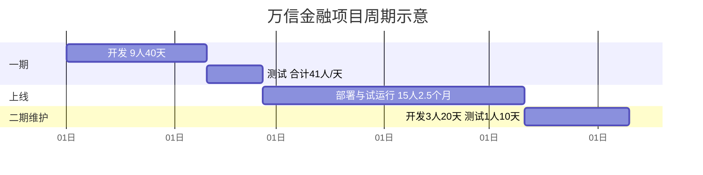

# 项目管理总结：万信金融项目的周期、团队与预算，面试里被问数字时怎么答

技术问题讲到这里告一段落。面试官聊完架构与代码，往往会换一个维度发问：你这个项目开发了多久、多少人做、成本多少、团队怎么分工。这些问题不考编码能力，考的是你对自己所在项目有没有全局认知。第六章项目总结在这里收官，把项目管理这组数据摊开讲一遍，让大家在被问到时至少能把自己岗位相关的数字答得出来。

## 先给结论

- 项目周期分四段：一期开发 9 人 40 天共 360 人/天，一期测试合计 41 人/天，上线 15 人团队约 2.5 个月，二期维护 70 人/天。
- 团队共 15 人：项目设计师 2 人、开发人员 9 人、测试人员 3 人、产品经理 1 人。
- 项目预算 55 万，开发人员人均 25000 元/月，折算 480 人/天；实际开发延期 8 天，迭代周期两年。
- 面试不必背下全部数字，重点答清楚与自己岗位相关的部分：后端开发要能报出开发周期、与前端和测试的协作方式。
- 「人/天」是整个项目管理话题的计量单位，一个人干一天算一个人天，所有周期与预算都由它乘出来。

## 项目周期：用人数乘天数把工期算清楚

衡量一个项目的工期不能只说「开发了 40 天」，因为 1 个人干 40 天和 9 个人干 40 天是完全不同的投入。行业里的计量单位是人/天：一个人干一天就是一个「人/天」，工期、成本、报价都建立在这个单位上。万信金融 P2P 项目的周期数据是这样的：

**一期开发，9 人 40 天，合计 360 人/天。** 这 40 天里交付的是平台主体功能，也就是开户、发标、投标放款、用户还款这几条业务主线对应的全部后端与前端工作。

**一期测试，合计 41 人/天，四项工作分别计价。** 测试用例编写 2 人 3 天，测试计划 1 人 1 天，系统测试 3 人 10 天，性能测试 2 人 2 天。开发 40 天只占项目的一半多一点，测试紧接着铺开，用例先行、计划随后、系统测试覆盖全功能、性能测试单独压一轮，这套节奏就是典型的瀑布式推进。

**上线周期，15 人团队约 2.5 个月。** 从开发完成到系统真正跑在生产环境，部署、联调、试运行都要人手，上线不是把包扔上去就完事。

**二期维护，开发 3 人 20 天加测试 1 人 10 天，共 70 人/天。** 系统上线后进入需求变更与缺陷修复的迭代期，投入从 15 人收缩到 4 人，这是项目生命周期的常态。整条时间线画出来：



关键读法：开发与测试的投入高峰在一期，上线阶段人最多但主要是支撑工作，维护阶段收缩到小团队长跑，两年迭代期结束后转交支持人员。

## 团队组成：15 个人的四种角色

团队人数 15 人，按职责分四类。项目设计师 2 人，负责 P2P 业务与运营平台的需求调研、概要设计以及银行存管系统 API 的设计，技术方案与对外接口出自他们。项目开发人员 9 人，负责项目开发，也就是后端、前端写代码的人。项目测试人员 3 人，负责项目测试。产品经理 1 人，负责产品推广与产品调研、确定客户需求。

作为后端开发，不必背下全部角色的职责，但要清楚自己每天和谁协作：与前端工程师约定接口报文，与测试工程师对接缺陷修复，与设计师确认接口设计是否按文档落地。聊天分团队与团伙的区别也在这一节：三五个人临时拉起来干活、没有角色分工与流程约束的只能算团伙；有角色划分、有需求调研、有测试把关的才叫团队。万信金融项目显然是前者意义上的正规军。

## 项目预算：55 万怎么算出来的

预算的算法就是人/天乘单价。开发人员人均 25000 元/月，按 480 人/天的开发投入折算，项目预算定为 55 万。这里有一个可供自己练习的核对：25 天工作日折一个月，25000 元除以 25 天约 1000 元/天，360 人/天的开发量对应 36 万上下，加上测试、上线、维护的投入与各项开销，落到 55 万的总盘子上。

计划之外还有两条真实数据值得记住：**实际项目开发完成延期 8 天**。工期估出来 40 天，实际多花了 8 天，这在真实项目里非常常见，需求变更、技术难点、联调卡壳都会吃掉排期。**迭代周期两年**，需求变更及系统维护让系统持续迭代，两年之后转交支持人员。一个项目的生命周期远比开发那 40 天长，维护期的投入常常被低估。

把人/天换算成钱，可以用一张最简单的核算表，这里按本课口径补一份示例：

```sql
-- 项目投入核算示例（示例数据为按本课写法补全）
SELECT
    phase          AS 阶段,            -- 一期开发 / 一期测试 / 二期维护
    head_count     AS 人数,
    work_days      AS 天数,
    head_count * work_days          AS 人天,
    head_count * work_days * 1000   AS 核算金额元   -- 开发单价约1000元/人天
FROM project_effort
ORDER BY phase;
```

面试里报数字时把口径说全：多少人、多少天、多少人/天、什么角色，比单说一个天数专业得多。

## 常见误区

- **把工期当成单人时长。** 错例：被问项目做了多久，答「40 天」，追问几个人就卡住。正解：工期要连同投入一起报，9 人 40 天 360 人/天，才有成本含义。
- **以为测试只有系统测试一项。** 错例：以为测试就是「点一遍」。正解：测试用例编写、测试计划、系统测试、性能测试是四项独立工作，合计 41 人/天，各自有产出物。
- **把项目生命周期等同于开发周期。** 错例：以为上线那天项目就结束了。正解：上线后还有 2.5 个月的上线周期与两年的迭代维护期，二期维护仍要投入 70 人/天。
- **面试时对与自己无关的数据信口开河。** 错例：连自己团队的测试人数都答不上来还硬编数字。正解：开发岗答不清性能测试细节是正常的，但开发周期、团队规模、协作角色必须答准。

## 面试可能被问到的问题

1. 面试官追问：「你们项目做了多久？投入了多少人？」
   答：一期开发 9 人 40 天共 360 人/天，一期测试合计 41 人/天，上线由 15 人团队支撑约 2.5 个月，二期维护投入 70 人/天。报数字时把人数、天数、人/天三个口径一起给。
2. 面试官追问：「你们的团队是怎么组成的？」
   答：团队 15 人，项目设计师 2 人负责需求调研、概要设计与存管系统 API，开发 9 人，测试 3 人，产品经理 1 人负责产品推广与需求确认。作为后端开发，日常主要与前端、测试、设计师三方协作。
3. 面试官追问：「项目成本怎么估算？」
   答：按人/天乘单价估算。本项目开发人员人均 25000 元/月，折算约 1000 元/人天，开发 360 人/天加上测试与维护投入，项目预算 55 万。人/天是连接工期与成本的核心计量单位。
4. 面试官追问：「项目延期了怎么办？」
   答：本项目实际开发延期 8 天。处理方式是如实复盘延期原因（需求变更、技术难点、联调阻塞），在迭代计划里消化，而不是压缩测试时间硬赶上线的日期，否则风险会转嫁到生产环境。
5. 面试官追问：「上线之后项目就结束了吗？」
   答：没有。上线后进入迭代周期，需求变更与系统维护让系统持续演进，本项目迭代周期为两年，之后转交支持人员。维护期的投入（70 人/天）在立项时就应计入预算。

## 配套资料

- 讲义：`materials/docs/10/day16-项目总结&就业指导v1.0.md`，四、项目管理：1. 项目周期（开发、测试、上线、维护的人/天明细），2. 团队组成（15 人四类角色），3. 项目预算（人均成本、55 万预算、延期 8 天、两年迭代）。
- 说明：本课为项目管理总结，无配套源码包；`gantt` 图按讲义周期数据绘制，`project_effort` 核算表为按本课写法补全的示例，数据与讲义口径一致。
