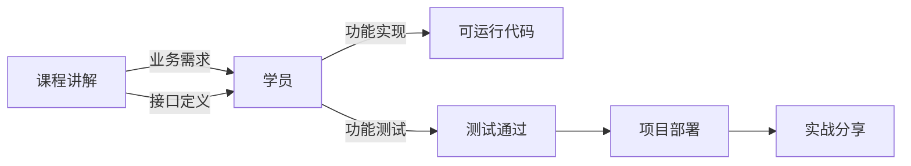

# 项目实战整体安排：三块业务、四天时间，从听课到独立交付的切换

前面的课程里，每一行代码都有讲解逐句带着走；从这一课起规则变了。万信金融 P2P 项目还剩三块业务没有实现，课程把它们交还给你：讲解只到业务与接口为止，功能实现和测试全部自己完成。这是整个项目从「学」到「练」的分界线，动工前先把整体安排看清楚，知道自己要交什么、按什么节奏交。

## 先给结论

- 实战阶段要独立完成三块业务：充值、提现、发标时的身份认证，都是此前课程未实现的功能。
- 实战模式是「只讲业务需求和接口，功能实现与测试自行完成」，与企业里拿到需求文档和接口定义后自己开发的情形一致。
- 充值与提现和已实现的开户业务高度相似，可以直接参考开户的代码与流程；发标时的身份认证则主要通过调用第三方接口实现。
- 建议三人一组，四天实战时间，每人至少实现一个模块；充值与提现二选一即可，不必重复造两遍。
- 开发测试完毕后做项目部署，最后半天组织实战分享，复盘遇到的问题与解决过程。

## 要独立完成的三块业务

三块业务的底细各不相同，动手前的准备策略也不同。

**第一，充值与提现，参照开户。** 充值是投资人把储蓄卡里的钱转入银行存管系统里的虚拟账户，提现是反方向把钱转回银行卡。这两块业务与开户业务非常相似：都要经过存管代理服务与银行存管系统（模拟）交互，都有「生成数据、请求存管、结果异步通知」的阶段划分，都要维护交易记录的同步状态。开户业务当时是怎么分阶段实现、怎么联调测试的，充值与提现照着走一遍即可，相当于用已学的套路再做一次。

**第二，发标时的身份认证，靠第三方接口。** 借款人发标时平台要核实申请人身份是否属实，这类能力不需要自己实现，主要通过调用第三方接口完成，例如借助第三方平台做身份认证：平台侧大量要做的是向第三方发请求、解析返回结果、把结果落库。考察点从「业务流程编排」换成了「外部接口对接」，超时、重试、结果校验这些对接细节是这块业务的坑位所在。

三块业务在课程资料里各有对应的实战文档，接口定义都已经在文档中给出，实现留白。

## 实战模式：接口给你，实现自己写

实战模式的分工画出来很直白：课程交付到接口这一层，剩下的编码与测试由学员自己闭环。



这个模式刻意模仿了企业的真实开发场景：进入企业后，拿到的通常就是需求文档和接口定义，没有人逐行带着写代码，功能实现、自测、联调都是开发者自己的责任。所以实战的目标不只是把三块功能做出来，更是锻炼独立思考、独立动手与自学能力，提前适应真实的工作节奏。

接口先行在这三块业务里同样成立。以充值为例，实战文档在用户中心 API 里给出的接口定义如下，方法体留空，等着被实现：

```java
// 接口① 用户中心生成充值数据接口 按充值实战讲义口径整理 包名按 com.study.finance 系改写
public interface ConsumerApi {

    /** 生成充值请求数据
     *  @param amount      充值金额
     *  @param callbackURL 回调地址
     *  @return 签名后的充值请求数据 */
    @ApiOperation("生成充值请求数据")
    @ApiImplicitParams({
        @ApiImplicitParam(name = "amount", value = "金额", required = true,
                dataType = "String", paramType = "query"),
        @ApiImplicitParam(name = "callbackURL", value = "通知结果回调Url", required = true,
                dataType = "String", paramType = "query")})
    @GetMapping("/my/recharge-records")
    RestResponse<GatewayRequest> createRechargeRecord(String amount, String callbackURL);
}
```

对照开户时定义过的接口可以看到完全一致的笔法：`RestResponse` 包返回值、Swagger 注解标参数、路径挂在 `/my` 前缀下。实现它的所有技术组件（网关签名、存管代理、RocketMQ 通知）都在开户业务里练过，这就是「参考开户」这句话的全部含义。

## 组织与节奏：三人一组，四天交付

时间与人力安排有五条硬性建议。

**第一，三人一组，共四天实战时间。** 自习时间要充分利用，小组内部多沟通；四天听起来不短，对首次独立走全流程的人来说其实很紧。

**第二，每人至少实现一个模块。** 三个人对三块业务分工认领，用一张分工表把责任钉死：

| 小组成员 | 实战分工 | 备注 |
|---|---|---|
| 张三（组长） | 身份认证 | 不服就干 |
| 李四 | 提现 | 键盘敲烂 |
| 王五 | 充值 | 为了最后的胜利 |

充值与提现两块业务高度相似，同一个人只需要实现其中一个即可，没必要一个人把两块都做一遍；做完自己那块如果还有时间，可以再认领发标时的身份认证。

**第三，过程要留痕。** 配套一张当日工作内容表，每天记录成员的工作内容与出勤，既是进度跟踪，也是最后分享时的素材：

| 天数 | 成员 | 当日工作内容 | 当日出勤 | 备注 |
|---|---|---|---|---|
| 实战第 1 天 | 张三 | | | |
| 实战第 1 天 | 李四 | | | |
| 实战第 1 天 | 王五 | | | |

**第四，开发并测试完毕后进行项目部署。** 功能在自己机器上跑通不算完，要把整套微服务部署起来，这一步检验的是前期部署文档的积累。

**第五，最后半天组织实战分享。** 每个人讲清楚实战中遇到了哪些问题、怎么解决的、有什么收获。独立开发时每个人踩的坑各不相同，分享是把三份经验合并成一份的最快方式。

## 常见误区

- **以为要同时实现充值和提现才算完成。** 错例：一个人把两块相似业务都做一遍。正解：每人至少实现一个模块即可，充值与提现二选一，省下的时间投入身份认证或其他收尾工作。
- **以为实战模式意味着不需要动手。** 错例：只看讲解不动键盘，想着后面有实现可抄。正解：实战阶段的讲解到接口为止，没有后续的逐行实现环节，实现与测试就是这一阶段的作业本身。
- **以为身份认证要自己实现核身算法。** 错例：打算自己写一套身份证校验逻辑。正解：该业务主要通过调用第三方接口实现，重点在请求编排与结果处理，不在算法本身。
- **以为开户的业务结构帮不上忙。** 错例：从零摸索充值怎么做。正解：充值与提现和开户非常相似，阶段划分、交易记录、异步通知都可以参考开户的已有实现。

## 面试可能被问到的问题

1. 面试官追问：「你们项目里你自己独立负责过什么？」
   答：可以答实战阶段独立完成的模块，如充值或提现：从需求分析、接口实现到功能测试自己闭环，过程中参考了开户业务的同构设计，并在部署与分享环节输出了完整结论。
2. 面试官追问：「拿到一个新的业务需求，你的开发步骤是什么？」
   答：实战模式训练出的路径：先读业务需求理清流程，再看接口定义确认出入参，然后参考同类已实现业务搭骨架，实现后自测、联调，最后部署验证。与企业拿到需求文档和接口定义后的做法一致。
3. 面试官追问：「充值和提现为什么要参考开户业务？」
   答：三者的系统链路同构，都是平台服务与存管代理、银行存管系统之间的数据交互，都遵循「生成数据、请求存管、结果异步通知」三段式，都维护交易记录的同步状态。通道、签名、通知机制完全复用。
4. 面试官追问：「发标时的身份认证和一般业务有什么不同？」
   答：它不是平台内部的功能编排，核心是调用第三方接口完成核身。开发重心在请求参数组装、第三方响应解析、超时与异常处理以及结果落库，属于外部接口对接型业务。
5. 面试官追问：「多人协作开发时怎么保证不乱？」
   答：按模块分工认领，一人负责一块业务；用分工表明确责任，用每日工作记录跟踪进度；模块间共用的接口与实体先对齐定义再各自实现，避免相互阻塞。

## 配套资料

- 讲义：`materials/docs/10/项目实战整体安排.md`，实战目标、三块业务说明、五条建议、分工表与每日工作记录表。
- 讲义：`materials/docs/10/万信金融-充值-实战v1.0.md`、`materials/docs/10/万信金融-提现-实战v1.0.md`、`materials/docs/10/万信金融-身份认证-实战v1.0.md`，三块业务各自的实战文档，业务流程与接口定义均以此为准。
- 代码：`materials/code/10/wanxinp2p/`，P2P 工程归档（目录保留原始命名，路径只列到该层级），可对照开户沉淀的工程结构与公共组件。
- 说明：`ConsumerApi` 代码块按充值实战讲义的接口定义口径整理，包名按 `com.study.finance` 系改写，方法体留空为讲义原意；分工表与工作记录表为讲义原表。
