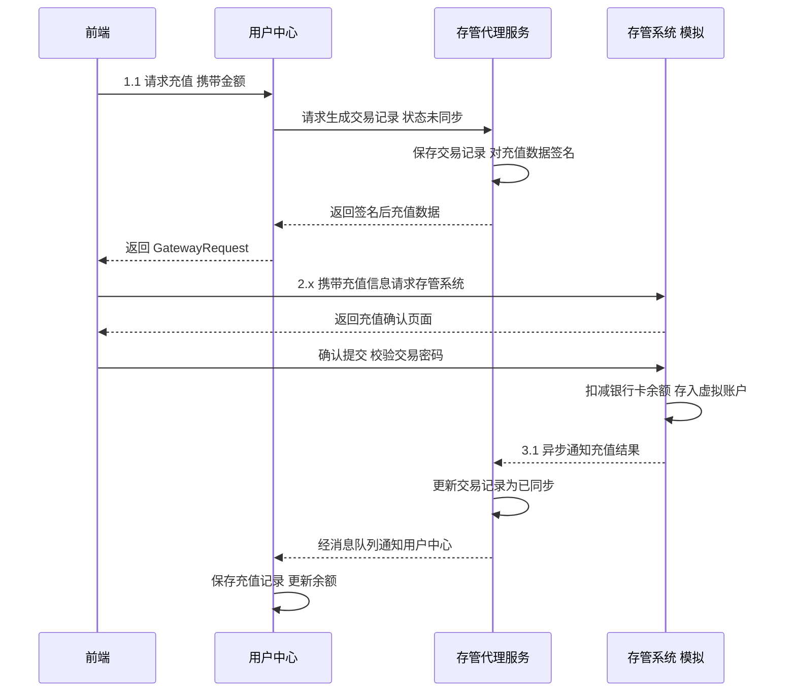

# 充值需求分析：三阶段十四步，把一条跨系统链路拆成可编码的任务

业务概述解决「充值是什么」，需求分析解决「代码怎么落」。实战文档里给的是一张时序图，企业里拿到手的就是这种图，读图能力直接决定编码质量。读时序图的第一步不是盯着箭头从上往下背，而是先看清图上有哪些系统、哪些微服务，把参与方数清楚，再把消息按编号分段，每段就是一个编码任务。

## 先给结论

- 充值链路涉及前端、用户中心、存管代理服务、银行存管系统四个显式参与方，前后端分离架构下还有一个没画出来的网关。
- 全流程分三阶段：第一阶段生成充值数据（图中 1.1～1.7），第二阶段请求充值（图中 2.1～2.8），第三阶段充值结果通知（图中 3.1～3.4）。
- 第二阶段前端直接与银行存管系统交互，前端代码不用写、存管系统是现成的，这一阶段几乎没有平台侧编码，可随第一阶段一起直接测试。
- 第三阶段是异步通知：存管系统充值成功后通知存管代理，存管代理把交易记录从「未同步」改为「已同步」，再经消息队列通知用户中心保存充值记录并更新余额。
- 平台侧要写的接口共四处：用户中心生成充值数据接口、存管代理生成充值数据接口、存管代理接收通知接口、用户中心的消息消费者。

## 链路上有哪些系统

时序图上的显式参与方是四个：前端，用户中心，存管代理服务，银行存管系统。前端发起操作；用户中心是平台侧的业务入口，充值数据在它手里组装；存管代理服务负责交易记录与签名，是平台与银行之间的统一通道；银行存管系统（模拟）是资金的真实管理者，它背后还有开卡银行，由存管系统与开卡银行交互完成扣款。

容易漏掉的是网关。万信金融 P2P 项目采用前后端分离架构，前端的请求都要过网关路由到各微服务，时序图里只是没画出来。看图时心里要把这个隐形环节补上，排查请求不通的问题时才不会只在业务服务里打转。整条链路的位置关系如下：


关键判断：银行存管系统与开卡银行一侧不用平台开发，平台侧的工作全部集中在用户中心与存管代理两个服务上。这也框定了编码任务的边界。

## 第一阶段：生成充值数据（1.1～1.7）

第一阶段本质是为第二阶段备料：银行存管系统接收充值请求时要校验签名与业务数据，这些数据就是第一阶段要生成的内容。六个步骤走下来：前端填写充值信息，用户尚未开户会被自动跳转到开户界面；前端请求用户中心服务充值；用户中心准备充值数据，包括流水号、用户标识等要素；用户中心请求存管代理服务生成交易记录，状态为「未同步」，并由存管代理对充值数据进行签名；存管代理把签名后的充值数据返回给用户中心；用户中心再把充值数据返回给前端。

与开户第一阶段对照几乎一模一样：交易记录先以「未同步」状态落库，作为后续对账与状态回滚的凭据；数据经签名后才允许离开平台。第二阶段前端拿到的 `GatewayRequest` 就是带签名的网关请求数据，充值流程的全景时序如下：



关键读法：图上三个阶段在时序上是串起来的，但责任边界分明，平台侧代码只覆盖用户中心与存管代理两列。

## 第二阶段：请求充值（2.1～2.8）

第二阶段只有四步：前端携带充值信息请求银行存管系统；存管系统向前端返回充值信息确认页面；前端确认后提交充值请求；存管系统接收数据并校验，校验交易密码，无误后从用户绑定的银行卡扣减余额，把钱存入存管系统里的虚拟账户。

这一阶段最大的特点是平台侧无事可做。前端直接与银行存管系统交互，不经过用户中心与存管代理；前端代码项目里已经提供，存管系统是现成的模拟系统。也就是说第二阶段几乎不用写代码，写完第一阶段就可以连同它一起直接测试，从界面上走完填金额、输交易密码、看到充值成功页面的全程。

## 第三阶段：充值结果通知（3.1～3.4）

一个常见的疑问是：界面上已经看到「充值成功」了，为什么还要单独做通知？答案是界面提示不可靠。第二阶段结束时存管系统要给前端返回成功页面，这个响应可能因为网络抖动、页面关闭等任何中间原因丢失，用户没看到成功提示但钱实际已经扣了。如果没有后续通知，平台侧的交易记录永远停在「未同步」，充值记录与余额也不会更新，账就对不上了。异步通知就是这条兜底路径：不管前端响应成没成功，存管系统都会主动把结果推给平台。

四步流程：充值成功后，存管系统异步通知存管代理服务；存管代理收到通知后，把交易记录状态从「未同步」更新为「已同步」；存管代理向用户中心服务发通知，方式是向消息队列发送消息；用户中心的消费者收到充值成功消息后，保存充值记录并更新余额。这套「回调收结果、改状态、发消息、消费落库」的组合与开户第三阶段完全同构：存管代理侧的 `DepositoryNotifyController` 接收回调、`GatewayMessageProducer` 发消息，用户中心侧的 `GatewayNotifyConsumer` 订阅通知主题，都是开户时已经搭好的设施，充值换一套标签与业务处理即可复用。

测试第三阶段前有一个与开户同款的注意点：银行存管系统里发送通知的代码此前为演示需要被注释了，要在存管系统工程的 `RechargeDetailsServiceImpl` 类中把其中两行代码的注释去掉，否则充值成功后不会有任何通知发出，第三阶段的表现就会像「丢了消息」一样。

## 接口地图：四处编码任务

需求拆完，平台侧的任务收敛为四个接口，编号沿用实战文档。

**接口①，用户中心生成充值数据接口。** 在 `ConsumerApi` 中新增方法，职责是接收用户填写的充值数据、请求存管代理生成签名数据、把签名数据返回前端：

```java
// 接口① 用户中心生成充值数据 按充值实战讲义口径整理 包名按 com.study.finance 系改写
public interface ConsumerApi {

    /** 生成充值请求数据
     *  @param amount      充值金额
     *  @param callbackURL 回调地址
     *  @return 签名后的充值请求数据 */
    @ApiOperation("生成充值请求数据")
    @ApiImplicitParams({
        @ApiImplicitParam(name = "amount", value = "金额", required = true,
                dataType = "String", paramType = "query"),
        @ApiImplicitParam(name = "callbackURL", value = "通知结果回调Url", required = true,
                dataType = "String", paramType = "query")})
    @GetMapping("/my/recharge-records")
    RestResponse<GatewayRequest> createRechargeRecord(String amount, String callbackURL);
}
```

**接口②，存管代理生成充值数据接口。** 在 `DepositoryAgentApi` 中新增方法，职责是接收用户中心发来的充值请求数据、保存交易记录、生成签名数据。该阶段涉及的新类有 `RechargeRequest` 与 `RechargeRecord`：

```java
// 接口② 存管代理生成充值数据 按充值实战讲义口径整理 包名按 com.study.finance 系改写
@ApiOperation("生成充值请求数据")
@ApiImplicitParam(name = "rechargeRequest", value = "充值信息", required = true,
        dataType = "RechargeRequest", paramType = "body")
@PostMapping("/l/recharges")
public RestResponse<GatewayRequest> createRechargeRecord(
        @RequestBody RechargeRequest rechargeRequest) {
    // 1. 保存交易记录 状态未同步 2. 对充值数据签名 3. 返回 GatewayRequest
    return null;
}
```

**接口③，存管代理接收通知接口。** 在 `DepositoryNotifyController` 类中新增 `receiveDepositoryRechargeResult` 方法，接收存管系统充值成功回调、更新交易状态、再向消息队列发消息。回调参数沿用存管网关报文规范，公开注解中可见的有 serviceName（请求的银行存管接口名）与 platformNo（平台编号，平台与存管系统签约时获取），其余参数按银行存管系统接口说明补全。

**接口④，用户中心接收通知。** 这一处不是严格意义上的 HTTP 接口，而是一个消息消费者，复用开户时写过的 `GatewayNotifyConsumer`：订阅存管代理发出的通知消息，收到充值成功消息后保存充值记录、更新余额。

四个接口与三个阶段的对应关系：接口①②支撑第一阶段，第二阶段零编码，接口③④支撑第三阶段。实现顺序建议按编号推进，每完成一段就与已有的开户实现对照一次，签名、报文、交易记录的状态机全部沿用既有设施。

## 常见误区

- **以为充值请求要一路穿过用户中心到存管系统。** 错例：按第一阶段链路把充值提交也做成用户中心透传。正解：第二阶段前端携带第一阶段生成的签名数据直接请求存管系统，平台侧服务不参与这次提交。
- **以为看到充值成功页面就完事了。** 错例：跳过第三阶段，交易记录永远停在未同步。正解：界面响应可能丢失，异步通知才是账实对齐的保证，交易状态、充值记录、余额三处更新都依赖它。
- **忘记放开存管系统里被注释的通知代码。** 错例：第三阶段测试时一直收不到消息，以为是 MQ 配错了。正解：先到存管系统工程的 `RechargeDetailsServiceImpl` 恢复那两行发送通知的代码，再排查链路。
- **把接口④当 HTTP 接口去写 Controller。** 错例：给用户中心定义一个接收通知的 REST 端点。正解：用户中心侧是消息消费者，从消息队列取存管代理发出的通知，与开户第三阶段的消费方式保持一致。

## 面试可能被问到的问题

1. 面试官追问：「读一张业务时序图，你的阅读顺序是什么？」
   答：先数清图上的参与方，包括没画出来的网关这类隐形环节；再把消息按编号分段，每段对应一个阶段或一个编码任务；最后识别哪一侧是外部系统，把平台侧责任边界框出来，转化为接口清单。
2. 面试官追问：「充值为什么要分成三个阶段？」
   答：因为参与方职责不同。生成充值数据是平台侧备料，签名与交易记录必须先做好；请求充值由前端与存管系统直接交互，平台不干预；结果通知是异步兜底，保证响应丢失时账务仍能对齐。按责任边界分段，编码与测试才能各自独立推进。
3. 面试官追问：「前端响应成功但平台没收到结果，怎么办？」
   答：这正是异步通知存在的意义。存管系统会主动回调存管代理，代理更新交易记录状态后经消息队列通知用户中心落库。消息消费失败还可以依赖 MQ 的重试机制，保证通知最终送达。
4. 面试官追问：「交易记录的未同步状态有什么用？」
   答：它是充值请求已发出、银行侧结果未确认之间的中间态，是对账与异常处理的依据：长期停在未同步的记录可以主动查询或重发，成功通知到达后翻转为已同步，状态机贯穿了整个资金链路。
5. 面试官追问：「充值和开户的系统链路有什么异同？」
   答：同构点是三阶段划分、交易记录与签名、异步通知与消息消费的整套机制，通道与组件全部复用；差异点在业务实体与数据处理，开户更新用户与银行卡状态，充值保存充值记录并更新余额，存管系统侧的接口名与回调内容也不同。

## 配套资料

- 讲义：`materials/docs/10/万信金融-充值-实战v1.0.md`，2.1 需求分析（三阶段十四步），2.2.2 接口定义（接口① `ConsumerApi.createRechargeRecord`、接口② `DepositoryAgentApi` 与 `RechargeRequest`/`RechargeRecord`、接口③ `DepositoryNotifyController.receiveDepositoryRechargeResult`、接口④ `GatewayNotifyConsumer`），2.4.2 功能测试注意点（存管系统 `RechargeDetailsServiceImpl` 注释恢复）。
- 讲义：`materials/docs/10/万信金融-第2章-讲义-开户v1.0.md`，3.5 存管通知与消息消费的实现出处，充值的第三阶段与之同构。
- 代码：`materials/code/10/wanxinp2p/`，P2P 工程归档（目录保留原始命名，路径只列到该层级），可对照 API 工程结构与网关报文组件；充值实现为实战留白，工程中无成品代码。
- 说明：接口①②的代码块按充值实战讲义接口定义口径整理，包名按 `com.study.finance` 系改写，方法体留空为讲义原意；时序图按讲义阶段编号绘制。
