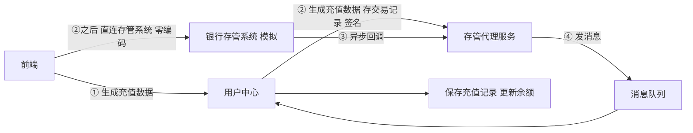

# 充值接口定义：四个接口，把三阶段链路钉进代码

需求分析把充值拆成了三个阶段，接下来的问题是：代码到底要写在哪几处。实战文档在这一步给出的是接口定义，方法体留空，实现由学员完成。接口定义的价值在于把一条跨系统的链路收敛成一份可分工的任务清单：接口一旦定下来，前端和后端就能各自开工，这和企业里架构师定接口、开发者拿接口实现的做法完全一致。动键盘之前，先把这四个接口的位置、参数与注意事项看透。

## 先给结论

- 平台侧一共要写四处：用户中心生成充值数据接口、存管代理生成充值数据接口、存管代理接收通知接口、用户中心的消息消费者，编号①②③④分别对应讲义口径。
- 接口①②支撑第一阶段（生成充值数据），第二阶段前端直连存管系统、零编码，接口③④支撑第三阶段（充值结果通知）。
- 接口①②的返回值统一是 `RestResponse<GatewayRequest>`，里面装的是带签名的网关请求数据，前端拿它拼 URL 直连银行存管系统。
- 接口②的路径以 `/l` 开头，在 P2P 项目里这是内部约定：`/l` 开头的服务只暴露给后端微服务互相调用，前端不可访问。
- 第三阶段测试前，必须在存管系统工程里把 `RechargeDetailsServiceImpl` 中两行被注释的通知代码放开，否则银行侧不会发出充值成功消息。

## 四个接口在链路上的位置

把 0199 那张三阶段时序图按「谁调谁」重新投影到接口上，任务清单就出来了。第一阶段是用户中心与存管代理之间的两跳，对应接口①②；第二阶段前端直接与银行存管系统交互，平台侧无事可做；第三阶段是存管系统回调存管代理、存管代理经消息队列通知用户中心，对应接口③④。对应关系如下图：



读图的要点：接口编号与阶段编号不是一一对应，而是①②占第一阶段、第二阶段空缺、③④占第三阶段。编码顺序也照这个来，先把①②做完，就能连同第二阶段一起从前端界面走通充值主流程，③④补上后整条链路闭环。

## 接口①：用户中心生成充值数据

接口①落在用户中心的 `ConsumerApi` 里，讲义给的职责有四条：接收用户填写的充值数据（充值金额）；用户中心保存充值信息；请求存管代理生成签名数据；把签名数据返回给前端。按实战讲义口径整理后的定义如下：

```java
// 接口① 用户中心生成充值数据 按充值实战讲义口径整理 包名按 com.study.finance 系改写
public interface ConsumerApi {

    /** 生成充值请求数据
     *  @param amount      充值金额
     *  @param callbackURL 回调地址
     *  @return 签名后的充值请求数据 */
    @ApiOperation("生成充值请求数据")
    @ApiImplicitParams({
        @ApiImplicitParam(name = "amount", value = "金额", required = true,
                dataType = "String", paramType = "query"),
        @ApiImplicitParam(name = "callbackURL", value = "通知结果回调Url", required = true,
                dataType = "String", paramType = "query")})
    @GetMapping("/my/recharge-records")
    RestResponse<GatewayRequest> createRechargeRecord(String amount, String callbackURL);
}
```

两个参数各有去向：`amount` 是用户在充值页填写的金额；`callbackURL` 是充值完成后前端页面的回调地址，要到第三阶段通知到达后跳转时才用得上。返回值沿用全项目统一的 `RestResponse` 包装，泛型是 `GatewayRequest`，它携带 `serviceName`、`platformNo`、`reqData`、`signature`、`depositoryUrl` 等字段，前端就靠这几个字段拼出直连存管系统的地址。

这个阶段涉及两个新类。一个是 `RechargeRequest`，用户充值请求信息的封装，第一阶段的备料最终都要装进它：

```java
// 用户充值请求信息 按讲义口径整理 包名按 com.study.finance 系改写
public class RechargeRequest {
    @ApiModelProperty("标识")
    private Long id;
    @ApiModelProperty("用户编号")
    private String userNo;
    @ApiModelProperty("请求流水号")
    private String requestNo;
    @ApiModelProperty("充值金额")
    private BigDecimal amount;
    @ApiModelProperty("页面回调URL")
    private String callbackUrl;
}
```

另一个是 `RechargeRecord` 实体类，对应 `consumer` 数据库里的充值记录表 `recharge_record`，类上标着 `@Table("recharge_record")`，字段有主键、用户标识等。用户中心「保存充值信息」这一步落的就是这张表。金额字段用 `BigDecimal` 而不是 `double`，金额计算不能用浮点数，这是资金类系统的基本功。

## 接口②：存管代理生成充值数据

第二跳由用户中心发起，落在存管代理服务的 `DepositoryAgentApi` 里。职责三条：接收用户中心发来的充值请求数据；保存交易记录，状态为「未同步」；对充值数据生成签名。讲义口径的 Controller 实现如下：

```java
// 接口② 存管代理生成充值数据 按充值实战讲义口径整理 包名按 com.study.finance 系改写
@Override
@ApiOperation("生成充值请求数据")
@ApiImplicitParam(name = "rechargeRequest", value = "充值信息", required = true,
        dataType = "RechargeRequest", paramType = "body")
@PostMapping("/l/recharges")
public RestResponse<GatewayRequest> createRechargeRecord(
        @RequestBody RechargeRequest rechargeRequest) {
    // 1. 保存交易记录 状态未同步 2. 对充值数据签名 3. 返回 GatewayRequest
    return null;
}
```

路径 `/l/recharges` 的 `/l` 前缀值得单独记一笔：项目约定里 `/l` 开头的服务只暴露给后端，供微服务之间互相调用，前端访问不到。这也和调用方吻合，调它的是用户中心，不是浏览器。签名生成需要密钥，课程环境里密钥一律用 `example-*` 占位串代替，配置在存管代理一侧。

实现时最大的提示还是那句：参考开户。开户第一阶段做过一模一样的事，交易记录先落库、再签名、再返回网关数据，把开户代码翻出来照着走，方法体就能填出来。

## 接口③与接口④：第三阶段的收尾

第三阶段两个接口分工明确。接口③在存管代理服务的 `DepositoryNotifyController` 中新增 `receiveDepositoryRechargeResult` 方法，接收银行存管系统充值成功的回调，更新交易状态，再向消息队列发消息通知用户中心：

```java
// 接口③ 存管代理接收充值结果通知 按充值实战讲义口径整理 包名按 com.study.finance 系改写
@ApiOperation("接受银行存管系统充值返回结果")
@ApiImplicitParams({
    @ApiImplicitParam(name = "serviceName", value = "请求的银行存管接口名",
            required = true, dataType = "String", paramType = "query"),
    @ApiImplicitParam(name = "platformNo", value = "平台编号，平台与存管系统签约时获取",
            required = true, dataType = "String", paramType = "query"),
    @ApiImplicitParam(name = "signature", value = "对reqData参数的签名",
            required = true, dataType = "String", paramType = "query"),
    @ApiImplicitParam(name = "reqData", value = "业务数据报文，json格式",
            required = true, dataType = "String", paramType = "query")})
@RequestMapping(value = "/gateway", method = RequestMethod.GET,
        params = "serviceName=RECHARGE")
public String receiveDepositoryRechargeResult(
        @RequestParam("serviceName") String serviceName,
        @RequestParam("platformNo") String platformNo,
        @RequestParam("signature") String signature,
        @RequestParam("reqData") String reqData) {
    return "OK";
}
```

四个参数与开户回调完全同款：`serviceName` 这次固定为 `RECHARGE`，`@RequestMapping` 的 `params` 属性直接用它做路由分流；`platformNo` 是平台与存管系统签约时拿到的编号；`reqData` 是 JSON 格式的业务数据报文；`signature` 用来验签。返回给存管系统的应答统一是字符串 `OK`。方法体里要做的事：验签、把交易记录从「未同步」更新为「已同步」、向消息队列发送充值成功消息。

接口④严格说不是 `interface`，而是一个消息消费者。用户中心侧复用开户时写过的 `GatewayNotifyConsumer`，订阅存管代理发出的通知，收到充值成功消息后保存充值记录、更新余额。翻出开户第三阶段的代码，在此基础上补几行针对充值的处理即可。

第三阶段测试前有一个专门的开关要打开：存管系统工程的 `RechargeDetailsServiceImpl` 类里，产生充值成功信息、更新充值记录结果的那两行代码默认被注释着，为的是不影响第一、二阶段的测试效果。走到第三阶段必须把注释去掉，否则银行侧不发通知，第三阶段表现为「消息凭空丢失」，排查时会浪费大量时间。

## 前端已经写好的调用证据

接口①定义得对不对，前端代码可以直接验证。课程前端工程里的充值页在提交时就是这样调的：

```javascript
// materials 前端工程 pages/user/pay.vue 摘录
this.request({
    url: 'consumer/my/recharge-records',
    params: {
        amount: this.amount,
        callbackUrl: `${this.utils.getBaseUrl()}/#/pages/common/success?st=2`
    }
}).then(res => {
    const urlData = res.data.result
    const url = `${urlData.depositoryUrl}?serviceName=${urlData.serviceName}` +
        `&platformNo=${urlData.platformNo}&reqData=${urlData.reqData}` +
        `&signature=${urlData.signature}`
    window.location.href = url
})
```

`consumer/my/recharge-records` 正是接口①的路径，请求参数正是金额与回调地址；拿到响应后前端从 `RestResponse.result` 里取出 `GatewayRequest`，拼上 `serviceName`、`platformNo`、`reqData`、`signature` 四个参数跳转存管系统。这一跳就是第二阶段的开端，也解释了为什么平台侧服务不参与第二阶段：浏览器带着签名数据直连银行了。

## 常见误区

- **把接口①②当成一个接口。** 错例：在用户中心一个方法里既保存充值信息又直接签名。正解：签名能力在存管代理一侧，用户中心必须经接口②跨服务调用，职责切分由接口定义钉死。
- **接口②的路径写成对外路径。** 错例：仿照接口①用 `/my` 前缀，导致存管代理的内部接口暴露给前端。正解：内部服务互调路径以 `/l` 开头，如 `/l/recharges`，与项目既有约定保持一致。
- **忘了第三阶段放开存管系统的注释代码。** 错例：测试时收不到充值成功通知，先去怀疑 MQ 配置。正解：先到 `RechargeDetailsServiceImpl` 恢复那两行发送通知的代码，再排查链路。
- **把接口④写成 REST 接口。** 错例：在用户中心新写一个 Controller 接收通知。正解：用户中心侧是消息消费者 `GatewayNotifyConsumer`，通知经消息队列异步到达，与开户第三阶段一致。

## 面试可能被问到的问题

1. 面试官追问：「充值为什么要在用户中心和存管代理各定义一个生成数据的接口？」
   答：签名密钥与交易记录都归存管代理管理，用户中心只掌握业务入口。用户中心负责接收前端参数、保存充值信息并组装请求数据，存管代理负责落交易记录与生成签名，两个接口的切分就是这条职责边界的落地。
2. 面试官追问：「`GatewayRequest` 里为什么要带签名和回调地址？」
   答：第二阶段前端要携带这些数据直连银行存管系统，签名保证数据未被篡改，`serviceName` 与 `platformNo` 让存管系统识别本次请求的接口与来源平台；回调地址则供通知到达或流程结束后前端跳转使用。
3. 面试官追问：「`/l` 开头的路径是什么约定，为什么这样设计？」
   答：项目内部约定 `/l` 前缀的接口只暴露给后端微服务互调，前端不可访问。它把内部接口与对外接口在路径层做了隔离，网关和前端只走对外路径，内部数据不会被外部直接触达。
4. 面试官追问：「存管系统回调为什么要用 `params = "serviceName=RECHARGE"`？」
   答：同一个 `/gateway` 端点要承接多种业务通知，`params` 属性让 Spring MVC 按请求参数做路由分流，充值通知进充值方法、提现通知进提现方法，一个入口支撑多类回调且互不干扰。
5. 面试官追问：「四个接口的实现顺序有讲究吗？」
   答：建议按①②③④推进。做完①②即可连同第二阶段从前端界面走通充值主流程，先验证备料阶段；③④补上异步通知后账务才最终对齐，每完成一段都与开户的对应实现对照一次，复用签名、报文与状态机的既有设施。

## 配套资料

- 讲义：`materials/docs/10/万信金融-充值-实战v1.0.md`，2.2.2 接口定义（接口① `ConsumerApi.createRechargeRecord`、接口② `DepositoryAgentApi` 与新类 `RechargeRequest`/`RechargeRecord`），2.4.2 接口定义（接口③ `DepositoryNotifyController.receiveDepositoryRechargeResult`、接口④ `GatewayNotifyConsumer` 与 `RechargeDetailsServiceImpl` 注释恢复）。
- 讲义：`materials/docs/10/万信金融-第2章-讲义-开户v1.0.md`，网关签名、交易记录状态机与消息消费的出处，充值四个接口均与其同构。
- 代码：`materials/code/10/wanxinp2p_front/wanxinp2p_front/pages/user/pay.vue`，充值页真实源码，含对 `consumer/my/recharge-records` 的调用与直连存管系统的跳转逻辑。
- 代码：`materials/code/10/wanxinp2p_apollo/wanxinp2p_apollo/wanxinp2p-common/`，公共工程归档（目录保留原始命名，路径只列到该层级），含 `RestResponse` 统一响应包装的真实定义。
- 说明：平台侧四个接口的实现为实战留白，代码块按充值实战讲义接口定义口径整理，包名按 `com.study.finance` 系改写，方法体留空为讲义原意。
