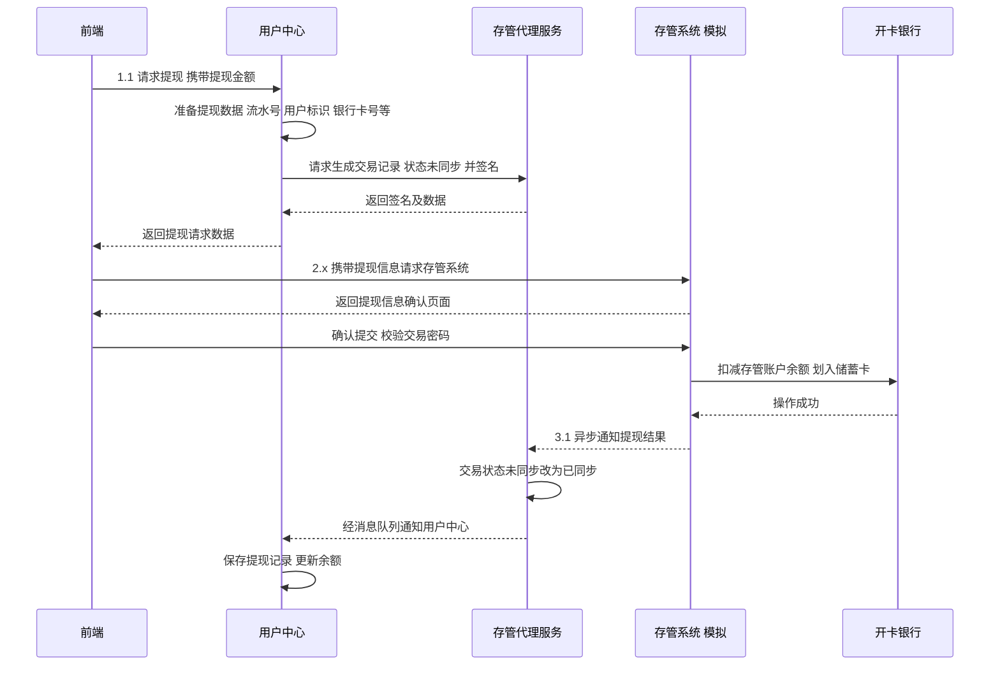

# 提现需求分析：把一进一出的镜像链路拆成三阶段十四步

业务概述回答了「提现是什么」，需求分析要回答「代码怎么落」。实战文档在这一步给的是一张用户提现时序图，这也是编码阶段的直接参照，动手前必须把图读透。提现与充值的时序图放在一起看几乎是镜像关系，这个相似性既是好事，能整套复用充值沉淀的套路；也是陷阱，容易让人扫一眼就下结论，漏掉提现特有的数据要素与账务方向。这一课把三阶段逐步拆开，最后收敛成平台侧的接口地图。

## 先给结论

- 提现链路的参与方与充值完全一致：前端、用户中心、存管代理服务、银行存管系统（模拟），外加一个时序图上没画出来但实际存在的网关。
- 全流程同样分三阶段：第一阶段生成请求数据（图中 1.1～1.7），第二阶段请求提现（图中 2.1～2.8），第三阶段提现结果通知（图中 3.1～3.4）。
- 第一阶段用户中心准备的提现数据比充值多出银行卡号、银行预留手机号、平台佣金等要素，因为钱要落到具体的那张卡上。
- 第二阶段前端直连银行存管系统，存管系统校验交易密码后从存管账户扣款、划到储蓄卡，平台侧零编码。
- 第三阶段异步通知与充值同构：存管系统通知存管代理更新交易状态，存管代理经消息队列通知用户中心保存提现记录、更新余额。

## 链路与阶段总览

时序图上的五个参与者依次是浏览器/App 前端、用户中心、存管代理服务、存管系统、开卡银行。前四者与充值时序图一模一样，存管系统背后仍由开卡银行配合完成资金进出；网关依旧没有出现在图上，但前后端分离架构下前端所有请求都要经网关路由，排查问题时这个隐形环节要一直记着。资金方向是这条链路与充值唯一的本质区别：充值时钱从储蓄卡流向存管账户，提现时钱从存管账户流向储蓄卡，一进一出。

三个阶段的划分逻辑也与充值相同，第一阶段平台备料，第二阶段前端与存管系统直连完成资金动作，第三阶段异步通知把结果同步回平台侧。全景时序如下：



读图的关键路径：平台侧代码只覆盖用户中心与存管代理两列，存管系统与开卡银行是现成的模拟系统与外部银行。把图按编号切段，每一段就是一个编码任务，这与充值需求分析时的读图方法完全一致。

## 第一阶段：生成请求数据（1.1～1.7）

第一阶段的任务是备料，为第二阶段准备好带签名的提现请求数据。六步走完：前端填写提现信息；前端请求用户中心服务提现；用户中心服务准备提现数据；用户中心服务请求存管代理服务生成交易记录（未同步），并对提现数据进行签名；存管代理服务将签名后的提现数据返回给用户中心；用户中心将提现数据返回给前端。

与充值第一阶段的差异集中在第 3 步「准备提现数据」上。充值要准备的是流水号、用户标识、充值金额、回调地址；提现除了这些，还要准备 REQUEST_NO、USER_ID 这类基础标识之外的银行卡要素：提现目标银行卡号、银行预留手机号，以及平台佣金。原因不难理解：钱最终要划到用户绑定的那张储蓄卡上，卡号与预留手机号是银行侧校验持卡人的依据；平台佣金是提现手续费的分账口径，平台收多少、用户提多少，要在请求发出前就算清楚。这些数据最终封装进 `WithdrawRequest` 对象，交给存管代理签名。

交易记录的处理与充值如出一辙：存管代理保存交易记录时状态默认为「未同步」，它是提现请求已发出、银行侧结果未确认之间的中间态，对账与异常处理都靠它兜底，第三阶段通知到达后才翻转为「已同步」。

金额约束在进入第一阶段之前就由前端把了一道关。课程前端工程提现页的真实校验逻辑如下，输入金额超过存管账户余额会被直接拦下：

```javascript
// materials 前端工程 pages/user/withdrawal.vue 摘录 提现金额校验
setNumber(event) {
    if (event > Number(this.balance)) {
        this.amount = ''
        this.subType = false
        uni.showToast({ icon: 'none', title: '提现金额输入有误 请从新输入' })
        return false
    }
    event === 'all' ? this.amount = this.balance : this.amount = event
    this.subType = true
}
```

`this.balance` 来自上一页传入的存管账户余额，「全部提现」按钮把它一键填满。前端先拦一道，后端与存管系统侧仍要做同样校验，两端校验缺一不可，这是金额类输入的标配做法。

## 第二阶段：请求提现（2.1～2.8）

第二阶段开始真正动钱。前端携带第一阶段生成的签名数据直接请求银行存管系统，不经用户中心与存管代理；存管系统向前端返回提现信息确认页面；前端确认后提交提现请求；存管系统接收提现数据并进行校验，校验交易密码，无误后从存管账户余额中扣减相应金额，把钱划入用户绑定的储蓄卡；存管系统侧同样保存交易记录；最终提现成功，前端看到提现成功页面。

这一阶段的特征与充值第二阶段相同：参与方只有前端和银行存管系统，两边都不需要平台开发，前端页面工程里现成、存管系统是课程提供的模拟系统。所以第二阶段没有编码任务，写完第一阶段就可以连同它一起直接测试，从界面上走完填金额、输交易密码、看到提现成功的全程。存管系统从虚拟账户扣款、储蓄卡到账，这个资金动作全部发生在银行一侧，平台全程不碰钱。

## 第三阶段：提现结果通知（3.1～3.4）

界面上的提现成功提示不可靠，网络抖动、页面提前关闭都可能让用户看不到它，但钱已经划走了。如果只有界面提示，平台侧交易记录会永远停在「未同步」，提现记录与余额也不会更新。异步通知就是兜底路径：不管前端响应成没成功，存管系统都会主动把结果推给平台。

四步流程：提现成功后银行存管系统异步通知存管代理服务；存管代理服务接收到提现成功通知，更新交易状态为已同步；存管代理服务通知用户中心服务，方式是向消息队列发送消息；用户中心服务接收到提现成功的消息后，保存提现记录到用户中心服务并更新余额。这套「回调收结果、改状态、发消息、消费落库」的组合与充值第三阶段、开户第三阶段完全同构，通道与组件全部复用，提现只是换了一套业务标签与落库内容。余额方向在账务上要注意：充值通知到达后余额增加，提现通知到达后余额减少，方向别做反。

## 接口地图：四处编码任务

三个阶段拆完，平台侧任务依旧收敛为四个接口，编号沿用提现实战文档，与充值一一镜像：

| 编号 | 所在服务 | 名称与路径 | 职责 |
|---|---|---|---|
| 接口① | 用户中心 | `ConsumerApi.createWithdrawRecord`，`GET /my/withdraw-records` | 接收提现金额与回调地址，保存提现信息，请求存管代理签名，返回签名数据 |
| 接口② | 存管代理服务 | `DepositoryAgentApi.createWithdrawRecord`，`POST /l/withdraw` | 接收提现请求数据，保存交易记录（未同步），生成签名 |
| 接口③ | 存管代理服务 | `DepositoryNotifyController.receiveDepositoryWithdrawResult`，`/gateway` | 接收存管系统提现结果回调，更新交易状态，发消息 |
| 接口④ | 用户中心 | 消息消费者 `GatewayNotifyConsumer` | 订阅通知消息，保存提现记录，更新余额 |

接口①②支撑第一阶段，第二阶段零编码，接口③④支撑第三阶段。四个接口的具体参数与实现提示在下一课展开，动手时按编号推进，每完成一处就对照一次充值的镜像实现。

## 常见误区

- **以为提现需求就是把充值文档里的「充值」替换成「提现」。** 错例：照抄充值三阶段，数据要素原样搬。正解：提现请求数据多出银行卡号、银行预留手机号、平台佣金，余额方向相反，这些差异点正是实战考察的地方。
- **以为第二阶段要平台做资金对接开发。** 错例：在用户中心或存管代理里安排扣款逻辑。正解：第二阶段只有前端与银行存管系统参与，扣款与到账由存管系统完成，平台侧零编码、直接测试。
- **把提现成功的界面提示当作账务完成的标志。** 错例：看到提现成功页就认为流程结束。正解：以第三阶段异步通知为准，交易状态、提现记录、余额三处更新都发生在通知链路上。
- **漏掉网关这个隐形环节。** 错例：前端请求用户中心不通时只在业务服务里排查。正解：前后端分离下所有前端请求都经网关路由，链路问题先确认网关路由与令牌透传是否正常。

## 面试可能被问到的问题

1. 面试官追问：「提现的需求分析和充值有什么异同？」
   答：相同点是参与方、三阶段划分、交易记录状态机与异步通知机制，整条链路同构；不同点是资金方向相反、请求数据多出银行卡号、预留手机号与平台佣金、落库实体从充值记录换成提现记录，余额一增一减。
2. 面试官追问：「第一阶段为什么要准备银行卡号和预留手机号？」
   答：提现的收款方是用户开户时绑定的储蓄卡，卡号定位资金去向，预留手机号是银行侧校验持卡人身份的要素，这些数据在请求存管系统前就必须备齐并随签名数据一起提交。
3. 面试官追问：「交易记录的未同步状态在提现里起什么作用？」
   答：它是提现请求已发出、银行侧结果未确认之间的中间态。长期停在未同步的记录可以主动查询或补发通知，成功通知到达后翻转为已同步，状态机为对账与异常补偿提供了依据。
4. 面试官追问：「第二阶段平台侧零编码，那它的测试怎么保证质量？」
   答：测的是链路联通与数据正确性：前端携带的签名数据能否被存管系统接受、交易密码校验是否生效、扣款金额与到账金额是否一致。它是检验第一阶段备料质量的集成测试，不是可以跳过的环节。
5. 面试官追问：「如果异步通知丢了，平台侧会怎样，怎么补救？」
   答：交易记录停留在未同步，提现记录与余额不更新，账实不一致。补救手段是主动对账与查询补发：对长期未同步的记录向存管系统查询真实结果，或依赖消息队列的重试机制保证通知最终送达。

## 配套资料

- 讲义：`materials/docs/10/万信金融-提现-实战v1.0.md`，2.1 需求分析（三阶段十四步：生成请求数据 1.1～1.7、请求提现 2.1～2.8、提现结果通知 3.1～3.4），时序图与阶段步骤以此为准。
- 讲义：`materials/docs/10/万信金融-充值-实战v1.0.md`，2.1 需求分析，与提现逐段对照的镜像链路出处。
- 讲义：`materials/docs/10/万信金融-第2章-讲义-开户v1.0.md`，存管通知与消息消费机制的原始出处。
- 代码：`materials/code/10/wanxinp2p_front/wanxinp2p_front/pages/user/`，前端工程归档（目录保留原始命名，路径只列到该层级），含 `withdrawal.vue`、`confirmWithdrawal.vue` 等提现相关真实页面。
- 说明：提现的平台侧实现为实战留白，工程中无成品代码；文中时序图按提现实战讲义阶段编号绘制，接口清单按讲义口径整理，包名按 `com.study.finance` 系改写。
