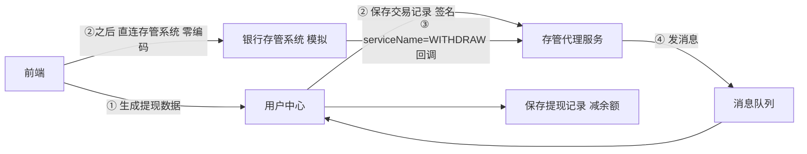

# 提现接口定义：四个镜像接口，把提现链路交到代码手里

需求分析把提现拆成了三阶段十四步，接口定义这一步要把它变成任务清单。与充值一样，接口定义好之后前端和后端各自开工，实现由学员按讲义口径完成。提现的四个接口与充值一一镜像，但参数与实体类各有差异，正是这些差异处容易出错：佣金字段、银行卡要素、通知路由参数，一个都不能照抄充值。动键盘前把这一课的参数约定与实现提示过一遍。

## 先给结论

- 平台侧共四处编码：接口①用户中心 `createWithdrawRecord`、接口②存管代理 `createWithdrawRecord`、接口③存管代理 `receiveDepositoryWithdrawResult`、接口④用户中心消息消费者，编号沿用提现实战讲义。
- 接口①②支撑第一阶段（生成提现数据），第二阶段零编码直接测试，接口③④支撑第三阶段（提现结果通知）。
- 接口①②返回值统一为 `RestResponse<GatewayRequest>`；接口②路径 `POST /l/withdraw`，`/l` 前缀表示只暴露给后端微服务互调。
- 新类两个：`WithdrawRequest` 封装提现请求数据，比充值多佣金 `commission`、银行卡号 `cardNumber`、银行预留手机号 `mobile`；`WithdrawRecord` 对应 `consumer` 库的提现记录表 `withdraw_record`。
- 第三阶段测试前要放开存管系统工程 `WithdrawDetailsServiceImpl` 里被注释的两行通知代码，否则银行侧不发提现成功消息。

## 四个接口与三个阶段的对应

接口编号与阶段编号的关系先用一张图钉住，编码顺序就按它来：



①②占第一阶段，第二阶段空缺、平台侧零编码，③④占第三阶段。做完①②就能从前端界面走通提现主流程，③④补上后账务才最终对齐。下面逐个看参数约定与实现提示。

## 接口①：用户中心生成提现数据

接口①落在用户中心的 `ConsumerApi` 里，讲义职责四条：接收用户填写的提现数据；用户中心保存提现信息；请求存管代理生成签名数据；将签名数据返回给前端。接口声明与 Controller 实现按提现实战讲义口径整理如下：

```java
// 接口① 用户中心生成提现数据 按提现实战讲义口径整理 包名按 com.study.finance 系改写
public interface ConsumerApi {

    /** 生成用户提现数据
     *  @param amount      提现金额
     *  @param callbackUrl 回调地址
     *  @return 签名后的提现请求数据 */
    RestResponse<GatewayRequest> createWithdrawRecord(String amount, String callbackUrl);
}
```

```java
// ConsumerController 中的实现 骨架按讲义口径整理 包名按 com.study.finance 系改写
@Override
@ApiOperation("生成用户提现数据")
@ApiImplicitParams({
    @ApiImplicitParam(name = "amount", value = "金额", required = true,
            dataType = "String", paramType = "query"),
    @ApiImplicitParam(name = "callbackUrl", value = "通知结果回调url", required = true,
            dataType = "String", paramType = "query")})
@GetMapping("/my/withdraw-records")
public RestResponse<GatewayRequest> createWithdrawRecord(
        @RequestParam String amount, @RequestParam String callbackUrl) {
    // 1. 保存提现信息 2. 组装 WithdrawRequest 调存管代理 3. 返回 GatewayRequest
    return null;
}
```

路径 `GET /my/withdraw-records` 与充值接口①的 `/my/recharge-records` 保持同一笔法：`/my` 前缀挂用户维度接口，资源名直接用提现记录。参数只有提现金额与回调地址，银行卡号、预留手机号、佣金这些要素不在前端入参里，由用户中心根据当前登录用户与绑定银行卡自行查库组装，这样接口面收敛，也避免让前端传敏感卡号。

## 接口②：存管代理生成提现数据

第二跳落在存管代理服务的 `DepositoryAgentApi`，职责三条：接收用户中心发来的提现请求数据；保存请求记录；生成签名数据。涉及两个新类，先看请求数据的封装：

```java
// WithdrawRequest 提现请求数据 按讲义口径整理 包名按 com.study.finance 系改写
public class WithdrawRequest {
    @ApiModelProperty("请求流水号")
    private String requestNo;
    @ApiModelProperty("提现金额")
    private BigDecimal amount;
    @ApiModelProperty("平台佣金")
    private BigDecimal commission;
    @ApiModelProperty("页面回调URL")
    private String callbackURL;
    @ApiModelProperty("银行卡号")
    private String cardNumber;
    @ApiModelProperty("银行预留手机号")
    private String mobile;
}
```

与充值 `RechargeRequest` 对照，金额、流水号、回调地址都在，多出来的三项就是需求分析时点过的差异：卡号与预留手机号定位收款卡与持卡人校验，`commission` 承载平台佣金的分账口径。再看 Controller 实现：

```java
// 接口② 存管代理生成提现数据 骨架按提现实战讲义口径整理 包名按 com.study.finance 系改写
@Override
@ApiOperation("生成提现请求数据")
@ApiImplicitParam(name = "withdrawRequest", value = "提现信息", required = true,
        dataType = "WithdrawRequest", paramType = "body")
@PostMapping("/l/withdraw")
public RestResponse<GatewayRequest> createWithdrawRecord(
        @RequestBody WithdrawRequest withdrawRequest) {
    // 1. 保存交易记录 状态未同步 2. 对提现数据签名 3. 返回 GatewayRequest
    return null;
}
```

`POST /l/withdraw` 的 `/l` 前缀沿用项目内部约定，该服务只暴露给后端微服务，调它的是用户中心。方法体三步与充值镜像：交易记录以「未同步」状态落库到 `withdraw_record` 表（对应实体 `WithdrawRecord`，字段含用户标识、用户编码、金额、佣金、触发时间），再对提现数据签名，最后把 `GatewayRequest` 返回给用户中心。签名密钥在课程环境用 `example-*` 占位串配置在存管代理一侧。

第二阶段按讲义口径不需要任何开发：前端携带签名数据直连银行存管系统，完成确认与交易密码校验后由存管系统扣款划账。写完接口①②即可连同第二阶段一起从前端界面直接测试。

## 接口③与接口④：第三阶段的收尾

接口③在存管代理服务的 `DepositoryNotifyController` 中新增 `receiveDepositoryWithdrawResult` 方法，接收银行存管系统提现成功的回调，更新交易状态，再经消息队列通知用户中心：

```java
// 接口③ 存管代理接收提现结果通知 骨架按提现实战讲义口径整理 包名按 com.study.finance 系改写
@ApiOperation("接受银行存管系统提现返回结果")
@ApiImplicitParams({
    @ApiImplicitParam(name = "serviceName", value = "请求的存管接口名",
            required = true, dataType = "String", paramType = "query"),
    @ApiImplicitParam(name = "platformNo", value = "平台编号，平台与存管系统签约时获取",
            required = true, dataType = "String", paramType = "query"),
    @ApiImplicitParam(name = "signature", value = "对reqData参数的签名",
            required = true, dataType = "String", paramType = "query"),
    @ApiImplicitParam(name = "reqData", value = "业务数据报文，json格式",
            required = true, dataType = "String", paramType = "query")})
@RequestMapping(value = "/gateway", method = RequestMethod.GET,
        params = "serviceName=WITHDRAW")
public String receiveDepositoryWithdrawResult(
        @RequestParam("serviceName") String serviceName,
        @RequestParam("platformNo") String platformNo,
        @RequestParam("signature") String signature,
        @RequestParam("reqData") String reqData) {
    return "OK";
}
```

与充值回调同住 `/gateway` 端点，靠 `params = "serviceName=WITHDRAW"` 做路由分流：充值通知的 `serviceName` 是 `RECHARGE`，提现通知是 `WITHDRAW`，同一控制器两种业务互不串线。返回值统一为字符串 `OK`。方法体内按讲义口径做三件事：验签、把提现交易记录从「未同步」更新为「已同步」、向消息队列发送提现成功消息。

接口④依旧不是 `interface`，而是用户中心侧的消息消费者 `GatewayNotifyConsumer`，开户时已经用过、充值时补过分支，提现再参考前两者加几行代码：收到提现成功消息后保存提现记录并更新余额。三个业务共用一条通知主题与消费骨架，差异只在落库实体与余额方向，提现是减。

第三阶段测试的开关与充值同款：存管系统工程的 `WithdrawDetailsServiceImpl` 类中，产生提现成功信息、更新提现记录结果的两行代码默认被注释，为的是不影响前两个阶段的测试效果；走第三阶段必须把注释去掉，否则银行侧不发通知，第三阶段的表现就像丢了消息。

## 前端已经写好的调用证据

接口①的出入参约定可以直接用前端真实代码验证。课程前端工程确认提现页在提交时就是这样调的：

```javascript
// materials 前端工程 pages/user/confirmWithdrawal.vue 摘录
submitHandle() {
    this.request({
        url: 'consumer/my/withdraw-records',
        params: {
            amount: this.amount,
            callbackUrl: `${this.utils.getBaseUrl()}/#/pages/common/success?st=3`
        }
    }).then(res => {
        const urlData = res.data.result
        const url = `${urlData.depositoryUrl}?serviceName=${urlData.serviceName}` +
            `&platformNo=${urlData.platformNo}&reqData=${urlData.reqData}` +
            `&signature=${urlData.signature}`
        window.location.href = url
    })
}
```

`consumer/my/withdraw-records` 正是接口①的路径，参数正是金额与回调地址；响应里的 `GatewayRequest` 被前端拼成存管系统地址后整页跳转，`serviceName`、`platformNo`、`reqData`、`signature` 四个查询参数就是第二阶段直连的全部凭据。前端不传卡号、不传佣金，印证了接口①入参收敛的设计：敏感与派生数据都在平台侧组装。

## 常见误区

- **照抄充值接口漏掉提现特有字段。** 错例：`WithdrawRequest` 里只放金额、流水号、回调地址。正解：佣金 `commission`、银行卡号 `cardNumber`、银行预留手机号 `mobile` 是提现数据的必备要素，缺了银行侧无法完成划款校验。
- **接口②路径写成对外风格。** 错例：仿照接口①用 `/my` 前缀或写成普通对外路径。正解：内部服务互调用 `/l` 前缀，如 `/l/withdraw`，与充值接口②的 `/l/recharges` 保持同一约定。
- **第三阶段回调的 `serviceName` 忘了换成提现。** 错例：从充值复制过来仍写 `serviceName=RECHARGE`，提现通知路由不进来。正解：提现回调是 `WITHDRAW`，靠 `@RequestMapping` 的 `params` 属性分流。
- **提现成功后把余额加成了正数。** 错例：复制充值的消费者代码，余额更新方向没改。正解：充值通知到达余额增加，提现通知到达余额减少，落库前先确认方向。
- **忘了放开存管系统的注释代码。** 错例：第三阶段收不到通知，先怀疑 MQ 配置。正解：先到 `WithdrawDetailsServiceImpl` 恢复那两行发送通知的代码，再排查链路。

## 面试可能被问到的问题

1. 面试官追问：「提现接口①为什么只暴露金额和回调地址两个参数？」
   答：银行卡号、预留手机号、佣金等要素属于敏感或派生数据，由用户中心根据当前登录用户与绑定银行卡查库组装，不让前端传。这样接口面小，也杜绝了前端伪造卡号的可能。
2. 面试官追问：「`WithdrawRequest` 和充值的请求封装差异在哪，为什么？」
   答：多了佣金、银行卡号、预留手机号三项。提现的资金流向是存管账户到储蓄卡，卡要素决定资金去向、手机号用于持卡人校验，佣金承载平台与用户之间的手续费分账，充值的资金流向用不到这些。
3. 面试官追问：「充值和提现的回调都打在 `/gateway`，Spring MVC 怎么区分？」
   答：用 `@RequestMapping` 的 `params` 属性按请求参数路由，`serviceName=RECHARGE` 进充值方法、`serviceName=WITHDRAW` 进提现方法。一个端点承接多业务回调，映射规则清晰且互不干扰。
4. 面试官追问：「接口④为什么做成消息消费者而不是 REST 接口？」
   答：存管代理到用户中心的通知走的是消息队列，异步解耦。消费失败可依赖 MQ 重试保证最终送达，流量高峰也不会压垮用户中心；HTTP 回调则要求用户中心同步在线应答，耦合更高。
5. 面试官追问：「实现提现时你会参考哪些已有代码？」
   答：开户与充值两条链路都要参考：接口定义与 Swagger 注解笔法抄充值，交易记录状态机与签名沿用开户沉淀的组件，消息消费参考 `GatewayNotifyConsumer` 里已有的分支，改动集中在落库实体、余额方向与业务标签。
6. 面试官追问：「测试提现第三阶段前最容易忽略什么？」
   答：存管系统 `WithdrawDetailsServiceImpl` 里两行被注释的通知代码。它们默认注释是为了不影响前两阶段测试，第三阶段必须恢复，否则银行侧不发声、平台侧状态永远不更新，现象与丢消息一样，容易把排查方向带偏。

## 配套资料

- 讲义：`materials/docs/10/万信金融-提现-实战v1.0.md`，2.2.1 接口定义（接口① `ConsumerApi.createWithdrawRecord`、接口② `DepositoryAgentApi` 与新类 `WithdrawRequest`/`WithdrawRecord`），2.4.2 接口定义（接口③ `DepositoryNotifyController.receiveDepositoryWithdrawResult`、接口④ `GatewayNotifyConsumer` 与 `WithdrawDetailsServiceImpl` 注释恢复）。
- 讲义：`materials/docs/10/万信金融-充值-实战v1.0.md`，充值四个接口的镜像参照，路径约定与注解笔法出处。
- 代码：`materials/code/10/wanxinp2p_front/wanxinp2p_front/pages/user/confirmWithdrawal.vue`，确认提现页真实源码，含对 `consumer/my/withdraw-records` 的调用与直连存管系统的跳转逻辑。
- 代码：`materials/code/10/wanxinp2p_apollo/wanxinp2p_apollo/wanxinp2p-common/`，公共工程归档（目录保留原始命名，路径只列到该层级），含 `RestResponse` 统一响应包装的真实定义。
- 说明：平台侧四个接口的实现为实战留白，代码块按提现实战讲义接口定义口径整理，包名按 `com.study.finance` 系改写，方法体留空为讲义原意。
