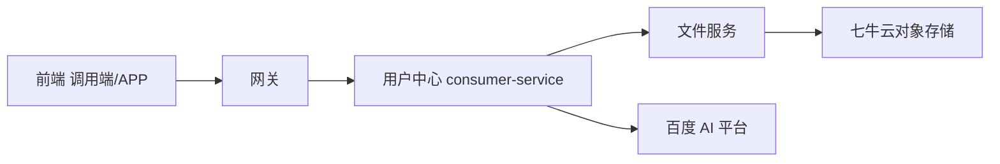
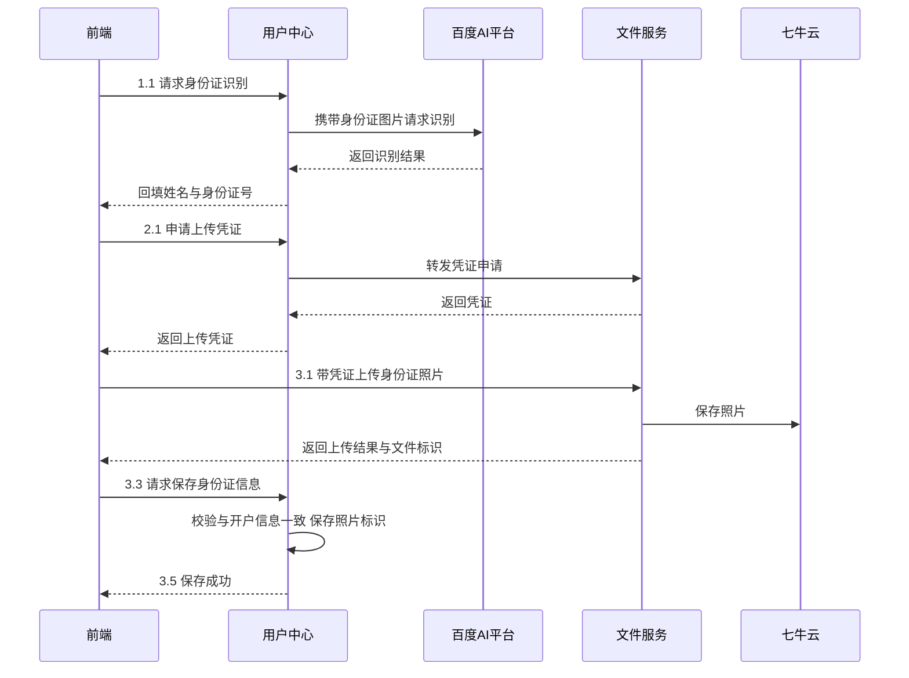

# 身份认证需求分析：一次认证拆成四个阶段，四方系统怎么接力

业务概述定下了「发标时认证」的决策，接下来做需求分析。看一张图，把身份认证涉及的系统、每一步谁请求谁、先做什么后做什么全部捋清，实战写代码时才知道自己要补的是哪几个接口。这张图里最大的特点是：认证这件事平台一家做不完，识别靠第三方 AI 平台，照片存储靠第三方对象存储，平台侧的角色更接近编排者。

## 先给结论

- 身份认证涉及四方：前端（调用端）、用户中心 `consumer-service`、独立抽取的文件服务、第三方百度 AI 平台，前端到后端之间还隔着网关。
- 整个认证流程分四个阶段：识别身份证、获取上传凭证、上传身份证、保存身份证信息，编号对应图中 1.1 至 3.5。
- 文件服务是专门处理文件上传下载的独立微服务，供项目各业务模块共用；照片最终存在第三方对象存储（默认七牛云），不在平台自己的服务器上。
- 身份证识别由用户中心调用百度 AI 完成，识别结果（姓名、身份证号）返回前端回填确认。
- 用户中心要新增的接口集中在 `ConsumerApi`：识别身份证、申请上传凭证、保存用户详细信息三个，上传功能由文件服务现成提供。

## 参与方与各自的职责

需求图上共四方，先把每方管什么定清楚。

**前端（调用端/APP）。** 用户操作的载体，上传证件照片、展示识别结果、发起各阶段请求。

**用户中心。** 也就是此前的 `consumer-service`，开户、注册都由它承载。在认证流程里它是中枢：识别请求经它转发给百度 AI，凭证申请经它转发给文件服务，最终的身份证信息由它落库。

**文件服务。** 一个单独抽取出来的通用微服务，专门处理文件的上传与下载。抽它的理由很朴素：项目里许多业务都会涉及文件上传下载，与其每个服务各自实现一遍，不如抽成一个通用的文件服务，谁要用谁来调。它对接的是第三方对象存储，课程默认选七牛云，将来也可换成百度云、阿里云等。这个服务的功能课程已实现好，实战中直接部署使用。

**百度 AI 平台。** 第三方开放平台，提供语音识别、图像识别、文字识别等智能能力。身份证上的姓名与身份证号本质是一串文字，认证用的是其中的文字识别（OCR）能力。



这张图在讲四方与第三方之间的连接关系：前端只面对网关与用户中心，百度 AI 只被用户中心调用，七牛云只被文件服务访问。责任边界清楚，任何一方的实现细节变更都不会波及其余各方。

## 四个阶段：识别、凭证、上传、保存

需求图把认证流程切成四个阶段，编号连贯地串起三方之间的所有请求。

**第一阶段，识别身份证（图中 1.1 至 1.5）。** 前端携带身份证图片信息请求用户中心，用户中心请求百度 AI 平台对身份证进行识别，识别结果沿原路返回给前端。这一阶段结束时，用户在页面上看到从照片里识别出的姓名与身份证号。

**第二阶段，获取上传凭证（图中 2.1 至 2.4）。** 前端请求用户中心获取上传授权，用户中心生成（或转发申请）上传凭证并返回。这里最容易产生疑问：上传就上传，为什么还要一个凭证？原因在下一阶段。

**第三阶段，上传身份证（图中 3.1 至 3.2）。** 前端携带上传凭证与照片请求文件服务，文件服务把照片保存到七牛云，返回上传结果。文件服务的存储并不在平台自己的服务器上，而在第三方：第三方不可能允许任何人随便往它的存储里放文件，必须先证明自己是合法用户，这个证明就是上传凭证，本质上是一个令牌（token）。凭证从文件服务侧按第三方规则生成，先拿凭证再上传，这是对象存储客户端直传的标准玩法。

**第四阶段，保存身份证信息（图中 3.3 至 3.5）。** 上传成功后，前端请求用户中心保存身份证信息，用户中心校验识别出的信息是否与开户信息一致，保存身份证照片的文件标识等，返回保存成功。



关键路径读法：识别走用户中心到百度 AI，上传走文件服务到七牛云，两条外部通道互不干扰；凭证是上传的前置条件，文件标识是保存阶段的核心数据。顺序乱了流程就断，这是编码时最容易出错的地方。

## 接口地图：用户中心要补的接口

四个阶段落到代码上，重心全在用户中心的 `ConsumerApi` 接口里。按实战讲义的口径，需要新增三个方法，加上前端工程的界面调整，构成了这块实战的全部工作面。

```java
// 接口定义按身份认证实战讲义口径整理 包名按 com.study.finance 系改写 方法体留白为讲义原意
public interface ConsumerApi {

    /** 提交身份证图片给百度 AI 进行识别
     *  @param file 被上传的文件
     *  @param flag 身份证正反面 取值 front 或 back
     *  @return 识别成功后把身份证上的姓名和身份证号存到 map 中返回 */
    @ApiOperation("提交身份证图片给百度AI进行识别")
    @PostMapping("/my/imageRecognition")
    RestResponse<Map<String, String>> imageRecognition(MultipartFile file, String flag);

    /** 申请获得上传凭证 */
    @ApiOperation("申请获得上传凭证")
    @GetMapping("/my/applyUploadCertificate")
    RestResponse<String> applyUploadCertificate();

    /** 保存用户详细信息 主要存储身份证文件标识
     *  @param consumerDetailsDTO 封装用户详情信息 */
    @ApiOperation(value = "保存用户详细信息", notes = "主要存储身份证文件标识")
    @PostMapping("/my/saveConsumerDetails")
    RestResponse<String> saveConsumerDetails(ConsumerDetailsDTO consumerDetailsDTO);
}
```

三个方法与四个阶段一一对应：`imageRecognition` 服务第一阶段，路径挂在 `/my` 前缀下，与开户、发标的接口笔法一致；`applyUploadCertificate` 服务第二阶段，实现时要参考文件服务的 `TokenController`，通过 `RestTemplate` 或 `OkHttpClient` 往文件服务发请求；`saveConsumerDetails` 服务第四阶段，配套的新类有 `ConsumerDetailsDTO`、`ConsumerDetails`、`ConsumerDetailsService`、`ConsumerDetailsServiceImpl`、`ConsumerDetailsMapper`。第三阶段无需新接口，上传功能在文件服务里已实现，前端调整即可。

需求分析到此为止，接口方法体按讲义口径留白，实现是学员的独立实战任务；每一步的准备条件（百度 AI 的密钥、文件服务的部署配置）在后续内容里分别展开。

## 常见误区

- **以为照片存在平台自己的服务器上。** 错例：在用户中心落盘一张证件照片，把绝对路径存库。正解：照片经文件服务存到第三方对象存储，用户中心只保存文件标识，存储与业务解耦。
- **把上传凭证当成多余的步骤跳过。** 错例：前端直接调文件服务传文件。正解：存储在第三方，凭证是第三方认定的合法身份证明，先申请凭证再上传，顺序不能颠倒。
- **以为文件服务也要自己实现。** 错例：从零写一个文件上传微服务。正解：文件服务是课程提供的现成微服务，实战内容是部署与配置，不理解时看它的接口文档或源码即可。
- **把识别接口直接暴露给前端调百度 AI。** 错例：前端拿密钥直连第三方。正解：百度 AI 只能由用户中心调用，密钥不出服务端，前端拿到的永远是识别结果。

## 面试可能被问到的问题

1. 面试官追问：「身份认证为什么要拆成四个阶段，一次请求做完不行吗？」
   答：识别、上传、保存分别依赖不同的能力方：识别靠 AI 平台，存储靠对象存储，落库靠业务库。拆开后每一段职责单一、可独立重试，凭证机制还保证第三方存储不被滥用，一次请求做完耦合且无法复用。
2. 面试官追问：「上传凭证是什么？为什么上传前要先申请？」
   答：凭证本质是对象存储签发的上传令牌。文件存的是第三方，第三方必须验证请求者合法才允许写入，所以客户端要先向服务侧申请凭证，再带凭证直传文件。
3. 面试官追问：「文件服务为什么抽成独立微服务？」
   答：文件上传下载是通用能力，多个业务模块都要用。抽成独立服务后对接存储源的逻辑只写一份，调用方只传文件与凭证，将来更换存储源不影响任何业务方。
4. 面试官追问：「识别结果返回前端，由用户确认后提交，为什么不让后端直接比对入库？」
   答：OCR 对照片质量敏感，识别结果需要人眼确认，避免把误识别的数据直接入库。用户确认后，后端在保存阶段再做一次与开户信息的比对，机器校验和人工确认各守一道。
5. 面试官追问：「保存阶段用户中心具体校验什么、存什么？」
   答：校验识别出的姓名与身份证号是否和开户时填写的信息一致；存储的是身份证照片的文件标识等凭据，作为该用户完成实名认证的证明。

## 配套资料

- 讲义：`materials/docs/10/万信金融-身份认证-实战v1.0.md`，2 需求分析：四方系统与四阶段流程；5 接口定义：`imageRecognition`、`applyUploadCertificate`、`saveConsumerDetails` 三个接口与配套类的出处。
- 代码：`materials/code/10/wanxinp2p/`，P2P 工程归档（目录保留原始命名，路径只列到该层级），可对照用户中心工程结构；文件服务为独立提供的项目，资料归档中不含其源码。
- 说明：`ConsumerApi` 代码块按身份认证实战讲义的接口定义口径整理，包名按 `com.study.finance` 系改写，方法体留白为讲义原意；时序图按讲义需求图的阶段编号还原。
