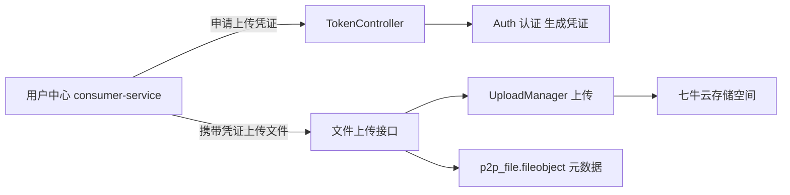

# 身份认证之文件服务：证件照片存哪里，为什么不在自己服务器上

> 🔒 安全提示：文中示例的口令/密钥均为课程教学环境演示口径，生产环境的安全要求见《安全与合规须知》。

需求分析把身份认证拆成四个阶段，其中上传身份证照片这一段由一个现成的文件服务承担。服务是现成的，编码不用写，但要把它部署起来、把配置改对，认证流程才能跑通。这一课的实操性很强，核心问题是三个：库怎么建、第三方存储怎么开通、配置里要填哪些值。

## 先给结论

- 文件服务是课程独立提供的通用微服务（farming 项目），专门处理文件上传下载，功能已实现，实战只做部署与配置。
- 照片默认存到第三方对象存储七牛云，不在平台自己的服务器上；文件服务的元数据（原文件名、存储源、文件 key、正反面标识等）落在自己的 `p2p_file` 库 `fileobject` 表里。
- 七牛云侧要完成三件事：新建存储空间、拿到融合 CDN 测试域名、在密钥管理里获取 AccessKey 与 SecretKey。
- 配置改两处：文件服务自己的 `application.yml`（数据库连接、七牛云密钥），以及使用方 Apollo 的 `micro_service.files` 命名空间（存储源 `my.file.url` 与存储空间名 `my.file.bucket`）。
- 上传成功后，七牛云生成的文件唯一标识会返回给用户中心，最终存入 `p2p_consumer` 库的 `consumer_details` 表。

## 文件服务的定位：通用能力单独成服务

文件服务是课程抽出来的一个独立微服务，专门用于处理文件上传和下载，可以为万信金融 P2P 项目的各个业务模块提供文件能力。默认采用七牛云作为文件存储源，将来也会和百度云、阿里云对接，成为一个通用的、独立的文件微服务。

功能代码是现成的，接口已实现完整，要了解它有哪些接口，启动后访问 `http://localhost:56082/farming/swagger-ui.html` 看文档，或者直接看源码：里面有申请上传凭证的 `TokenController`，也有实现文件上传的接口。实战中要做的是部署与配置，而不是重新造轮子。



这张图在讲文件服务内部的分工：凭证由认证模块按七牛云规则生成，上传接口带凭证把文件送进七牛云，同时把文件元数据记入自己的库。用户中心面对的只有两个入口，先凭证后上传。

## 部署第一步：建库建表

环境要求 Java 1.8 以上、MySQL 5.6.5 以上。上传文件时要把文件信息保存到 `fileobject` 表，所以要提前建库建表，执行部署指南提供的 SQL（密码按本课环境口径为 root/123456）：

```sql
SET NAMES utf8mb4;
SET FOREIGN_KEY_CHECKS = 0;

CREATE DATABASE `p2p_file` CHARACTER SET 'utf8' COLLATE 'utf8_general_ci';
USE p2p_file;

DROP TABLE IF EXISTS `fileobject`;
CREATE TABLE `fileobject` (
  `ID` bigint(20) NOT NULL AUTO_INCREMENT COMMENT '主键',
  `fileName` varchar(50) DEFAULT NULL COMMENT '原文件名',
  `origin` varchar(20) NOT NULL COMMENT '存储源',
  `resourceKey` varchar(100) NOT NULL COMMENT '文件key',
  `flag` varchar(10) NOT NULL COMMENT '正反面',
  `downloadUrl` varchar(200) DEFAULT NULL COMMENT '文件下载地址',
  `isProtect` tinyint(1) NOT NULL COMMENT '公有还是私有',
  `uploaddate` datetime NOT NULL COMMENT '上传日期',
  PRIMARY KEY (`ID`)
) ENGINE=InnoDB DEFAULT CHARSET=utf8;

SET FOREIGN_KEY_CHECKS = 1;
```

字段设计把「文件存哪」这件事讲得很明白：`origin` 记录存储源，值是七牛云、阿里云还是百度云，对应文件服务「通用」的定位；`resourceKey` 是文件在存储源里的唯一标识；`flag` 记录身份证的正反面，认证业务专用字段；`isProtect` 区分公有与私有空间，决定下载要不要签名。

## 部署第二步：开通七牛云并拿三样东西

文件服务把文件传到七牛云，七牛云不是谁想存就能存的，必须注册登录后完成设置。到控制台左侧菜单点「对象存储」，做三件事。

**第一，新建存储空间。** 它类似一个云端的文件夹，将来文件就存进这个空间。设置空间名字（名字自己定，要与后面的配置一致）、选择存储区域、访问控制选公开空间，点击确定即创建成功。

**第二，拿到融合 CDN 测试域名。** 创建成功后系统自动生成，将来在线浏览图片、拼文件下载地址都要用它，先记下。

**第三，获取密钥。** 在密钥管理页面可以看到 AccessKey（AK）与 SecretKey（SK）。第三方凭什么认你是合法用户？就凭这对密钥。它是整个文件上传链路里最敏感的凭证，不能泄露给任何人，博客与代码示例中一律以 `example-ak`、`example-sk` 占位，实际使用时换成自己账号的值。

## 部署第三步：改两处配置

Java 代码现成，剩下的就是把配置填对。第一处是文件服务自己的 `application.yml`，改数据库连接与七牛云信息：

```yaml
spring:
  datasource:
    url: jdbc:mysql://localhost:3306/p2p_file?useUnicode=true
    driver-class-name: com.mysql.cj.jdbc.Driver
    username: root
    password: 123456
    type: com.alibaba.druid.pool.DruidDataSource

# 自定义配置 密钥以 example- 占位 实际值从七牛云密钥管理页获取
file:
  oss:
    access-key: example-ak
    secret-key: example-sk
    # 融合 CDN 测试域名 用于拼接文件访问地址
    url: http://example-cdn.example.com
    # 存储空间名 与七牛云后台创建的空间一致
    bucket: p2p
```

数据库连接按自己机器的环境改账号密码；密钥与测试域名从七牛云后台复制过来；`bucket` 就是第一步里新建存储空间时起的名字，程序靠这个值决定文件存进哪个空间。

第二处在使用方。哪个微服务要用文件服务，就要在 Apollo 里加配置。以用户中心为例：登录 Apollo，找到 `consumer-service` 项目，创建命名空间 `micro_service.files`，增加两条配置：

| Key | Value | 备注 |
|---|---|---|
| `my.file.url` | `qiniu` | 存储源，当前默认七牛云 |
| `my.file.bucket` | `p2p` | 存储空间名，与七牛云后台创建的空间一致 |

`my.file.url` 的值体现了文件服务的通用设计：存七牛云写 `qiniu`，将来对接阿里云就写阿里，对接百度云就写百度，程序按这个值选择存储源。`my.file.bucket` 必须与七牛云后台的空间名一字不差，否则文件会被传到一个不存在（或不是你的）空间里。这两条配置在写代码时都会用到，属于编码前的准备工作。

配置就位后启动文件服务即可。上传功能跑通后，可以到七牛云控制台的「内容管理」里核验：里面能看到上传过的所有文件，类型、大小、上传时间一目了然，其中文件名一列就是每个文件的唯一标识，由七牛云自动生成、永不重复。这个标识会被返回给用户中心，保存到 `p2p_consumer` 数据库的 `consumer_details` 表里，作为身份证照片的存档凭据。

## 上传代码长什么样

文件服务的源码在资料归档中没有收录，部署用的 SQL 与配置以部署指南为准；上传的核心写法可以对照课程另一项目的真实工具类（聚合支付工程里的 `QiniuUtils`），其骨架如下，包名按 `com.study.finance` 系改写：

```java
// 按课程资料中 QiniuUtils 的真实写法整理 包名按 com.study.finance 系改写
public class FileServiceImpl implements FileService {

    @Value("${file.oss.access-key}")
    private String accessKey;
    @Value("${file.oss.secret-key}")
    private String secretKey;
    @Value("${file.oss.bucket}")
    private String bucket;
    @Value("${file.oss.url}")
    private String cdnUrl;

    @Override
    public String upload(byte[] bytes, String fileName) {
        // 指定存储区域 与存储空间所选区域一致
        Configuration cfg = new Configuration(Region.huanan());
        UploadManager uploadManager = new UploadManager(cfg);
        // AK/SK 认证 通过后得到上传凭证（令牌）
        Auth auth = Auth.create(accessKey, secretKey);
        String upToken = auth.uploadToken(bucket);
        try {
            // 上传文件 参数：字节数组、key、凭证
            Response response = uploadManager.put(bytes, fileName, upToken);
            new Gson().fromJson(response.bodyString(), DefaultPutRet.class);
        } catch (QiniuException ex) {
            throw new RuntimeException(ex.response.bodyString());
        }
        // 返回文件访问地址 由 CDN 测试域名拼文件名
        return cdnUrl + fileName;
    }
}
```

对照需求分析里的凭证机制看这段代码就通了：`auth.uploadToken(bucket)` 生成的那串令牌，正是通过 `TokenController` 返还给用户中心、再返还给前端的上传凭证；`uploadManager.put` 则是第三阶段文件服务实际执行的直传动作。凭证的签发与使用在同一个服务里完成了闭环，只是分别由两个接口对外。

## 常见误区

- **以为要给文件服务写代码。** 错例：从零实现上传下载。正解：功能已实现，实战只做建库、改配置、启动与验证，不理解的接口看 swagger 文档或源码。
- **存储空间名与配置对不上。** 错例：七牛云后台建的空间叫 `p2p_file`，Apollo 里 `my.file.bucket` 却写 `p2p`。正解：空间名、`bucket` 配置、上传代码里的值必须完全一致，否则上传报错或文件落错位置。
- **把真实密钥硬编码或提交进仓库。** 错例：AK/SK 直接写在代码里。正解：密钥放配置中心或配置文件，不进版本库；泄露后别人可以用你的空间任意读写文件。
- **忽略了元数据与文件本体的分离。** 错例：只把照片传上去了，自己库里什么都没记。正解：`fileobject` 表要记录存储源、文件 key、正反面等元数据，用户中心还要保存文件标识，供后续认证比对与追溯。

## 面试可能被问到的问题

1. 面试官追问：「为什么文件不存自己服务器，要传第三方对象存储？」
   答：自建存储要操心磁盘扩容、备份、带宽与高可用，对象存储按需付费、可靠性高，还天然支持客户端直传。业务服务只记元数据，存储压力与业务解耦。
2. 面试官追问：「上传凭证机制是怎么运作的？」
   答：服务端用 AK/SK 按 SDK 规则对指定存储空间签发上传令牌，客户端持令牌直传文件，第三方验证令牌合法才接收写入。密钥不出服务端，权限可按空间与有效期控制。
3. 面试官追问：「你的文件服务怎么做到可替换存储源？」
   答：对外只暴露申请凭证与上传两个接口，配置里用存储源标识（如 `my.file.url=qiniu`）决定走哪个实现，文件表用 `origin` 字段记录实际存储源，将来对接阿里云、百度云只增加实现不改调用方。
4. 面试官追问：「文件上传成功后，业务库里存了什么？」
   答：文件本体在对象存储，业务库存元数据：原文件名、存储源、文件 key、正反面标识、下载地址、公有私有、上传日期；用户中心再把返回的文件唯一标识存进用户详情表作为认证凭据。
5. 面试官追问：「AK/SK 泄露会有什么后果，怎么防？」
   答：泄露者可用你的身份读写删除空间内文件，产生存储与流量费用甚至篡改文件。防范上密钥只存配置中心、不进代码仓库、定期轮换，必要时按最小权限使用独立密钥。

## 配套资料

- 讲义：`materials/docs/10/文件服务部署指南.md`，1.2 初始化数据库 SQL；2.3 至 2.5 修改配置（数据库、七牛云、文件存储）；3 使用文件服务：`micro_service.files` 命名空间配置与 `consumer_details` 表落库说明。
- 讲义：`materials/docs/10/万信金融-身份认证-实战v1.0.md`，3 部署文件服务：服务部署与 swagger 接口文档入口、`TokenController` 的引用出处。
- 讲义：`materials/docs/10/七牛云对象存储使用指南.md`，对象存储概念、新建存储空间步骤、SDK 上传与私有空间下载签名。
- 代码：`materials/code/10/完整代码/完整代码/shanjupay/shanjupay-common/src/main/java/com/shanjupay/common/util/QiniuUtils.java` 与同工程 `shanjupay-merchant-application/.../service/FileServiceImpl.java`，课程真实七牛云上传实现（聚合支付项目），文件服务源码未收录，正文 Java 示例按其写法整理、包名按 `com.study.finance` 系改写并注明占位配置。
- 代码：`materials/code/10/wanxinp2p/`，P2P 工程归档（目录保留原始命名，路径只列到该层级）。
