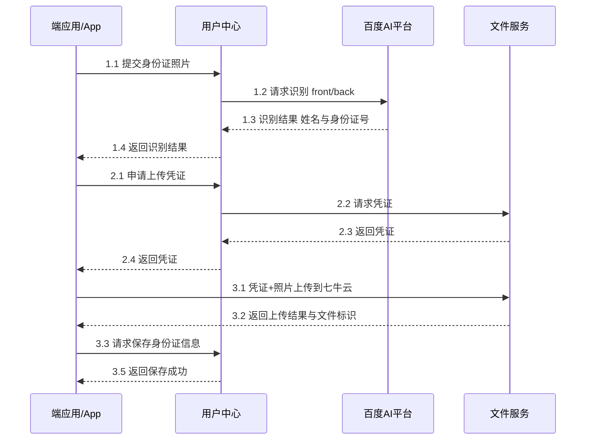

# 身份认证接口定义：四个阶段对应三个接口，一次把契约定清楚

文件服务与百度 AI 的准备工作就位后，身份认证进入真正的编码阶段。动手之前还有一步容易被跳过的活：把接口定义出来。接口定义好，前端、用户中心、文件服务三方就知道各自要传什么、返回什么，后续实现和联调才不会来回返工。这一课把身份认证的全部接口按四个阶段一次定完，讲完身份认证章收官。

## 先给结论

- 接口定义与需求分析的四个阶段一一对应：识别身份证、获取上传凭证、上传身份证、保存身份证信息，前两个阶段和第四阶段在用户中心定义接口，第三阶段不需要写任何新代码。
- 用户中心的接口全部定义在 `ConsumerApi` 接口中，在 `ConsumerController` 类里实现，共三个方法：`imageRecognition`、`applyUploadCertificate`、`saveConsumerDetails`。
- `imageRecognition` 的 `flag` 参数固定取 `front`（正面）或 `back`（反面），因为百度 AI 对正反面识别出的字段不同，必须区分。
- 识别结果以 `RestResponse<Map<String, String>>` 返回，Map 里存识别出的姓名和身份证号，前端拿到后自动回填到表单，用户确认后提交。
- 第四阶段涉及一套全新的类和一张新表：`consumer_details` 表存身份证正反面文件标识，配套 DTO、实体类、业务层、数据访问层。

## 四个阶段与接口的对应关系

需求分析阶段把身份认证拆成了四个阶段，接口定义完全按这个划分来，一个阶段一组动作，谁的活就定义在谁那边：



这张图把四个阶段的调用链画在一起：第一阶段用户中心只跟百度 AI 打交道，第二阶段用户中心只跟文件服务打交道，第三阶段前端直连文件服务，第四阶段前端回到用户中心保存数据。用户中心始终处在中间层，密钥与凭证的细节都不落到前端。

## 第一阶段：识别身份证接口

接口描述四句话：前端提交身份证照片到用户中心，用户中心请求百度 AI 进行识别，百度 AI 返回识别结果，用户中心响应前端。定义在 `ConsumerApi` 接口中（包名按 `com.study.finance` 系改写）：

```java
/**
 * 提交身份证图片给百度AI进行识别
 * @param file 上传的文件
 * @param flag 身份证正面、反面 front 或 back
 * @return Map集合 识别成功后把身份证上的姓名和身份证号存到map中返回
 */
RestResponse<Map<String, String>> imageRecognition(MultipartFile file, String flag);
```

两个参数各有讲究。`file` 是前端上传的身份证照片，这个好理解。`flag` 表示身份证的正反面，之所以要区分，是因为上传时会传两张照片（国徽面和人像面），而百度 AI 那边的要求就是按面识别：正面能识别出姓名和公民身份号码，反面识别出的是签发机关、有效期这些字段，两边的字段结构不一样，所以必须用 `flag` 告诉平台当前识别的是哪一面，取值固定 `front` 或 `back`。

返回值是 `RestResponse<Map<String, String>>`，键和值都是字符串。Map 里存的是识别成功后从身份证上读出来的姓名和身份证号，返回给前端的用途很明确：页面上这两个文本框不需要用户手动填，识别结果直接回填进去，用户核对确认后进入下一阶段。

`ConsumerController` 中实现该方法，访问路径按实战讲义口径统一定为 `/my` 开头：

```java
@Override
@ApiOperation("提交身份证图片给百度AI进行识别")
@PostMapping("/my/imageRecognition")
public RestResponse<Map<String, String>> imageRecognition(
        @RequestParam("file") MultipartFile file,
        String flag) {
    // 实现时按百度AI官方SDK文档的示例编码 文档含快速入门与Java SDK示例
    return null;
}
```

至于怎么通过百度 AI 进行身份证识别，实现时直接参考百度 AI 开放平台的官方文档，文档里有现成的例子：身份证识别接口的说明、快速入门、Java SDK 的依赖引入和示例代码都写得清清楚楚，照着写即可。这也印证了上一课的结论：`AipOcr` 客户端封装了全部平台交互，用户中心要写的只是取图、传参、解析结果。

## 第二阶段：获取上传凭证接口

身份证识别通过后，照片要上传到第三方存储（七牛云），而七牛云要求先有上传凭证才能传。所以第二阶段的任务就是申请凭证，链路是前端请求用户中心，用户中心向文件服务申请，凭证再逐层返回。

```java
/**
 * 申请获得上传凭证
 * @return
 */
RestResponse<String> applyUploadCertificate();
```

这个接口没有参数，申请凭证不需要带什么数据；返回值是 `RestResponse<String>`，String 里装的就是凭证，相当于一个上传令牌。Controller 实现：

```java
@Override
@ApiOperation("申请获得上传凭证")
@GetMapping("/my/applyUploadCertificate")
public RestResponse<String> applyUploadCertificate() {
    // 实现思路 用户中心远程调用文件服务的凭证接口 文件服务已实现该功能
    return null;
}
```

实现上的关键提示在需求分析里已经交代过：文件服务里「申请或获取上传凭证」这个功能已经实现过，用户中心只需要发请求到文件服务对应的接口，把结果透传回前端。具体调用文件服务的哪个接口，需要到文件服务工程里自己找，这也是实战练习的一部分。

## 第三阶段：上传身份证，零代码但要动手

第三阶段最容易误解：它不需要写任何后端代码，也不需要定义新接口，但不等于什么都不做。链路是前端拿着凭证和照片直接请求文件服务，文件服务把照片存到七牛云的存储空间里再返回结果，这条链路两端都现成：文件服务是直接提供的，前端代码也在资料里。

需要动手的地方在前端：之前提供的前端代码里，上传身份证的界面与功能默认没有开启，要按实战讲义的操作说明把相关页面和代码替换掉，替换完第三阶段就可以直接测试。上传成功后注意一个细节：文件服务会返回一个文件名，这就是文件标识，第四阶段要把它存进数据库。

## 第四阶段：保存身份证信息接口与新表

上传成功后，前端请求用户中心保存用户详情信息。接口定义：

```java
/**
 * 保存用户详细信息（主要存储身份证文件标识）
 * @param consumerDetailsDTO 封装用户详情信息
 * @return
 */
RestResponse<String> saveConsumerDetails(ConsumerDetailsDTO consumerDetailsDTO);
```

参数 `consumerDetailsDTO` 里包含身份证的文件标识：上传成功后七牛云返回的那个文件名，正面一张、反面一张，各一个标识。这些信息最终要存到数据库，将来前端网站展示数据时会封装到 `ConsumerDetailsVO` 对象里。

支撑这个接口的是一套全新的类和一张新表。consumer 数据库里新增 `consumer_details` 表，主要存用户的详细信息，核心字段是身份证正反面的文件标识：

```sql
-- 按实战讲义口径整理的表结构示例 供实现时对照
CREATE TABLE `consumer_details` (
    `id`                BIGINT       NOT NULL COMMENT '主键',
    `user_id`           BIGINT       NOT NULL COMMENT '所属用户',
    `front_file_key`    VARCHAR(64)  DEFAULT NULL COMMENT '身份证人像面文件标识',
    `back_file_key`     VARCHAR(64)  DEFAULT NULL COMMENT '身份证国徽面文件标识',
    `create_time`       DATETIME     DEFAULT NULL COMMENT '创建时间',
    PRIMARY KEY (`id`)
) ENGINE = InnoDB DEFAULT CHARSET = utf8mb4 COMMENT = '用户身份认证详情';
```

有了表，就对应实体类、业务层、数据访问层，这一套套路前面项目里已经反复练过：`ConsumerDetailsDTO` 与 `ConsumerDetails` 实体这两个类直接提供在资料文件夹里，可以对照着看属性和表字段的对应关系；业务层与数据访问层的代码需要自己写。

## 常见误区

- **正反面共用一套识别逻辑。** 错例：`flag` 传什么值都按正面字段解析。正解：`front` 与 `back` 识别出的字段完全不同，反面照片拿不到姓名和身份证号，解析时必须按 `flag` 区分字段。
- **把识别接口做成免费可用。** 错例：`imageRecognition` 不做登录校验就放行。正解：接口路径以 `/my` 开头，属于用户自有资源，识别前应确认请求携带合法令牌，防止接口被刷量消耗百度 AI 调用额度。
- **跳过凭证申请直接上传。** 错例：前端把照片直接 POST 给七牛云。正解：七牛云凭上传凭证放行上传，凭证必须先由文件服务申请，再由前端携带，流程顺序不能乱。
- **只保存识别结果不保存文件标识。** 错例：把姓名、身份证号存库就完事。正解：第四阶段的落库重点是身份证正反面的文件标识，识别结果只是回填确认用的，两者职责不同。

## 面试可能被问到的问题

1. 面试官追问：「身份证识别的接口为什么要返回 Map 而不是定义一个 DTO？」
   答：识别结果来自第三方 OCR，不同正反面返回的字段集合不同，用 `Map<String, String>` 可以按识别出的字段原样携带，接口契约简单稳定；前端只关心姓名和身份证号两个固定键，从 Map 里取即可。如果字段要在后端继续加工，再考虑收窄成 DTO。
2. 面试官追问：「上传凭证是什么，为什么不让用户中心直接生成？」
   答：上传凭证是对象存储平台（七牛云）认可的上传令牌，由持有 AccessKey/SecretKey 的一方签发。用户中心不应持有存储密钥，密钥收敛在文件服务里，用户中心只远程调用文件服务取凭证，这样存储凭据不扩散，权限边界清晰。
3. 面试官追问：「三个接口的 URL 前缀都用 /my，有什么考虑？」
   答：`/my` 表示用户自有资源，需要登录态才能访问。网关或服务端可以按前缀统一做认证拦截，省得每个接口单独配置，也让接口清单一看就知道哪些是用户级接口、哪些是公开接口。
4. 面试官追问：「第三阶段为什么不写代码，测试前还要做什么？」
   答：上传由前端直连文件服务完成，文件服务的上传与凭证接口都已实现，用户中心不参与，所以没有后端代码。但提供的前端工程默认没开启上传身份证的页面，要按讲义的操作说明替换对应页面与代码，替换后才能联调测试。
5. 面试官追问：「保存身份证信息时，后端还要校验什么？」
   答：除了参数完整性，要把用户确认后的姓名与身份证号和开户时的信息做一致性比对，防止识别回填与开户信息不一致的数据入库；入库的是正反面文件标识，与用户的关联关系也要校验，避免把别人的文件标识挂到自己账户下。

## 配套资料

- 讲义：`materials/docs/10/万信金融-身份认证-实战v1.0.md`，5 接口定义：四个阶段的接口描述与接口定义（`imageRecognition`、`applyUploadCertificate`、`saveConsumerDetails`）、访问路径、新增 `consumer_details` 表与配套类清单的完整口径。
- 讲义：`materials/docs/10/万信金融-身份认证-实战v1.0.md`，2 需求分析：四阶段流程（图中 1.1-1.5、2.1-2.4、3.1-3.2、3.3-3.5）与每阶段的前端、用户中心、文件服务职责划分。
- 代码：`materials/code/10/wanxinp2p/`，P2P 工程归档（目录保留原始命名，路径只列到该层级），可对照用户中心工程结构与 `RestResponse` 等公共类的既有写法；身份认证三个接口的成品实现按讲义口径留白，正文 Controller 骨架为按本课写法补全的示例。
- 说明：`consumer_details` 建表语句为按讲义字段口径整理的示例；百度 AI 官方文档示例地址在讲义中给出，实现时以其为准。
