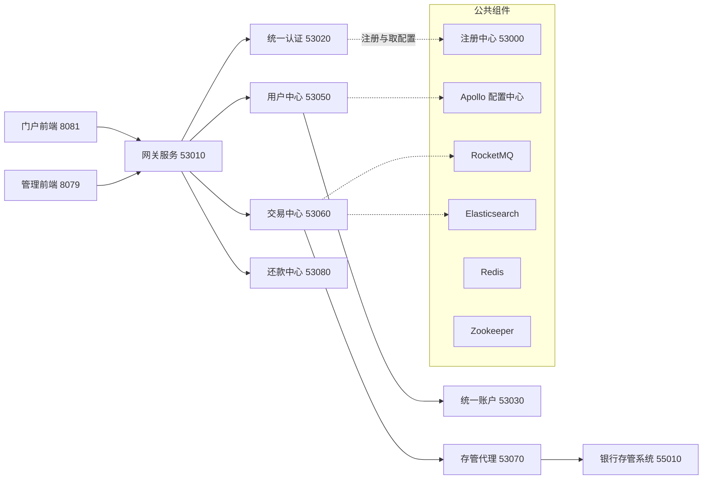

# 使用 Docker Compose 部署项目：一套编排文件拉起整个生产环境

> 🔒 安全提示：文中示例的口令/密钥均为课程教学环境演示口径，生产环境的安全要求见《安全与合规须知》。

DevOps 的理念清楚了，落到万信金融项目上，第一步就是用 Docker Compose 把生产环境搭起来、把项目跑起来。要部署的东西远不止几个 jar 包：注册中心、配置中心、消息队列、搜索引擎、缓存、数据库，加上五个业务微服务、验证码服务、银行存管系统和两套前端，每个都手工装一遍不现实，容器化编排才是正路。

## 先给结论

- 部署依据是成套的生产环境部署文档，先安装 Docker 与 Docker Compose，再按规划建目录、装基础软件、部署微服务，最后部署前端并验证。
- 部署前先做统一规划：每个服务的目录、端口、数据映射路径都提前定好，尽量保持一致，改动必须同步改 compose 文件里的对应参数。
- 基础软件（MySQL、Apollo、RocketMQ、Zookeeper、ES、Logstash、Redis）与业务微服务全部通过 Docker Compose 安装启动，一个服务一个 compose 配置。
- 端口是现成约定：网关 53010、统一认证 53020、统一账户 53030、用户中心 53050、交易中心 53060、存管代理 53070、还款中心 53080、注册中心 53000、银行存管系统 55010、验证码服务 56085，前端页面 8081。
- 前端部署要特别注意：开发阶段用的前端工程环境不完整，必须换成部署专用前端工程，并修改其中的请求地址与文件服务地址。
- 全程考验的是细心加耐心，路径、端口、参数照文档对齐，出错概率会小很多。

## 部署架构：先知道要摆什么

动手前先回顾系统架构，明确要部署的对象。服务架构上，前端请求先过网关，网关把请求分发到各微服务；公共组件里注册中心负责服务注册发现，Apollo 统一配置中心提供配置，各微服务启动时要注册到注册中心、从 Apollo 拉取配置；与银行存管系统的交互全部经过存管代理服务。数据架构上，各微服务有各自的数据库，交易中心的标的与投标数据还做了分库分表。



这张图在讲生产环境的服务全景：实线是业务请求链路，虚线是服务与公共组件的支撑关系。数一下就知道工作量：光后端服务就十来个，再加上六七个基础软件和两套前端，没有编排工具，部署一次要敲的命令和踩的坑都不堪设想。

## 统一规划：目录、端口、映射路径

部署文档里提前规定了每个服务的名称、服务目录、端口和服务数据映射目录，这是整个部署的坐标系。基础软件部分的规划节选：

| 服务 | 目录 | 端口 | 数据映射 |
|---|---|---|---|
| mysql | `./mysql` | 3306 | 数据库文件 `./db`，初始化脚本 `./init/init.sql` |
| apollo-configservice | `./apollo/apollo-configservice` | 8080 | 日志 `./logs/100003171` |
| apollo-adminservice | `./apollo/apollo-adminservice` | 8090 | 日志 `./logs/100003172` |
| rmqnamesrv / rmqbroker | `./rmq` | 9876 / 10909 | 数据与日志 `./data` |
| elasticsearch | `./es` | 9200、9300 | 配置 `./elasticsearch.yml`，数据 `./data` |
| zookeeper | `./zk` | 21811 | 无 |
| redis | `./redis` | 6379 | 数据 `./data` |

业务微服务按「服务目录 + 端口 + 日志目录 `./logs`」同样的模式规划，如用户中心 `53050`、交易中心 `53060`。这些名字和端口不是死的，端口被占用、目录有冲突都可以改，但改了目录或端口，compose 文件里引用的路径与端口必须跟着改，否则服务之间通过端口互访的配置会全部对不上。规划的价值就在这里：文档里的 compose 示例都按这套约定写，照着约定部署，命令可以逐条复用。

建目录本身用一条命令序列完成，总目录下分出各类子目录（示例按规划口径补全）：

```bash
# 新建部署总目录与各服务子目录
mkdir -p /opt/p2p/{mysql,apollo,rmq,zk,redis,es,logstash}
mkdir -p /opt/p2p/mysql/{db,init}
mkdir -p /opt/p2p/{discover-server,gateway-server,uaa-service,account-service}
mkdir -p /opt/p2p/{consumer-service,transaction-service,depository-agent-service,repayment-service}
```

## 环境搭建：装 Docker、装软件、导数据

先把容器基础设施就位：检查服务器上是否有旧版本 Docker，卸载干净后安装指定版本的 docker-ce，启动服务；再安装 Docker Compose，版本同样保持与文档一致。版本一致不是强迫症，不同版本的 compose 对配置字段的解析有差异，照文档操作时版本对齐可以少掉一批诡异报错。

基础软件全部走 Docker Compose。以 MySQL 为例，在 `./mysql` 目录下编写 `docker-compose.yml`，数据库文件和初始化脚本分别映射进容器：

```yaml
# ./mysql/docker-compose.yml 数据库账号密码按课程口径 root/123456
version: "3"
services:
  mysql:
    container_name: mysql
    image: mysql:5.7
    ports:
      - "3306:3306"
    volumes:
      - "./db:/var/lib/mysql"        # 数据库表文件
      - "./init:/docker-entrypoint-initdb.d"  # 初始化脚本 init.sql
    environment:
      MYSQL_ROOT_PASSWORD: "123456"
    restart: always
```

初始化脚本从课程资料里取 `init.sql` 放进 `./init` 目录，容器首次启动时自动建库建表；导入镜像用 `docker load -i <镜像包>`，镜像包在离线服务器上比 `docker pull` 靠谱。Apollo 的 compose 配置多了数据源环境变量，三个服务各自连自己的库：

```yaml
# ./apollo/apollo-configservice/docker-compose.yml 节选
version: "3"
services:
  apollo-configservice:
    container_name: apollo-configservice
    image: apollo-configservice:1.6.0
    ports:
      - "8080:8080"
    volumes:
      - "/logs/100003171:/opt/logs/100003171"
    environment:
      spring.datasource.url: "jdbc:mysql://127.0.0.1:3306/ApolloConfigDB?characterEncoding=utf8"
      spring.datasource.username: "root"
      spring.datasource.password: "123456"
      JAVA_OPTS: "-Xms512m -Xmx512m -Xmn256m"
```

按同样的模式把 Apollo 另两个服务、RocketMQ、Zookeeper、ES、Logstash、Redis 一个一个装完。这一步慢，但都是重复劳动，照文档操作即可。

## 部署微服务与前端

微服务的部署分两步：先在开发机把各微服务打包，把 jar 与 Dockerfile 复制到对应服务目录；再为每个服务写 compose 配置。微服务 compose 与软件类 compose 的差别在 `build` 与运行参数，以存管代理服务为例：

```yaml
# ./depository-agent-service/docker-compose.yml 节选
version: "3"
services:
  depository-agent-service:
    container_name: depository-agent-service
    image: depository-agent-service:1.0-SNAPSHOT
    network_mode: "host"        # 直接使用宿主机网络 与注册中心互通
    ports:
      - "53070:53070"
    depends_on:
      - discover-server
    restart: always
    environment:
      SERVER_PORT: "53070"
      JAVA_OPTS: "-Xms512m -Xmx512m -Xmn256m -Dserver.port=53070 -Denv=dev -Dapollo.cluster=DEFAULT"
```

几个字段值得留意：`network_mode: host` 让容器直接用宿主机网络，省去容器互联的麻烦；`depends_on` 声明启动顺序，注册中心要先起来；`JAVA_OPTS` 里的 `-Denv` 与 Apollo 客户端环境参数决定服务启动时从哪个配置中心取配置。验证码服务用 `build: .` 让 compose 现场构建镜像，银行存管系统是独立的一套系统，单独一组 compose 启动，五个业务微服务照搬同款配置，改服务名与端口即可。

前端稍微特殊。开发阶段发的那个前端工程环境不完整，直接拿来部署会有页面与接口对不上的问题，部署时要用课程提供的部署专用前端工程。把前端工程复制到 `./web` 目录后，还要修改其中的请求地址：网关地址与文件服务地址都要改成生产环境的值，典型的是前端配置里的两行（示例按口径整理）：

```javascript
// 前端配置 请求走网关 文件上传直连文件服务
const Baseurl = "http://127.0.0.1:53010/"
const Fileserviceurl = "http://127.0.0.1:56082/farming/"
```

门户前端映射到 8081，管理前端映射到 8079，同样用 compose 起容器。所有服务与前端都启动后，像平时使用系统一样打开前端登录、浏览数据、执行业务操作，各功能正常即部署完成。

## 常见误区

- **随手改端口或目录，不改 compose。** 错例：3306 被占用就换端口，但 compose 与微服务的数据源配置没同步。正解：规划值可以改，但服务目录、端口、映射路径三处必须一起改，凡是文档里按约定写的配置都要对齐。
- **拿开发环境的前端工程去部署。** 错例：把开发阶段的前端工程原样上线。正解：使用部署专用前端工程，并修改网关地址与文件服务地址，否则页面请求会指向开发环境。
- **忘记数据映射，容器一删数据就没。** 错例：MySQL 不挂 `./db` 目录。正解：数据库文件、日志、配置都要通过 `volumes` 映射到宿主机，容器重建后数据不丢。
- **不核对 Docker 与 Compose 版本。** 错例：随意装最新版。正解：与文档版本保持一致，compose 配置字段的兼容性问题大多源于版本漂移。
- **一口气 up 不看启动顺序。** 错例：忽略 `depends_on`，微服务先于注册中心启动。正解：按「基础软件、注册与配置中心、微服务、前端」的顺序分批启动，失败的服务看日志重试。

## 面试可能被问到的问题

1. 面试官追问：「为什么用 Docker Compose 部署而不是逐个 docker run？」
   答：Compose 把每个服务的镜像、端口、挂载、环境变量、启动顺序声明在一个 yaml 文件里，可版本化、可重复执行；服务多了之后手工 docker run 的参数管理成本和出错率直线上升，一条 docker-compose up 就能按配置编排整套环境。
2. 面试官追问：「compose 文件里 volumes 和 ports 的作用是什么？」
   答：volumes 把宿主机目录与容器目录映射，数据库文件、日志、配置放宿主机，容器删除重建数据不丢；ports 做宿主机与容器的端口映射，外部请求通过宿主机端口访问容器内服务。这两个字段是部署配置里最容易出错的地方。
3. 面试官追问：「network_mode: host 是什么，什么时候用？」
   答：让容器直接共享宿主机网络栈，容器内监听的端口就是宿主机端口。适合微服务与注册中心通信频繁、想省去容器网络互联配置的场景；代价是失去网络隔离，端口冲突需要自己管理，生产上按安全要求权衡。
4. 面试官追问：「微服务启动时怎么拿到 Apollo 的配置？」
   答：compose 的 environment 里通过 JAVA_OPTS 传入 `-Denv`、`-Dapollo.cluster` 等启动参数，Apollo 客户端据此连接配置中心拉取命名空间配置；同时用 depends_on 保证配置中心先启动，配置就绪服务才能正常初始化。
5. 面试官追问：「部署完成后怎么验证？」
   答：先看容器状态与日志确认全部正常启动，再按用户视角从门户前端登录，走通注册、认证、业务查询等主流程；有条件的话逐个抽查关键服务接口（如文件服务的 swagger 页面），前后端联通且数据正确才算部署成功。

## 配套资料

- 讲义：`materials/docs/10/万信金融-生产环境-部署文档.md`，2 服务总览（服务名称、目录、端口、数据映射目录的完整规划表）、3 部署说明（安装 Docker 与 Docker Compose、新建各服务目录、各软件与微服务的 compose 配置、前端工程替换与请求地址修改）的完整口径。
- 讲义：`materials/docs/10/万信金融-讲义-项目部署v1.0.md`，2 使用 Docker Compose 部署项目：章节口径与部署文档指引。
- 代码：`materials/code/10/wanxinp2p/`，P2P 工程归档（目录保留原始命名，路径只列到该层级），可对照各微服务工程与打包配置；正文 compose 与目录示例为按部署文档口径整理补全，服务名按语义化命名改写（原始模块名不进正文）。
