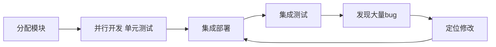
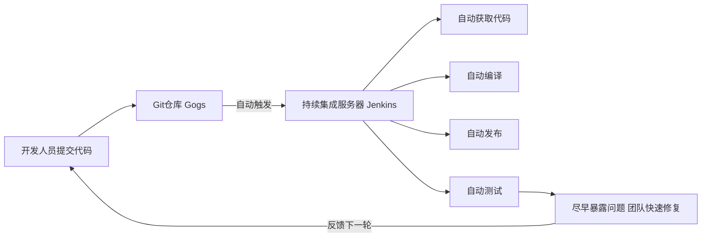

# 持续集成的作用：把集成阶段集中爆发的 bug 提前拆掉

生产环境用 Docker Compose 搭好之后，项目部署实战要讲的重点来了：持续集成。它是这次部署章节里真正的全新内容，企业里用得也越来越多。要理解它的价值，得先看它要治的病：为什么项目集成阶段总会冒出一堆 bug，为什么修 bug 的人越来越不想干。

## 先给结论

- 传统流程是「各自开发完再集成」，模块之间依赖关系复杂，集成时集中爆发大量 bug，测试等待时间长，集成部署耗时耗力，软件交付没有保障。
- 持续集成（Continuous Integration，简称 CI）是针对这类问题的软件协同实践：团队成员经常集成各自的工作，甚至每天多次，每次集成靠自动化构建完成。
- 它的解法是两句话：把集成测试提前到开发过程中反复进行；用自动化工具代替人工做集成部署。
- 每次自动化集成包括自动获取仓库代码、自动编译、自动发布和测试，目的是尽可能早地发现问题。
- 带来四个直接好处：自动化集成部署提高集成效率、更快修复问题、更快交付、提高产品质量。

## 传统流程的病根：问题堆到最后才爆

传统软件开发流程大概是这个样子：项目经理或架构师按模块分工，小张一块、小王一块，约定完成时间；各开发人员并行开发，开发过程中只做自己模块的单元测试；全部开发完毕，各模块代码统一提交到服务器，集成部署到测试环境，测试人员进行测试；发现 bug 提交，开发修改；修改完再次集成、再次测试。

单看每一步都没毛病，问题出在「集成」被放在了最末端。平时开发时每个人只对自己的模块熟悉、只测自己的模块，模块与模块之间的协作从来没有验证过，等几十个模块合到一起，依赖关系一绕，问题集中出现。



这张图在讲传统流程里那个转不出去的环：集成、测试、报 bug、修改、再集成，每转一圈都要动几十个模块。修完一轮再集成，又冒出一批新的，相当于一个死循环，人在不停经历同样痛苦的事情。

把病根拆开看有三个：**第一，bug 的量非常大。** 二十个模块集成到一起，测试一跑一堆问题，多到没法管。**第二，测试难度陡增。** 单模块测试时开发自己就能搞定，集成测试牵扯所有模块的交互，测试人员面对的是整个系统，工作量扛不住。**第三，反复集成部署本身耗时耗力。** 几十个模块改了一轮 bug，还得重新集成、重新部署一次，来回折腾，最后谁都不想干这活，每个人都觉得「我的模块没问题，集成出错不怪我」。项目越大越明显，万信金融这种后端十来个微服务的项目，问题堆到最后的后果就是交付时间完全失控。

## 两个思考：提前集成，交给自动化

针对这套流程的痛点，有两个关键思考，它们分别对应持续集成的两个核心动作。

**第一，能不能把集成测试提前？** 不等所有人开发完毕，而是在开发过程中就不断集成：每隔几天把各自的模块合到一起，部署一下、测试一下，甚至每天做一次集成测试。这样问题被切成小块、摊到平时，每次集成只处理最近几天的变更，出错的定位范围小得多，错误在开发的早期就被发现和解决，而不是攒到最后一起爆。

**第二，人工集成不现实，能不能自动化？** 这个思考顺着第一个来：既然要每隔几天甚至每天集成一次，靠人工去部署、去反复执行，谁也扛不住，没人愿意干。所以迫切需要自动化工具代替人工，把集成部署的全过程交给机器。有了自动化，每天集成多少次都不怕，因为不需要人去做。

```bash
# 持续集成出现之前 一次人工集成要手工做的事 全部重复执行
git pull origin master          # 手动拉取最新代码
mvn clean package               # 手动编译打包各模块
docker build -t transaction-service:1.0 .   # 手动构建镜像
docker-compose up -d            # 手动部署到测试环境
# 然后人工发起测试 再人工统计结果
```

这一段命令就是问题本身：人工集成等于每天把这串命令敲一遍、敲对一遍，任何一步漏敲错敲，集成就失败。命令越多、模块越多，人工越不可持续，自动化工具存在的必要性不言自明。

## 持续集成是什么：定义与四个好处

把两个思考合起来，就是持续集成的定义：随着软件开发复杂度不断提高，团队如何在不断变化的需求中快速适应并保证质量，成了绕不开的问题，持续集成就是针对此类问题的软件协同实践。它倡导团队开发成员必须经常集成各自的工作，甚至每天可能发生多次集成，而每次集成都是通过自动化构建实现的，包括自动获取仓库代码、自动编译、自动发布和测试，从而尽可能早地发现问题，让团队更快开发出高质量的软件。

名字本身就是流程的浓缩：「持续」对应高频、常态化，集成不再是一次性事件；「集成」对应每次都把大家的最新代码合到一起验证。开发完才集成变成了边开发边集成，这是与传统流程的本质区别。

持续集成的好处有四条：自动化集成部署，把人从重复劳动里解放出来，集成效率提高；问题发现得早、范围小，修复更快；集成与测试不再阻塞在末期，交付更快；整个过程中质量验证的密度从一年几次变成每天多次，产品质量随之提高。

放在 DevOps 的视角里，持续集成是工具链中专门承担「集成」环节的工程实践，前面讲 DevOps 闭环时提到的自动化手段，最典型的落地就是它。行业里常用的实现工具是开源的 Jenkins，它提供持续集成所需的全部功能，配合 Git 仓库（如局域网里的 Gogs）构成代码到构建的自动流水线，后续课程会亲手把这套环境搭起来。



这张图在讲持续集成的运转方式：提交代码即触发，集成服务器自动完成取代码、编译、发布、测试，问题在提交后不久就被暴露并回到开发手里。与传统流程对比，集成从「集中一次大爆炸」变成了「每次提交小步快跑」。

## 常见误区

- **把持续集成理解成持续测试工具。** 错例：以为 CI 只是帮测试人员跑测试。正解：CI 覆盖取代码、编译、发布、测试的完整构建过程，测试只是其中一环，它解决的是「集成太晚、人工太累」两个问题。
- **认为每天集成一次就够了、频率无所谓。** 错例：攒一周再集成一次，等于把传统流程微缩。正解：集成的价值来自高频与自动化，间隔越长单次变更越多，问题定位越难，应尽量做到每天多次。
- **集成失败无人认领。** 错例：自动化流水线报红了，大家各自继续开发。正解：持续集成的纪律是集成失败优先修复，失败意味着主干已经不健康，拖着不管就退化成「集中爆发」的老问题。
- **以为上了 Jenkins 就等于有了持续集成。** 错例：装了工具但没有代码入库纪律、没有自动测试。正解：工具只是载体，配套的提交频率、构建脚本与测试保障才是持续集成生效的条件。

## 面试可能被问到的问题

1. 面试官追问：「什么是持续集成？它解决什么问题？」
   答：持续集成（CI）是一种软件协同实践，倡导团队成员经常集成各自的工作，甚至每天多次，每次集成通过自动化构建完成，包括自动获取代码、自动编译、自动发布和测试。它解决传统流程中集成阶段集中爆发 bug、集成部署耗时耗力、交付无保障的问题。
2. 面试官追问：「传统开发流程在集成阶段有哪些具体痛点？」
   答：一是模块间依赖复杂，开发期只做单模块测试，集成时问题集中出现且数量大；二是集成测试涉及全部模块交互，测试难度与工作量大，等待时间长；三是修完 bug 要反复重新集成部署，耗时耗力，形成集成、报错、修复、再集成的循环，交付周期失控。
3. 面试官追问：「持续集成和 DevOps 是什么关系？」
   答：DevOps 是涵盖开发、测试、运维全过程的方法论，强调用自动化打通部门协作；持续集成是其中自动化实践的起点和核心环节，负责代码合入后的自动构建与验证，向上衔接持续交付与持续部署，是 DevOps 工具链中最先落地的一环。
4. 面试官追问：「为什么集成必须靠自动化，人工不行吗？」
   答：集成要高频进行，每次都包含取代码、编译、打包、部署、测试等固定动作，人工执行既慢又易错，每天多次根本不可持续。自动化让频率不再受人力限制，每次集成步骤一致、结果可重复，这是持续集成成立的前提。
5. 面试官追问：「持续集成带来哪些好处？」
   答：自动化集成部署提高集成效率；问题发现提前，修复更快；集成不再阻塞交付，交付节奏更快；质量验证密度大幅提高，产品质量整体提升。
6. 面试官追问：「持续集成工具链里常见的组合是什么？」
   答：代码托管与版本控制用 Git，局域网内常用 Gogs 这类自建仓库；持续集成服务器常用开源的 Jenkins，从仓库拉代码执行构建脚本；构建工具用 Maven 或 Gradle；产物用 Docker 打成镜像部署。提交触发、自动构建、结果反馈构成最基础的一条流水线。

## 配套资料

- 讲义：`materials/docs/10/万信金融-讲义-项目部署v1.0.md`，3 持续集成：3.1.1 问题描述（传统软件开发流程五步与三个问题）、3.1.2 什么是持续集成（CI 定义与四个好处）、3.1.3 P2P 项目持续集成流程的完整口径。
- 讲义：`materials/docs/10/Gogs安装文档.md` 与 `materials/docs/10/Jenkins安装文档.md`，持续集成环境的两个基础组件安装口径，正文提到的 Gogs 与 Jenkins 在后续课程中展开。
- 代码：本课为概念课，无配套源码包；正文 bash 手工集成命令为按本课写法补全的示例，自动化流水线的真实配置在后续持续集成课程中给出。
