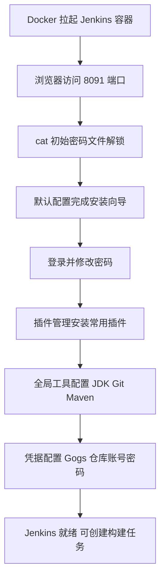

# Jenkins 的安装和配置：把持续集成的管家请进内网

代码仓库 Gogs 就位之后，流水线还缺中枢单元：谁来负责「收到通知就拉代码、调 Maven 打包、再驱动部署」这件事。这个角色由 Jenkins 承担。它是一个开源的持续集成工具，本质上就是一个 Web 应用程序，装好后用浏览器访问即可操作，官方站点是 `https://www.jenkins.io`。它的 logo 是一个管家模样的小人，定位很形象：集成中的杂活全部交给这位管家，开发者专注业务逻辑。

## 先给结论

- Jenkins 提供自动构建、自动编译、自动部署能力，本课用 Docker 安装，对外端口为 8091，镜像为 `jenkinsci/blueocean`。
- 首次访问需要「解锁」：管理员初始密码存在容器内 `/var/jenkins_home/secrets/initialAdminPassword`，用 `cat` 命令取出填入即可，默认账户名是 admin。
- 使用前必须装插件并做两类配置：全局工具配置告诉 Jenkins JDK、Git、Maven 在哪里；凭据配置把 Gogs 仓库的账号密码交给 Jenkins，它才有权限拉取源码。
- 插件与配置的入口都在「系统管理」菜单下：插件管理装 Git、Gogs、Docker Compose、Maven 集成、简体中文语言包等；全局工具配置支持指定本机路径或勾选自动安装两种方式。

## 安装：三个 Docker 命令

安装文档的做法是直接在 Docker 下运行 Jenkins。镜像选择 `jenkinsci/blueocean`，三个命令依次是拉取镜像、创建容器、启动容器：

```bash
# 1. 拉取镜像
docker pull jenkinsci/blueocean

# 2. 创建容器
docker create --name jenkins -u root -p 8091:8080 --privileged=true \
  -v jenkins-data:/var/jenkins_home \
  -v /var/run/docker.sock:/var/run/docker.sock \
  -v /home/jenkins:/home \
  jenkinsci/blueocean

# 3. 启动容器
docker start jenkins
```

参数里有三处是为后续流水线铺路。`-p 8091:8080` 把容器内的 Web 端口映射到宿主机 8091，以后都通过这个端口访问 Jenkins；`-v /var/run/docker.sock:/var/run/docker.sock` 把宿主机的 Docker 套接字挂进容器，让 Jenkins 内部能直接操作宿主机上的 Docker，后面构建镜像、启停容器都依赖它；`-u root` 与 `--privileged=true` 则保证容器内进程有足够权限执行这些操作。

## 解锁与首次登录

启动后浏览器访问 `http://<服务器 IP>:8091`，第一次会进入「解锁 Jenkins」页面。页面提示管理员密码已被写入服务器上的某个文件，路径为 `/var/jenkins_home/secrets/initialAdminPassword`。密码不是随便定的初始值，必须从这个文件里读出来：

```bash
# 进入 Jenkins 容器
docker exec -it jenkins /bin/bash

# 读取管理员初始密码
cat /var/jenkins_home/secrets/initialAdminPassword
```

`cat` 输出的就是那串很长的初始密码，复制粘贴到解锁页面，点击继续，按默认配置走完安装向导即可。默认账户名是 admin，登录成功后建议立刻改密码；也可以在系统里自行新建账户，用新账户登录。登录后的主界面左侧是功能菜单，首页列表里出现的条目就是后续要创建的构建任务。

安装与配置的整体步骤如下面这张图，从上到下做完，Jenkins 才算真正可用：



这条链的分水岭在 F：E 之前是安装层面的一次性动作，F 到 H 是让 Jenkins 具备干活能力的三项配置，缺一项流水线都会在对应环节断掉。

## 插件安装：让 Jenkins 与周边工具协作

持续集成天然要和一堆工具协作：从 Git 仓库拉代码，用 Maven 构建项目，部署时和 Docker 打交道。Jenkins 靠插件机制与这些工具集成，所以装完本体要先补插件，而且插件是在线安装的，必须保证联网。

操作路径：系统管理 → 插件管理 → 可选插件（英文界面为 Available 标签页），在搜索框按名字查找安装。已安装的插件在「已安装」页可以确认。需要安装的插件包括：

```text
# 需搜索安装的常用插件（按 Jenkins 安装文档口径整理）
Git              # 与 Git 仓库协作的基础插件
Gogs plugin      # 对接 Gogs 仓库，支持其 Webhook 通知
Docker Compose   # 构建后用 Compose 编排启动服务
Maven Integration# 提供「构建一个 Maven 项目」任务类型
Locale / 简体中文语言包  # 界面汉化，菜单名与英文文档对照即可
```

搜索不到通常说明已经装过了，到已安装列表确认即可。语言包装完后界面变成中文，菜单名与安装文档英文截图逐一对应。

## 全局工具配置：告诉 Jenkins 工具在哪

Jenkins 干活时依赖 JDK 1.8、Git 和 Maven，这些工具装在哪里必须明确告诉它，这一步称为全局工具配置。入口：系统管理 → 全局工具配置（英文为 Global Tool Configuration）。

页面里依次有 JDK、Git、Maven 三块配置，每块都有两种配法。以 Maven 为例：一种是在本机提前装好 Maven，名字随意起，再把安装路径填进去，例如文档示例把 Maven 目录放在宿主机 `/home` 下，settings 文件路径配为 `/home/apache-maven-3.6.3/conf/settings.xml`；另一种是勾选「自动安装」，让 Jenkins 自己下载指定版本。JDK 同理，配置 `JAVA_HOME` 指向 JDK 目录，例如 `/usr/local/jdk-1.8.0_212`，或者交给 Jenkins 自动安装；Git 一般机器上已装，按固定写法填可执行文件路径即可，也可自动安装。

每个人的安装路径各不相同，示例里的路径不能照抄，自己的工具装在哪就填哪。

## 凭据配置：把仓库账号密码交给 Jenkins

还差最后一环。Jenkins 要自动从 Gogs 仓库拉取源码，而访问仓库需要登录，所以必须把代码仓库的账号密码存进 Jenkins，这类信息在 Jenkins 里称为凭据。

入口不太好找：主界面左侧菜单点「凭据」，再进入「系统」域，在下拉菜单里选择「添加凭据」。类型选择 Username with password，范围保持默认的 Global，然后把 Gogs 的登录账号和密码填进去保存。有了这条凭据，Jenkins 就能拿着它自动从 Gogs 获取项目源码，后续创建构建任务时在源码管理里直接选用即可。

## 常见误区

- **以为 Jenkins 是命令行工具。** 错例：装完在终端里找 Jenkins 命令。正解：Jenkins 本质是一个 Web 应用程序，启动后通过浏览器访问 8091 端口操作，所有配置都在页面里完成。
- **初始密码到登录框里瞎猜。** 错例：不知道初始密码，反复尝试常见密码。正解：密码写在容器内 `/var/jenkins_home/secrets/initialAdminPassword` 文件中，`docker exec` 进容器用 `cat` 读出来即可。
- **跳过插件直接建任务。** 错例：新建任务时发现没有「构建一个 Maven 项目」类型，或源码管理里连不上仓库。正解：Maven Integration、Git、Gogs、Docker Compose 等插件是任务类型和工具对接的前提，装插件必须联网。
- **照抄示例路径配置全局工具。** 错例：把文档里 `/home/apache-maven-3.6.3` 之类路径原样填进自己的 Jenkins。正解：路径取决于自己机器的安装位置，用指定路径方式就填真实路径，拿不准就用「自动安装」。
- **以为凭据是 Jenkins 自己的账号密码。** 错例：把 admin 密码填进凭据。正解：凭据存的是代码仓库（Gogs）的登录账号密码，用途是让 Jenkins 有权限拉取项目源码。

## 面试可能被问到的问题

1. 面试官追问：「Jenkins 是什么？你们用它做什么？」
   答：Jenkins 是一个开源的持续集成工具，本质上是一个提供持续集成全套能力的 Web 应用。在万信金融项目里它承担流水线中枢：收到 Gogs 的代码变动通知后自动拉取源码，调 Maven 编译打包，再驱动 Docker Compose 构建镜像并启动服务，把集成部署全流程自动化。
2. 面试官追问：「Jenkins 用 Docker 装有哪些关键挂载？」
   答：两类最关键。一是把 `/var/run/docker.sock` 挂进容器，Jenkins 内部就能操作宿主机 Docker，直接构建镜像和启停容器；二是用数据卷持久化 `/var/jenkins_home`，插件、任务配置、凭据都在这个目录里，容器重建后环境不丢。
3. 面试官追问：「首次解锁 Jenkins 的密码从哪里来？」
   答：初次访问时 Jenkins 把管理员初始密码写在容器内 `/var/jenkins_home/secrets/initialAdminPassword` 文件里，页面会给出这个路径，用 `docker exec` 进入容器后 `cat` 该文件取出，粘贴到解锁框即可，默认账户名是 admin。
4. 面试官追问：「全局工具配置是配什么的？不配会怎样？」
   答：配置 Jenkins 依赖的 JDK、Git、Maven 的位置或让其自动安装。不配的话 Jenkins 既不知道用哪个 JDK 编译，也无法调用 Maven 打包，构建任务在执行阶段就会失败。两种配法：指定宿主机真实安装路径，或勾选自动安装让 Jenkins 自行下载。
5. 面试官追问：「凭据起什么作用？怎么配？」
   答：凭据存储 Jenkins 访问外部系统所需的安全信息，本课主要用来存放 Gogs 仓库的账号密码。在「凭据 → 系统」下添加，类型选 Username with password、范围 Global，填入仓库账密保存。创建构建任务时在源码管理里选用这条凭据，Jenkins 才有权限自动拉取项目源码。

## 配套资料

- 讲义：`materials/docs/10/Jenkins安装文档.md`，Docker 安装命令、初始密码获取命令、常用插件清单、JDK/Git/Maven 全局工具配置与 Git 凭据配置的操作说明均出自该文档。
- 讲义：`materials/docs/10/万信金融-讲义-项目部署v1.0.md`，3.2.2 节对 Jenkins 的定位描述与正文一致。
- 讲义：`materials/docs/10/Gogs安装文档.md`，凭据配置所需的 Gogs 账号来自该篇的注册流程。
- 代码：`materials/code/10/wanxinp2p/`，P2P 工程归档（目录保留原始命名，路径只列到该层级），Jenkins 配置完成后要构建的就是这套工程。
- 说明：插件清单为按安装文档口径整理的列表；全局工具配置中的路径为文档示例，实际以各自机器的安装位置为准。
