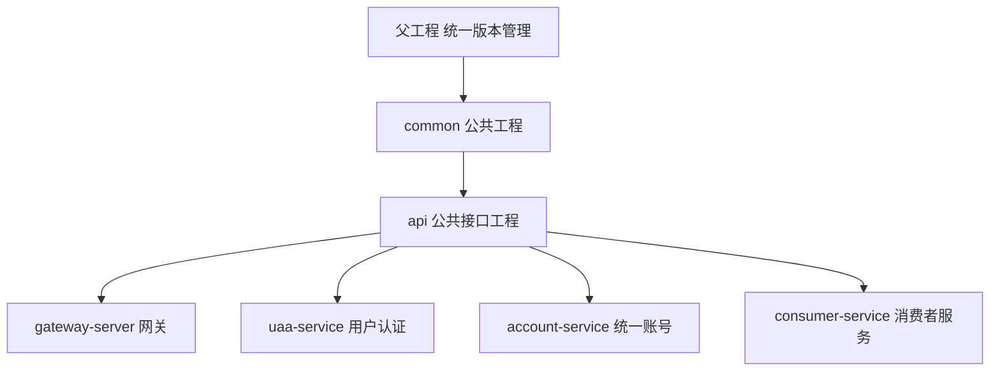
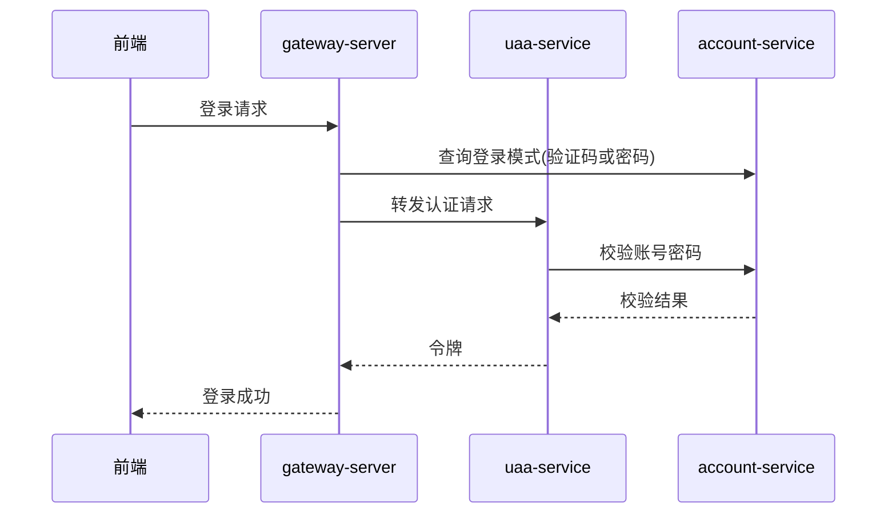

# 万信金融 P2P 项目落地服务调用链路追踪：从入门案例到真实业务

Sleuth 与 Zipkin 的原理、集成、持久化、依赖分析都在入门案例里练完了，但案例只有两个服务，离真实项目还差最后一步：把这套追踪体系接进万信金融 P2P 项目，让登录、开户这些真实业务的调用链完整地呈现在 Zipkin 的界面上。这一课以登录功能为例完成接入与验证，链路追踪这条线到此收官。

## 先给结论

- 接入只有三步：在公共 API 工程引入 Sleuth 与 Zipkin 依赖；在 Apollo 的 common-template 项目新建 `micro_service.spring-zipkin` 名称空间写入三行配置；各微服务关联该名称空间并在 `application.yml` 中引入。
- 依赖引到 API 工程一份即可：几乎所有微服务工程都依赖 API 工程，依赖会层层传导，不必每个服务单独引。
- 追踪配置属于通用配置，要放进 Apollo 的通用配置模板项目，而不是写死在某个服务的本地配置文件里。
- 验证链路选登录功能：前端请求先到网关，网关到用户认证服务，再到统一账号服务，登录成功后在 9411 端口能看到整条链路。
- 依赖分析图同步可用：网关指向用户认证与统一账号、用户认证指向统一账号、网关直连 consumer，与注册登录流程图完全对得上。

## 为什么依赖只引一次

万信金融 P2P 项目的工程结构是一个清晰的依赖金字塔，追踪依赖放哪一层决定了要做几次接入：



这张图在讲依赖的传导路径。解读关键路径：几乎所有微服务工程都依赖 API 工程，API 工程又依赖 common 工程，common 继承父工程。把 Sleuth 与 Zipkin 的依赖引入 API 工程的 `pom.xml`，所有下游微服务自动继承，一份依赖全项目生效。动手前先到 API 工程里确认这两个依赖是否已经存在，可能导入过也可能没有，没有的话补上即可：

```xml
<dependency>
    <groupId>org.springframework.cloud</groupId>
    <artifactId>spring-cloud-starter-sleuth</artifactId>
</dependency>
<dependency>
    <groupId>org.springframework.cloud</groupId>
    <artifactId>spring-cloud-starter-zipkin</artifactId>
</dependency>
```

zipkin starter 自带 Sleuth 与上报客户端，两个依赖同时列出与讲义口径一致，重复引入反而多余。

## 三行配置进 Apollo 通用模板

集成真正生效靠三行配置：开启 Sleuth、指定 Zipkin 服务端地址、设置采样率。它们不能写进某个微服务的本地配置文件，因为这是一组通用配置，将来网关、用户认证、统一账号、消费者服务全都要用。

万信金融 P2P 项目用 Apollo 做配置中心，通用配置统一放在 common-template 项目里，它就是通用配置模板，各微服务按需关联里面的名称空间。操作是在 common-template 下新建一个名称空间，命名为 `micro_service.spring-zipkin`，把三行配置放进去并发布：

```properties
# 开启Sleuth
spring.sleuth.enabled=true
# 设置zipkin服务地址
spring.zipkin.base-url=http://localhost:9411
# 采样率，取值范围[0-1]
spring.sleuth.sampler.probability=1
```

采样率设为 1 即全量采集，演示场景下链路信息最完整。

配置发布之后还差两个关联动作，缺一不可。第一，在 Apollo 控制台里给需要用这组配置的项目（consumer-service、gateway-server、uaa、account-service 等）关联 `micro_service.spring-zipkin` 名称空间，用添加公共名称空间的方式选中即可。第二，在各微服务本地的 `application.yml` 里把该名称空间追加进 `apollo.bootstrap.namespaces`，名称空间没引进来，Apollo 里配了也等于没配。以 uaa-service 为例，在原有列表末尾追加：

```yaml
app:
  id: uaa-service
apollo:
  bootstrap:
    enabled: true
    eagerLoad: true
    namespaces: application,micro_service.spring-boot-druid,micro_service.spring-boot-http,micro_service.spring-boot-redis,micro_service.spring-cloud-hystrix,micro_service.spring-cloud-ribbon,micro_service.spring-cloud-zipkin
spring:
  application:
    name: uaa-service
```

gateway、consumer、account 的改法相同，逗号隔开追加到各自 yml 的 namespaces 列表末尾。这一步最容易被漏掉，检查方式就是打开每个相关服务的配置文件逐个确认。

## 用登录功能验证真实链路

启动准备分三拨。Zipkin 服务端先起；然后是与登录相关的微服务：注册中心、gateway、account-service、uaa-service，具体启动哪些不记得时回到工程关系图对照；consumer-service 也一并启动，后面看依赖图会用到。验证码服务可以不启动，登录时采用密码模式，验证码输入框里填默认密码（手机号本身）即可。

前端工程启动后打开登录页，找一个测试手机号，密码同样填手机号，点击登录。登录成功后访问 9411 端口的 Zipkin UI，点查找，与登录相关的链路记录已经出现。点开详情，调用顺序与预期完全一致：请求先到网关，网关分发到 uaa，uaa 再调 account，account 负责登录账号与密码的校验。



这张图在讲登录链路在 Zipkin 里呈现的形态。解读关键路径：强前端分离架构下所有请求先过网关，登录涉及网关、用户认证、统一账号三个服务两两调用，每个服务都接入了追踪，这条链上的每一段都被完整记录。

## 依赖图与流程图的对照

链路验证完，再点「依赖」菜单看服务级关系图。图中能读出两组信息：一是所有前端请求都先经过网关，网关再分发到 consumer、uaa、account；二是服务之间谁调用谁，箭头方向即调用方向。

拿注册登录流程图来对照，两条边值得专门解释。网关直连 account 的一条边来自模式判断：网关收到登录请求后要先问统一账号当前启用的是验证码模式还是密码模式，这次测试虽走密码模式，这条调用照常发生。网关直连 consumer 的一条边与登录无关：登录成功后前端进入主界面，主界面自己向 consumer 发了请求，请求同样先过网关再被分发，这条链路也被依赖图捕获。凡是接入了追踪的服务，与它相关的请求都会进入依赖分析，这正是全量接入的价值。

## 常见误区

- **以为每个微服务都要单独引追踪依赖。** 错例：gateway、uaa、account 的 pom 里各贴一遍。正解：项目所有微服务都依赖公共 API 工程，依赖在 API 工程引一份即可全项目传导。
- **把追踪配置写进某个服务的本地配置文件。** 错例：只在 consumer 的 yml 里加三行追踪配置。正解：通用配置应放进 Apollo 的 common-template 项目统一管理，各服务通过关联名称空间共享。
- **在 Apollo 关联了名称空间却没改本地 yml。** 错例：控制台里关联了 `micro_service.spring-zipkin`，服务却读不到配置。正解：还要在 `application.yml` 的 `apollo.bootstrap.namespaces` 里追加该名称空间，两个动作缺一不可。
- **以为不开验证码服务就无法测试登录。** 错例：为了走完整流程把验证码服务也拉起来。正解：登录可采用密码模式，验证码处填默认密码（手机号）即可，验证码服务不参与本次链路验证。

## 面试可能被问到的问题

1. 面试官追问：「你们项目的链路追踪是怎么接入的？」
   答：在公共 API 工程引入 Sleuth 与 Zipkin 依赖，借助项目统一的工程依赖关系传导给所有微服务；通用配置放在 Apollo 的 common-template 项目，新建名称空间写入开启开关、Zipkin 地址与采样率三行配置并发布；各微服务在控制台关联名称空间并在 application.yml 的 namespaces 列表中引入。
2. 面试官追问：「为什么追踪依赖引在 API 工程而不是各服务自己引？」
   答：项目的工程结构里几乎所有微服务都依赖 API 工程，依赖会沿这条关系传导，引一份即可全覆盖。这样版本统一、改动收敛，新服务只要按规范依赖 API 工程就自动获得追踪能力。
3. 面试官追问：「追踪配置为什么放 Apollo 而不写在本地配置文件？」
   答：这是典型的通用配置，网关、用户认证、统一账号、消费者服务都要用，放 Apollo 的通用配置模板项目里可以统一维护、统一变更，各服务按名称空间关联复用；写在本地则要重复维护多份且改一次要动多个工程。
4. 面试官追问：「登录功能的调用链在 Zipkin 里是什么样子？」
   答：前端请求先到网关，网关先查统一账号确认登录模式是验证码还是密码，再把认证请求转发给用户认证服务，用户认证服务调用统一账号完成账号密码校验，逐层返回令牌。Zipkin 里能看到这条链的时间轴、每段耗时以及各服务的请求路径。
5. 面试官追问：「接入追踪后业务代码有改动吗？」
   答：没有。Sleuth 与 Zipkin 通过依赖与配置生效，对业务代码完全透明，登录、注册等功能不需要任何修改，追踪能力由工程依赖传导与配置中心下发静默开启，这也是低侵入方案适合在存量项目铺开的原因。

## 配套资料

- 讲义：`materials/docs/10/服务调用链路追踪.md`，「4. 万信金融 P2P 项目集成服务链路追踪」章节（依赖引入位置、Apollo 名称空间配置、yml 引入方式与集成步骤）。
- 代码：`materials/code/10/wanxinp2p/`，万信金融 P2P 工程归档（目录保留原始命名，路径只列到该层级），可对照其中各微服务工程的 `application.yml` 与 Apollo 名称空间组织；归档快照的 API 工程 pom 中尚未包含本次新增的追踪依赖，以讲义步骤为准补入。
- 代码：`materials/code/10/wanxinp2p_apollo/`，接入 Apollo 后的工程归档（目录保留原始命名，路径只列到该层级），consumer-service 与 gateway-server 的 `application.yml` 展示了 `apollo.bootstrap.namespaces` 的追加位置。
