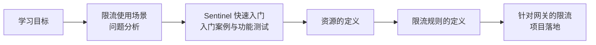

# Sentinel 实现限流：先看清这条路线要解决什么问题

微服务把一个整体拆成了一堆相互调用的服务，稳定性问题随之而来：任何一个服务的处理能力都是有限的，流量一旦越过这个上限，再多的请求不是变慢，而是把系统直接压垮。万信金融 P2P 平台的业务量与日俱增，网关、认证、业务服务迟早要面对真实流量，限流就是为这一刻准备的手段。这一节本身只有一分多钟，作用是把整个 Sentinel 单元的边界划清楚：要学什么、按什么顺序学、每一块学到什么程度。

## 先给结论

- 本单元共五个学习目标：能说出限流的使用场景、掌握 Sentinel 快速入门、理解 Sentinel 对资源的定义、理解 Sentinel 对限流规则、掌握针对网关的限流实现方法。
- 主角是 Sentinel，阿里巴巴开源的轻量级流量控制框架，限流只是它能力的一部分。
- 整条路线围绕两条主线展开：先把要保护的东西定义成「资源」，再为资源配置「限流规则」。
- 网关限流放在收尾位置，因为它是限流落地到万信金融项目里的最终形态，前面三块都是它的铺垫。

## 为什么先学场景，再学框架

学习目标的排列顺序不是随意的，它对应一条从问题到方案的推理链。

**第一，搞清楚什么情况下需要限流。** 框架永远是为问题服务的，如果不知道系统会被流量压垮这个场景，后面的注解、API 全部变成无意义的手势。所以路线的第一站是问题分析：用现实中的例子看清超载的后果，再回到软件系统里找对应物。

**第二，用 Sentinel 快速入门拿到第一手体感。** 场景清楚了，接下来引入框架并跑通一个最小案例，亲眼看到请求被拒绝的那一瞬间，限流这个概念才算真正落地。

**第三、第四，吃透资源与规则两个概念。** 快速入门里出现的注解和 API 背后是两个核心抽象：资源回答「保护谁」，规则回答「怎么保护」。这两个概念吃透之后，再看任何 Sentinel 的配置都不会迷路。

**第五，落到网关上。** 单个方法、单个服务的限流原理都一样，但万信金融平台的 HTTP 网关是整个系统的唯一入口，在入口处限流比在每个服务里各自设防更有效。所以课程最后专门讲 Sentinel 针对网关的限流实现方式，把前面学的概念汇总成项目里真正要用的形态。

整条路线画出来是一条层层递进的链：



这张图讲的是五个目标的先后关系：场景分析回答「为什么」，快速入门回答「怎么用」，资源与规则回答「背后的模型」，网关限流回答「怎么落进项目」。每一环都依赖上一环的结论，跳着学会在半路卡住。

## 两条主线在代码里的样子

学习目标里反复出现的「资源」和「限流规则」，落到代码上就是一段依赖加几行配置。下面两段代码来自本单元配套讲义，先把样子亮出来，后面几节会逐行拆解。

接入 Sentinel 从引入客户端依赖开始：

```xml
<!-- Sentinel 客户端依赖，版本按讲义口径为 2.1.0.RELEASE -->
<dependency>
    <groupId>com.alibaba.cloud</groupId>
    <artifactId>spring-cloud-starter-alibaba-sentinel</artifactId>
    <version>2.1.0.RELEASE</version>
</dependency>
```

一条最简单的限流规则长这样：

```java
// 针对 hello 资源：QPS 模式，每秒最多放行 2 个请求（按讲义口径整理）
FlowRule rule = new FlowRule();
rule.setResource("hello");                    // 作用对象：资源名
rule.setGrade(RuleConstant.FLOW_GRADE_QPS);   // 阈值类型：QPS
rule.setCount(2);                             // 限流阈值
```

注意这两段代码之间的呼应：`setResource("hello")` 里的 `hello` 必须和被保护方法上标注的资源名完全一致，规则才能挂到资源上。这个对应关系正是「资源定义」和「限流规则」两个学习目标的交点，也是后面动手实践时最容易出错的地方。

## 常见误区

- **把限流当成一个孤立知识点。** 错例：直接跳到快速入门抄注解用法。正解：限流解决的是「系统承载能力有限」这个真实问题，先理解场景，注解和 API 才有附着点。
- **把 Sentinel 理解成只能限流。** 错例：认为学完限流就学完了 Sentinel。正解：流量控制、熔断降级、系统负载保护都是它的能力维度，本单元聚焦流量控制这一块，其余能力是后续专题的延伸。
- **忽略网关这一站。** 错例：学会在业务方法上定义资源就收工。正解：项目里流量从网关统一进出，针对网关的限流才是万信金融项目的实际落地形态，学习目标里单独列了一条。
- **资源名与规则随手起名。** 错例：注解里写一个名字，规则里凭记忆再写一个。正解：规则通过资源名挂载到资源上，两处必须逐字一致。

## 面试可能被问到的问题

1. 面试官追问：「你们项目的限流是在哪一层做的，为什么？」
   答：在网关层做。HTTP 网关是系统唯一入口，入口处统一限流可以保护后面所有微服务，避免流量直接打到业务服务上；单个服务内部的资源限流作为补充手段。
2. 面试官追问：「Sentinel 里资源和规则是什么关系？」
   答：资源是保护对象，可以是服务、方法甚至一段代码；规则是挂在资源上的流量控制策略。规则通过资源名与资源关联，一个资源可以同时挂多条规则。
3. 面试官追问：「学习一个限流框架，你的路径是什么？」
   答：先明确使用场景与要解决的问题，再跑通官方入门案例建立体感，然后吃透资源与规则两个核心抽象，最后结合项目架构决定落点，比如网关层统一限流。
4. 面试官追问：「系统流量超过承载能力会发生什么？」
   答：不采取措施时线程池与连接被占满，响应时间飙升，上游调用方跟着超时，故障沿调用链向上蔓延，最终整个系统崩溃；限流通过在阈值处拒绝或排队多余请求来避免这种结局。

## 配套资料

- 讲义：`materials/docs/10/Sentinel实现限流.md`，学习目标、限流概述与快速入门均以此为准。
- 代码：`materials/code/10/wanxinp2p/`，万信金融工程归档（目录保留原始命名，路径只列到该层级），父工程 `pom.xml` 的依赖管理中已包含 Sentinel 网关适配与规则数据源相关依赖，可对照网关限流的接入方式。
- 说明：正文两段代码按讲义口径整理并做了精简，包名按 `com.study.finance` 系改写；入门案例工程在课程中以 IDE 现场搭建为主，无单独归档源码。
