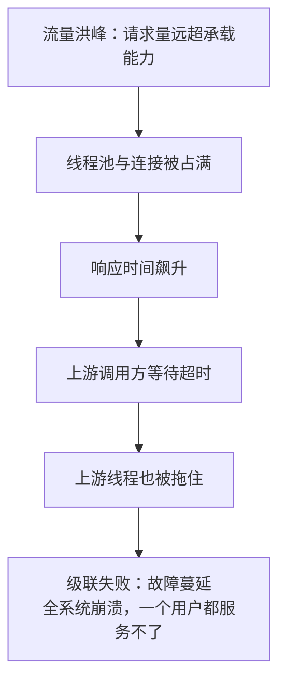

# Sentinel 问题分析：系统为什么会被流量压垮

限流这个词，后端开发者多少都听过，但很多人说不清它到底在防什么：请求多一点就多一点，顶多响应慢些，为什么会让整个系统崩溃？这一节不写一行框架代码，专门把这个问题讲透。想明白系统超载的后果，后面 Sentinel 的每一条规则才有存在的理由。

## 先给结论

- 系统的承载能力是有限的：带宽、线程池、连接数、下游依赖的处理能力都有上限，超过上限后服务质量急剧恶化。
- 不加控制的高并发不是「慢一点」，而是级联失败：故障沿调用链向上蔓延，最终连原本能正常服务的用户也一并失效。
- 限流的定义：限制系统的输入和输出流量，达到保护系统的目的。系统吞吐量可以被测算，达到阈值就要采取措施。
- 达到阈值后的处置方式不止「拒绝」一种：延迟处理、拒绝处理、部分拒绝处理都可以，目的是保住系统稳定运行。

## 景区的选择：一天只卖 5000 张票

热门景点是理解限流最直观的例子。故宫这样的景点，节假日每天只卖出固定数目的门票，票卖完当天就无法进入。

从收入角度看这笔账很奇怪：门票卖得越多收入越高，为什么要限制人流？答案藏在承载能力里。景点的面积、服务人员数量、卫生保障都是有限的，入场人数一旦超出承载能力，买瓶水买不到、吃个饭没地方，体验先崩；更危险的是密集人群带来的安全事故，踩踏、拥挤坠落都可能发生。到那个时候问题已经不是赚钱多少，而是景点彻底瘫痪。

所以景区必须二选一：要么放开卖票，人流滚雪球，直到出现重大事故；要么主动限流，每天服务一部分人，让每个进来的游客都得到基本的服务保障。所有景区都会选后者。

## 软件系统里的同一个问题

把景区换成软件系统，逻辑一字不差。一个系统按设计每天可以服务 100 万用户，某一天突然涌来 500 万，如果不加任何措施，结果不是「服务得慢一点」，而是这 500 万请求把系统直接压垮。压垮之后最讽刺的一幕出现了：本来正常情况下能服务 100 万用户，崩溃之后一个用户都服务不了。流量大本是好事，不设防的大流量却是最坏的结局。

这个场景有一个全民都体验过的案例。12306 刚推出的时候，春节抢票期间登录不上、买票卡死的问题铺天盖地，原因正是购票请求量远超服务承载能力，源源不断的请求在系统里排队、堆积，把仅有的处理资源耗尽。后来的 12306 引入了排队机制，高峰期让部分请求等待，本质就是在做流量控制。

超载的破坏力不是匀速出现的，它会沿着调用链自我放大：



这张图讲的是级联失败的发生路径：洪峰占满下游的处理资源，下游变慢，上游被迫挂起等待，上游自己的资源也被拖垮，故障逐层向上传染。图里最致命的是从「响应变慢」到「全系统崩溃」这段放大过程，这正是限流要在第一个节点就切断的东西：在洪峰入口处把多余的请求拒之门外，后面的节点根本感知不到洪峰的存在。

## 限流的定义与应对措施

讲义给出的定义只有一句话：限流就是限制系统的输入和输出流量，达到保护系统的目的。

拆开看，这条定义里有两个关键词。

**第一，输入和输出都要限。** 输入流量是外部打进来的请求，输出流量是系统调用下游发出的请求，两个方向都可能成为压垮系统的载荷。

**第二，达到阈值后要有措施。** 一般来说系统的吞吐量是可以被测算的，压测给出的容量数字就是限流阈值的依据。达到阈值后可选的处置不止一种：延迟处理（让请求等一等）、拒绝处理（直接返回失败）、部分拒绝处理（放行一部分、拒绝一部分）。哪种合适取决于业务，核心诉求只有一个：系统平稳运行。

限流落地的形态是一组规则，讲义里网关限流的规则配置长这样，阈值数字就是承载能力的量化表达：

```json
[
  {
    "resource": "uaa-service",
    "grade": 1,
    "count": 2,
    "intervalSec": 1
  }
]
```

字段含义依次是：作用对象（这里是统一认证服务对应的网关路由）、限流模式（1 代表按 QPS 统计）、阈值上限、统计时间窗口（单位秒）。组合起来的语义很直白：这个服务每秒最多受理 2 个请求，超出的直接拒绝。这套字段出自本单元配套讲义，具体如何编写与加载会在入门案例里展开。

验证限流效果也可以很朴素，在 1 秒内连发多次请求，观察超出阈值的那几次是否被拒（示例命令，端口号以入门案例工程实际配置为准）：

```bash
# 1 秒内并发发 5 次请求，阈值若为 2，后 3 次应返回拒绝提示
for i in 1 2 3 4 5; do curl -s http://localhost:59000/sentinel/hello & done; wait
```

## 常见误区

- **把限流当成丢掉流量的浪费。** 错例：觉得拒绝请求就是少赚钱，不肯设阈值。正解：不设限的结果是系统崩溃后连一个用户都服务不了，限流保住的是大部分用户的可用服务，这笔账反而是赚的。
- **以为流量大会自动变慢、自己会退去。** 错例：等着洪峰自己过去。正解：超载会触发级联失败，故障自我放大，等待只能等来崩溃，必须在入口主动拦截。
- **只想着限输入，忘了输出。** 错例：只在外部入口设防。正解：系统调用下游发出的流量同样需要控制，否则下游被拖垮后故障照样传染回来。
- **阈值拍脑袋定。** 错例：随手写一个大数字当阈值。正解：系统吞吐量可以被测算，阈值应以压测得出的承载能力为依据。

## 面试可能被问到的问题

1. 面试官追问：「限流的定义是什么，目的何在？」
   答：限制系统的输入和输出流量，达到保护系统的目的。系统吞吐量可以测算，一旦达到阈值就采取延迟处理、拒绝或部分拒绝等措施，保证系统稳定运行。
2. 面试官追问：「为什么流量超过承载能力会导致整个系统崩溃，而不是只影响部分用户？」
   答：超载后线程池与连接被占满，响应时间飙升，上游调用方因等待而超时，上游线程被拖住，故障沿调用链级联蔓延，最终把原本正常的服务也拖垮。
3. 面试官追问：「达到限流阈值后，除了直接拒绝还有什么做法？」
   答：可以延迟处理，让请求排队等待；可以部分拒绝，放行一部分拒绝一部分；网关入口处也常用排队机制，让请求以可控速率进入系统，具体选择取决于业务对时效和成功率的要求。
4. 面试官追问：「限流阈值应该怎么定？」
   答：以压测得出的系统吞吐量为基础，结合业务峰值预估与降级预案综合确定，并且要能在运行中调整，而不是拍脑袋写死一个数字。
5. 面试官追问：「能举个现实中限流的例子吗？」
   答：热门景区每天只卖固定数量的门票，卖完即止；12306 早期的抢票崩溃到后来引入排队机制，也是典型的流量控制实践。

## 配套资料

- 讲义：`materials/docs/10/Sentinel实现限流.md`，问题分析与限流定义出自其中「1.1 问题分析」「1.2 限流算法」小节。
- 说明：规则 JSON 与 curl 验证命令按讲义口径整理，curl 命令为演示用示例；本节无对应独立源码包。
