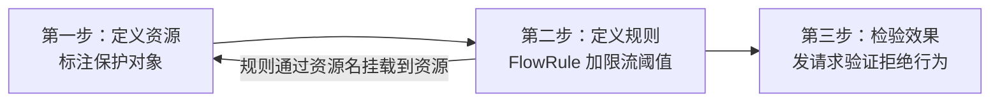
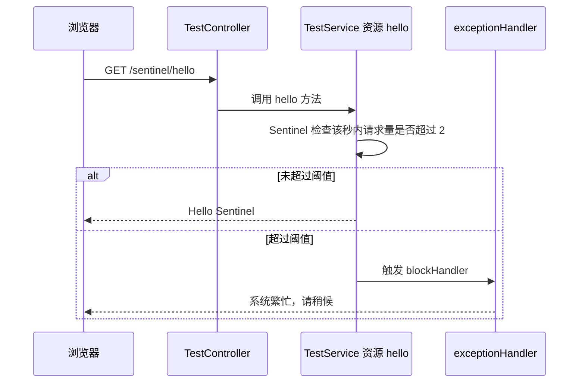

# Sentinel 入门案例：两行注解与一段规则，压出第一次限流

限流的概念讲完之后，剩下的就是把框架真正跑起来。这一课用一个尽可能小的工程完成第一轮闭环：新建一个只有一个接口的 Spring Boot 工程，把业务方法声明成 Sentinel 资源，写一条 QPS 为 2 的限流规则，然后在浏览器里快速刷新，亲眼看到请求被拒绝时返回的「系统繁忙，请稍候」。整个案例不足百行代码，却完整覆盖了 Sentinel 限流的所有关键环节，后面网关限流、动态规则这些复杂内容，都是这个最小骨架的加宽加厚。

## 先给结论

- 使用 Sentinel 实现流控主要分三步：定义资源、定义规则、检验规则是否生效。资源可以是任何东西：某个服务、某个服务里的方法，甚至一段代码。
- 资源用 `@SentinelResource` 注解声明，`value` 属性是资源名，`blockHandler` 属性指定被限流后执行的方法。
- 规则用 Sentinel 的 API 定义：构造 `FlowRule` 对象设置资源名、阈值类型与阈值，塞进集合后调用 `FlowRuleManager.loadRules` 加载生效。
- 功能测试的现象很直观：慢速刷新持续返回正常内容，快速刷新则交替出现正常内容与「系统繁忙，请稍候」，说明对 hello 资源限流成功。
- 限流详情同时记录在本地日志文件里，控制台启动时打印的路径下可以找到，图形化控制台后续会将这些纯文本数据转成图表。

## 三步走：资源、规则、检验

讲义把使用 Sentinel 实现流控的路径总结成三步，顺序不能乱。

**第一步，定义资源。** 资源这个概念初看很抽象，「可以是任何东西」的解释反而让人更迷糊，实际落到工程里很具体：对外提供接口的微服务是资源，微服务里被调用的方法是资源，甚至任意一段代码都可以是资源。判断标准只有一条，这段代码需不需要保护？需要保护，就把它定义为一个资源。套用问题分析里的例子，故宫是景区要保护的对象，微服务和它里面的方法就是系统要保护的对象。

**第二步，定义规则。** 资源只是被圈定的保护对象，保护策略本身是流量控制规则：每秒放行多少、超了怎么办。相当于景区规定「每天只接待 5000 名游客」，5000 这个数字就是规则。

**第三步，检验规则是否生效。** 规则写完不等于限流生效，要发请求实际验证一次，亲眼看到拒绝行为才算闭环。

三步之间的依赖关系可以这样画：



这张图讲的是三步的因果链：资源先存在，规则才有挂载点；规则加载后，检验才有可观察的现象。中间那条反向标注是全案例最容易出错的地方，规则里的资源名必须与注解里声明的名字逐字一致。

还有一个省力的事实值得知道：对于主流框架，Sentinel 都提供了适配，例如 Web Servlet、Dubbo、Spring Boot / Spring Cloud、Spring WebFlux、gRPC。按适配说明配置之后，Sentinel 会默认把框架提供的服务、方法定义为资源，很多场景下甚至不用手动加注解。入门案例为了看清每个环节，选择手动定义资源。

## 搭建 demo 工程：一个干净的最小骨架

新建一个名为 `sentinel-demo` 的 Maven 工程，先不带任何 Sentinel 的东西，只有一个最普通的 Spring Boot 应用。

工程坐标与编译配置如下，包名按 `com.study.finance` 系改写为 `com.study.finance.sentinel.demo`：

```xml
<parent>
    <groupId>org.springframework.boot</groupId>
    <artifactId>spring-boot-starter-parent</artifactId>
    <version>2.1.3.RELEASE</version>
</parent>

<groupId>com.study.finance.sentinel</groupId>
<artifactId>sentinel-demo</artifactId>
<version>0.0.1-SNAPSHOT</version>
<name>sentinel-demo</name>

<properties>
    <java.version>1.8</java.version>
    <project.build.sourceEncoding>UTF-8</project.build.sourceEncoding>
    <project.reporting.outputEncoding>UTF-8</project.reporting.outputEncoding>
</properties>
```

依赖有三个：Spring Boot 的 web 启动器提供 HTTP 能力，Spring Cloud 的启动器提供微服务基础，Sentinel 客户端是本次的主角，版本按讲义为 2.1.0.RELEASE：

```xml
<dependencies>
    <dependency>
        <groupId>org.springframework.boot</groupId>
        <artifactId>spring-boot-starter-web</artifactId>
    </dependency>
    <dependency>
        <groupId>org.springframework.cloud</groupId>
        <artifactId>spring-cloud-starter</artifactId>
    </dependency>
    <dependency>
        <groupId>com.alibaba.cloud</groupId>
        <artifactId>spring-cloud-starter-alibaba-sentinel</artifactId>
        <version>2.1.0.RELEASE</version>
    </dependency>
</dependencies>
```

配置文件同样平淡无奇：应用名叫 SentinelDemo，端口 59000，基本访问路径是 `/sentinel`：

```properties
spring.application.name=SentinelDemo
server.port=59000
server.servlet.context-path=/sentinel
```

业务代码只有两层。Controller 里一个方法，注入 Service 后调用它的 hello 方法：

```java
@RestController
public class TestController {

    @Autowired
    private TestService testService;

    @GetMapping("hello")
    public String hello() {
        return testService.hello();
    }
}
```

demo 不做分包，Service 直接放在同一个包里，hello 方法返回一个字符串：

```java
@Service
public class TestService {

    public String hello() {
        return "Hello Sentinel";
    }
}
```

骨架到此为止，浏览器访问 `http://localhost:59000/sentinel/hello` 会返回 `Hello Sentinel`。接下来在这个例子的基础上加 Sentinel，目标是给 hello 方法加一条规则：一秒之内最多允许调用 2 次，超过就限流。实际开发中 2 这个阈值显然太小，demo 里设成 2 纯粹是为了人工刷新就能看到效果。

## 第一步：定义资源与限流后的动作

把 hello 方法声明为资源靠一个注解。加上注解后的 Service 变成这样：

```java
@Service
public class TestService {

    @SentinelResource(value = "hello", blockHandler = "exceptionHandler")
    public String hello() {
        return "Hello Sentinel";
    }

    public String exceptionHandler(BlockException ex) {
        ex.printStackTrace();
        return "系统繁忙，请稍候";
    }

    @PostConstruct
    public void initFlowRules() {
        List<FlowRule> rules = new ArrayList<>();
        // 创建 FlowRule 对象封装限流规则
        FlowRule rule = new FlowRule();
        rule.setResource("hello");
        rule.setGrade(RuleConstant.FLOW_GRADE_QPS);
        rule.setCount(2);
        rules.add(rule);
        // 加载限流规则，使其生效
        FlowRuleManager.loadRules(rules);
    }
}
```

`@SentinelResource` 注解用来标识资源是否被限流、降级，两个常用属性各有分工。

**value 属性设置资源名。** 资源总得有个名字，这个名字在后面定义限流规则时要用，可以随意命名，本例就叫 `hello`。名字随意，但一旦定了就要前后一致。

**blockHandler 属性设置限流的后续动作。** 资源被限流之后，还会有不断的新调用过来，必须有地方承接这些被拒绝的请求：可以拒绝它，可以让它排队，总之要有一个后续动作。这个动作定义成一个方法，属性值填方法名。本例的 `exceptionHandler` 方法只做一件事，打印异常堆栈后返回「系统繁忙，请稍候」，实际开发中可以在这里返回降级数据、记录告警或者引导排队。

这个兜底方法的参数有硬性规定，也是初学者最常踩的坑：方法参数永远要比受保护的方法多一个 `BlockException`。对应关系是：受保护方法无参，兜底方法至少有一个 `BlockException` 参数；受保护方法有 1 个参数，兜底方法就先写一个相同类型的参数，再追加 `BlockException`；受保护方法有两个参数，兜底方法就照抄这两个参数再追加 `BlockException`。参数对不上，限流发生时框架找不到匹配的兜底方法，调用就会以异常的形式暴露出来。

## 第二步：定义规则并加载生效

规则的定义写在上面 Service 代码里的 `initFlowRules` 方法中，用的是 Sentinel 的 API。方法的执行时机值得先说清楚。

`initFlowRules` 方法上标了 `@PostConstruct` 注解。这个注解的作用是：Spring 框架创建 `TestService` 这个 Bean 时会先调用构造方法，构造方法执行完毕之后，被 `@PostConstruct` 标注的方法会被自动执行，不需要人工调用。限流规则必须赶在任何请求到来之前加载好，这正是它最合适的执行时机。

方法内部的五行代码逐一看：

- `new FlowRule()` 创建规则对象。Flow 是流量，Rule 是规则，这个对象专门用来封装一条限流规则。
- `rule.setResource("hello")` 设置规则的作用对象。定义规则必须告诉框架这条规则管谁，值就是注解 `value` 属性里定的资源名，两处必须一致。
- `rule.setGrade(RuleConstant.FLOW_GRADE_QPS)` 设置限流模式。模式常量封装在 `RuleConstant` 类里，QPS 模式指按每秒的请求量做判断，也就是前面说的每秒最多 2 次。实际开发时选哪种模式要看业务需求。
- `rule.setCount(2)` 设置限流阈值，含义是每秒最多允许调用 hello 方法 2 次。
- `rules.add(rule)` 把规则对象存进集合。

集合这一步看着多余，实则不能省：`FlowRuleManager.loadRules` 的参数是规则集合而不是单个规则对象，即使只定义一条规则，也必须先放进集合再交给管理器加载。这个设计同时也暴露了框架的灵活性，Sentinel 允许对一个资源定义多条规则，`FlowRule` 对象可以创建多个，每个对象的规则各不相同，却可以作用于同一个资源，全部装进集合一次性加载。

## 一条限流规则由什么组成

把上面的 setter 归纳一下，一条限流规则主要由五个元素组成，组合它们可以实现不同的限流效果：

| 元素 | 含义 |
|---|---|
| resource | 资源名，即限流规则的作用对象 |
| grade | 限流阈值类型，QPS 或并发线程数 |
| count | 限流阈值 |
| limitApp | 流控针对的调用来源，为 default 时不区分来源 |
| controlBehavior | 流量控制效果：直接拒绝、Warm Up、匀速排队 |

其中 grade 有两种口径值得掰开说。QPS 模式限制的是每秒进入的请求个数，适合保护「接口被刷爆」的场景；并发线程数模式限制的是同时正在处理请求的线程个数，适合保护「处理太慢拖垮线程池」的场景。两者保护的资源维度不同，选型时先想清楚要防的是什么。

controlBehavior 的三种流控效果各有适用场景。直接拒绝是默认方式，QPS 超过阈值后新请求立即被拒绝，拒绝方式为抛出 `FlowException`，适合系统处理能力确切已知的情况，比如通过压测确定了准确水位。Warm Up 即预热或冷启动，系统长期低水位运行时，流量突然拉到高水位可能瞬间把冷系统压垮，它让通过的流量缓慢增加，在一定时间内逐渐升到阈值上限，给系统一段预热时间。匀速排队会严格控制请求通过的间隔时间，让请求以均匀的速度通过，对应漏桶算法，适合处理突发脉冲式的流量。

入门案例里没有显式设置 limitApp 与 controlBehavior，两者走默认值：不区分调用来源、超过阈值直接拒绝，页面看到的「系统繁忙，请稍候」正是直接拒绝策略触发了 blockHandler。

## 第三步：功能测试，压出「系统繁忙，请稍候」

代码写完，启动应用，观察控制台没有报错。浏览器访问 `http://localhost:59000/sentinel/hello`，开始验证。

**慢速刷新：限流不触发。** 每隔一秒以上点一次刷新，页面上始终显示 `Hello Sentinel`。因为每次请求间隔都超过了统计窗口，任何一秒内的请求数都到不了 2，规则没有机会触发。

**快速刷新：限流触发。** 拼命快速刷新时，页面上开始交替出现 `Hello Sentinel` 与「系统繁忙，请稍候」。刷新越快，调用 hello 方法的频率越高，很快就会超出每秒 2 次的限制；一旦超出，Sentinel 对 hello 资源执行限流，被拒绝的请求转进 `exceptionHandler` 方法，于是浏览器收到了那句提示。看到「系统繁忙，请稍候」，就证明限流已经发生；看到 `Hello Sentinel`，说明这一秒还有余量。两种画面交替出现，恰好是 QPS 阈值为 2 的活教材。

一次请求从进入系统到被放行或被拒绝的完整路径如下：



这张图讲的是限流判定的位置：检查发生在业务方法真正执行之前，被拒绝的请求不会进入 hello 方法本体，而是转入 blockHandler 指定的兜底方法。这也解释了为什么限流能保护系统：超载的请求根本没有消耗业务处理的资源。

人工刷新验证 QPS=2 的规则确实可行，但真实的压测不会靠手速，用脚本并发发请求即可，1 秒内发 10 次就能稳定看到 8 次左右的拒绝（示例命令）：

```bash
# 1 秒内并发 10 次请求，阈值 2 时预期约 8 次返回系统繁忙
for i in $(seq 1 10); do curl -s http://localhost:59000/sentinel/hello & done; wait
```

## 限流日志：纯文本明细长什么样

除了页面现象，Sentinel 还会把限流详情记录到日志文件里。应用启动时，控制台会打印一个日志目录路径，进入该目录下的 `csp` 文件夹可以看到一批日志文件，本案例要看的名字形如 `SentinelDemo-metrics.log.2026-11-12`，即应用名加当天日期。

打开文件，每行是一条秒级统计记录：时间戳、具体年月日时分秒、受保护的资源名，后面跟着一串数字。这串数字里每一个都有含义，有的表示通过的次数，有的表示被拒绝的次数，还有表示响应耗时与占用时长的，逐列对应着通过量、拒绝量、异常量等统计维度。日志样例如下（来自讲义，字段间以竖线分隔）：

```text
1572862726000|2019-11-04 18:18:46|hello|1|0|1|0|4|0|0
```

纯文本观察起来确实费劲，数字记不住也没必要记。这套明细数据真正的打开方式是图形化控制台：控制台会把同样的统计转成图表，通过量、拒绝量随时间变化的曲线一目了然。Sentinel 的 Dashboard 独立运行，应用侧配置好控制台地址后数据自动上报，图形化部分在后续的 Dashboard 内容中专门演示。

## 常见误区

- **资源名前后不一致。** 错例：注解里写 `hello`，规则里写 `hello-api`，限流静默不生效。正解：规则通过 `setResource` 挂载到资源名上，两处必须逐字一致，不生效时第一个检查这里。
- **兜底方法签名写错。** 错例：`exceptionHandler` 方法只写一个 `BlockException`，或漏掉与原方法相同的参数。正解：兜底方法参数永远比受保护方法多一个 `BlockException`，受保护方法的参数要原样带过去。
- **以为规则定义完就生效。** 错例：构造完 `FlowRule` 对象就启动应用发请求，刷新再快也没有拒绝。正解：必须调用 `FlowRuleManager.loadRules(rules)` 加载规则，且单个规则也要放进集合再加载。
- **把 `@PostConstruct` 当成随意的初始化方法。** 错例：把规则加载写在普通方法里却从不调用。正解：`@PostConstruct` 保证该方法在 Bean 构造完成后自动执行，限流规则要赶在请求到来前加载完成，这个注解正是为此服务的。
- **用页面现象反推阈值单位。** 错例：刷新两次被拒一次，误以为阈值是「两次刷新」。正解：阈值按 QPS 统计，即每秒通过数，刷新间隔、网络耗时都会影响观测，精确验证要用压测脚本。

## 面试可能被问到的问题

1. 面试官追问：「Sentinel 里怎么把一个方法声明成资源？」
   答：在方法上加 `@SentinelResource` 注解，`value` 属性指定资源名，`blockHandler` 属性指定被限流后执行的兜底方法。另外接入主流框架的适配模块后，Sentinel 也会默认把服务、方法识别为资源。
2. 面试官追问：「blockHandler 指定的方法有什么约束？」
   答：访问修饰符与返回值要和原方法一致，参数列表必须包含原方法的全部参数，并在末尾追加一个 `BlockException` 参数。限流发生时框架按这个签名找到兜底方法并传入阻断异常。
3. 面试官追问：「用代码定义一条限流规则的步骤是什么？」
   答：构造 `FlowRule` 对象，依次设置 `resource` 资源名、`grade` 阈值类型、`count` 阈值，把规则加入 `List` 集合，最后调用 `FlowRuleManager.loadRules` 加载生效。规则定义一般放在 `@PostConstruct` 方法里，保证 Bean 初始化时完成加载。
4. 面试官追问：「限流规则有哪些关键要素？」
   答：resource 资源名、grade 阈值类型即 QPS 或并发线程数、count 阈值、limitApp 调用来源、controlBehavior 流控效果，效果分直接拒绝、Warm Up 预热、匀速排队三种，直接拒绝为默认并抛出 `FlowException`。
5. 面试官追问：「你如何验证限流规则真的生效了？」
   答：两个途径。功能上发请求观测现象，慢速刷新返回正常内容，快速刷新交替出现正常内容与兜底提示；数据上看 metrics 日志或控制台，秒级统计里有明确的拒绝计数，两者互相印证。
6. 面试官追问：「QPS 模式和并发线程数模式该选哪个？」
   答：QPS 模式限制每秒进入的请求个数，防的是请求量超载；并发线程数模式限制同时处理请求的线程数，防的是慢调用拖垮线程池。前者适合防刷，后者适合保护处理耗时长的资源。

## 配套资料

- 讲义：`materials/docs/10/Sentinel实现限流.md`，入门案例的依赖、配置、代码与功能测试步骤均出自「2 快速入门」「2.1 入门案例」「2.3 限流规则详解」小节。
- 代码：`materials/code/10/wanxinp2p/`，万信金融工程归档（目录保留原始命名，路径只列到该层级），父工程 `pom.xml` 依赖管理中含 Sentinel 相关依赖，可对照项目级接入方式。
- 说明：入门案例工程在课程中以 IDE 现场搭建，无单独归档源码包；正文代码按讲义与画面口径整理，包名与坐标按 `com.study.finance` 系改写，日志样例行取自讲义，压测 bash 命令为演示用示例。
