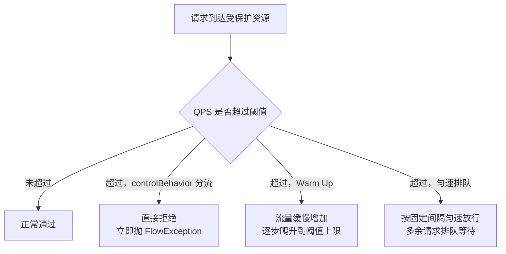

# Sentinel 限流规则参数：五个参数各管一件事

Sentinel 入门案例里，限流规则只露过三张脸：`rule.setResource` 设资源名，`rule.setGrade` 设限流模式，`rule.setCount` 设上限值。跑通之后去 Dashboard 的流控规则页点「编辑」，弹窗里却还有「针对来源」「流控效果」「高级选项」这些没见过的字段，对不上号就不知道每一项改了会发生什么。这一课把一条限流规则的全部常用参数补齐，讲清每个参数管什么、取什么值、改了之后限流行为怎么变。

## 先给结论

- 一条限流规则由五个元素组成：resource 资源名、grade 阈值类型（QPS 或并发线程数）、count 限流阈值、limitApp 流控针对的调用来源、controlBehavior 流量控制效果。
- limitApp 取 `default` 时不区分调用来源，所有请求按同一条规则限流；也可以按来源区分，对不同来源设不同规则。
- controlBehavior 有三种取值：直接拒绝（默认，抛 `FlowException`）、Warm Up 预热、匀速排队等待（漏桶算法）。
- Dashboard 编辑与新增流控规则的界面字段和代码参数一一对应，不写一行代码也能完成同样的配置。
- 控制台手动改规则属于手动方式，一般仅用于测试和演示，生产环境的规则管理要走动态规则，这是下一课的主题。

## 从三个参数到五个参数

入门案例里用 API 定义规则的代码是这样的，阈值当时为了演示方便临时改成了 3：

```java
List<FlowRule> rules = new ArrayList<>();
// 外层流控规则
FlowRule rule = new FlowRule();
rule.setResource("hello");
rule.setGrade(RuleConstant.FLOW_GRADE_QPS);
rule.setCount(3);
rules.add(rule);
// 加载流控规则，使其启用
FlowRuleManager.loadRules(rules);
```

这段代码覆盖了五个参数中的前三个：resource 是资源名，即限流规则的作用对象；grade 是限流阈值类型，QPS 模式看每秒能处理多少次请求或调用，并发线程数模式看同时占用的线程数；count 是具体的上限值。讲义把它们归纳成一张完整的参数表：

| 参数 | 含义 |
|---|---|
| resource | 资源名，即限流规则的作用对象 |
| grade | 限流阈值类型（QPS 或并发线程数） |
| count | 限流阈值 |
| limitApp | 流控针对的调用来源，若为 default 则不区分调用来源 |
| controlBehavior | 流量控制效果（直接拒绝、Warm Up、匀速排队等待） |

组合这五个元素，就能拼出不同的限流策略。前三个决定「管谁、按什么口径、超多少」，后两个决定「对谁生效、超了之后怎么办」。

## limitApp：按调用来源区别对待

limitApp 解决的是「这条规则只管谁发来的请求」。设想一个电商站点，请求来自全国各地：有河南客户的请求、山东客户的请求、北京客户的请求。如果要对不同来源施加不同的限流强度，就可以按请求来源的 IP 区分，河南 IP 一条规则、山东 IP 一条规则，彼此互不干扰，灵活性非常高。

参数值填 `default` 是最常用的形态：不区分来源，不管请求从哪里来，一律套用同一条限流规则。入门案例没有显式设置 limitApp，走的就是这个默认口径。来源区分是个进阶玩法，需要框架能解析出调用来源（例如从请求头或认证信息里取），demo 阶段保持 default 即可。

## controlBehavior：超过阈值之后怎么办

前四个参数决定限流怎么判，controlBehavior 决定判定了之后怎么处理，一共三种取值。

**直接拒绝。** 常量是 `RuleConstant.CONTROL_BEHAVIOR_DEFAULT`，默认的流量控制方式。QPS 超过任意一条规则的阈值后，新请求立即被拒绝，拒绝的方式是抛出 `FlowException`。它适用于系统处理能力确切已知的场景，比如通过压测摸清了系统的准确水位，超了就干脆利落地拒掉。入门案例页面上那句「系统繁忙，请稍候」，链路就是 QPS 超限抛 `FlowException`，再由 blockHandler 指定的兜底方法接住。

**Warm Up，预热或冷启动。** 常量是 `RuleConstant.CONTROL_BEHAVIOR_WARM_UP`。系统长期低水位运行时，流量突然拉满，直接把系统拉升到高水位可能瞬间把它压垮：缓存没热、连接池没起量、JIT 没优化到位。Warm Up 让通过的流量缓慢增加，在一定时间内逐渐升到阈值上限，给冷系统一段预热时间。它是「慢性子」策略，宁可通过得慢一点，也要避免被洪峰一巴掌拍死。

**匀速排队等待。** 常量是 `RuleConstant.CONTROL_BEHAVIOR_RATE_LIMITER`，严格控制请求通过的间隔时间，让请求以均匀的速度通过，对应的是漏桶算法。规则设成一秒处理 10 个，那么不管请求是憋了一秒一次性涌进来，还是稀稀拉拉慢慢来，系统永远按每秒 10 个的匀速放行，多出来的排队等。适合处理突发脉冲式的流量：把洪峰削平成平稳的水流，代价是请求要容忍排队延迟。

三种效果的分流逻辑如下：



这张图讲的是同一份超载流量在三种流控效果下的不同去向。关键区别在于时间维度：直接拒绝把成本转嫁给调用方，Warm Up 把压力摊到未来的预热期里，匀速排队把洪峰摊平成恒定速率。

## 不写代码也能改：控制台配置同一套参数

前面所有参数都通过代码设置，Sentinel 还提供了更直观的方式：Dashboard 图形化控制台。在流控规则页找到资源 `hello`，点「编辑」，弹窗里的字段逐个对上号：资源名对应 resource，「针对来源」对应 limitApp（值为 default），阈值类型对应 grade，阈值数字 2 对应 count，「是否集群」是集群模式开关；点开「高级选项」，流控效果就在里面，快速失败即直接拒绝，另有 Warm Up 与排队等待两项。改完点保存，规则立即生效，全程不需要碰代码。

新增规则的弹窗与编辑完全一致：填上资源名 hello，按需设置各项参数，点击新增即完成一条规则的定义。实时监控页能看到规则生效后的数据，某次演示中的秒级记录如下：

| 时间 | 通过 QPS | 拒绝 QPS | 响应时间 (ms) |
|---|---|---|---|
| 15:19:12 | 2.0 | 1.0 | 0.0 |
| 15:19:11 | 1.0 | 0.0 | 0.0 |

通过 2 拒绝 1 的那一秒，正是阈值 2 的规则在起作用。控制台调规则比改代码重启灵活得多，但定位要清楚：手动方式主要用于测试和演示，生产环境的限流规则一般存放在配置中心等统一的规则源里动态管理，具体做法在动态规则一课展开。

## 常见误区

- **以为「系统繁忙」是 Sentinel 自带的响应。** 错例：认为直接拒绝就是返回这句话。正解：直接拒绝的动作是抛出 `FlowException`，用户看到什么取决于 blockHandler 兜底方法或网关层的降级处理怎么写。
- **把匀速排队的 count 理解成队列容量。** 错例：设 count 为 10，以为最多排 10 个。正解：count 依旧是每秒通过的请求数，匀速排队只改变放行节奏，把 10 个/秒拆成固定间隔逐个放行，超出的请求在时间窗内排队，排不进才拒绝。
- **以为 Warm Up 结束前会一直拒绝流量。** 错例：配了 Warm Up 后发现请求偶尔被拒就认为配置失效。正解：预热期内放行量从低水位逐步爬升到阈值上限，爬升途中部分请求被拒是设计行为，不是故障。
- **把控制台手改的规则当成生产方案。** 错例：生产故障时临时上控制台改阈值，应用一重启规则全丢。正解：控制台规则存在内存里，生产环境要用动态规则源持久化，控制台只负责推送变更。

## 面试可能被问到的问题

1. 面试官追问：「Sentinel 一条限流规则有哪些参数？」
   答：五个核心参数。resource 资源名，grade 阈值类型分 QPS 和并发线程数，count 阈值，limitApp 调用来源（default 表示不区分），controlBehavior 流控效果，分直接拒绝、Warm Up、匀速排队三种。组合这些参数可以实现针对不同来源、不同处理策略的限流。
2. 面试官追问：「controlBehavior 的三种流控效果分别适合什么场景？」
   答：直接拒绝是默认方式，适合系统水位确切已知、超载立即拒绝的场景；Warm Up 适合长期低水位、怕突发流量压垮冷系统的场景，让流量缓慢爬升；匀速排队对应漏桶算法，严格按固定间隔放行，适合把突发脉冲流量削平，比如消息处理类接口。
3. 面试官追问：「limitApp 是怎么实现按来源限流的？」
   答：limitApp 指定规则针对的调用来源，填 default 时不区分来源。按来源限流时填具体来源标识，不同来源配不同规则。来源标识需要框架侧提供解析能力，例如从请求上下文中提取调用方信息，再交给规则匹配。
4. 面试官追问：「控制台改规则和代码里写规则是什么关系？」
   答：两处配置的都是同一套参数，最终都写入客户端的规则管理器生效。代码方式随应用启动加载，控制台方式即时下发便于调整。都属于手动方式，官方定位是测试和演示；生产环境推荐动态规则源，规则存配置中心或数据库，客户端监听变更。
5. 面试官追问：「Warm Up 解决什么问题，原理是什么？」
   答：解决冷系统被突发流量压垮的问题。系统长期低水位运行时，缓存、连接池都处于冷状态，流量瞬间拉到高水位容易出事。Warm Up 让通过量在指定预热时间内从低阈值逐步爬升到设定阈值，给系统一个预热窗口。

## 配套资料

- 讲义：`materials/docs/10/Sentinel实现限流.md`，「2.3.1 限流规则参数」小节（五参数定义、三种流控效果的常量与说明）与「2.2 Sentinel-Dashboard 图形化控制台」小节（控制台编辑规则的界面口径）。
- 代码：`materials/code/10/wanxinp2p/`，万信金融工程归档（目录保留原始命名，路径只列到该层级），限流规则代码为课程现场演示内容，未单独归档。
- 说明：`FlowRule` 定义代码按本课画面与讲义口径整理，包名与工程坐标沿用 `com.study.finance` 系口径；实时监控数据表为课程演示画面记录值。
