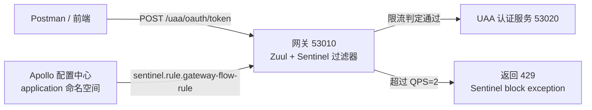
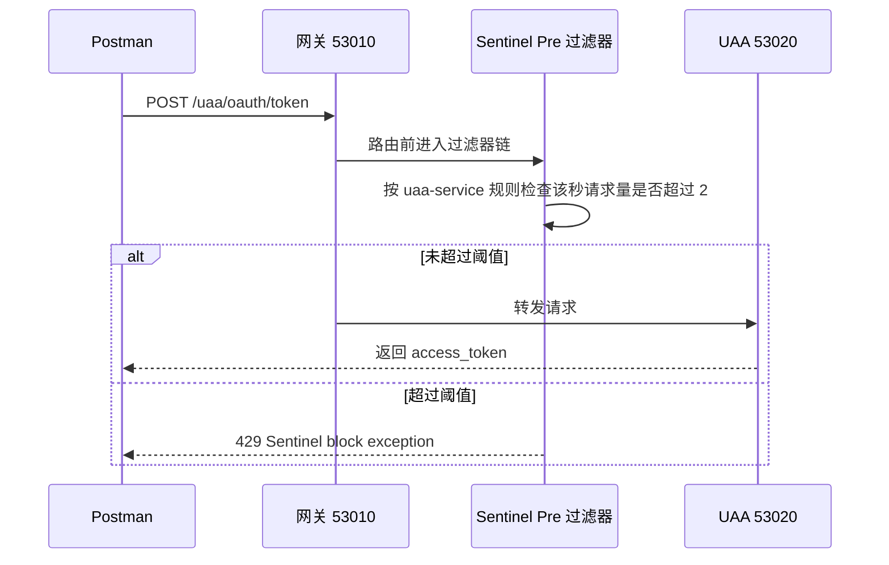

# 万信金融 P2P 项目网关限流落地：从依赖到压测的完整闭环

> 🔒 安全提示：文中示例的口令/密钥均为课程教学环境演示口径，生产环境的安全要求见《安全与合规须知》。

Sentinel 的概念课到这里全部铺完：入门案例跑通了资源、规则、检验三步，规则参数课补齐了五个参数，动态规则课把规则挪出了代码，网关限流课指明了项目级的施力点。剩下的问题只有一个：这套东西怎么真正落进万信金融 P2P 项目。这一课给出完整答案，项目采用 Spring Cloud Zuul 作网关、Apollo 作配置中心，正好是 Sentinel 网关限流与动态规则的绝佳组合。四步走完，再用 Postman 压一次登录接口，亲眼看到限流生效，这也是第八章 Sentinel 系列的收官。

## 先给结论

- 落地分四步：父工程做依赖管理、网关工程引依赖；在网关配置类注册三个 Zuul 过滤器完成与 Sentinel 的集成；在 Apollo 的 application 命名空间配置限流规则；在同一个配置类里用 `ApolloDataSource` 拉取规则并注册生效。
- 限流资源是 `uaa-service`，名字必须照抄 Zuul 路由配置里的路由 ID，不能自造。
- 规则以 JSON 数组形式存在 key `sentinel.rule.gateway-flow-rule` 下，改规则只需在 Apollo 改配置并发布，网关不重启即实时生效。
- 测试现象：Postman 慢速发 `POST http://localhost:53010/uaa/oauth/token` 正常返回令牌；一秒内超过 2 次就返回 `code` 为 429 的「Sentinel block exception」，说明网关限流已起作用。

## 整体方案：为什么是 Zuul 加 Apollo

万信金融 P2P 平台在发展过程中吞吐量会与日俱增，为了保证系统稳定性需要限流。项目的技术选型早已确定：HTTP 网关用 Spring Cloud Zuul，配置中心用 Apollo。既然限流要放在网关层，规则要放到配置中心，技术组合自然就敲定为 Sentinel 集成 Zuul，再用 Apollo 作为限流规则的数据源。这种搭配是企业正式开发中的常见组合，两个适配件都是 Sentinel 官方提供的现成模块。落地之后的整体链路如下：



这张图讲的是规则与流量的两条流向：规则从 Apollo 流向网关，请求从客户端流向网关，网关拿着规则判定每一条请求的去向。解读关键路径时要注意，规则数据源在配置中心而不在网关本地，这正是动态规则一课确立的生产做法。

规则之所以放 Apollo 而不是写代码，理由在动态规则一课已经论证过：限流阈值是典型的运营参数，促销日放宽、平日收紧都是常态操作，写死在代码里每次调整都要走编译发布流程；放到 Apollo 上，改配置、点发布，规则即时生效。项目的其余微服务配置本来就托管在 Apollo，限流规则入乡随俗，运维视角只有一处配置面板，不需要为限流单独引入一套规则存储。

## 第一步：引入依赖，父工程管版本

项目是多模块结构，版本统一由父工程管理。在父工程 `pom.xml` 的 `dependencyManagement` 中增加两个依赖声明（依赖在工程归档中已经存在，动手前先检查自己电脑上有没有，没有再补）：

```xml
<dependency>
    <groupId>com.alibaba.csp</groupId>
    <artifactId>sentinel-zuul-adapter</artifactId>
    <version>1.6.2</version>
</dependency>
<dependency>
    <groupId>com.alibaba.csp</groupId>
    <artifactId>sentinel-datasource-apollo</artifactId>
    <version>1.6.2</version>
</dependency>
```

两个依赖各司其职：`sentinel-zuul-adapter` 是 Sentinel 与 Zuul 的适配器，网关限流的三个过滤器就来自这里；`sentinel-datasource-apollo` 是 Apollo 数据源适配，动态规则的拉取靠它。父工程只做版本仲裁，真正的引入发生在网关工程：打开网关工程的 `pom.xml`，把这两个依赖（不带版本号）加进 `dependencies`。至此依赖就绪。

## 第二步：注册三个过滤器，完成 Sentinel 与 Zuul 的集成

网关限流一课讲过，Sentinel 与 Zuul 的集成点就是三个过滤器。网关工程里已有配置类 `ZuulConfig`，里面原本放着 CORS 跨域配置，把三个过滤器的 Bean 定义加到这个类里：

```java
package com.study.finance.gateway.config;

import com.alibaba.csp.sentinel.adapter.zuul.filters.SentinelZuulErrorFilter;
import com.alibaba.csp.sentinel.adapter.zuul.filters.SentinelZuulPostFilter;
import com.alibaba.csp.sentinel.adapter.zuul.filters.SentinelZuulPreFilter;
import com.netflix.zuul.ZuulFilter;
import org.springframework.context.annotation.Bean;
import org.springframework.context.annotation.Configuration;

@Configuration
public class ZuulConfig {

    // 其他代码（CORS 跨域配置等）...

    @Bean
    // pre 过滤器，在请求路由之前进行限流操作
    public ZuulFilter sentinelZuulPreFilter() {
        return new SentinelZuulPreFilter();
    }

    @Bean
    // post 过滤器，路由之后恢复资源
    public ZuulFilter sentinelZuulPostFilter() {
        return new SentinelZuulPostFilter();
    }

    @Bean
    // error 过滤器，异常后的处理
    public ZuulFilter sentinelZuulErrorFilter() {
        return new SentinelZuulErrorFilter();
    }
}
```

三个对象全是直接 `new` 出来注册成 Bean，代码简单到不像集成工作，但含义不简单。Pre 过滤器在请求路由之前执行，做 API 匹配与限流判定，是限流功能的主要执行者；Post 过滤器在路由之后调用，恢复资源现场，保证统计计数正确收尾；Error 过滤器在出现异常时介入，负责异常记录与后续处理。三个过滤器注册完成，网关就合二为一：它既是 Zuul，又是带 Sentinel 限流功能的网关。

把三个过滤器的分工串起来看，恰好对应一次调用的完整生命周期：请求进来，Pre 过滤器先解析请求属性、匹配资源、检查网关规则，放行或阻断在路由之前定夺；请求转发完成，Post 过滤器把资源的调用现场恢复干净；任何一环出了异常，Error 过滤器兜底记录并处理。少注册任何一个，链路都会缺一环：只装 Pre 不装 Post，资源的统计现场收不了尾；不装 Error，限流异常会以网关原始错误的形式暴露给调用方。这也是适配模块把它们设计成三个独立过滤器的原因，各司其职，按需装配。

## 第三步：在 Apollo 配置动态规则

规则存进 Apollo 才能动态生效。配置放到 Apollo 的网关项目下，命名空间选 application，也就是项目各微服务默认读取的那个公共命名空间；key 定为 `sentinel.rule.gateway-flow-rule`，用「前缀加语义」的方式命名，`sentinel.rule` 表明这是 Sentinel 的规则配置，`gateway-flow-rule` 表明是网关流控规则，一眼可辨，也避免了与其他配置项撞名。value 是一个 JSON 数组：

```json
[
  {
    "resource": "uaa-service",
    "resourceMode": 0,
    "grade": 1,
    "count": 2,
    "intervalSec": 1,
    "controlBehavior": 0,
    "burst": 0,
    "maxQueueingTimeoutMs": 500,
    "paramItem": {}
  }
]
```

这份 JSON 就是限流规则参数一课那五个参数的 JSON 化，另加几个网关专属字段，逐个拆开看。

**resource，限流资源，取 uaa-service。** 万信金融 P2P 项目有一堆微服务，这里把每一个微服务当成一个资源来限流，示例以统一认证服务为例，因为登录业务必经 UAA。这个名字不能随便起：网关限流的资源对应 Zuul 的 routes，必须照着网关的路由配置写。路由表里统一认证服务的路由 ID 是 `uaa-service`（对应 `zuul.routes.uaa-service.path=/uaa/**` 这条路由），资源名照抄它，网关的 Pre 过滤器才能把请求和规则对上号。

**resourceMode，资源模式，取 0。** 网关限流模式下这个值基本固定，表示按路由 ID 匹配资源。

**grade 与 count，限流模式与上限值。** 数字 1 表示 QPS 限流模式，2 表示并发线程数模式；count 是上限值，每秒最多处理 2 次请求。为了测试方便仍然取 2，人工就能压出限流。

**intervalSec，统计时间窗口。** 单位秒，默认 1 秒，含义是以 1 秒为单位统计请求量。

**controlBehavior，流控效果。** 0 表示直接拒绝，另有 Warm Up 与匀速排队等待可选，对应关系与普通流控规则一致。

**burst 与 maxQueueingTimeoutMs。** burst 是应对突发请求时额外允许的请求数目，0 表示不允许；maxQueueingTimeoutMs 是匀速排队模式下的最长排队时间，单位毫秒，示例里 500 即半秒，仅在匀速排队模式下生效。

**paramItem，动态参数项。** 针对请求参数的细粒度限流开关，目前用不到，留空对象即可。

操作上有两个必须注意的细节。**一是不要从讲义 PDF 里直接复制粘贴。** PDF 里带着换行和多余空格，原样粘进 Apollo 保存时会报错，value 必须是干净的单行 JSON；课程资料里整理好了不带换行的版本，从那里复制。**二是配置完必须点发布。** Apollo 的修改不发布就不生效，这是配置中心的基本规矩，漏了发布，后面怎么测都是正常响应。

## 第四步：客户端拉取规则并注册生效

规则躺在 Apollo 上，网关得把它读出来才起作用。读取代码加在第二步同一个 `ZuulConfig` 类里，方法标 `@PostConstruct`，保证 Bean 构造完成后自动执行：

```java
/**
 * 从 Apollo 上获取限流规则并进行配置
 */
@PostConstruct
private void initGatewayRules() {
    String namespaceName = "application"; // 对应 Apollo 的命名空间名称
    String ruleKey = "sentinel.rule.gateway-flow-rule"; // 限流规则的 key
    String defaultRules = ""; // 连接不上 Apollo 时的默认规则，自定义规则给空串
    ReadableDataSource<String, Set<GatewayFlowRule>> gatewayRuleDataSource =
            new ApolloDataSource<>(namespaceName, ruleKey, defaultRules, source ->
                    JSON.parseObject(source, new TypeReference<Set<GatewayFlowRule>>() {}));
    GatewayRuleManager.register2Property(gatewayRuleDataSource.getProperty());
}
```

代码骨架与动态规则一课的 `FlowRule` 版本完全一致，只有两处不同。一处是泛型类型：网关限流用的规则类型是 `GatewayFlowRule`，即网关流控规则，JSON 里的 resourceMode、intervalSec 等字段正对应它的属性；反序列化目标是从 JSON 数组转成的 Set 集合，因为规则允许定义多条。另一处是注册器：`GatewayRuleManager.register2Property` 把数据源属性注册进网关规则管理器，注册完成规则即生效。四个参数的语义再对一遍：命名空间 application，key 是第三步配的那串，默认规则传空串，最后一个参数用 Lambda 写出 JSON 串到 `Set<GatewayFlowRule>` 的转换。Apollo 上改一次配置并发布，这条通道立刻把新规则送进管理器，网关不用重启。

到这里四个动作全部完成，回看依赖关系会发现每一步都在为下一步铺垫：没有第一步的适配依赖，过滤器类与数据源类都不存在；没有第二步的过滤器，规则再准也没有执行者；没有第三步的配置，数据源读到的永远是空串；没有第四步的注册，配置永远停在 Apollo 里。四步缺一不可，这正是动态规则与网关限流两个概念在工程上的完整投影。

## 功能测试：一秒压出 429

只改了网关的代码，所以把网关微服务重启一下即可，登录链路上的其他服务与 Apollo 此前已经启动。动笔测试前把服务清单过一遍：Apollo 配置中心、Eureka 注册中心（53000）、网关（53010）、UAA 认证服务（53020），登录请求依次穿过它们；用户中心不在这条链路上，可以不起。网关重启后，新加的两个依赖与三个过滤器随应用一起加载，Apollo 里的规则在 `@PostConstruct` 方法执行时就被拉到本地。

测试对象是登录：限流规则针对 uaa-service，而登录业务正好要访问 UAA。前端压测不方便，用 Postman 频繁发送登录请求。

Postman 里找到之前做过的过网关登录用例：请求地址 `POST http://localhost:53010/uaa/oauth/token`，走网关 53010 而不是直连 UAA 的 53020，路径与参数原样保留，表单参数包括 grant_type、client_id、client_secret（占位值 `example-secret`）、username、password、domain、authenticationType 等七项，Body 类型必须是 `x-www-form-urlencoded`。

验证分两步。**慢速发送，一切正常。** 间隔一秒以上点一次 send，返回体里拿到 access_token，登录成功，限流没有触发，因为任何一秒内的请求量都没到 2。**快速连点，限流现身。** 拼命快速点击 send，一秒内超过两次后，某个响应会变成这样：

```json
{
  "code": 429,
  "message": "Sentinel block exception",
  "route": "uaa-service"
}
```

这是网关限流内部定义好的提示信息：编号 429 表示请求被阻断，message 说明是 Sentinel 限流，route 字段标明限流发生在 uaa-service 这个资源上。正常情况下应该看到登录成功拿到令牌，一旦看到这段 JSON，就证明限流确实起作用了。如果想让验证更有说服力，可以把网关接入 Dashboard 实时监控：连点时拒绝 QPS 曲线上会出现清晰的尖峰，与 429 响应互相印证，监控数据的上报通道与限流本身互不干扰。另外还能做一组对照实验：回到 Apollo 把 count 从 2 调到 5 并发布，再连点，会发现拒绝明显变少甚至消失，规则变更实时生效这一点也随之得到验证。一次请求的完整判定路径如下：



这张图讲的是判定位置：限流检查发生在网关路由之前，被拒请求根本不会转发到 UAA，下游完全不受超载流量的冲击。这正解释了网关限流的保护价值，也回扣了本系列开篇的问题分析：限流让超量的请求在入口处被挡下。

到这里，第八章的 Sentinel 系列正式收官。回头看这条线：入门案例建立资源、规则、检验三步框架；Dashboard 把监控数据图形化并支持界面配规则；规则参数课讲透五个参数；动态规则课把规则搬进配置中心；网关限流课指明项目级的施力点；本课把全部概念压进真实项目，四个动作完成落地，一次压测完成验证。限流从概念到生产，闭环走通。

## 常见误区

- **把 PDF 里的 JSON 原样粘进 Apollo。** 错例：直接从讲义复制多行 JSON，保存时报错。正解：PDF 里的换行与空格不合法，value 必须是单行干净 JSON，从整理好的资料里复制。
- **配完规则不点发布。** 错例：在 Apollo 里改完配置就去压测，怎么测都正常响应。正解：Apollo 的修改发布后才推送，发布是规则生效的必要动作。
- **资源名凭感觉起。** 错例：resource 写成 UAA 的应用名或随手起的别名，限流永远不触发。正解：网关限流的资源对应 Zuul 路由 ID，照路由配置里的 `uaa-service` 写。
- **以为改规则要重启网关。** 错例：每次调阈值都重启网关微服务。正解：`GatewayRuleManager.register2Property` 注册的是动态数据源通道，Apollo 发布后规则实时刷新，无需重启。
- **把 429 响应当成业务故障排查。** 错例：看到「Sentinel block exception」去查登录逻辑。正解：code 429 加 route 字段是网关限流的标准阻断响应，先确认请求频率是否超过阈值。

## 面试可能被问到的问题

1. 面试官追问：「在一个已有微服务项目里落地 Sentinel 网关限流的步骤是什么？」
   答：先在父工程 dependencyManagement 里管理 sentinel-zuul-adapter 与 sentinel-datasource-apollo 的版本，网关工程引入依赖；再在网关配置类注册 Pre、Post、Error 三个 Zuul 过滤器完成集成；然后把规则以 JSON 配置到配置中心；最后在配置类里用 @PostConstruct 方法创建 ApolloDataSource 读取规则，注册到 GatewayRuleManager 生效。
2. 面试官追问：「网关限流的资源名为什么必须和 Zuul 路由 ID 一致？」
   答：网关限流模式下 resourceMode 取 0，按路由 ID 匹配资源，Pre 过滤器收到请求后根据路由计算资源名再去查规则。资源名与路由 ID 对不上，规则永远匹配不到请求，限流会静默失效。
3. 面试官追问：「规则存在 Apollo，网关怎么保证改动实时生效？」
   答：网关通过 ApolloDataSource 指定命名空间与 key，Apollo 客户端监听该配置的变更，配置发布后数据源立即拉到新值，转换函数把 JSON 反序列化成 GatewayFlowRule 集合，register2Property 把通道注册进规则管理器，规则无重启自动刷新。
4. 面试官追问：「限流触发后客户端收到什么，如何定制？」
   答：Zuul 适配下默认返回包含 code 429、message「Sentinel block exception」与 route 资源名的 JSON。定制可以通过 Error 过滤器或 Fallback 处理改造返回体，例如换成业务约定的错误码与提示文案。
5. 面试官追问：「压测网关限流时怎么设计验证用例？」
   答：把阈值设成人工可触发的值（如 QPS 2），构造两类请求：慢速请求验证正常链路不受影响，应返回业务成功结果；快速连发验证超载行为，一秒内超过阈值应稳定出现限流响应。两类现象交替可复现，即证明规则生效。
6. 面试官追问：「为什么依赖版本声明放父工程，网关工程只引依赖？」
   答：多模块项目用父 pom 的 dependencyManagement 统一仲裁版本，各模块按需引入不写版本号。版本升级只改一处，避免多个模块版本漂移，这是 Maven 多工程的标准治理方式。

## 配套资料

- 讲义：`materials/docs/10/Sentinel实现限流.md`，「3 实现万信金融 P2P 网关限流」章节：「3.2 功能实现」（依赖、ZuulConfig 集成代码、Apollo 规则 JSON、initGatewayRules 代码）与「3.3 功能测试」（Postman 压登录请求与限流响应）。
- 代码：`materials/code/10/wanxinp2p/`，万信金融工程归档（目录保留原始命名，路径只列到该层级），网关工程为其中 `wanxinp2p-gateway-server/` 子目录，父工程 `pom.xml` 的依赖管理中含 `sentinel-zuul-adapter` 与 `sentinel-datasource-apollo` 1.6.2，网关配置类的 CORS 跨域配置与归档一致。
- 说明：三个过滤器的注册代码与 Apollo 规则 JSON 取自讲义，归档中的 `ZuulConfig.java` 为集成前的版本，Sentinel 相关代码按讲义与画面口径补全，包名按 `com.study.finance` 系改写；表单参数中的密钥以 `example-secret` 占位。
