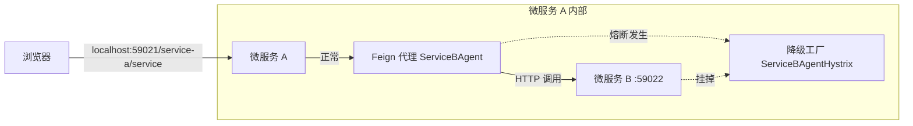

# Hystrix 与 Feign 入门案例：两个注解一行配置，把熔断挂到远程调用上

Feign 代理写过好几次了，`@FeignClient` 一标、启动类一扫，远程调用就通了。可这套姿势默认裸奔：目标服务一挂，调用方只能在超时和报错里干等。这一节用一套完整的入门工程演示 Feign 与 Hystrix 的标准集成方式：一个配置项开启熔断器，一个 `fallbackFactory` 属性挂上降级工厂，目标服务停掉的那一刻，请求不再报错，而是走本地降级方法返回兜底结果。工程不大，却是后面万信金融项目里给登录链路加熔断的同款套路。

## 先给结论

- Feign 与 Hystrix 同属 Spring Cloud 组件，集成是官方设计好的，只需两步：配置文件开启熔断器，Feign 代理上指定降级工厂。
- 开关配置是 `feign.hystrix.enabled=true`，加上它断路器就开始工作。
- `@FeignClient` 增加 `fallbackFactory` 属性指向降级工厂类，工厂类实现 Hystrix 的 `FallbackFactory` 接口并以 Feign 代理接口为泛型，`create` 方法返回降级实现对象。
- 降级实现对象与远程代理接口方法签名一致，熔断发生时调用方拿到的是同一个接口的本地实现，远程调用与本地降级无缝切换。
- 验证方式：目标服务正常时返回真实数据，把目标服务关掉再访问，返回的是降级工厂里的兜底内容。

## 工程结构：一个注册中心加两个微服务

入门案例用 Maven 多模块搭建，父工程 `feign-hystrix` 下挂三个模块：一个 Eureka 注册中心，微服务 A 和微服务 B。调用方向是 A 通过 Feign 访问 B，Hystrix 在 A 侧对这次调用实施熔断保护。注册中心与此前见过的没有任何区别，配置里指明端口号 59020 即可，不再赘述。

父工程 pom 里做版本管理，Spring Boot 用 2.1.3 版本，Spring Cloud 用 Greenwich 版本：

```xml
<parent>
    <groupId>org.springframework.boot</groupId>
    <artifactId>spring-boot-starter-parent</artifactId>
    <version>2.1.3.RELEASE</version>
</parent>
<groupId>com.study.finance.hystrix</groupId>
<artifactId>feign-hystrix</artifactId>
<packaging>pom</packaging>

<dependencyManagement>
    <dependencies>
        <dependency>
            <groupId>org.springframework.cloud</groupId>
            <artifactId>spring-cloud-dependencies</artifactId>
            <version>Greenwich.RELEASE</version>
            <type>pom</type>
            <scope>import</scope>
        </dependency>
    </dependencies>
</dependencyManagement>
```

微服务 A 与 B 的依赖基本相同：web 启动器、Eureka 客户端、OpenFeign，再加 Hystrix 的 starter。B 是被调方，理论上可以不引 Feign，工程里两边保持一致也无妨；A 是调用方，这四个依赖一个都不能少：

```xml
<dependency>
    <groupId>org.springframework.boot</groupId>
    <artifactId>spring-boot-starter-web</artifactId>
</dependency>
<dependency>
    <groupId>org.springframework.cloud</groupId>
    <artifactId>spring-cloud-starter-netflix-eureka-client</artifactId>
</dependency>
<dependency>
    <groupId>org.springframework.cloud</groupId>
    <artifactId>spring-cloud-starter-openfeign</artifactId>
</dependency>
<dependency>
    <groupId>org.springframework.cloud</groupId>
    <artifactId>spring-cloud-starter-netflix-hystrix</artifactId>
</dependency>
```

微服务 B 的配置与启动类都很朴素：服务名、端口 59022、上下文路径 `/service-b`、注册中心地址，启动类标 `@SpringBootApplication` 与 `@EnableFeignClients`。对外只提供一个查询接口，返回一句话证明自己活着：

```java
@RestController
public class ServiceBController {

    @GetMapping("service")
    public String service() {
        return "Service B is running";
    }
}
```

微服务 A 侧是重头戏：端口 59021、上下文路径 `/service-a`，里面有一个 Feign 代理和一个 Controller。

## 第一步：一行配置点亮断路器

集成之所以简单，是因为 Feign 和 Hystrix 同属 Spring Cloud，一家人的集成早就设计好了。第一步只需在微服务 A 的 `application.properties` 里加一条配置，把熔断器启用：

```properties
spring.application.name=feign-hystrix-service-a
server.port=59021
server.servlet.context-path=/service-a
eureka.client.serviceUrl.defaultZone=http://localhost:59020/eureka/
# 启用 hystrix
feign.hystrix.enabled=true
```

这条配置加上之后，断路器就已经工作了。但此时熔断发生只是直接失败，还没有任何兜底处理，第二步就是把降级回退的代码补上。

## 第二步：fallbackFactory 挂上降级工厂

降级代码写在哪？想清楚调用发生的位置就明白了：A 通过 Feign 代理向 B 发请求，熔断正是在这次调用上起作用，所以降级回退的代码也应该写在 Feign 代理这里。具体做法是在 `@FeignClient` 注解里增加一个 `fallbackFactory` 属性，指向一个降级工厂类：

```java
@FeignClient(name = "feign-hystrix-service-b",
        fallbackFactory = ServiceBAgentHystrix.class)
public interface ServiceBAgent {

    @GetMapping("/service-b/service")
    String service();
}
```

工厂类不是普通类，要实现 Hystrix 的 `FallbackFactory` 接口，泛型指定为这个 Feign 代理接口，并重写 `create` 方法。`create` 方法最终产出一个降级实现对象，它同样实现了 Feign 代理接口，这样一来实际的远程调用与本地降级方法的参数与返回就保持一致了：

```java
@Component
public class ServiceBAgentHystrix implements FallbackFactory<ServiceBAgent> {

    @Override
    public ServiceBAgent create(Throwable throwable) {
        // 匿名内部类实现代理接口，方法体里写降级回退的具体动作
        return new ServiceBAgent() {
            @Override
            public String service() {
                // demo 简化处理：真实项目可返回空值、默认值或缓存数据
                return "service-b熔断...";
            }
        };
    }
}
```

这段代码有三个细节值得咀嚼。第一，类上标 `@Component` 注册进容器，Feign 才能找到它。第二，`create` 的入参是 `Throwable`，熔断的触发原因就在里面，真实项目里要记录下来而不是吞掉。第三，`create` 里 new 的是接口的匿名内部类，也可以换成 lambda 写法，方法体里放的就是降级回退的业务动作，demo 阶段返回一句固定字符串，看到这句话就知道降级生效了。真实开发时，这里可能是返回空值、返回默认值，也可能是把缓存中的数据返回。

Controller 这边没有任何特殊之处，注入代理直接调用，调用方完全感知不到后面有熔断层：

```java
@RestController
public class ServiceAController {

    @Autowired
    private ServiceBAgent serviceBAgent;

    @GetMapping("service")
    public String service() {
        String serviceb = serviceBAgent.service();
        return serviceb;
    }
}
```

整个调用链路用一张图收拢：



这张图讲的是正常路径与降级路径的分岔：正常时 Feign 代理把请求转发给 B；B 挂掉触发熔断时，同一个代理接口的调用改由降级工厂创建的本地实现接手，返回兜底内容。

## 触发验证：关掉 B 看兜底

启动注册中心、微服务 A、微服务 B，浏览器访问 `http://localhost:59021/service-a/service`，页面返回 `Service B is running`，说明链路通畅。故意把微服务 B 关掉，再次访问同一个地址，页面返回 `service-b熔断...`，请求没有报错，而是拿到了降级工厂里的兜底字符串，降级回退效果成立。整条链路的动作顺序是：A 收到请求，通过代理调 B，B 不可用触发熔断逻辑，Hystrix 找到 `fallbackFactory` 指定的工厂类，调用 `create` 拿到降级实现对象，执行其中的降级方法返回结果。

把关键步骤再压缩一遍：pom 里四个依赖引齐；配置文件 `feign.hystrix.enabled=true` 开启断路器；Feign 代理上用 `fallbackFactory` 指定降级工厂，工厂实现 `FallbackFactory` 接口并在 `create` 里写降级动作。凡是写 Feign 代理的地方都可以照这个套路加上降级回退，万信金融项目后续给登录功能接入熔断，用的正是同一套三步法。

## 常见误区

- **只加 `feign.hystrix.enabled=true` 不写降级工厂。** 错例：以为开了开关熔断保护就完整了。正解：开关只是让断路器工作，没有 `fallbackFactory` 时熔断发生直接返回失败，用户看到的还是报错，降级代码必须补齐。
- **降级工厂忘标 `@Component`。** 错例：类写了、接口实现了，启动后熔断不生效或报找不到 Bean。正解：工厂类要注册进 Spring 容器，Feign 才能在熔断发生时定位到它。
- **`FallbackFactory` 的泛型写成别的接口。** 错例：泛型随手填了另一个代理接口，方法对不上。正解：泛型必须与 `@FeignClient` 所在的代理接口一致，保证降级对象与远程调用方法签名相同。
- **在降级方法里把异常彻底吞掉。** 错例：`create(Throwable throwable)` 的入参从来不用。正解：`throwable` 携带熔断原因，至少打一条日志，否则下游故障被兜底内容掩盖，线上排查无从下手。

## 面试可能被问到的问题

1. 面试官追问：「Feign 集成 Hystrix 一共要动几处？」
   答：三处：pom 引入 `spring-cloud-starter-netflix-hystrix` 依赖；配置文件 `feign.hystrix.enabled=true` 开启断路器；Feign 代理的 `@FeignClient` 上加 `fallbackFactory` 属性指向降级工厂，工厂实现 `FallbackFactory` 接口并重写 `create` 返回降级实现对象。
2. 面试官追问：「为什么用 `fallbackFactory` 而不是 `fallback` 直接指定实现类？」
   答：两者都能提供降级实现，但 `fallback` 直接给实现类时拿不到熔断原因，`fallbackFactory` 的 `create(Throwable throwable)` 能拿到触发降级的异常，便于记录日志与区分失败原因，工程上更常用。本课入门案例采用的正是工厂方式。
3. 面试官追问：「降级实现对象和 Feign 代理接口是什么关系？」
   答：降级工厂实现了 `FallbackFactory<代理接口>`，`create` 返回的对象就是代理接口的一个本地实现，方法签名与远程代理完全一致。调用方注入的还是同一个接口，熔断时框架把调用切到这个本地实现上，远程调用与本地降级对上层透明。
4. 面试官追问：「怎么验证熔断降级真的生效了？」
   答：先把全链路跑通确认正常返回目标服务的数据，然后故意把目标服务停掉再访问调用方接口，返回的是降级工厂里的兜底内容且不报错，说明熔断触发、降级路径接手了。生产上还可以结合熔断器监控界面观察状态变化。
5. 面试官追问：「这套三步法怎么迁移到真实项目里？」
   答：套路完全固定：依赖与开关配置放到公共配置或配置中心统一管理，每个 Feign 代理按业务语义写一个降级工厂，降级动作按接口性质选择返回空值、默认值、缓存或友好提示。例如登录链路调用统一账户服务，降级时就可以返回约定的错误码与提示，告知用户稍后再试。

## 配套资料

- 讲义：`materials/docs/10/SpringCloud Hystrix服务熔断.md`，父工程版本、依赖清单、`feign.hystrix.enabled` 开关、`fallbackFactory` 降级工厂写法与测试步骤均出自「3 Feign&Hystrix 入门」小节。
- 代码：`materials/code/10/wanxinp2p/`，P2P 工程归档（目录保留原始命名，路径列到该层级），工程中可找到 `spring-cloud-starter-netflix-hystrix` 依赖的真实使用。
- 说明：入门案例的 `feign-hystrix` 独立工程未在仓库归档，文中代码按本课讲义与画面线整理，包名按 `com.study.finance` 系改写；注册中心端口 59020、A 端口 59021、B 端口 59022 沿用讲义口径。
