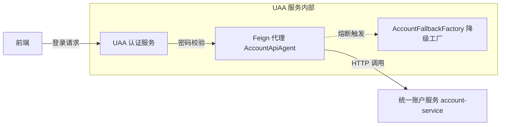

# 万信金融 P2P 项目实现服务熔断：把 Hystrix 降级挂到登录链路上

入门案例里那个三步法（引依赖、开开关、挂降级工厂）已经在独立工程里跑通了，剩下的问题是怎么搬进真实项目。万信金融 P2P 项目里需要熔断保护的地方不止一处，开户、发标、投标、放款，凡是有 Feign 远程调用的链路都值得挂一层保护。一处处演示没有必要，这一课挑登录功能做样板：它链路清晰、人人都会测，走完这一遍，其余链路照葫芦画瓢即可。

## 先给结论

- 登录链路涉及两个微服务：UAA 认证服务与统一账户服务（account-service），熔断要加在 UAA 调用统一账户的那次 Feign 远程调用上。
- 接入共五步：两个微服务引入 `spring-cloud-starter-netflix-hystrix` 依赖；在 Apollo 的 common-template 工程新建 `micro_service.feign-hystrix` 命名空间写入开关配置；其他项目关联该命名空间；本地 `application.yml` 把命名空间追加进 `apollo.bootstrap.namespaces`；修改 Feign 代理 `AccountApiAgent` 增加 `fallbackFactory`。
- 降级工厂 `AccountFallbackFactory` 实现 `FallbackFactory<AccountApiAgent>` 接口，`create` 方法里 new 一个代理接口的匿名内部类，重写 `login` 方法返回兜底响应。
- 降级返回复用项目统一的响应封装 `RestResponse`，错误码取 `CommonErrorCode.E_999995`（统一账户服务被熔断），与项目里预留的熔断错误码族保持一致。

## 登录链路与熔断的施力点

动手之前先确定熔断加在哪。登录功能的调用关系是：前端发出登录请求，请求落到 UAA 认证服务；UAA 校验用户名密码时自己并不持有账户数据，要通过 Feign 代理 `AccountApiAgent` 远程调用统一账户服务完成密码校验。这条链路上真正会发生远程调用的只有 UAA 指向统一账户的那一跳，所以熔断器与降级代码都装在这一跳上：



这张图讲的是正常路径与降级路径的分岔位置。正常时 Feign 代理把密码校验请求转发给统一账户服务；一旦统一账户不可用，同一个代理接口的调用被降级工厂接手，返回兜底响应，UAA 不至于在超时和重试里空耗线程。看图的关键在虚线那一步：降级对象与远程代理实现的是同一个接口，上层代码毫无感知。

## 五步完成接入

**第一步，两个微服务引入 Hystrix 依赖。** 打开统一账户服务与 UAA 的 `pom.xml`，确认各自都有下面这段依赖。工程归档里两个服务的 pom 已经引过了，动手前先检查自己的工程里有没有，缺了再补：

```xml
<dependency>
    <groupId>org.springframework.cloud</groupId>
    <artifactId>spring-cloud-starter-netflix-hystrix</artifactId>
</dependency>
```

版本号不用写，父工程的 `dependencyManagement` 已经统一仲裁。被调方的统一账户严格说可以不引，但项目里每个服务都可能成为调用方，两个服务的依赖保持一致是最省心的做法。

**第二步，在 Apollo 建公共命名空间放开关配置。** 熔断开关只有一项 `feign.hystrix.enabled=true`，但项目里要用它的服务很多，配置必须集中管理，不能散在各工程本地。放到 Apollo 的 common-template 工程里（这是项目预先建好的通用配置模板工程），新建一个命名空间，名字按项目既有惯例定为 `micro_service.feign-hystrix`，内容只有一行：

```properties
feign.hystrix.enabled = true
```

**第三步，其他项目关联这个命名空间。** 进入 Apollo 上 account-service、uaa 等项目，在权限管理里添加对 `micro_service.feign-hystrix` 命名空间的关联，关联之后配置才会出现在这些项目的可见列表里。

**第四步，本地配置引入命名空间。** 这是最容易漏的一步。Apollo 侧全部配完，本地微服务的 `application.yml` 里还要把新命名空间追加到 `apollo.bootstrap.namespaces` 列表末尾，客户端才会真正加载它。项目归档里的 consumer-service 配置就是这种写法，一行排开所有 `micro_service.*` 命名空间：

```yaml
app:
  id: account-service
apollo:
  bootstrap:
    enabled: true
    # 原有命名空间保持不动，把 micro_service.feign-hystrix 追加到末尾
    namespaces: application,micro_service.spring-boot-http,micro_service.spring-eureka,micro_service.feign-hystrix
```

UAA 的配置文件同样追加。顺序没有讲究，逗号分隔、英文逗号即可。漏了这一步，Apollo 上的开关永远不会被读到，熔断静默失效。

**第五步，改 Feign 代理，挂上降级工厂。** UAA 里的 `AccountApiAgent` 是指向统一账户服务的 Feign 代理，登录方法定义如下，改动只有 `@FeignClient` 上新增的 `fallbackFactory` 属性：

```java
@FeignClient(value = "account-service", fallbackFactory = AccountFallbackFactory.class)
public interface AccountApiAgent {

    @PostMapping(value = "/account/l/accounts/session")
    RestResponse<AccountDTO> login(@RequestBody AccountLoginDTO accountLoginDTO);
}
```

方法签名与统一账户服务 `AccountController` 的登录接口一一对应：路径 `/account/l/accounts/session`，入参是封装了用户名、密码、终端类型的 `AccountLoginDTO`，返回值是项目统一响应封装 `RestResponse<AccountDTO>`。

## 降级工厂的写法与兜底设计

`AccountFallbackFactory` 与入门案例的降级工厂结构完全相同：实现 `FallbackFactory` 接口，泛型指定为代理接口本身，`create` 方法返回一个匿名内部类对象，在重写的 `login` 方法里执行降级动作：

```java
@Component
@Slf4j
public class AccountFallbackFactory implements FallbackFactory<AccountApiAgent> {

    @Override
    public AccountApiAgent create(Throwable cause) {
        // 返回 AccountApiAgent 的降级实现，方法签名与远程代理完全一致
        return new AccountApiAgent() {
            @Override
            public RestResponse<AccountDTO> login(AccountLoginDTO accountLoginDTO) {
                // 记录错误原因，cause 里携带触发熔断的异常
                log.info("fallback; reason was:", cause);
                // 降级返回统一账户服务的熔断错误码与描述
                return new RestResponse<>(CommonErrorCode.E_999995.getCode(),
                        CommonErrorCode.E_999995.getDesc());
            }
        };
    }
}
```

三个细节撑起这段代码。第一，类上必须有 `@Component`，降级工厂要注册进 Spring 容器，Feign 在熔断发生时才能定位到它。第二，`create(Throwable cause)` 的入参保留着熔断原因，至少打一条日志，否则下游故障被兜底响应掩盖，线上排查无从下手。第三，降级返回值没有随手编一个字符串，而是复用了项目的两套既有设施：响应封装 `RestResponse` 提供了 `(int code, String msg)` 形式的构造器（工程归档的 `wanxinp2p-common` 模块里就是这个定义），错误码则取自 `CommonErrorCode` 枚举。

错误码选哪一项也有讲究。项目里预留了一组熔断错误码，从 `E_999991` 到 `E_999996`，分别对应交易中心、用户服务、资源服务、统一账户服务、存管代理服务等被调方，一眼就能看出这条链路的降级发生在哪个服务上。登录调用的是统一账户，取 `E_999995`（统一账户服务被熔断），`getCode` 拿编号，`getDesc` 拿描述，两个值正好填进 `RestResponse` 的构造器。到这里代码全部写完，整体就两大块：一大块是配置，借 Apollo 集中下发；另一大块是降级工厂，二十来行。启动相关微服务，就可以进入功能测试了。

## 常见误区

- **Apollo 配完不引命名空间。** 错例：命名空间建了、其他项目也关联了，本地 `application.yml` 的 `namespaces` 列表却没追加，开关读不到，熔断静默失效。正解：Apollo 侧操作完必须回头检查本地 `apollo.bootstrap.namespaces`，把 `micro_service.feign-hystrix` 追加进去。
- **只给被调服务引依赖，调用方反而没引。** 错例：以为熔断保护的是统一账户，依赖加在 account-service 上。正解：Feign 与 Hystrix 的熔断发生在调用方 UAA 这一次远程调用上，调用方的依赖与开关才是关键，两个服务都保持引入最稳妥。
- **降级工厂漏标 `@Component`。** 错例：类写了、接口实现了，熔断发生时报找不到 Bean。正解：降级工厂必须注册进 Spring 容器，`@Component` 一个注解不能省。
- **降级返回随手 `return null`。** 错例：降级方法直接返回空对象，调用方拿到空值再抛出莫名的空指针。正解：复用项目统一的 `RestResponse` 封装与 `CommonErrorCode` 熔断错误码，让降级响应与正常响应结构一致，调用方的处理逻辑不用特殊化。

## 面试可能被问到的问题

1. 面试官追问：「在配置中心管理的项目里接入 Feign 加 Hystrix，与在普通工程里接入有什么区别？」
   答：三步法的骨架不变，区别在配置的存放位置。普通工程把 `feign.hystrix.enabled=true` 写在本地配置文件；配置中心项目里把它放进公共命名空间（如 `micro_service.feign-hystrix`），各服务关联命名空间并在本地 `namespaces` 列表中引入，一处修改全体生效。
2. 面试官追问：「降级工厂的泛型为什么必须写对应的 Feign 代理接口？」
   答：`FallbackFactory<T>` 的 `create` 返回的对象类型就是 T，这个对象会被框架当作代理接口的本地实现去承接熔断后的调用。泛型与代理接口一致，降级对象的方法签名才与远程调用完全对齐，上层代码不用改任何东西。
3. 面试官追问：「降级方法里为什么要记录 cause？」
   答：`create(Throwable cause)` 携带了触发熔断的真实异常，是连接超时、读超时还是连接被拒全在里面。兜底响应会把故障掩盖掉，不记日志的话下游服务已经挂了调用方却毫无线索，排查成本极高。
4. 面试官追问：「降级响应怎么设计才不算糊弄用户？」
   答：结构与正常响应保持一致，用约定的业务错误码加友好描述，而不是把异常堆栈抛给前端。本项目用 `RestResponse` 统一封装加 `CommonErrorCode` 熔断错误码族，每条调用链路对应专属错误码，前端能据此给出「稍后再试」类提示，运维能据码定位被熔断的服务。
5. 面试官追问：「哪些链路值得加熔断？」
   答：凡是跨服务的远程调用都可能因下游故障拖垮上游，优先保护核心链路。以本项目为例，登录要调统一账户、开户要调银行存管代理、放款涉及交易中心，这些链路的 Feign 代理都应挂降级工厂；纯内网的低频查询可以酌情简化。

## 配套资料

- 讲义：`materials/docs/10/SpringCloud Hystrix服务熔断.md`，「4 万信金融 P2P 项目服务熔断」小节：五步接入清单、`feign.hystrix.enabled` 配置、`AccountApiAgent` 代理与 `AccountFallbackFactory` 降级工厂完整代码均出自此处。
- 代码：`materials/code/10/wanxinp2p_apollo/` 与 `materials/code/10/wanxinp2p/`，万信金融工程归档（目录保留原始命名，路径只列到该层级）；`wanxinp2p-common` 模块下的 `RestResponse.java` 为响应封装的真实实现，各服务 `application.yml` 中 `apollo.bootstrap.namespaces` 的 `micro_service.*` 命名空间写法与正文一致。
- 说明：`AccountFallbackFactory` 与 Apollo 命名空间 `micro_service.feign-hystrix` 属于本课新增，工程归档为集成前版本，相关代码按讲义与画面口径补全，包名按 `com.study.finance` 系改写。
