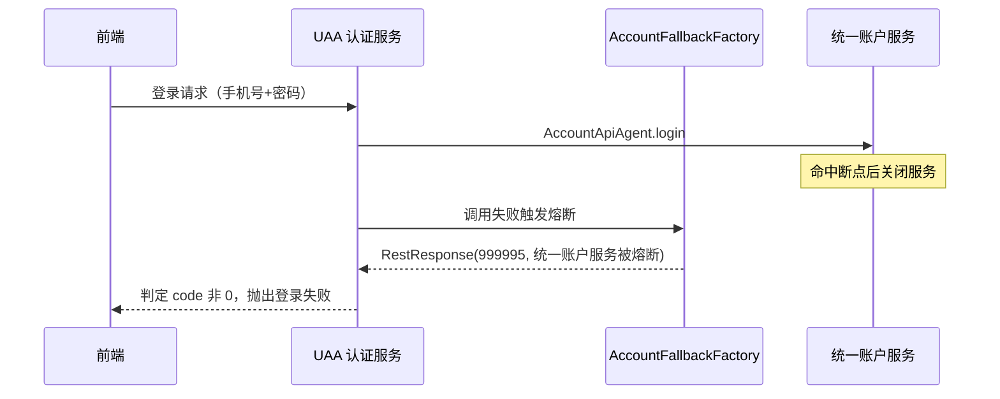

# 万信金融 P2P 项目熔断测试：断点里取证，看穿「登录失败」背后的降级真相

熔断代码写完，不等于熔断已经生效。测试这一课有个反直觉的桥段：把统一账户服务关掉再登录，前端弹出来的提示不是降级逻辑里写的「统一账户服务被熔断」，而是老熟人「登录失败」。如果只看前端现象，很容易误判熔断没生效、白写一场代码。真相藏在一层额外的异常处理里，只有靠断点才能取到证据。

## 先给结论

- 测试思路：在统一账户服务的 `AccountController.login` 方法上加断点，请求命中断点后把该服务关掉，让 UAA 发出的远程调用自然失败，触发熔断。
- 第一轮现象：前端显示「登录失败」，而不是降级响应里的「调用微服务-统一账户服务 被熔断」，与预期不符但并非熔断失效。
- 真相：降级确实发生了，`AccountFallbackFactory` 返回的 `RestResponse` 里 code 为 999995；UAA 的认证处理器检查到 code 非 0，抛出 `BadCredentialsException`，把提示替换成了「登录失败」。
- 第二轮在 UAA 的 `IntegrationUserDetailsAuthenticationHandler` 上加断点重测，能直接看到降级响应携带的 999995 与熔断描述，拿到降级已生效的铁证。
- 服务清单：Apollo 配置中心、Eureka 注册中心、UAA、统一账户、用户中心与前端工程；网关这一轮可以不启。测试时注意服务必须完成注册中心注册，刚启动就测会误报。

## 测试环境与用例设计

登录链路一次完整的交互要走五步：前端发起登录，UAA 认证服务受理，UAA 通过 Feign 代理 `AccountApiAgent` 远程调用统一账户服务校验密码，结果沿原路返回，前端拿到响应。把启动清单过一遍：Apollo 已经在跑，Eureka、UAA、统一账户、用户中心、前端工程全部提前启动，正常登录是通的，这不用再演示。网关在这条验证路径上不承担角色，暂时省掉。

熔断要人为制造故障才能现形。选哪一步下手？调用链上第 18 步，UAA 通过 Feign 调统一账户的那次请求，正是熔断器看守的位置。测试用例围绕它设计：



这张图讲的是故障注入点与两层响应的叠加：断点命中后关服务，让远程调用以连接失败告终；降级工厂接住失败返回兜底响应；UAA 的业务层再对这个兜底响应做一次判定。图的最后一跳是理解本轮测试的关键，前端看到的提示来自那一跳，而不是降级工厂。

## 第一轮：关服务触发熔断，看到的却是「登录失败」

操作顺序如下。在统一账户服务的 `AccountController.login` 方法第一行打断点，这是远程请求刚落到统一账户的位置；重启统一账户服务让它带着断点起来；等注册完成，从前端输入手机号与密码点击登录。

断点命中，说明请求正常抵达。此时把统一账户服务直接停掉，模拟服务宕机。UAA 那边等到的是连接失败，Feign 代理触发熔断，降级工厂返回兜底响应。刷新前端，弹出的提示是「登录失败」。

预期明明是「调用微服务-统一账户服务 被熔断」，怎么变成了「登录失败」？要回答这个问题，得回到 UAA 内部看登录逻辑的实现位置。UAA 里真正执行认证的是 `IntegrationUserDetailsAuthenticationHandler` 的 `authentication` 方法，它先从令牌里取出用户名与密码，做非空校验，然后远程调用统一账户服务进行密码校验，拿到响应后还有一段判定：

```java
// 远程调用统一账户服务，进行用户密码校验
RestResponse<AccountDTO> restResponse = accountApiAgent.login(accountLoginDTO);
// 检查响应码：降级兜底返回的 999995 同样不是 0，会被当成业务失败
if (restResponse.getCode() != 0) {
    throw new BadCredentialsException("登录失败");
}
```

这段判定本意是拦截账号或密码错误：业务失败时 `RestResponse` 的 code 非 0，抛出认证异常，前端展示「登录失败」。问题在于它只认 code 是不是 0，分不清「密码错了」和「统一账户被熔断了」。降级工厂返回的 code 是 999995，同样非 0，于是兜底响应里那句熔断描述在这一步被替换成了「登录失败」。前端显示没有错，它忠实地反映了这层判定的输出。

## 第二轮：断点取证，降级确实发生了

提示被替换不等于降级失效，需要证据。在 UAA 的 `IntegrationUserDetailsAuthenticationHandler` 里远程调用返回之后加一个断点，原断点保留。因为上一轮把统一账户关掉了，先把它重新启动，等它完成向注册中心的注册（服务刚起来还没注册完就点登录会失败，稍等片刻刷新前端再试），再次登录。

这次 UAA 侧的断点会命中。查看断点现场的 `restResponse` 对象：code 的值是 999995，msg 是「调用微服务-统一账户服务 被熔断」。这正是降级工厂里 `CommonErrorCode.E_999995` 封装出去的内容，两个断点前后接力，完整呈现了降级路径：远程调用失败，`AccountFallbackFactory.create` 被触发，兜底响应回到 UAA，随后在 handler 的判定里被换成「登录失败」。熔断生效、降级生效，前端看到的只是最终经过业务层加工的提示。

顺带把这个错误码族展开看一眼，项目在 `CommonErrorCode` 枚举里为各条链路预置了专属熔断码：`E_999991` 对应交易中心，`E_999993` 对应用户服务，`E_999994` 对应资源服务，`E_999995` 对应统一账户，`E_999996` 对应存管代理服务。哪条链路被熔断，降级响应里的码与描述就指向哪个服务，排查时一眼定位。

## 复盘：第八章收官，三套稳定性武器的分工

以登录链路熔断测试通过为标志，第八章微服务高级部分到此收官。回看这一章铺开的三套武器，各自站位不同：Sleuth 加 Zipkin 解决「出了问题在哪查」，链路数据落进 Elasticsearch，一次请求穿过哪些服务、耗时多少一目了然；Sentinel 解决「请求太多怎么办」，网关层限流把超量流量挡在入口；Hystrix 解决「下游挂了怎么办」，熔断降级保证调用方不被故障拖垮，快速失败返回兜底。限流管压力，熔断管故障，链路追踪管排查，三者拼出微服务稳定性的完整拼图。

这一课留下的方法论同样重要：验证熔断不能只看前端提示，因为提示可能经过多层加工；用断点沿调用链取证，降级响应的码与描述就是最直接的证据。

## 常见误区

- **把「登录失败」当成熔断没生效。** 错例：关掉统一账户后前端弹「登录失败」，判定降级代码白写，回头改代码。正解：降级响应的 code 非 0 会命中 handler 里的业务失败判定，提示被替换属正常行为，在 UAA 侧加断点确认 `restResponse` 携带 999995 即可取证。
- **断点命中后关服务，忘了重启就复测。** 错例：第二轮测试直接点登录，连「登录失败」都得不到。正解：统一账户被关后必须重新启动并完成注册中心注册，再进行下一轮测试。
- **服务刚启动就发请求。** 错例：统一账户重启完端口刚出来就登录，请求失败，误以为熔断配置有问题。正解：等服务在 Eureka 注册完成再测，注册有短暂延迟，刷新前端稍候即可。
- **只在统一账户侧加断点，UAA 侧不加。** 错例：只在被调服务断点观察，降级发生后调用方内部发生了什么完全看不到。正解：降级的证据在调用方手里，UAA 的 handler 断点才能看到兜底响应的原始内容。

## 面试可能被问到的问题

1. 面试官追问：「怎么设计一个测试用例来验证 Feign 熔断降级？」
   答：制造下游不可用即可。在被调服务的入口方法加断点，请求命中后停掉该服务，再发起一次调用；或者直接不启动被调服务。调用方应快速返回降级工厂的兜底响应而非超时报错，对照响应中的错误码与描述确认降级路径被执行。
2. 面试官追问：「降级返回了兜底响应，前端为什么看到的还是『登录失败』？」
   答：降级响应经过调用方业务层再加工。认证处理器只检查响应 code 是否为 0，降级兜底的 999995 同样非 0，于是抛出 `BadCredentialsException`，提示被统一替换成「登录失败」。降级与业务失败在 code 判定这一层被合并处理了。
3. 面试官追问：「这种提示合并是设计缺陷吗，怎么改进？」
   答：算可改进点。稳妥的做法是先判断响应是否来自降级（如维护专门的熔断错误码区间），熔断类错误直接透传「服务繁忙稍后再试」，与账号密码错误区分开；更进一步可以让 Feign 层抛出可区分的异常，由统一异常处理器按异常类型生成响应。
4. 面试官追问：「断点调试分布式调用链路有什么技巧？」
   答：在链路的每个服务各设一个关键断点，按调用顺序逐个命中，能完整看到请求在各跳的形态变化。注意远程调用断点会阻塞请求，验证超时与熔断行为时要控制断点停留时间；服务重启后必须等注册中心同步完成，否则现象会失真。
5. 面试官追问：「限流和熔断都保护系统，触发后返回给用户的东西有什么区别？」
   答：限流发生在流量入口，被拒请求根本没到业务层，返回的是框架层定义的阻断响应，如网关限流的 429 与 block exception；熔断发生在调用链路内部，返回的是降级工厂给出的业务结构兜底响应，错误码指向被熔断的服务，还可能被上层业务逻辑再次加工。

## 配套资料

- 讲义：`materials/docs/10/SpringCloud Hystrix服务熔断.md`，「4 万信金融 P2P 项目服务熔断」小节第 4 步「启动相关微服务，进行功能测试」；`materials/docs/10/day16-项目总结&就业指导v1.0.md` 中用户登录流程时序图（步骤 1 至 19）为测试用例的链路依据。
- 代码：`materials/code/10/完整代码/完整代码/shanjupay/shanjupay-uaa/shanjupay-uaa-service/src/main/java/com/shanjupay/uaa/integration/IntegrationUserDetailsAuthenticationHandler.java`，认证处理器类名与方法结构与课程口径一致，可作为 handler 分层的真实参照；`materials/code/10/shanjupay/shanjupay/shanjupay-common/src/main/java/com/shanjupay/common/domain/CommonErrorCode.java`，熔断错误码族 `E_999991` 至 `E_999994` 的真实定义。
- 说明：统一账户 `AccountController.login` 的断点位置、`E_999995`（统一账户服务被熔断）的码值与 UAA 侧 code 非 0 抛出「登录失败」的判定逻辑取自画面线口径，UAA 代码片段按本课写法补全，包名按 `com.study.finance` 系改写。
