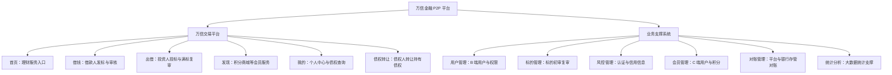
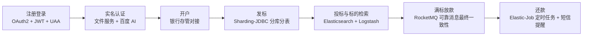

# 万信金融 P2P 项目课程总结：一张功能地图、一份技术栈全景、一条学习路径

万信金融 P2P 项目从搭建第一个微服务基础工程开始，到登录链路挂上 Hystrix 熔断，几十个课时全部走完。收尾这一课没有新知识点，价值在于把散落在各章的技术点重新串回业务主线：当初为什么引入 Apollo、为什么在放款环节上 RocketMQ、为什么检索要换 Elasticsearch，放回「一笔借款的完整旅程」里再看一遍，理解会完全不同。这一篇按功能地图、技术栈全景、学习路径三块做全项目收束。

## 先给结论

- 万信金融是一款面向互联网大众的 P2P 网贷平台（课程虚构产品），包含万信交易平台与业务支撑系统两个核心子系统，各分六个功能模块，服务借款人、投资人、平台运营人员三类角色。
- 技术栈的主轴是 Spring Cloud 微服务全家桶，再按业务痛点逐层加码：Apollo 管配置、Sharding-JDBC 管分库分表、TCC 与可靠消息管分布式事务、Elastic-Job 管定时任务、Elasticsearch 管标的检索、限流熔断链路追踪管稳定性、Docker Compose 管部署。
- 复习的最佳路径不是按章节倒序翻，而是按业务主线正向串：注册登录、实名认证、开户、发标、投标、满标放款、还款，每一站对应一组技术选型，能说清「为什么在这里用它」才算真的掌握。
- 讲项目的面试表达同样有主线：先说业务模式与角色，再说架构分层与微服务拆分，最后挑两三个技术难点（分布式事务、分库分表、认证授权）展开，切忌按技术名词罗列。

## 功能模块地图：两个子系统，三类角色

平台上有三类角色：借款人在平台发起网络借款，投资人对平台发布的借款标的进行购买，平台运营人员负责审核借款人与借款信息、处理日常运营。两个子系统的分工与模块划分如下：



这张图讲的是功能全景：左边一列面向 C 端交易，右边一列面向运营支撑。读图的重点是对账管理，它核对 P2P 平台与银行存管之间的账单是否一致，背后是项目的合规底座：监管要求采用银行存管模式，投资者资金由银行存管系统管理，每位用户在存管系统内有独立账号，平台管交易、银行管资金，资金与交易分离，平台碰不到钱。

## 一笔借款的旅程：业务主线串起全部技术点

模块地图是空间视角，时间视角是一条交易链：借款人注册登录后完成实名认证与开户，平台审核通过后发起借款（发标），标的信息经审核发布，投资人充值并投标，标的满标后平台复审放款，借款人到期还款，平台按还款计划自动扣款并提醒。把这条线与各章技术点对齐：



这张图讲的是业务链与技术选型的对应关系。逐站展开：注册与登录走 OAuth2 认证体系，UAA 认证服务签发 JWT 令牌，网关统一校验；开户要对接银行存管系统，跨系统调用的可靠性靠熔断降级兜底；借款标的量级增长后单库撑不住，交易中心用 Sharding-JDBC 做分库分表；标的检索走 Elasticsearch，Logstash 把数据同步进索引；满标放款横跨交易与存管多个服务，用 RocketMQ 事务消息实现最终一致性，开户阶段则用 Hmily 落地 TCC 模式解决注册链路的分布式事务；还款日当天的自动扣款由 Elastic-Job 分布式定时任务触发，配套短信提醒，还款消息的消费靠 Redis 保证幂等，防止重复扣款。

## 技术栈全景：一条主轴，六个加码方向

课程讲义把技术方案归纳为十几条，按职责归组之后脉络更清楚。主轴是微服务架构本身：Spring Boot 加 Swagger 定接口规范，MyBatis-Plus 做持久层，Spring Cloud 全家桶承担注册发现、远程调用、网关路由，Apollo 做分布式配置中心。在此之上按六个方向加码：认证授权方向是 Spring Security Oauth2 加 JWT 加 Zuul；数据方向是 Sharding-JDBC 分库分表；一致性方向是 TCC、可靠消息最终一致性、最大努力通知三种方案按场景混用；任务与检索方向是 Elastic-Job 加 Elasticsearch 加 Logstash；稳定性方向是 spring-cloud-zuul-ratelimit 与 Sentinel 限流、Hystrix 熔断、Sleuth 加 Zipkin 链路追踪；交付方向是 Docker Compose 部署加 Gogs 加 Jenkins 持续集成。安全交易全程贯穿 HTTPS 与 SHA1withRSA 签名。

各服务接入这套体系的方式高度统一，可以浓缩成一份配置样板。每个微服务的 `application.yml` 都长这个样子，Apollo 的命名空间列表就是该服务技术栈的清单：

```yaml
app:
  id: consumer-service
apollo:
  bootstrap:
    enabled: true
    # 命名空间列表即该服务用到的技术栈清单
    namespaces: application,micro_service.spring-boot-http,micro_service.spring-eureka,micro_service.spring-ribbon,micro_service.spring-hystrix,micro_service.spring-boot-redis,micro_service.mybatis-plus,micro_service.spring-rocketmq
```

配置中心化之后，连限流规则这类运营参数都进了 Apollo，网关从配置中心拉取 Sentinel 规则，改阈值只需发布配置，不用重启服务：

```json
[
  {
    "resource": "uaa-service",
    "resourceMode": 0,
    "grade": 1,
    "count": 2,
    "intervalSec": 1,
    "controlBehavior": 0,
    "burst": 0,
    "maxQueueingTimeoutMs": 500,
    "paramItem": {}
  }
]
```

这两段配置放在一起，恰好体现了整个项目的方法论：技术选型服务于业务场景，配置统一托管，代码里只留业务逻辑。

## 学习路径建议：三段式消化这个项目

**第一段，跑通主干。** 从开发环境搭建、微服务基础工程、Apollo 集成开始，把注册、登录、认证拦截这条链路亲手走一遍。这一段的目标是建立「配置中心加多服务协作」的体感，理解每个服务为什么独立部署、配置为什么不下发到代码里。

**第二段，攻坚难点。** 分布式事务（Hmily 的 TCC 与 RocketMQ 的可靠消息）、分库分表、Elasticsearch 检索、分布式任务调度，这四块是中级工程师与初级工程师的分水岭，也是最值得反复啃的部分。学的时候盯住触发场景：不是为用而用，是单库容量不够才分库分表，跨服务写操作才需要事务方案，数据量到了千万级才需要换检索引擎。

**第三段，生产化收尾。** 部署文档、Docker Compose、Gogs 加 Jenkins 持续集成、限流熔断与链路追踪，这一段把「能跑的 demo」推向「可上线的系统」。稳定性三板斧（限流、熔断、追踪）建议用本系列的方式亲手测一遍：压一次网关看 429，关一次下游服务看降级，翻一次 Zipkin 看调用链。

面试表达上，介绍这个项目建议控制在三分钟内：业务模式一句话（P2P 网贷，银行存管模式），架构一句话（前后端分离的 Spring Cloud 微服务，配置中心 Apollo，认证 OAuth2 加 JWT），难点挑两个展开（比如满标放款的分布式事务方案选型、交易中心分库分表的设计），有始有终。

## 常见误区

- **把项目当成 CRUD 练习。** 错例：复述项目时只说「做了注册登录、发标投标几个页面」。正解：这个项目的价值在分布式场景的工程决策，每个模块背后都有「为什么不用单机方案」的理由，讲项目要讲决策而不是讲功能清单。
- **跳过业务直接背技术。** 错例：能背出 TCC 三个阶段，却说不出项目里哪条链路用了 TCC、为什么。正解：把开户注册链路（TCC）与满标放款链路（可靠消息最终一致性）各自的事务场景讲清楚，技术点才有落点。
- **技术栈当成平等清单。** 错例：面试时把十几个技术名词一口气报完。正解：分主次，Spring Cloud 加 Apollo 是主轴，其他按「业务痛点驱动引入」的逻辑分层叙述，报清单式介绍只会暴露理解深度不足。
- **认为课程结束等于掌握。** 错例：跟着视频敲完就翻篇。正解：脱离视频独立搭一遍环境、独立实现一条交易链路，再对照部署文档把整套系统用 Docker Compose 拉起来，三件事做完才算真正消化。

## 面试可能被问到的问题

1. 面试官追问：「用两分钟介绍一下你做过的最有代表性的项目。」
   答：万信金融是一个 P2P 网贷平台，采用银行存管模式，平台管交易、银行管资金。系统是前后端分离的 Spring Cloud 微服务架构，Apollo 做配置中心，OAuth2 加 JWT 做认证授权，包含注册登录、开户、发标、投标、满标放款、还款的完整交易链路。我负责的部分横跨统一账户、UAA、交易中心等微服务，重点解决了跨服务事务一致性与标的检索性能问题。
2. 面试官追问：「项目里为什么同时存在 TCC 和可靠消息两种分布式事务方案？」
   答：两种方案适配不同场景。开户注册链路要求强一致且需要 try、confirm、cancel 三阶段的业务预留动作，用 Hmily 落地 TCC；满标放款链路涉及交易、存管多个系统，业务上允许短暂不一致但对可靠性要求极高，用 RocketMQ 事务消息实现最终一致性，配合消息回查保证不丢。按场景选方案而非一刀切，是项目的核心设计决策之一。
3. 面试官追问：「这个项目最难的技术点是什么？」
   答：满标放款的事务问题。放款要更新标的状态、生成还款计划、生成投资人应收明细，还涉及与存管系统的资金交互，任何一步失败都会造成数据不一致。方案是 RocketMQ 事务消息加本地事务：半消息先发送，本地事务执行成功后提交消息，消费方幂等消费，失败靠回查与重试兜底，最终达成一致。
4. 面试官追问：「平台的资金安全靠什么保证？」
   答：三个层面。业务层面采用银行存管模式，用户资金在银行存管系统内流转，平台接触不到资金；交易层面全程 HTTPS 加 SHA1withRSA 签名防篡改；数据层面用 Redis 幂等防止重复扣款，对账管理模块定期核对平台与存管系统的账单一致性。
5. 面试官追问：「系统上线后如何保障稳定性？」
   答：三层防线。入口层 Sentinel 加 Zuul 限流，超量请求在网关被挡下；调用层 Hystrix 熔断降级，下游故障时调用方快速失败返回兜底响应，防止雪崩；观测层 Sleuth 加 Zipkin 链路追踪，链路数据落 Elasticsearch，配合日志能快速定位故障服务。三者覆盖了限流、容错、排查三个环节。
6. 面试官追问：「接下来怎么继续提升？」
   答：三个方向。把项目里未覆盖的深水区补上，例如更大规模下的分库分表扩容与在线数据迁移；跟进技术栈的新版本生态，理解 Hystrix 进入维护期后 Sentinel、Resilience4j 等替代方案的取舍；用 DevOps 把部署链路自动化做深，从 Docker Compose 走向容器编排与流水线发布。

## 配套资料

- 讲义：`materials/docs/10/day16-项目总结&就业指导v1.0.md`，系统角色、功能架构两子系统十二模块、技术架构与十几条技术解决方案、整体业务与关键业务描述均出自此处；`materials/docs/10/项目实战整体安排.md` 提供各阶段实战安排对照。
- 代码：`materials/code/10/wanxinp2p/` 与 `materials/code/10/wanxinp2p_apollo/`，万信金融工程归档（目录保留原始命名，路径只列到该层级），含注册中心、网关、统一账户消费端等模块与 `RestResponse`、工具类等公共代码；`materials/code/10/完整代码/`、`materials/code/10/基准代码/` 归档了闪聚支付与 UAA 认证体系的完整工程，认证处理器等类可作为结构参照。
- 说明：功能模块与技术方案口径出自讲义，各章技术点的落地细节见本系列前序各篇；文中 `application.yml` 取自工程归档真实文件，Sentinel 网关规则 JSON 沿用本系列网关限流一篇的讲义口径。
