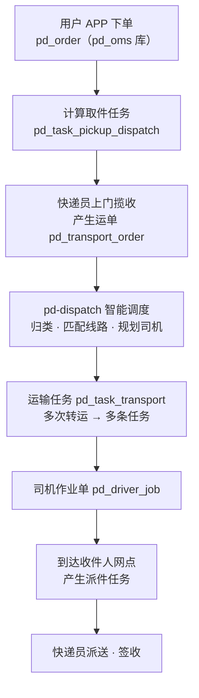
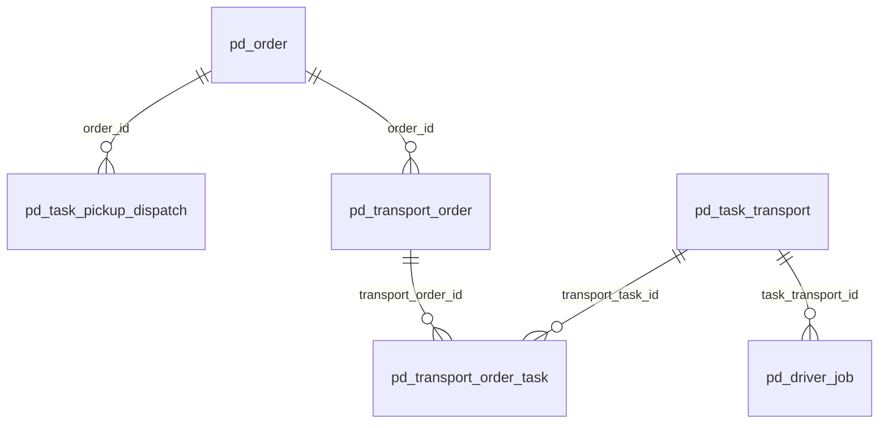

# 作业中心服务：从下单到签收，五张表串起物流核心数据链

品达物流 TMS 项目进入第五章，主角是作业中心服务，对应的 Maven 工程叫 `pd-work`，依赖的数据库也叫 `pd_work`，里面一共五张表。这一章在代码层面并不复杂——五张表的增删改查在导入的初始工程里已经全部提供好，接口的开发过程也写在讲义中，课堂上不再重复造轮子；真正的重点是业务梳理：这五张表各自记录什么、彼此如何关联。它们承载的是整个物流系统最核心的运行数据，值得花一整章来捋清楚。

## 先给结论

- 作业中心服务对应工程 `pd-work`、数据库 `pd_work`，共五张表：取件/派件任务表 `pd_task_pickup_dispatch`、运单表 `pd_transport_order`、运输任务表 `pd_task_transport`、运单与运输任务关联表 `pd_transport_order_task`、司机作业单表 `pd_driver_job`。
- 用"客户从下单到收货"这条业务主线，可以把五张表的产生顺序完整串起来：订单 → 取件任务 → 运单 → 运输任务 → 司机作业单 → 派件任务。
- 取件任务和派件任务共用一张表，靠 `task_type` 字段区分；表里还有签收状态、取消时间等字段，覆盖派送与订单取消两类分支场景。
- 一个运单往往要经历多次转运才能到达目的地，每次转运对应一个运输任务，所以运单与运输任务是一对多关系，中间靠 `pd_transport_order_task` 维护。
- 运输任务只说明"有这么个事"——哪个车次、从哪个机构到哪个机构、用哪辆车；具体由哪个司机执行，落在司机作业单 `pd_driver_job` 上，司机通过移动端看到作业单后照单执行。
- 运输任务的数据不是人工录入的，而是 `pd-dispatch` 调度服务基于订单、运单数据自动计算后写入；匹配不到线路的运单才转人工干预。

## 主线：一票快递的数据流转

五张表不是孤立的，以客户寄件为起点，可以把整条链路上的数据产生过程完整捋一遍：

1. **下单**：用户在手机 APP 上寄件，点下单后产生订单，保存在 `pd_oms` 库的 `pd_order` 表——这张表在前面的订单章节已经见过。
2. **产生取件任务**：系统根据寄件人地址算出坐标，定位到负责的网点，再从网点里选出合适的快递员，产生一条快递员取件任务，写入 `pd_task_pickup_dispatch`。
3. **揽收产生运单**：快递员上门揽件、把货物取走，产生运单，写入 `pd_transport_order`。用户之后凭运单号查询物流信息，靠的就是这条记录。
4. **计算运输任务**：调度服务 `pd-dispatch` 基于订单和运单做归类、线路匹配、司机规划，把运送过程分解成一个个运输任务，写入 `pd_task_transport`。
5. **记录运单与任务的关联**：一票货通常不是一次运转就能从寄件人直达收件人，中间有多个运转环节，每个环节都是一个运输任务；运单与这些运输任务的关联关系，记在 `pd_transport_order_task`。
6. **落地为司机作业单**：每个运输任务再计算产生司机作业单 `pd_driver_job`；货物到达收件人所在网点后，系统计算产生派件任务（仍写 `pd_task_pickup_dispatch`，任务类型为派件），最后由快递员派送、签收。

对应到表关系上，就是下图这张 ER 图：

## 逐表拆解

### pd_task_pickup_dispatch：取件、派件共用一张任务表

快递员的取件任务和派件任务都保存在这一张表里，用 `task_type` 区分。表结构如下：

| 字段 | 说明 |
| :--- | :--- |
| `id` | 主键 |
| `order_id` | 关联订单 id，取件也好派件也好，都必须挂在一个订单上 |
| `task_type` | 任务类型：1 取件任务，2 派件任务 |
| `status` | 任务状态：待执行、进行中、待确认、已完成、已取消 |
| `sign_status` | 签收状态：已签收 / 已拒收 |
| `agency_id` | 机构（网点）id |
| `courier_id` | 快递员 id |
| `estimated_start_time` / `actual_start_time` | 预计开始时间 / 实际开始时间 |
| `estimated_end_time` / `actual_end_time` | 预计完成时间 / 实际完成时间 |
| `confirm_time` / `cancel_time` | 确认时间 / 取消时间 |
| `assigned_status` | 任务分配状态：未分配、已分配、待人工分配 |
| `mark` / `create_time` | 备注 / 创建时间 |

重点字段是三个关联字段：`order_id` 说明这个任务是针对哪个订单，`agency_id` 说明由哪个网点负责——取件、派件最终都是由某个网点来承担的，`courier_id` 说明由哪个快递员执行。

时间字段分两组：预计与实际的开始、完成时间，再加上确认时间和取消时间。取消时间的存在很自然——订单可能被取消，订单一取消，对应的任务也就不用执行了。

`assigned_status` 值得单独说一下。正常情况下不可能靠人工去一个一个分派快递员，效率太低；客户下完单，程序就会自动产生这条任务数据并由系统自动分配。所以这个字段有三种状态：还未分配、已分配、待人工分配——只有系统没分配成功时，才需要人工介入指定快递员兜底。

### pd_transport_order：运单表，结构最简单的一张表

运单产生的时机很明确：快递员上门揽收、把货物取走的那一刻。这张表是五张表里最简单的：

| 字段 | 说明 |
| :--- | :--- |
| `id` | 主键，即运单号 |
| `order_id` | 关联订单 id——运单基于订单产生 |
| `status` | 运单状态：新建、已装车、到达、到达终点（终端）网点、已签收、拒收，共六种 |
| `scheduling_status` | 调度状态：待调度、未匹配到线路、已调度 |
| `create_time` | 运单产生时间 |

`status` 描述运单本身走到哪一步了；而 `scheduling_status` 描述的是调度环节的进展。货物被揽收回网点之后怎么走，由调度中心 `pd-dispatch` 接手：订单归类、线路匹配、规划司机、产生司机作业单，最终由司机装车发运。整个流程由程序自动调度，因为每天的业务量非常庞大，人工逐单分配效率实在太低。调度程序工作时需要查询当前产生了哪些运单，再据此做调度，所以表里专门记录每个运单的调度状态。万一没匹配到线路，就需要人工干预看看这单怎么处理——但一般情况下都能调度成功。

### pd_task_transport：字段最多的运输任务表

运输任务基于前面已经产生的运单和订单计算产生，数据由调度模块自动写入 `pd_task_transport`，不是人工通过表单录进去的。这张表字段很多，挑重点看：

| 字段 | 说明 |
| :--- | :--- |
| `id` | 主键 |
| `transport_trips_id` | 车次 id，逻辑外键；车次基础数据在 `pd_base` 库的车次信息表（`pd_transport_trips`）里 |
| `start_agency_id` | 起始机构 id |
| `end_agency_id` | 目的机构 id |
| `status` | 任务状态：待执行、进行中、待确认、已结束 |
| `assigned_status` | 任务分配状态 |
| `loading_status` | 装载状态，反映车辆空载、半载、满载及装卸进度 |
| `truck_id` | 执行车辆 id |
| `cargo_pick_up_picture` 等 | 提货凭证、回单凭证、交付货物照片，均需拍照上传 |
| `delivery_latitude` / `delivery_longitude` | 交付地点经纬度，与提货坐标一起构成作业位置的留痕 |
| `plan_*` / `actual_*` 系列 | 计划与实际的发车、到达、提货、交付时间 |
| `create_time` | 创建时间 |

核心逻辑体现在三个关联字段上。运输任务是一个动态概念，必须由某个车次来负责，所以 `transport_trips_id` 是逻辑外键——真正的车次表在 `pd_base` 基础数据库里。`start_agency_id` 和 `end_agency_id` 描述"从哪个机构转到哪个机构"，这里的机构既可能是网点，也可能是转运中心：寄件人所在网点到所在城市的转运中心是第一个运输任务，收件人所在城市的转运中心到收件人所在网点又是另一个任务。一票货经过多次转运，就被拆解成多条运输任务记录，最终到网点后再分配给快递员派送。

### pd_transport_order_task 与 pd_driver_job：关联表和司机作业单

关联表 `pd_transport_order_task` 一共只有三个字段：`id` 主键、`transport_order_id` 运单 id、`transport_task_id` 运输任务 id，是一个典型的中间关系表。它存在的原因前面已经反复出现：一个运单要经过多次运转才能把货送到客户手中，每次运转产生一个运输任务，所以一个运单会关联多个运输任务，这层关系必须有表来保存。

司机作业单表 `pd_driver_job` 回答的是另一个问题。运输任务表里只记录了车辆 id、车次 id 这些信息，并没有记录由哪个人去负责——它只说明"有这么一个事要做：从某个网点到某个网点（或转运中心）"，具体由谁实施，落在司机作业单上。司机开着某辆车，从某个网点或转运中心出发，拉着货物到另外一个机构卸货，这就是一次作业；司机通过移动端应用看到自己的作业单，按单实际执行即可。

| 字段 | 说明 |
| :--- | :--- |
| `id` | 主键 |
| `start_agency_id` / `end_agency_id` | 起始机构 / 目的机构 id |
| `status` | 作业状态：待执行、进行中、待确认、已结束 |
| `driver_id` | 执行司机 id |
| `task_transport_id` | 关联运输任务 id，逻辑外键指向 `pd_task_transport` 主键 |
| `start_handover` / `finish_handover` | 提货对接人 / 交付对接人，普通字符串 |
| `plan_departure_time` / `actual_departure_time` | 计划发车时间 / 实际发车时间 |
| `plan_arrival_time` / `actual_arrival_time` | 计划到达时间 / 实际到达时间 |
| `create_time` | 创建时间 |

这张表的设计里有明显的冗余：`start_agency_id`、`end_agency_id` 与运输任务表重复出现。这是有意为之的冗余设计，目的是便于计算。重点字段有四个：起止机构 id 记录"从哪到哪"，`driver_id` 记录"谁来干"，`task_transport_id` 记录"这个作业是为完成哪个运输任务而产生的"。

工程侧没有任何悬念：`pd-work` 服务的 `bootstrap.yml` 已配好（端口 8080），五张表的增删改查接口在初始工程里都是现成的，照着讲义就能对上号。

## 小结

作业中心服务这一章的价值不在代码而在模型：五张表分别对应物流作业链上的五类核心实体——任务、运单、运输任务、关联关系、司机作业单，`pd_order` 订单数据从 `pd_oms` 库流入，作为整条链的源头。设计上有两个值得记住的取舍：其一，取件与派件共用一张表、运单与运输任务一对多靠中间表维护，都是"一类业务一张表、关系单独建表"的常规解法；其二，司机作业单冗余了起止机构字段，用可控的冗余换取查询计算效率。把"下单 → 取件 → 运单 → 运输任务 → 作业单 → 派件"这条主线记住，后续调度中心（`pd-dispatch`）如何自动计算出这些任务数据，就有了清晰的落点。
