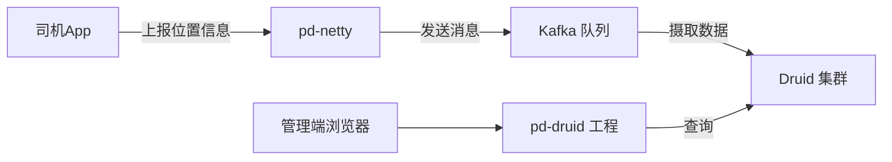
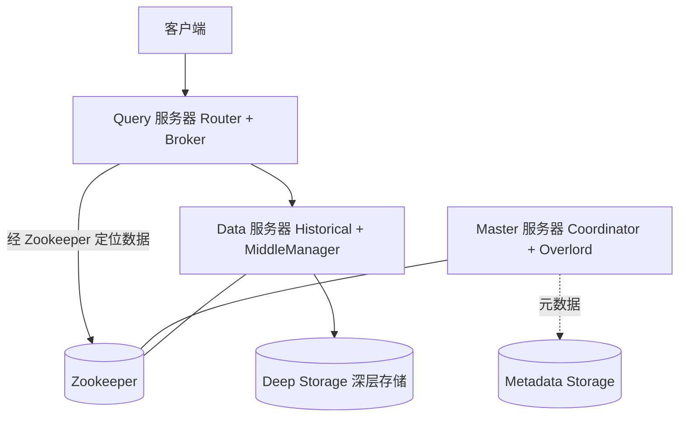

# 车辆轨迹服务为什么选 Apache Druid：架构、数据结构与安装全流程

品达物流 TMS 项目进入第七章——车辆轨迹服务开发，对应两个 Maven 工程：pd-netty 负责接收司机端上报的位置信息，pd-druid 负责对接存储并对外提供查询。支撑这条链路的存储引擎是 Apache Druid。先说清楚一点：它与阿里巴巴那个同名的 Druid 连接池没有任何关系，只是单词一样，属于两个完全不同的技术。本篇把第七章的前置知识一次讲完：Druid 是什么、为什么轨迹数据适合用它、进程与数据结构长什么样，以及依赖环境如何安装并验证。

## 先给结论

- Apache Druid 是一个开源、分布式、高性能的实时数据分析数据存储系统。它本质上也在存数据，可以粗略当成一个数据库，但面向的是分析场景，不是 MySQL 那种订单、交易流水式的业务明细存储。
- 它适合的典型场景有六类：插入频繁但很少更新、大多数查询是聚合（group by）和报告性质、查询延迟要求在 100 毫秒到几秒、数据自带时间戳、存在需要快速计数排名的高基数列、数据从 Kafka/HDFS/文件/对象存储加载。
- 车辆轨迹服务逐条命中：每隔几秒采集一次车辆经纬度写入 Druid，写进去就基本不再更新；管理端按时间段做聚合查询。
- 架构上它是多进程分布式系统：六类常用进程（Coordinator、Overlord、Broker、Router、Historical、MiddleManager），每个进程可独立配置和扩展，官方建议按 Master / Query / Data 三类服务器组织部署。
- 数据被组织成段（segment），存在类似"表"的数据源里，列分三类：时间戳列、维度列、指标列；摄取时可以按指标列自动预聚合，10 万条明细进去可能只剩几百条。
- 依赖环境按 JDK → Zookeeper → Kafka → Druid 的顺序装，Zookeeper 和 Kafka 直接用 Docker 容器跑，Kafka 装完可以用自带脚本收发消息验证。

## Druid 是什么：面向实时分析的存储系统

官方的定义只有一句话：Apache Druid 是一个开源、分布式、高性能的实时数据分析的数据存储系统。落点在"数据存储系统"，所以可以把它当数据库看，但它与 MySQL、Oracle 这类关系型数据库的分工完全不同：

- 关系型数据库存的是业务数据：订单、交易流水，一条一条记录，面向事务操作。
- Druid 面向分析：从海量数据里按各种维度聚合，最终提取出结果。它能快速实现查询与数据分析，具备高可用、高拓展能力。

高可用来自分布式部署，多个节点互相兜底；高拓展则来自它的存储设计：数据既可以存本地磁盘，也可以挂到深层存储（deep storage），后端对接 HDFS 这类分布式存储平台。接上 HDFS 之后，理论上存储能力可以无限扩展，数据量级与传统数据库完全不是一个概念。更多细节可参考官方中文网站 http://www.apache-druid.cn/。

常见应用领域包括：点击流分析（web 和移动端行为分析）、网络遥测分析（网络性能监控）、服务器指标存储、供应链分析（制造指标）、应用程序性能度量、数字营销/广告分析、商业智能/联机分析处理。共同点都是海量数据加多维度聚合。

落到本项目的车辆轨迹上，为什么关系型数据库扛不住？司机在运输途中每隔几秒上报一次经纬度，这个数据量非常庞大；而且坐标一旦采集进来，那个时刻出现在那个位置就已经定死了，几乎不存在更新操作——正是"插入频繁、更新很少"的典型形态。完整的数据链路如下：



两条链路各管一头。写入侧：司机 App 上报位置到 pd-netty，pd-netty 不直连 Druid，而是把定位消息发到 Kafka 队列，由 Druid 摄取入库。查询侧：管理平台想知道某个司机在某个时间点的位置，通过 pd-druid 工程连接 Druid 服务查询，结果返回浏览器展示。一个管存储，一个管查询，场景就这么多。

## 进程与服务：六类进程、三类服务器

Druid 是多进程分布式架构，每个进程都可以独立配置和扩展，部署方式灵活——六台服务器每台跑一个进程可以，三台服务器每台跑两个进程也可以。为了便于部署，官方建议按三类服务器组织：

| 服务器角色 | 运行的进程 | 职责 |
| --- | --- | --- |
| Master 主服务器 | Coordinator、Overlord | 管理数据可用性与摄取工作负载分配 |
| Query 查询服务器 | Broker、Router（可选） | 处理来自外部客户端的查询请求 |
| Data 数据服务器 | Historical、MiddleManager | 数据采集以及存储所有历史查询数据负载 |

六个进程各自的分工：

| 进程 | 职责 |
| --- | --- |
| Coordinator | 管理集群上的数据可用性 |
| Overlord | 控制数据摄取工作负载的分配 |
| Broker | 处理来自外部客户端的查询请求 |
| Router | 可选进程，把请求路由到 Brokers、Coordinators 和 Overlords |
| Historical | 存储历史查询到的数据 |
| MiddleManager | 负责摄取数据，如从文件或 Kafka 队列实时摄取 |

除了这六个进程，整套服务跑起来还需要三个外部依赖：

- **Zookeeper**：所有进程都要与它通信，负责服务协调，比如高可用场景下的选主。
- **Deep storage（深层存储）**：可以是 HDFS、本地磁盘，也可以是阿里云、亚马逊这类对象存储。数据副本安全地存放在这里，即使服务器故障也能从中恢复，所以不会丢数据。
- **Metadata storage（元数据存储）**：默认使用 Druid 内置的数据库，也可以自己装一个 MySQL 来存元数据，取决于配置文件怎么配。

架构与交互大致如下：



一条查询的完整路径：客户端请求先到查询服务器，由 Router 接住并路由给 Broker；Broker 与 Zookeeper 交互得知数据存在哪里，再请求数据服务器上的 Historical 或 MiddleManager；这两个进程与深层存储交互拿到数据，最终返回客户端。架构图里三类箭头各有所指：实线是 query（查询），虚线是 metadata（元数据），点划线是 data segment（数据段）。服务启动后，从启动日志和 Druid 自带的管理界面都能看到这些进程的存在。

## 数据结构：segment、数据源与三类列

Druid 中所有数据都被组织成段（segment），段对应数据文件，通常每个段最多有几百万行。一个段圈多大范围可以自己配置：按日配置就是一天的数据成一个段，按周配置就是一周一个段。

"加载数据"在 Druid 里叫摄取（ingestion）：从源系统（Kafka、外部数据文件等）读取数据并基于它创建段。大多数摄取方式下，具体干活的是 MiddleManager 进程。

摄取来的数据存在一个叫数据源（datasource）的逻辑对象里，把它直接类比为关系型数据库里的"表"即可。数据源的列分成三类：

| 列类型 | 存储方式 | 用途 |
| --- | --- | --- |
| 时间戳列（timestamp column） | 单独处理，每行必须有时间戳 | 所有查询围绕时间轴进行；判断数据归属哪一天、按时间分段都靠它 |
| 维度列（dimension columns） | 按原样存储 | 数据属性，类似表的普通字段，查询时用于分组、筛选或聚合 |
| 指标列（metric columns） | 以聚合形式存储 | 可衡量的数据，用于 count、sum 等聚合计算 |

时间戳是强制的：两条数据是不是同一天的，看的是时间戳本身，跟数据是几点摄取进来的没有关系。维度列可以在查询时以特殊方式进行分组、筛选；指标列做统计运算。

三类列组合起来，就产生了 Druid 很有代表性的行为——采集时自动汇总（预聚合）。举例：摄取 10 万条订单明细，存进 Druid 之后可能只剩几百条甚至更少，因为摄取的同时就按指标列做了 count、sum 这类聚合，真正存储下来的是聚合之后的统计数据。按哪些列聚合由配置控制。这个特性既节省存储成本，也直接提升查询性能。

## 安装：JDK → Zookeeper → Kafka → Druid

Druid 本质上也是一个服务，安装前先把依赖环境备齐：JDK、Zookeeper、Kafka。

**1. JDK 安装**

```bash
# 解压到 /usr/local
tar -zxvf jdk-8u191-linux-x64.tar.gz -C /usr/local/

# 编辑 /etc/profile，追加环境变量
vi /etc/profile
export JAVA_HOME=/usr/local/jdk1.8.0_191
export PATH=$JAVA_HOME/bin:$PATH

# 使配置生效并验证
source /etc/profile
java -version
```

**2. Zookeeper 安装（Docker 容器化）**

```bash
# 启动 Zookeeper 容器，映射 2181 端口和时区文件
docker run -id --name my_zookeeper -p 2181:2181 -v /etc/localtime:/etc/localtime zookeeper:3.4.14

# 查看启动日志，确认绑定 2181 且无报错
docker logs -f my_zookeeper
```

容器启动时间非常快，日志无报错、能看到绑定到 2181 端口即为成功。

**3. Kafka 安装（Docker 容器化）**

Kafka 是大数据领域常用的消息队列，同类产品有 ActiveMQ、RabbitMQ、RocketMQ，区别在于 Kafka 吞吐量极大，所以在大数据场景用得多。这里用它承接车辆定位消息。

```bash
# 拉取镜像，不指定版本号会拉取最新的 latest（镜像有几百兆，需要等一会）
docker pull wurstmeister/kafka

# 启动容器，注意把命令里的服务器 IP 换成你自己的（Zookeeper 就装在这台机器上）
docker run -d --name kafka -p 9092:9092 \
  -e KAFKA_BROKER_ID=0 \
  -e KAFKA_ZOOKEEPER_CONNECT=68.79.63.42:2181 \
  -e KAFKA_ADVERTISED_LISTENERS=PLAINTEXT://68.79.63.42:9092 \
  -e KAFKA_LISTENERS=PLAINTEXT://0.0.0.0:9092 \
  -v /etc/localtime:/etc/localtime \
  wurstmeister/kafka

# 查看启动日志，确认注册了 broker 且无报错
docker logs -f kafka
```

启动参数的含义：

| 参数 | 说明 |
| --- | --- |
| KAFKA_BROKER_ID=0 | 集群中每个 broker 的唯一标识，用来区分各个 broker |
| KAFKA_ZOOKEEPER_CONNECT | 配置由 Zookeeper 来管理 Kafka |
| KAFKA_ADVERTISED_LISTENERS | 把 Kafka 的地址端口注册给 Zookeeper |
| KAFKA_LISTENERS | Kafka 自己监听的端口，默认 9092 |
| -v /etc/localtime:/etc/localtime | 容器时间与宿主机保持一致 |

**4. 验证 Kafka：创建队列、收发消息**

日志不报错只能说明进程起来了，具体能不能正常工作还要实测一遍。

```bash
# 进入 Kafka 容器
docker exec -it kafka /bin/bash

# Kafka 根目录在 /opt 下，进到带版本号目录的 bin 里
# 注意：镜像拉的是 latest，目录里的版本号以容器内实际为准
cd /opt/kafka_2.12-2.5.0/bin/

# 创建测试队列：副本数 1、分区数 1，IP 换成自己的
./kafka-topics.sh --create --zookeeper 68.79.63.42:2181 --replication-factor 1 --partitions 1 --topic test

# 查看 topic 列表，确认 test 创建成功
./kafka-topics.sh --list --zookeeper 68.79.63.42:2181

# 窗口一：启动消费者监听 test 队列（--from-beginning 表示队列里已有的消息也从头消费）
./kafka-console-consumer.sh --bootstrap-server 68.79.63.42:9092 --topic test --from-beginning

# 窗口二：启动生产者向 test 队列发送消息
./kafka-console-producer.sh --broker-list 68.79.63.42:9092 --topic test
```

消费者命令会独占终端进入监听状态，所以要另开一个窗口跑生产者。生产端输入 1、2、3，每敲一次回车，消费端就立即输出一条——消息收发正常，Kafka 服务验证通过。这两个 console 脚本只是调试用的，生产环境会用 Java 程序编写监听器来消费队列并做业务处理。

**5. Druid 本体**

依赖环境就绪后，下载并解压 Druid 本体备用：

```bash
cd /root
wget https://archive.apache.org/dist/incubator/druid/0.15.0-incubating/apache-druid-0.15.0-incubating-bin.tar.gz
tar -zxvf apache-druid-0.15.0-incubating-bin.tar.gz
mv apache-druid-0.15.0-incubating-bin druid
```

## 小结

第七章的选型逻辑可以串成一条线：车辆定位数据每隔几秒采集一次、写入后不再更新、查询以时间段聚合为主——这正好逐条命中 Druid 的适用场景（插入频繁很少更新、聚合查询、数据带时间戳、从 Kafka 加载数据）。架构上记住六类进程与三类服务器的对应关系：Master 跑 Coordinator + Overlord，Query 跑 Broker + Router，Data 跑 Historical + MiddleManager；三个外部依赖各司其职，Zookeeper 管协调，Deep storage 存数据副本，Metadata storage 存元数据。数据结构上，segment 是存储单位，数据源类比"表"，时间戳列、维度列、指标列三类列分工明确，摄取时还能按指标列预聚合来省存储、提性能。环境搭建按 JDK → Zookeeper → Kafka → Druid 的顺序推进，Kafka 用自带脚本收发消息验证通过后，依赖环境就全部就绪，可以进入下一步的数据摄取。
