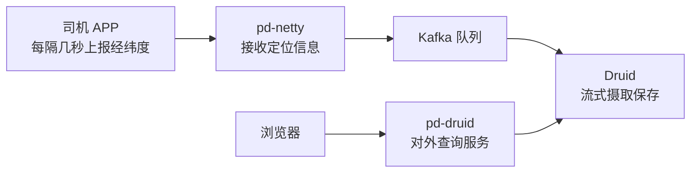

# Apache Druid 实战：单机安装、本地与 Kafka 双路摄取、Java 客户端查询

品达物流 TMS 项目第七章要开发车辆轨迹服务，数据落到哪是第一个要解决的问题：司机端每隔几秒上报一次经纬度，这种带时间戳、写入频繁、按时间维度聚合分析的数据，交给时序数据库 Druid 存最合适。这一篇先把 Druid 在单机服务器上装起来并启动，再通过三个本地文件案例和一个 Kafka 案例把"摄取数据"讲透，最后在 Java 程序里把数据查出来，为轨迹服务打好底座。

## 先给结论

- Druid 不走 Docker，直接下载 `apache-druid-0.15.0-incubating-bin.tar.gz` 解压使用；单机演示用 `start-single-server-small` 脚本一次拉起 coordinator、overlord、broker、router、historical、middleManager 六个进程，光启动就吃掉约 8G 内存，服务器至少要预留 16G。
- 配置改四处：`bin/verify-default-ports` 去掉 2181 端口检查、`small.conf` 注释掉内置 ZooKeeper、`common.runtime.properties` 把 host 和 ZK 地址改成 127.0.0.1、各进程的 `jvm.config` 统一时区 `UTC+8`。
- 摄取数据分两条路：控制台 Tasks 页提交一次性任务做本地文件批量摄取；Submit supervisor 提交常驻任务做 Kafka 流式摄取。
- 本地文件三个案例层层递进：向导生成摄取规范 → 手写规范开启 rollup 上卷聚合（9 行原始数据聚成 5 行）→ transform 表达式加 filter 过滤做摄取期清洗（4 行变 3 行）。
- 数据摄取规范（JSON）是贯穿全程的核心：type、dataSource、parser、metricsSpec、granularitySpec、ioConfig 各管一段，向导只是帮你生成它，真正要会的是看懂和改造。
- Java 端用 Calcite Avatica 的 JDBC 驱动，连接串指向 Druid 的 `/druid/v2/sql/avatica` 接口，代码写法和普通 JDBC 一模一样。

## 安装与启动：small 模式一次拉起六个进程

前置依赖 JDK、ZooKeeper（2181）、Kafka（9092）都已经装好。Druid 本身不用容器方式启动，而是下载安装包部署：官方仓库在国外，wget 直连非常慢，直接用提前下载好的安装包上传到服务器，解压后目录名很长，mv 改成 `druid`：

```bash
tar -zxvf apache-druid-0.15.0-incubating-bin.tar.gz
mv apache-druid-0.15.0-incubating druid
```

Druid 的配置相当分散：`conf/druid/single-server/` 下按启动规模分成 micro-quickstart、small、medium、large、xlarge 几套，每个进程各有自己的目录，里面放着 `jvm.config` 和 runtime 配置，broker 默认最大最小堆都是 4G，router 只要 512M。`bin/` 下的 `start-single-server-small` 等脚本，本质就是按对应规模读这些配置、把六个进程全部拉起来，方便测试；生产环境一般一台服务器只跑一两个进程。要改的配置集中在四处：

1. **端口检查**：`bin/verify-default-ports` 会检查一批默认端口是否被占用，其中包含 2181——而外部 ZooKeeper 已经跑在 2181 上，把这一项从检查列表里去掉，避免误伤。
2. **内置 ZooKeeper**：`conf/supervise/single-server/small.conf` 里有一行会启动 Druid 自带的 ZooKeeper，外部 ZK 已经在跑，把这行注释掉。
3. **公共地址**：`conf/druid/single-server/small/_common/common.runtime.properties`，`druid.host` 和 `druid.zk.service.host` 都从 localhost 改成 127.0.0.1（ZK 与 Druid 同机）。
4. **时区**：每个进程自己的 `jvm.config` 统一改成 `-Duser.timezone=UTC+8`（东八区）。Druid 是时序数据库，每条数据必须带时间戳列，对时间极度敏感，时区必须统一。

启动与验证：

```bash
cd /root/druid/bin
./start-single-server-small
# 浏览器访问控制台（演示环境 IP）
http://39.99.34.207:8888
```

启动过程中内存占用快速增长，六个进程全部起来后大约用掉 8G（演示机总内存 15.51G），后续执行摄取任务还会继续涨。停止服务直接 Ctrl+C，内存瞬间回落到 1G 以内。能看到控制台的 Status、Datasources、Segments、Tasks 等模块，就说明服务起来了。

## 数据摄取（一）：本地文件三案例，读懂摄取规范

先把"摄取"说清楚。Druid 不像 MySQL、Oracle 那样写 insert 语句插数据，它把外部数据加载进来叫摄取（ingestion），常见两种来源：本地文件，整理成一个文件一次性批量加载；Kafka 队列，Druid 持续监听、来一条收一条的流式摄取。摄取的前置条件：ZK（2181）、Kafka（9092）、Druid 全部启动。

### 案例一：控制台向导，39244 行原样入库

控制台 Load data → local disk，Base directory 填 `quickstart/tutorial`，File filter 填安装包自带的示例文件 `wikiticker-2015-09-12-sampled.json`，点 Preview 能预览内容——此时只是预览，数据还没进 Druid。

向导逐页往下走：Parse data 选 json 解析（文件本身就是 JSON）；Parse time 识别 time 列（ISO 格式），Druid 会据此给每行生成 `__time` 列作为时间戳，这就是数据模型三段论（时间戳列、维度列、指标列）里的第一段；Transform、Filter 保持默认；Rollup（上卷）是摄取过程中就做聚合统计的能力，原始一万行可能变成几百行，案例一先关掉，留到案例二对比；Segment granularity 段粒度默认 day，时间戳属于同一天的数据组织成一个段，可选 hour/week/month/year；最后指定数据源名，Druid 的 datasource 相当于关系型数据库的表，这里取名 `itcast`。

Submit 前生成的 JSON 就是**数据摄取规范**：向导本质上是帮我们把前面每页配置拼成这份规范，提交后按它执行。任务页面出现 RUNNING 状态的 `index_parallel` 任务，执行完成后 Datasources 页面出现 itcast：39244 行、4.82MB、1 个段（所有数据时间戳都是同一天，正好落进一个段）。Query 页面直接用 SQL 查：

```sql
SELECT * FROM itcast
```

结果分页展示。回头看这份规范，结构完全对应数据模型三段论：

```json
{
  "type": "index_parallel",
  "spec": {
    "dataSchema": {
      "dataSource": "itcast",
      "parser": {
        "parseSpec": {
          "format": "json",
          "timestampSpec": { "column": "time", "format": "iso" },
          "dimensionsSpec": {
            "dimensions": ["isAnonymous", "channel", "cityName", "comment", "countryIsoCode"]
          }
        }
      }
    },
    "ioConfig": {
      "type": "local",
      "firehose": {
        "type": "local",
        "baseDir": "quickstart/tutorial",
        "filter": "wikiticker-2015-09-12-sampled.json"
      }
    }
  }
}
```

`type=index_parallel` 表示并行索引，任务并行执行提高效率；`timestampSpec` 指明时间戳列来自原始 time 字段；dimensions 列出一批维度列；没开上卷所以没有指标列；`ioConfig` 指明从本地哪个目录读哪个文件。案例一带出来的硬要求：规范不必逐字手写，但必须能看懂、能改造——后两个案例就要自己动手了。

### 案例二：手写规范，rollup 上卷聚合

Tasks 页面 → Submit task → 选 raw JSON task，直接把规范贴进去。数据文件换成 `quickstart/tutorial` 下的 `rollup-data.json`：9 行 JSON，每行 5 个字段：timestamp、srcIP、dstIP、packets、bytes。

```json
{
  "type": "index",
  "spec": {
    "dataSchema": {
      "dataSource": "ip_msg",
      "parser": {
        "type": "string",
        "parseSpec": {
          "format": "json",
          "timestampSpec": { "column": "timestamp", "format": "iso" },
          "dimensionsSpec": { "dimensions": ["srcIP", "dstIP"] }
        }
      },
      "metricsSpec": [
        { "type": "count", "name": "count" },
        { "type": "longSum", "name": "packets", "fieldName": "packets" },
        { "type": "longSum", "name": "bytes", "fieldName": "bytes" }
      ],
      "granularitySpec": {
        "type": "uniform",
        "queryGranularity": "minute",
        "rollup": true
      }
    },
    "ioConfig": {
      "type": "index",
      "firehose": {
        "type": "local",
        "baseDir": "quickstart/tutorial",
        "filter": "rollup-data.json"
      }
    }
  }
}
```

与案例一的关键差别全在聚合上：

- `type` 写 index：摄取数据也叫索引（indexing），同一个意思，固定写法；
- 维度列只有 srcIP、dstIP 两个；
- `metricsSpec` 定义指标列：count 是扩展出来的（原始文件根本没有这个字段），统计聚合成一行的源数据条数；packets、bytes 用 longSum 求和。原始每行 5 个字段，入库后变成 6 个；
- `queryGranularity=minute` 是聚合的参照之一：同一分钟的数据**有可能**聚成一条；另两个参照是维度列 srcIP、dstIP。三者共同决定分组：时间戳同一分钟且两个维度都相同，才会聚合；
- `rollup` 必须为 true，不开上卷，上面这些聚合配置全部被忽略。

对照数据验证：9 行里 3 行同在一分钟内且 IP 相同，聚成 1 行，count=3，packets 20+255+11=286，bytes 同理求和；2 行同在下一分钟且 IP 相同，聚成 1 行；再下 1 行无同伴原样保留；21:33 的 2 行聚成 1 行；最后一行原样入库。9 → 5，查询确认时间列从分钟上看再无重复，count 就是每组源行数。

### 案例三：transform 表达式 + filter 过滤，摄取期清洗

还是 Submit task 贴规范，文件换成 `transform-data.json`：4 行，字段 timestamp、animal、location、number，数据源取名 `mydatasource2`。这一案例的重点在 transformSpec：

```json
"transformSpec": {
  "transforms": [
    { "type": "expression", "name": "animal", "expression": "concat('super-', animal)" },
    { "type": "expression", "name": "tripleNumber", "expression": "number * 3" }
  ],
  "filter": {
    "type": "or",
    "fields": [
      { "type": "selector", "dimension": "animal", "value": "super-mongoose" },
      { "type": "selector", "dimension": "tripleNumber", "value": "300" },
      { "type": "selector", "dimension": "location", "value": "3" }
    ]
  }
}
```

两件事：transforms 做表达式计算，animal 是字符串处理，concat 统一拼上 `super-` 前缀；tripleNumber 是扩展字段（原始数据没有），值等于 number×3。filter 做过滤，type 为 or，三个 selector 规则任一匹配即放行（animal 等于 super-mongoose、tripleNumber 等于 300、location 等于 3），三条都不匹配的数据直接淘汰。

granularitySpec 里段粒度配成 week、查询粒度仍是 minute、interval 只收 2018-01-01 到 01-03 的数据、rollup 为 true。两个细节：dimensions 里 location 类型不是默认 string，要用对象形式标 long，animal 也可以改写成 `{"type": "string", "name": "animal"}` 让写法统一；规范编辑窗口自带 JSON 校验，少个逗号当场打叉。

结果 4 → 3：查出来的 animal 全带 super- 前缀，count 都是 1——不是聚合没生效，而是原始 4 行的时间戳各在不同分钟，凑不齐聚合条件；tripleNumber 分别是 600、900、300（原始 number 200、300、100 各乘 3）。被淘汰的那条动物数据三条规则一个都不满足：animal 不是 super-mongoose，tripleNumber 对不上 300，location 也不等于 3。整个过程相当于把数据清洗前移到了摄取阶段，不要的数据在这一步就拦掉了。

## 数据摄取（二）：Kafka 流式，supervisor 常驻任务

批量摄取是一次性任务，提交、执行完就结束；Kafka 是消息队列，数据随时在产生，对应流式摄取：任务常驻运行、持续监听队列、来一条摄取一条。入口也因此不同：不再是 Tasks 页的简单任务，而是 Submit supervisor。

准备工作：进 Kafka 容器创建一个新主题：

```bash
./kafka-topics.sh --create --zookeeper 39.99.34.207:2181 \
  --replication-factor 1 --partitions 1 --topic ip_message
# --list 确认创建成功：test、ip_message
```

回到控制台 Submit supervisor，贴入 Kafka 版规范。与案例二相比，数据模型一模一样：同样的 JSON 解析、timestamp 时间戳列、srcIP/dstIP 维度、count/packets/bytes 三个指标、minute 查询粒度、同样的上卷配置，数据也还是那批 IP 流量数据。唯一变的是数据来源：

```json
{
  "type": "kafka",
  "spec": {
    "dataSchema": { "dataSource": "ip_message" },
    "tuningConfig": { "type": "kafka", "reportParseExceptions": false },
    "ioConfig": {
      "topic": "ip_message",
      "replicas": 1,
      "consumerProperties": { "bootstrap.servers": "39.99.34.207:9092" }
    }
  }
}
```

提交后 supervisor 列表出现该任务，状态一直 RUNNING——流式任务没有"执行完"一说，监听队列就是它的工作。

验证靠生产消息：用 kafka-console-producer 连上 9092，往 ip_message 里逐条贴 JSON：

```bash
./kafka-console-producer.sh --broker-list 39.99.34.207:9092 --topic ip_message
```

效果立等可见，而且实时聚合：第 1 条进来，查询 `ip_message` 出 1 行；第 2 条与第 1 条同分钟同 IP，行数不变、count 变 2，packets/bytes 同步求和；第 3 条同分钟同 IP，count 变 3；第 4 条时间戳在另一分钟，新出 1 行；9 条发完聚成 5 行，与案例二按文件摄取的结果完全一致，规则相同、数据相同，只是加载来源不同。把同一批消息再原样发一遍，count 直接翻倍，实时上卷一目了然。

## Java 客户端与轨迹服务落点

项目里真正用数据的地方在 Java 程序。Druid 提供 JDBC 风格的查询入口（Avatica），导入两个固定坐标后，就是一套熟悉的 JDBC 代码，在工程的 test 目录建 `DruidTest` 类即可：

```java
// 驱动与连接串都是固定写法，只有 IP 要换成自己的 Druid 服务器
Class.forName("org.apache.calcite.avatica.remote.Driver");
Connection connection = DriverManager.getConnection(
    "jdbc:avatica:remote:url=http://39.99.34.207:8888/druid/v2/sql/avatica");

Statement statement = connection.createStatement();
ResultSet resultSet = statement.executeQuery("SELECT * FROM ip_message");

ResultSetMetaData metaData = resultSet.getMetaData();
int columnCount = metaData.getColumnCount();
List<Map<String, Object>> rows = new ArrayList<>();
while (resultSet.next()) {
    Map<String, Object> row = new HashMap<>();
    for (int i = 1; i <= columnCount; i++) {
        row.put(metaData.getColumnName(i), resultSet.getObject(i));
    }
    rows.add(row);
}
System.out.println(rows);
connection.close();
```

跑 main 方法：控制台先输出 connecting to server 等日志，然后是查询结果：5 条数据，每条封装成一个 HashMap（key 为字段名，value 为字段值），全部装进 List；调试视图里 size=5，与页面上查到的 Kafka 数据完全对应。轨迹服务后续要查某辆车的历史坐标，走的就是这条 JDBC 通道。

最后回到本章主角——车辆轨迹服务的整体结构，五个参与方：



司机 APP 在运输途中每隔几秒上报一次经纬度；pd-netty 接收上报的定位消息并转发写入 Kafka，支持 HTTP 接口和基于 Netty 的 TCP 两种接收方式（下一篇展开）；Druid 从队列流式摄取，坐标数据落库；pd-druid 对外提供查询能力，按参数查出某辆车、司机或快递员的当前位置与历史轨迹，返回给浏览器。这一篇完成的正是图里"Kafka → Druid"与"pd-druid 查 Druid"两段的地基。

## 小结

完整链路回顾：安装（解压改名、四处配置、16G 内存起步）→ 启动（small 脚本拉起六进程、8888 控制台验证）→ 摄取（本地文件三案例递进：向导生成规范、rollup 上卷聚合、transform/filter 摄取期清洗；Kafka supervisor 常驻流式）→ 查询（控制台 SQL 与 Java Avatica JDBC 两条路）。贯穿始终的核心抽象是数据摄取规范：一份 JSON 描述从哪读、怎么解析、时间戳取哪列、维度指标怎么分、按什么粒度聚合、要不要上卷，向导只是生成器，会读会改才算掌握。下一篇进入轨迹服务本体，用 pd-netty 接收司机上报、pd-druid 查询落地，把这套 Druid 底座真正用起来。
